# AquaPulse 💧

**Open-source smart water management for multi-home buildings.**
Per-home metering, remote valve control, water-quality monitoring, slab billing in 11 currencies, AI leak detection and a real-time dashboard, built on ESP32, MQTT over TLS, FastAPI, TimescaleDB, React and Flutter.

[](https://github.com/Sanaullah-Niazi/aquapulse/actions/workflows/ci.yml)
[](https://github.com/Sanaullah-Niazi/aquapulse/actions/workflows/security.yml)
[](LICENSE)

> **Status: v1.0.0 released.** All 12 milestones are built and tested in CI. The Android APK is on the [Releases page](https://github.com/Sanaullah-Niazi/aquapulse/releases). What changed: [CHANGELOG.md](CHANGELOG.md).
> What is measured and what is not yet: [docs/test-report.md](docs/test-report.md).

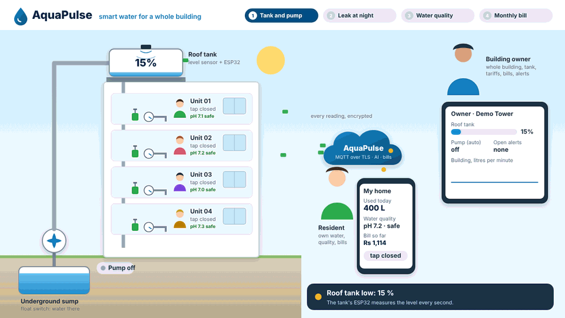

<sub>Four real AquaPulse features: the pump fills the roof tank by itself, the AI stops a leak at night, an unsafe pH raises an alert, and the monthly bill is paid. ▶ Watch the [video](docs/screenshots/animation/aquapulse-system.mp4) or the [video with sound](docs/screenshots/animation/aquapulse-system-sound.mp4).</sub>

## What it does

AquaPulse turns a normal apartment building into a smart-water building:

- **Owners** see every home's consumption, bill residents fairly, turn water on/off remotely, watch water quality and get alerts.
- **Residents** see their own usage and bill, pay online (test mode), control their own water and check water safety.
- **Devices** (a realistic digital-twin simulator, or real ESP32 boards running the firmware in `firmware/`) report flow, pH and temperature over secure MQTT.

The full plan is in the [Software Requirements Specification](docs/SRS.md) (IEEE 29148 style): 75 functional and 30 non-functional requirements, architecture, database, API, STRIDE threat model and test plan.

## Screenshots

Real pages of the running demo (`make demo`), taken by `make screenshots`
(Playwright). Nothing is drawn or edited. All of them, phone and desktop, are
in [docs/screenshots](docs/screenshots).

| Building owner | Resident |
|---|---|
| 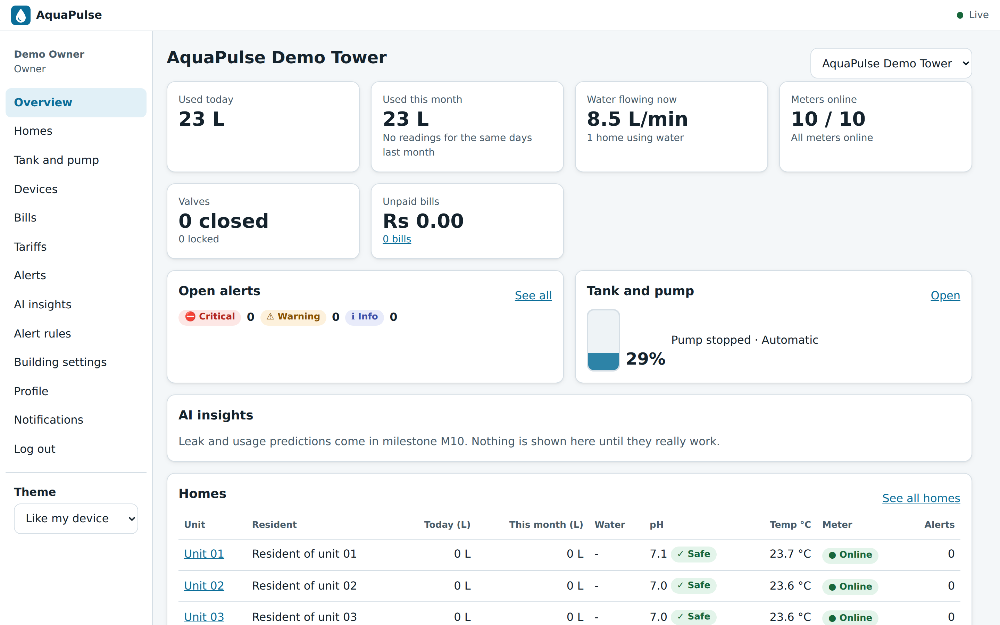 | 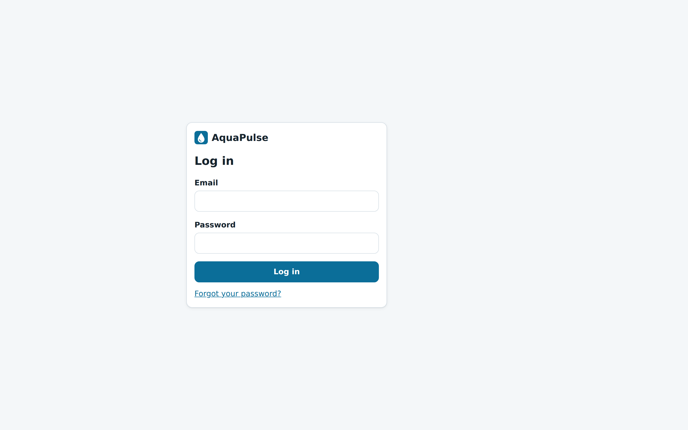 |
| 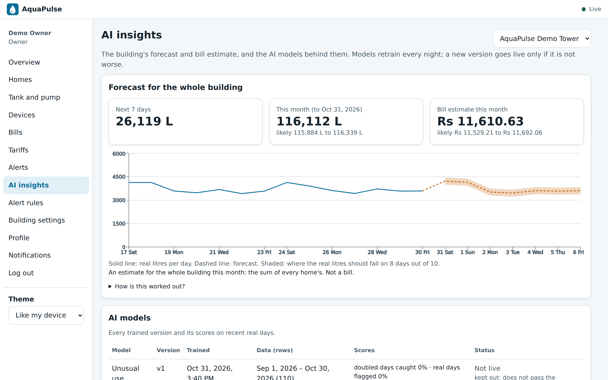 | 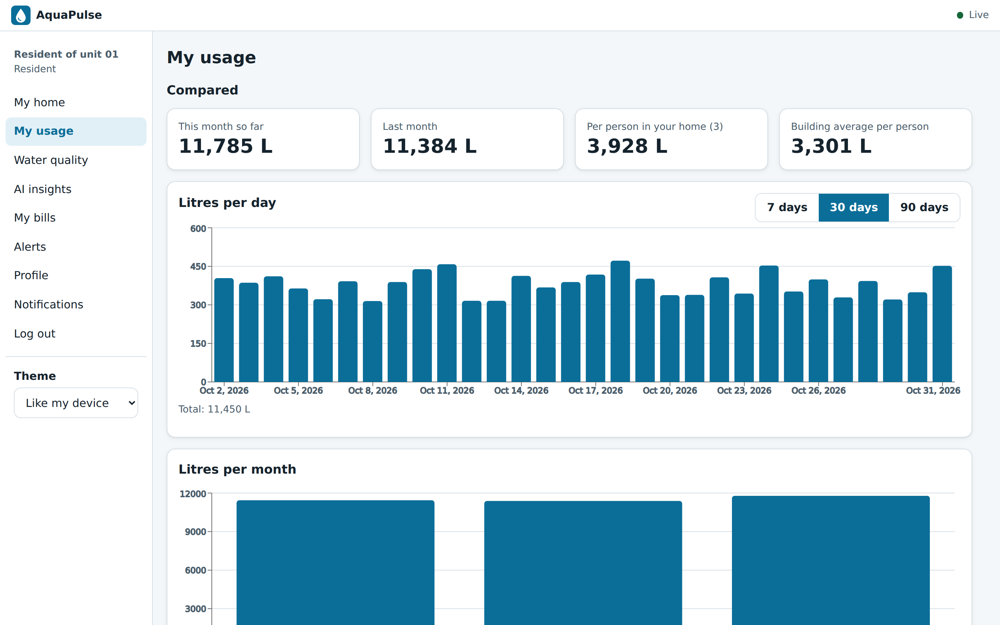 |
| 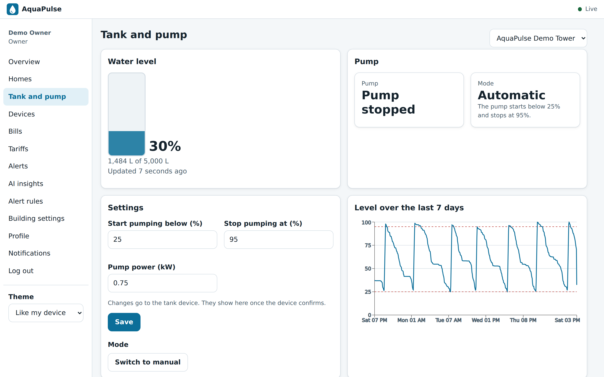 | 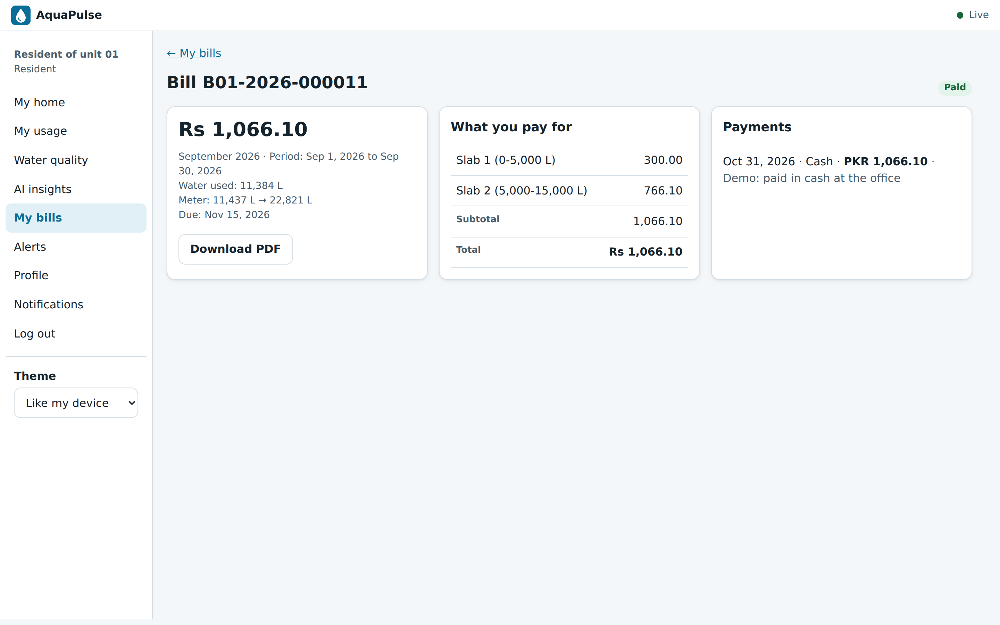 |

| Phone | | | |
|---|---|---|---|
| 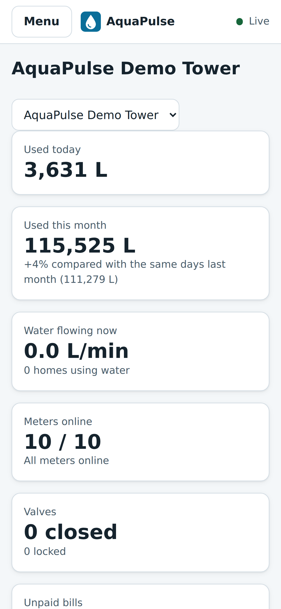 | 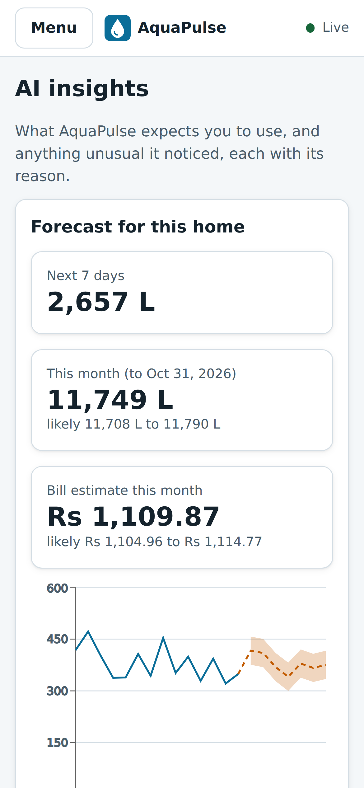 | 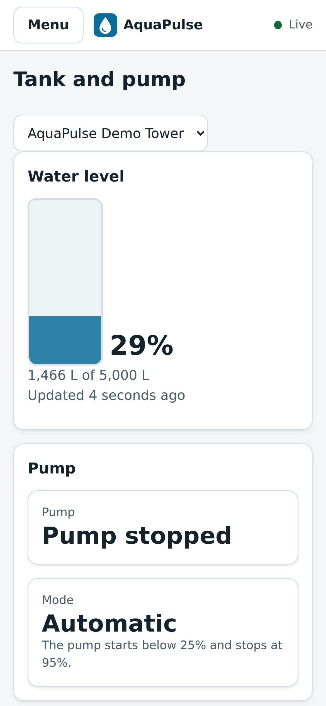 | 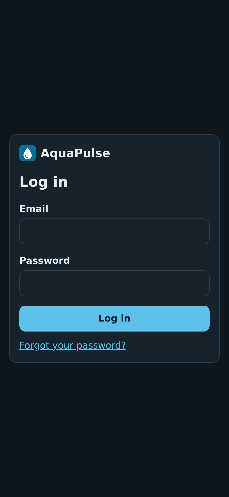 |

**Hardware (Wokwi).** The two ESP32 circuits, drawn from the simulator's own
files in `firmware/wokwi`. In CI both nodes run their demo scenarios in the
Wokwi simulator: the tank node turns the pump on when the tank is low and off
when it is full, and the home node counts the water when a tap opens. What
they printed is in
[tank-node-serial.txt](docs/screenshots/hardware/tank-node-serial.txt) and
[home-node-serial.txt](docs/screenshots/hardware/home-node-serial.txt).

| Home node | Tank node |
|---|---|
| 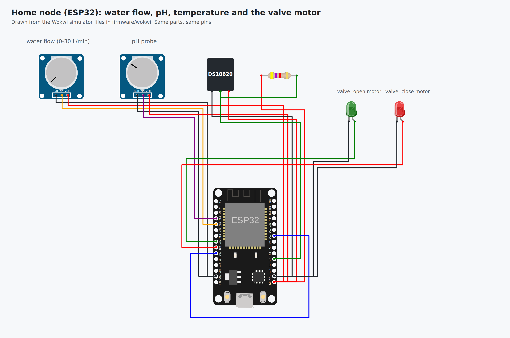 | 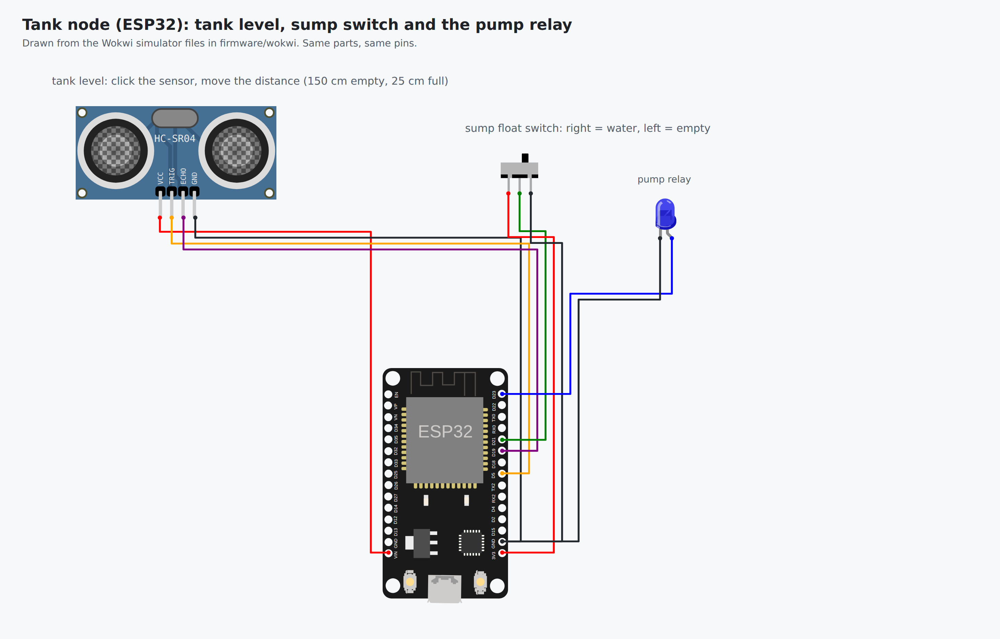 |

## Architecture

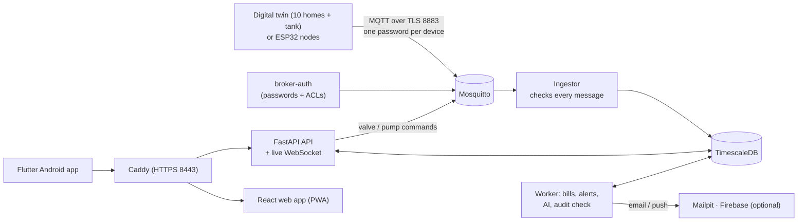

Everything runs with one command on a laptop (Docker Compose). Design decisions are in [docs/adr](docs/adr), the full design in the [SRS](docs/SRS.md).

## Roadmap

| Milestone | Status |
|---|---|
| M0 Tools and repository | ✅ done |
| M1 Infrastructure (Docker Compose) | ✅ done |
| M2 Digital twin simulator | ✅ done |
| M3 Backend core (auth, roles, audit) | ✅ done |
| M4 Live data and valve control | ✅ done |
| M5 Secure MQTT and HTTPS | ✅ done |
| M6 Billing and payments | ✅ done |
| M7 Alerts and notifications | ✅ done |
| M8 Web app | ✅ done |
| M9 Android app | ✅ done |
| M10 AI: leak detection and forecasting | ✅ done |
| M11 ESP32 firmware and hardware | ✅ done |
| M12 Demo data, polish and v1.0 release | ✅ done |

## Getting started (developers)

Requirements and install steps for macOS are in [docs/milestones/M0-tools-and-repo.md](docs/milestones/M0-tools-and-repo.md).

```bash
git clone https://github.com/Sanaullah-Niazi/aquapulse.git
cd aquapulse
make check-tools   # are all tools installed?
make setup         # create .env (with random secrets) and install git hooks
make demo          # start everything, demo accounts, 90 days of history, bills (a few minutes)
```

Then open https://localhost:8443/app/ and log in as `owner@example.com` or `resident01@example.com`
(the password is `DEMO_PASSWORD` in your `.env`). `make smoke` proves every service works;
`make leak`, `make problem` and `make valve-close DEVICE=home-b01-03` show the system reacting live.

| What | Where |
|---|---|
| Status page (Caddy) | https://localhost:8443 (http://localhost:8080 redirects) |
| Email inbox (Mailpit) | http://localhost:8025 |
| MQTT broker (Mosquitto) | `localhost:8883`, TLS only, a password for every account |
| Database (TimescaleDB) | `localhost:5432`, password in your `.env` |
| Simulator control API (Swagger) | http://localhost:8090/docs |
| AquaPulse API (Swagger) | https://localhost:8443/api/docs |

Every service is reachable from your own computer only. The certificates come from the project's own CA (`make certs`); `make trust-ca` makes your Mac's browsers trust it. `make help` lists all commands.

## What works today

**Digital twin (M2).** A building with 10 virtual homes and one overhead tank. Every home is its own MQTT device with a water meter, a motorised valve, and pH and temperature sensors. The tank has a level sensor and a pump with automatic control.

- Realistic water use: morning and evening peaks, quiet nights, more on weekends, 1 to 6 people per home, 100 to 150 L per person per day. The same seed always gives the same data.
- Valve commands over MQTT with acknowledgements, expiry and duplicate protection.
- Tank automation: pump on below 25%, off above 95%, dry-run and overflow protection.
- Fault injection for demos and AI testing: leak, burst, pH drift, temperature spike, stuck sensor, stuck valve, device offline (MQTT Last Will), reboot, tank sensor failure, empty sump.
- Every message is checked against the shared JSON Schemas in [`contracts/`](contracts/README.md), the same contract the ESP32 firmware will follow.

Guide: [docs/milestones/M2-digital-twin.md](docs/milestones/M2-digital-twin.md).

**Backend core (M3).** A FastAPI server with interactive docs at `/api/docs`.

- Login with short-lived Ed25519-signed access tokens and rotating refresh tokens; reusing an old refresh token ends the whole session (theft detection). Logout and "log out everywhere".
- Three roles (System Admin, Owner, Resident) plus per-object checks: owners see only their buildings, residents only their own home during their stay. A test calls every endpoint with every role.
- Buildings (11 currencies, any time zone), homes with unique unit numbers and soft delete, resident invitations by email, occupancies with one billing contact per home (enforced by the database).
- Argon2id passwords, common-password check, login rate limit (5 failures per 15 min), single-use reset codes.
- An append-only, hash-chained audit log; the API's own database role cannot change or delete it.
- `/healthz`, `/readyz` and private Prometheus `/metrics`. 213 tests against a real database, 98% coverage.

Guide: [docs/milestones/M3-backend-core.md](docs/milestones/M3-backend-core.md).

**Live data and valve control (M4).** An ingestor turns MQTT messages into checked, de-duplicated readings in TimescaleDB.

- Every device message is checked (registered device, 2 KB limit, JSON Schema, clock) and counted by reason when rejected.
- Litres come from the meter's cumulative counter, so lost messages lose nothing (tested: 10% loss, daily totals within 0.5%); reboots and counter jumps are handled.
- Hourly, daily and monthly totals in the building's own time zone, DST included, from a TimescaleDB continuous aggregate.
- Valve and pump commands with a full life cycle (queued, pending, succeeded, failed, rejected, timeout): QoS 1, never retained, expiring after 30 s, one at a time per device, and only the device's ack counts.
- Owner valve locks with a written reason (residents get 423 and an email), tank level history, pump hours and energy, thresholds confirmed by the device.
- A live WebSocket with one-time tickets, where each user only receives events they may see.
- `make demo-data`: 90 days of history with labelled leaks and pH events, loaded through the same checks as live data.

Guide: [docs/milestones/M4-live-data.md](docs/milestones/M4-live-data.md).

**Secure MQTT and HTTPS (M5).** Nothing travels unencrypted, and every account can do exactly one job.

- MQTT only over TLS 1.2+ (1.3 negotiated, modern ciphers only); the plain port 1883 is gone. A free testssl.sh scan finds nothing.
- Every device has its own password (32 random bytes, only a hash stored) and may only use its own topics. The server's reading and command-sending parts use separate accounts.
- Owners register devices (password shown once, plus a QR code with the full config), rotate passwords and revoke devices. The broker applies it in about a second, without a restart, and cuts off connections that are no longer allowed.
- HTTPS through Caddy with HSTS, a strict Content-Security-Policy and other security headers; CORS only for configured sites.
- A STRIDE threat-model review: [docs/security/threat-model.md](docs/security/threat-model.md).

Guide: [docs/milestones/M5-secure-mqtt-https.md](docs/milestones/M5-secure-mqtt-https.md).

**Billing and payments (M6).** Monthly water bills from the real meter readings, in the building's own currency.

- The owner sets every rate: up to 10 litre slabs plus extra charges and taxes, saved as versions so old bills never change. No built-in fees.
- 11 currencies (PKR, USD, GBP, EUR, AUD, AED, SAR, QAR, KWD, BHD, OMR), with 3 decimals for KWD, BHD and OMR. Money is `Decimal` only; a test fails on any float in the billing code.
- Fair bills when people move in or out, or prices change mid-month: each stay gets its own bill and the slabs shrink with the days.
- Bills go draft → issued → paid (or overdue), with gap-free numbers, PDF bills (WeasyPrint) and void-and-replace instead of delete.
- Cash and bank payments with receipts and reversals; card payments through Stripe in **test mode only**, confirmed by a signed webhook.
- A worker container makes last month's bills on the 1st and marks overdue bills. Shutting off water for non-payment needs the owner's policy and a 48-hour warning.

Guide: [docs/milestones/M6-billing.md](docs/milestones/M6-billing.md).

**Alerts and notifications (M7).** The right people hear about water problems within a minute.

- A rule engine in the worker with 9 rules (unsafe pH, hot or freezing water, device offline, tank low or overflowing, pump dry-run, high daily use, failed valve command, stuck sensor). It hears each reading through PostgreSQL `LISTEN/NOTIFY` and needs several bad readings in a row, so 7 normal simulated days raise no alerts.
- One problem is one alert (a de-duplication key): open → acknowledged → resolved, or auto-resolved 10 minutes after the problem stops.
- In-app (live WebSocket) and email, through a queue with 3 retries (10 s, 30 s, 90 s); failures are visible to the System Admin. Each person picks from which severity they get emails; each owner picks who gets which severity and tunes the rules within safe limits.
- Bill reminders 3 days before, on, and 7 days after the due date, each sent once; an unpaid list with totals per currency.
- A tamper-evident audit log: every entry's SHA-256 hash covers the previous one. The worker checks the chain daily (100,000 entries in about 5 s) and raises a critical alert if anything was changed.

Guide: [docs/milestones/M7-alerts.md](docs/milestones/M7-alerts.md).

**Web app (M8).** A React web app you can install on your phone (PWA), at https://localhost:8443/app/.

- Log in with an optional second step: a 6-digit code from any free authenticator app, plus 10 one-time recovery codes.
- Residents see their home live (litres today and this month, water running, pH with a Safe / Check / Unsafe label, temperature, the bill so far), turn their water off and on, compare with last month and with the anonymous building average per person, follow pH and temperature live, and open their bills (PDF, pay online in Stripe test mode).
- Everyone can change their details and password, and choose which alert emails they get, with quiet hours (critical alerts always come at once).
- Works from 360 px phones to big screens, light and dark, keyboard and screen-reader friendly. Playwright clicks through it at phone and desktop size and runs an axe accessibility check on every screen.
- Owners run the building from it: live overview, homes, valves and locks, residents, tank and pump, devices, tariffs with a live example bill, bills and payments, alert rules, settings and CSV exports.
- System Admins get a console: health of every service (database, broker, ingestor, worker), devices online, readings per minute, refused messages, failed emails and the last audit check; owners and buildings; and the audit log with filters and a "check the chain now" button. Two-factor login is required for them.
- One build runs from any folder of any website: `make web-site BASE=/water/ API=https://...`. Guide: [docs/guides/host-on-your-website.md](docs/guides/host-on-your-website.md).

Guide: [docs/milestones/M8-web-app.md](docs/milestones/M8-web-app.md).

**Android app (M9).** One Flutter app for residents and owners; the server role decides which screens appear.

- Choose any AquaPulse server (your Mac, a tunnel or the cloud). HTTPS only; the app trusts Android's normal certificates plus, when built with `make apk`, your own AquaPulse CA.
- Log in with the optional two-factor code. The refresh token is kept in Android's secure storage (Keystore), never in plain settings.
- Residents: my home live, water on/off with the device's answer, usage and comparison, water quality charts, bills (PDF, pay online in test mode), alerts, profile and alert emails.
- Owners: live building overview, homes with search and sort, valve control and locks with a reason, tank and pump with manual mode, monthly bills (make, issue, void, record payments).
- Every push builds the APK in GitHub Actions after `flutter analyze` and the widget tests pass.
- Push notifications (optional, free Firebase): alerts reach the phone even when the app is closed, with per-severity and per-type choices. Tag `v*` to get the APK attached to a GitHub Release.

Guide: [docs/milestones/M9-android-app.md](docs/milestones/M9-android-app.md).

**AI (M10).** Part 1: leak and burst detection on every live reading, each alert with a plain-language reason and its evidence, and optional automatic shut-off (at most once per hour, never on a locked valve). Part 2: a 7-day forecast per home and per building (Holt-Winters with an 80% range) with a month-end bill estimate from the real tariff, unusual-use flags (Isolation Forest) with reasons, and a model registry: models retrain every night and a new version goes live only if it is not worse. Part 3: the AI screens in the web app and the Android app (forecast chart with its range, bill estimate, insights with evidence charts, the model list, and the owner's auto shut-off switch). The scores in [docs/ai-evaluation.md](docs/ai-evaluation.md) are made by `make ai-eval` on a labelled simulator test set, and CI checks them on every push.

Guide: [docs/milestones/M10-ai.md](docs/milestones/M10-ai.md).

**ESP32 firmware (M11).** Part 1: the home-node firmware (flow meter, pH with two-point calibration, temperature, motorised valve, TLS MQTT with Last Will). The device rules are plain C++ tested on a computer, and every message is checked against the device contract. It runs in the free Wokwi simulator against your own broker, and CI builds it with PlatformIO. Part 2: the tank node, which runs the pump by itself with dry-run and overflow protection even when the server is down, plus parts lists and wiring diagrams in [docs/hardware](docs/hardware). Guide: [docs/milestones/M11-firmware.md](docs/milestones/M11-firmware.md).

**Privacy and security scans (M12, part 1).** Every user can download their own data as one JSON file, and residents can delete their account (name, email and phone removed; bills kept without a name for accounting). Raw readings older than 13 months are deleted automatically, and failed-login logs no longer store the email. A Security workflow runs pip-audit, pnpm audit, Bandit, CodeQL and Trivy on every push and every week, and Dependabot watches every part of the project. Guide: [docs/milestones/M12-polish-and-release.md](docs/milestones/M12-polish-and-release.md).

**Backups and speed checks (M12, part 3).** A `backup` service copies the database into `backups/` every day and keeps a week. CI restores a backup on every push and checks it ([docs/backups.md](docs/backups.md)). `make perf` measures valve, live-update and API speed and the stack's memory and CPU. The numbers are in the [test report](docs/test-report.md).

**Demo, scans and reports (M12, part 2).** `make demo` builds the whole demo in one command: the stack, the accounts, 90 days of history and two months of real bills (some paid, some not). An OWASP ZAP baseline scan of the web app runs in CI. The [test report](docs/test-report.md), the [traceability matrix](docs/requirements-traceability.md) (made from the tests, checked in CI) and the [ASVS checklist](docs/security/asvs-checklist.md) say plainly what is proven and what is not yet.

## Repository layout

```text
contracts/   MQTT message formats shared by simulator, backend and firmware  (M2)
simulator/   digital twin of the building's devices                          (M2)
backend/     API (M3), ingestor (M4), broker-auth (M5), billing (M6), alerts (M7), AI (M10)
web/         React web app / PWA: resident, owner and System Admin screens  (M8)
mobile/      Flutter Android app                                              (M9)
firmware/    ESP32 firmware (PlatformIO) + Wokwi simulation                   (M11)
infra/       Mosquitto, Caddy, certificates, backups                          (M1+)
docs/        SRS, milestone guides, decisions (ADRs), security                (all)
```

## Documentation

| Document | What it is |
|---|---|
| [docs/SRS.md](docs/SRS.md) | The requirements: 75 functional, 30 non-functional, architecture, threat model, test plan |
| [docs/milestones/](docs/milestones) | A step-by-step guide for each milestone, M0 to M12 |
| [docs/test-report.md](docs/test-report.md) | Test results and every non-functional requirement: measured, partly, or not yet |
| [docs/requirements-traceability.md](docs/requirements-traceability.md) | Which tests prove each requirement (made from the code by `make rtm`) |
| [docs/security/](docs/security) | Threat model, OWASP ASVS checklist, scan exceptions |
| [docs/backups.md](docs/backups.md) | Daily database backups, and how to restore one |
| [docs/ai-evaluation.md](docs/ai-evaluation.md) | Real scores of the leak, unusual-use and forecast models |
| [docs/hardware/](docs/hardware) | Parts lists and wiring for the ESP32 nodes |

## Contributing and security

- Read [CONTRIBUTING.md](CONTRIBUTING.md) before opening a pull request.
- Found a security problem? Please follow [SECURITY.md](SECURITY.md) and report it privately.

## Background

AquaPulse is a complete rebuild of my 2023 final-year project *"IoT based Pure Aqua Utilization in Smart Edifice"* (BUITEMS, Quetta). It keeps the original idea and replaces everything else with a modern, secure, tested design.

## License

[MIT](LICENSE) © 2026 Sanaullah Khan Niazi
