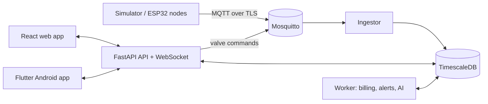

# AquaPulse 💧

**Open-source smart water management for multi-home buildings.**
Per-home metering, remote valve control, water-quality monitoring, slab billing in 11 currencies, AI leak detection and a real-time dashboard, built on ESP32, MQTT over TLS, FastAPI, TimescaleDB, React and Flutter.

[](https://github.com/Sanaullah-Niazi/aquapulse/actions/workflows/ci.yml)
[](LICENSE)

> 🚧 **Status: under active development (milestone M2 of 12).**
> This README only describes what already works. Features are added milestone by milestone; see the [roadmap](#roadmap).

## What it will do

AquaPulse turns a normal apartment building into a smart-water building:

- **Owners** see every home's consumption, bill residents fairly, turn water on/off remotely, watch water quality and get alerts.
- **Residents** see their own usage and bill, pay online (test mode), control their own water and check water safety.
- **Devices** (a realistic digital-twin simulator today, real ESP32 hardware later) report flow, pH and temperature over secure MQTT.

The full plan is in the [Software Requirements Specification](docs/SRS.md) (IEEE 29148 style): 75 functional and 30 non-functional requirements, architecture, database, API, STRIDE threat model and test plan.

## Architecture (planned)



## Roadmap

| Milestone | Status |
|---|---|
| M0 Tools and repository | ✅ done |
| M1 Infrastructure (Docker Compose) | ✅ done |
| M2 Digital twin simulator | 🚧 in progress |
| M3 Backend core (auth, roles, audit) | ⏳ |
| M4 Live data and valve control | ⏳ |
| M5 Secure MQTT and HTTPS | ⏳ |
| M6 Billing and payments | ⏳ |
| M7 Alerts and notifications | ⏳ |
| M8 Web app | ⏳ |
| M9 Android app | ⏳ |
| M10 AI: leak detection and forecasting | ⏳ |
| M11 ESP32 firmware and hardware | ⏳ |
| M12 Demo data, polish and v1.0 release | ⏳ |

## Getting started (developers)

Requirements and install steps for macOS are in [docs/milestones/M0-tools-and-repo.md](docs/milestones/M0-tools-and-repo.md).

```bash
git clone https://github.com/Sanaullah-Niazi/aquapulse.git
cd aquapulse
make check-tools   # are all tools installed?
make setup         # create .env (with random secrets) and install git hooks
make up            # start the stack: MQTT broker, TimescaleDB, Mailpit, Caddy, simulator
make smoke         # prove every service works end to end
make mqtt-watch    # watch 10 virtual homes + 1 tank send live readings
```

| What | Where |
|---|---|
| Status page (Caddy) | http://localhost:8080 |
| Email inbox (Mailpit) | http://localhost:8025 |
| MQTT broker (Mosquitto) | `localhost:1883` (development only; TLS arrives in M5) |
| Database (TimescaleDB) | `localhost:5432`, password in your `.env` |
| Simulator control API (Swagger) | http://localhost:8090/docs |

Every service is reachable from your own computer only. `make help` lists all commands.

## What works today

**Digital twin (M2).** A building with 10 virtual homes and one overhead tank. Every home is its own MQTT device with a water meter, a motorised valve, and pH and temperature sensors. The tank has a level sensor and a pump with automatic control.

- Realistic water use: morning and evening peaks, quiet nights, more on weekends, 1 to 6 people per home, 100 to 150 L per person per day. The same seed always gives the same data.
- Valve commands over MQTT with acknowledgements, expiry and duplicate protection.
- Tank automation: pump on below 25%, off above 95%, dry-run and overflow protection.
- Fault injection for demos and AI testing: leak, burst, pH drift, temperature spike, stuck sensor, stuck valve, device offline (MQTT Last Will), reboot, tank sensor failure, empty sump.
- Every message is checked against the shared JSON Schemas in [`contracts/`](contracts/README.md), the same contract the ESP32 firmware will follow.

Guide: [docs/milestones/M2-digital-twin.md](docs/milestones/M2-digital-twin.md).

## Repository layout

```text
contracts/   MQTT message formats shared by simulator, backend and firmware  (M2)
simulator/   digital twin of the building's devices                          (M2)
backend/     API, ingestor, worker, billing engine, AI                        (M3+)
web/         React web app / PWA                                              (M8)
mobile/      Flutter Android app                                              (M9)
firmware/    ESP32 firmware (PlatformIO) + Wokwi simulation                   (M11)
infra/       Mosquitto, Caddy, certificates, backups                          (M1+)
docs/        SRS, milestone guides, decisions (ADRs), security                (all)
```

## Contributing and security

- Read [CONTRIBUTING.md](CONTRIBUTING.md) before opening a pull request.
- Found a security problem? Please follow [SECURITY.md](SECURITY.md) and report it privately.

## Background

AquaPulse is a complete rebuild of my 2023 final-year project *"IoT based Pure Aqua Utilization in Smart Edifice"* (BUITEMS, Quetta). It keeps the original idea and replaces everything else with a modern, secure, tested design.

## License

[MIT](LICENSE) © 2026 Sanaullah Khan Niazi
