# Software Requirements Specification

## AquaPulse: Smart Water Management for Multi-Home Buildings

*(original title: "Smart Eco Utilization for Smart Edifice")*

| Item | Value |
|---|---|
| Document | Software Requirements Specification (SRS), structured after ISO/IEC/IEEE 29148:2018 |
| Version | 1.0 (draft for approval) |
| Date | 30 October 2026 |
| Author | Sanaullah Khan Niazi (GitHub: `Sanaullah-Niazi`) |
| Status | Waiting for owner approval |
| License of the project | MIT |

### Name suggestions

The original title is long. Here are three shorter, modern names. This SRS uses **AquaPulse** as a working name; it can be renamed later with one find-and-replace.

| Name | Why it works |
|---|---|
| **AquaPulse** | "Pulse" means live readings and the pulses a flow meter actually sends. Short and easy to remember. |
| **FlowWise** | Describes the goal: using water wisely, with smart (AI) help. |
| **HydroNest** | A "nest" of homes in one building, all looked after by one system. |

> Before the GitHub repo is created, check that the chosen name is free on GitHub and as a domain (see Open Questions, Section 16).

### How to read this document

Each section starts with a short plain-English explanation in a quote box like this one, followed by the formal requirements. Words in **bold** are defined in the Glossary (Section 16.1). Requirement IDs (FR-xx, NFR-xx) are used everywhere else: in the milestone plan, in tests and in commit messages. That lets anyone trace a feature from idea to test.

### Table of contents

1. [Introduction](#1-introduction)
2. [Overall description](#2-overall-description)
3. [User roles and permissions](#3-user-roles-and-permissions)
4. [Functional requirements](#4-functional-requirements)
5. [Non-functional requirements](#5-non-functional-requirements)
6. [Architecture](#6-architecture)
7. [Database design and MQTT topic design](#7-database-design-and-mqtt-topic-design)
8. [API list](#8-api-list)
9. [Screens list](#9-screens-list)
10. [Use case, sequence and activity diagrams](#10-use-case-sequence-and-activity-diagrams)
11. [Security design and STRIDE threat model](#11-security-design-and-stride-threat-model)
12. [Testing plan](#12-testing-plan)
13. [Complete free tools list](#13-complete-free-tools-list)
14. [Milestone plan](#14-milestone-plan)
15. [Requirements traceability matrix](#15-requirements-traceability-matrix)
16. [Glossary and open questions](#16-glossary-and-open-questions)
- [Appendix A: Hardware parts list and wiring](#appendix-a-hardware-parts-list-and-wiring)

---

## 1. Introduction

> **In simple words:** this section says why the system exists, what it will and won't do, and which documents we rely on.

### 1.1 Purpose

This SRS describes everything AquaPulse must do and how well it must do it. It is the single source of truth for:

- **Sana** (developer and owner of the project), to build it milestone by milestone;
- **reviewers and recruiters** looking at the GitHub portfolio, to see professional requirements engineering;
- **future contributors** who want to add real hardware or new features.

Nothing gets built that is not in this document, and every requirement here will be built and tested. If something changes, this document changes first.

### 1.2 Scope

**AquaPulse** is an open-source system that measures, controls and bills water use in a building with many homes (flats/apartments).

Each home has one smart water node with:

- a **flow meter** (how many litres pass),
- a **motorised valve** (water on/off),
- a **pH sensor** (water quality: acidic or alkaline),
- a **temperature sensor**.

The building also has an **overhead water tank** with a **level sensor** and a **pump** (this idea comes from the original 2023 thesis, which focused on stopping tank overflow).

What the system does:

| In scope | Out of scope (v1.0) |
|---|---|
| Realistic **digital twin** simulator that behaves exactly like real ESP32 devices over MQTT | Selling or shipping hardware |
| ESP32 firmware, parts list and wiring for anyone with hardware | Certified "legal metrology" billing meters (we document what a real deployment needs) |
| Secure backend (FastAPI), time-series database (TimescaleDB), MQTT broker (Mosquitto with TLS) | Real money payments (Stripe runs in **test mode** only) |
| Owner and resident features on a **web app** (installable PWA, hostable on Sana's website) and an **Android app** (APK) | iOS App Store release (Flutter code will build for iOS, but publishing needs a paid Apple account) |
| Configurable tariffs in 11 currencies, monthly bills, PDF bills, payment tracking | Live currency conversion between currencies |
| Alerts (water quality, leaks, offline devices, tank level, unpaid bills) by in-app, push and email | SMS alerts (no reliable free SMS service) |
| AI leak and abnormal-usage detection, consumption and bill forecasting | Water pressure, turbidity, chlorine sensors (listed as future work) |
| Strong security: TLS, per-device credentials, JWT, RBAC, audit log, STRIDE threat model | Multi-tenant SaaS billing of building owners |
| Docker Compose one-command setup, demo data (10 homes, 3 months), CI with tests | Kubernetes deployment |

**Benefits:** fair billing by actual use, early leak detection (saves water and money), safe-water awareness, remote control, and a complete portfolio piece covering IoT, backend, mobile, web, AI and security.

### 1.3 Definitions, acronyms and abbreviations

Short list here; the full glossary is in Section 16.1.

| Term | Meaning |
|---|---|
| ACL | Access Control List: which MQTT topics a device may use |
| API | Application Programming Interface |
| APK | Android app install file |
| CA | Certificate Authority: signs TLS certificates |
| Digital twin | Software that behaves exactly like a real physical device |
| ESP32 | Low-cost Wi-Fi microcontroller made by Espressif |
| FR / NFR | Functional / Non-Functional Requirement |
| JWT | JSON Web Token: signed login token |
| MQTT | Lightweight publish/subscribe messaging protocol for IoT |
| PWA | Progressive Web App: a website that can be installed like an app |
| QoS | MQTT Quality of Service level (0, 1 or 2) |
| RBAC | Role-Based Access Control |
| RTM | Requirements Traceability Matrix |
| STRIDE | Threat categories: Spoofing, Tampering, Repudiation, Information disclosure, Denial of service, Elevation of privilege |
| TLS | Transport Layer Security: encryption on the network |
| MoSCoW | Priorities: **Must**, **Should**, **Could**, **Won't (this time)** |

### 1.4 References

| ID | Reference |
|---|---|
| R1 | ISO/IEC/IEEE 29148:2018, *Systems and software engineering: Life cycle processes, Requirements engineering* |
| R2 | OASIS, *MQTT Version 5.0* and *MQTT Version 3.1.1* specifications: https://mqtt.org/mqtt-specification/ |
| R3 | IETF RFC 7519, *JSON Web Token (JWT)* and RFC 8725, *JWT Best Current Practices* |
| R4 | IETF RFC 8446, *TLS 1.3* |
| R5 | OWASP Application Security Verification Standard (ASVS) 4.0.3: https://owasp.org/www-project-application-security-verification-standard/ |
| R6 | OWASP API Security Top 10 (2023): https://owasp.org/API-Security/ |
| R7 | OWASP IoT Top 10: https://owasp.org/www-project-internet-of-things/ |
| R8 | Microsoft, *The STRIDE Threat Model*: https://learn.microsoft.com/azure/security/develop/threat-modeling-tool-threats |
| R9 | ISO 4217, *Currency codes* (minor units: KWD, BHD, OMR = 3 decimals) |
| R10 | WHO, *Guidelines for Drinking-water Quality*, 4th ed. with addenda; US EPA Secondary Standards (pH 6.5 to 8.5); Pakistan National Standards for Drinking Water Quality (pH 6.5 to 8.5) |
| R11 | Espressif, *ESP32 Technical Reference Manual* and Arduino-ESP32 core docs: https://docs.espressif.com/ |
| R12 | Eclipse Mosquitto documentation: https://mosquitto.org/documentation/ |
| R13 | TimescaleDB documentation: https://docs.timescale.com/ |
| R14 | FastAPI documentation: https://fastapi.tiangolo.com/ |
| R15 | WCAG 2.1, *Web Content Accessibility Guidelines*: https://www.w3.org/TR/WCAG21/ |
| R16 | Original thesis: Raza, Khan, Akram, *IoT based Pure Aqua Utilization in Smart Edifice*, BUITEMS Quetta, 2023 (used only for the original idea) |

### 1.5 What changed from the 2023 thesis

| 2023 thesis | AquaPulse (this SRS) | Why it is better |
|---|---|---|
| Arduino UNO + HC-05 Bluetooth | ESP32 with Wi-Fi + MQTT over TLS | Works from anywhere, not only within about 10 m of a phone; encrypted |
| One hardcoded mobile app | Backend + database + web app + Android app with roles | Many homes, many users, real data history |
| Solenoid valve | Motorised ball valve with position feedback | Uses no power while holding, and the system knows the *real* valve state |
| Bill shown on phone | Configurable slab tariffs, 11 currencies, PDF bills, payment status | Real billing workflow |
| No security | TLS, per-device credentials, JWT, RBAC, audit log, STRIDE | Safe to put on the internet |
| No tests | Unit, integration, end-to-end, security tests in CI | Proof that it works |
| Tank overflow control | Kept and improved: level sensor, automatic pump with hysteresis, dry-run protection | The good idea stays |

---

## 2. Overall description

> **In simple words:** how AquaPulse fits together, who uses it, where it runs, and the limits we must respect.

### 2.1 Product perspective

AquaPulse is a new, self-contained system. It has six parts:

1. **Edge devices**: one *home node* per flat and one *tank node* per building. In v1.0 these are played by the **simulator (digital twin)**; real ESP32 boards can replace them later with no change to the apps, because both speak the same MQTT "contract".
2. **MQTT broker** (Eclipse Mosquitto): the post office between devices and the server.
3. **Backend**: an *ingestor* (stores device messages), an *API* (REST + WebSocket) and a *worker* (scheduled jobs: billing, alerts, AI).
4. **Database**: PostgreSQL with the TimescaleDB extension, which is very good at time-series data like meter readings.
5. **Clients**: a React **web app** (owner, resident and system-admin views) and a Flutter **Android app** (owner and resident views).
6. **External free services**: Firebase Cloud Messaging (push), an SMTP service (email), Stripe in test mode (payments).

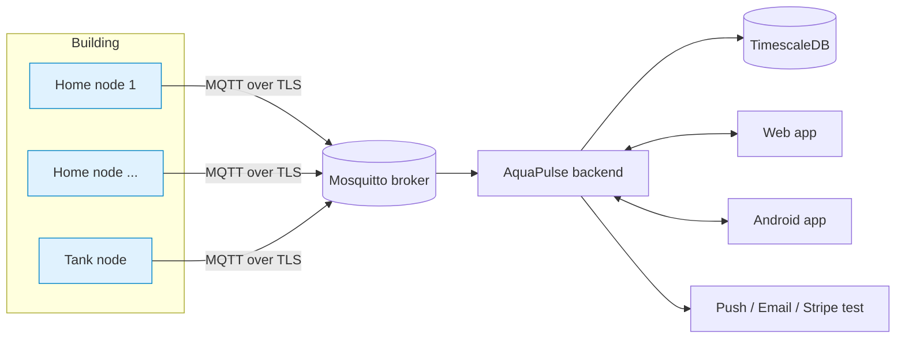

### 2.2 Product functions (summary)

- Measure litres used per home in near real time, and per day and month.
- Turn any home's water on or off remotely, with confirmation from the device.
- Monitor water quality (pH) and temperature, and warn when unsafe.
- Monitor the building tank and run the pump automatically so it never overflows or runs dry.
- Generate monthly bills from owner-defined slab tariffs, in the building's currency, as PDFs.
- Track payments (manual entry and Stripe test checkout).
- Detect leaks and abnormal use with AI, and forecast usage and the month-end bill.
- Show everything live on dashboards, and send alerts by in-app, push and email.
- Keep a tamper-evident audit log of every important action.

### 2.3 User classes and characteristics

| User class | Who | Technical skill | Frequency | Main goals |
|---|---|---|---|---|
| **Owner** (building admin) | Owner or manager of one or more buildings | Medium: comfortable with apps and dashboards | Daily | See all homes, bill residents, control water, handle alerts |
| **Resident** | Person or family living in one home | Low to medium: phone user | Weekly, plus when alerted | See own usage and bill, pay, turn own water on/off, check water safety |
| **Device** | Home node or tank node (simulated or real ESP32) | n/a (machine) | Every 10 seconds | Send readings, obey valve and pump commands, report status |
| **System Admin** | Person running the AquaPulse installation (in the demo: Sana) | High | Occasionally | Create owners and buildings, watch system health, read the audit log, manage security |

### 2.4 Operating environment

| Item | Requirement |
|---|---|
| Development machine | MacBook Pro M1 Max, 32 GB RAM, macOS 14 (Sonoma) or newer; Docker Desktop for Apple silicon |
| Server runtime | Any 64-bit Linux or macOS host with Docker Engine 24+ and Docker Compose v2; at least 2 CPU cores, 4 GB RAM for the 10-home demo. Images are multi-arch (arm64 + amd64) |
| Optional free hosting | (a) The Mac itself, exposed with Cloudflare Tunnel, or (b) Oracle Cloud "Always Free" Ampere VM |
| Web app | Latest two versions of Chrome, Edge, Firefox and Safari; mobile browsers; installable as PWA. Built as static files that can be hosted on Sana's own website |
| Android app | Android 8.0 (API 26) or newer, distributed as an APK |
| Real devices | ESP32-WROOM-32 (or ESP32-S3) on 2.4 GHz Wi-Fi with internet access to the broker on TCP 8883 |
| Network | HTTPS (443) for clients; MQTT over TLS (8883) for devices |

### 2.5 Design and implementation constraints

- **C1, Free only:** every tool, library and service must be free for this use (open-source or a free tier). No paid plan may be required to run, build or demo the project.
- **C2, No fake features:** anything shown in the README, screenshots or demo video must really work. Things not built are labelled "future work".
- **C3, Hardware independence:** apps and backend must not know whether data comes from the simulator or from a real ESP32. The MQTT contract (Section 7.3) is the only interface.
- **C4, Open source:** MIT license. No secrets in the repository.
- **C5, One-command start:** `docker compose up` must start the full system with demo data.
- **C6, Explainable code:** clean, commented code; every milestone comes with an explanation.
- **C7, Languages:** Python 3.12 (backend, simulator, AI), TypeScript (web), Dart (Flutter), C++ (ESP32 firmware, Arduino framework via PlatformIO).
- **C8, Money is exact:** all money uses decimal arithmetic (never floating point), rounded to the currency's minor unit.
- **C9, Water is an essential service:** remote shut-off must always record who, when and why; residents are always notified (see FR-27).

### 2.6 Assumptions and dependencies

| ID | Assumption / dependency |
|---|---|
| A1 | Each home has exactly one water inlet with one home node. |
| A2 | Each building chooses **one** billing currency; bills are issued in that currency only. |
| A3 | Tariffs are slab based (price per 1,000 litres for each usage band), plus optional percentage taxes and optional owner-defined extra charges. There is **no built-in fixed fee**; the owner controls every charge. |
| A4 | Billing period is one calendar month in the building's time zone. |
| A5 | The simulator's flow readings are realistic but are not a legal meter. A real deployment needs a certified meter with pulse output (Appendix A). |
| A6 | Free tiers (GitHub, Firebase, Stripe test mode, Brevo, Cloudflare) remain available with similar limits. If one changes, it is replaceable (each external service sits behind an adapter). |
| A7 | Stripe test mode requires a Stripe account. If sign-up is not possible from Sana's country, payments still work through manual entry (FR-40), and Stripe remains an optional plugin (Open Question OQ-2). |
| A8 | Time is synchronised (devices use NTP; servers use the host clock). All timestamps are stored in UTC. |
| A9 | English is the UI language for v1.0; texts are kept in translation files so Urdu or Arabic can be added later. |

---

## 3. User roles and permissions

> **In simple words:** who is allowed to do what. The server checks these rules on **every** request; hiding a button in the app is never enough.

Legend: ✅ allowed · 🟡 only for *their own* home or building · ❌ not allowed

| Permission | System Admin | Owner | Resident | Device |
|---|:---:|:---:|:---:|:---:|
| Log in to web / Android app | ✅ | ✅ | ✅ | ❌ |
| Create / disable owner accounts | ✅ | ❌ | ❌ | ❌ |
| Create / edit buildings | ✅ | 🟡 own buildings | ❌ | ❌ |
| Create / edit homes | ✅ | 🟡 | ❌ | ❌ |
| Invite / move out residents | ❌ | 🟡 | ❌ | ❌ |
| Register devices, rotate device credentials | ✅ | 🟡 | ❌ | ❌ |
| View live readings (flow, pH, temperature) | ✅ | 🟡 all homes in own buildings | 🟡 own home | ❌ |
| View consumption history | ✅ | 🟡 | 🟡 own home, own occupancy period | ❌ |
| View building average (anonymous) | ✅ | ✅ | ✅ (number only, no other homes) | ❌ |
| Turn a home's water on / off | ❌ (by design) | 🟡 any home in own buildings | 🟡 own home, unless locked by owner | ❌ |
| Lock / unlock a home's valve (overrides resident) | ❌ | 🟡 with mandatory reason | ❌ | ❌ |
| Control tank pump (manual override) | ❌ | 🟡 | ❌ | ❌ |
| Configure tariffs and currency | ❌ | 🟡 | ❌ | ❌ |
| Generate / void bills | ❌ | 🟡 | ❌ | ❌ |
| View bills | ✅ (read only) | 🟡 | 🟡 own bills | ❌ |
| Record manual payment | ❌ | 🟡 | ❌ | ❌ |
| Pay a bill online (Stripe test) | ❌ | ❌ | 🟡 own bills | ❌ |
| View / acknowledge alerts | ✅ system alerts | 🟡 | 🟡 own home | ❌ |
| Configure alert rules and auto-shutoff | ❌ | 🟡 | ❌ | ❌ |
| Set own notification preferences | ✅ | ✅ | ✅ | ❌ |
| View AI insights and forecasts | ✅ | 🟡 | 🟡 own home | ❌ |
| View audit log | ✅ all | 🟡 own buildings | ❌ | ❌ |
| View system health | ✅ | ❌ | ❌ | ❌ |
| Publish telemetry / status / acks | ❌ | ❌ | ❌ | 🟡 only on its own topics |
| Receive valve / pump commands | ❌ | ❌ | ❌ | 🟡 only on its own topics |

**Why can't the System Admin turn water off?** Separation of duties: the person running the servers should not control residents' water. Only the building's owner (and the resident, for their own home) can.

---

## 4. Functional requirements

> **In simple words:** the list of everything the system must *do*. Each requirement has an ID, a priority, the milestone that builds it, a description, and **acceptance criteria**: the exact checks that prove it is done. If all acceptance criteria pass, the requirement is done.

**Priorities (MoSCoW):** **Must** = needed for v1.0 · **Should** = important, planned for v1.0 · **Could** = nice to have, built if time allows · **Won't** = not in v1.0.

**Modules:** SIM Simulator · DEV Device/MQTT · API Backend API · BIL Billing · OWN Owner app · RES Resident app · WEB Web dashboard · ALT Alerts · AI Artificial intelligence · SEC Security

Requirements in **OWN** and **RES** apply to **both** clients: the web app and the Android app.

### 4.1 Simulator (digital twin): SIM

#### FR-01 · Virtual home devices
**Priority:** Must · **Module:** SIM · **Milestone:** M2

The simulator runs one virtual *home node* per home (default 10, configurable 1 to 500). Each one behaves like an independent ESP32: its own device ID, its own MQTT connection, its own credentials, its own state.

**Acceptance criteria**
1. `docker compose up simulator` with `SIM_HOMES=10` creates 10 MQTT client connections, visible in MQTTX as 10 distinct device IDs.
2. Stopping one virtual device (via the scenario API) does not affect the others.
3. Each virtual device keeps its own cumulative litre counter that only increases.

#### FR-02 · Realistic consumption profiles
**Priority:** Must · **Module:** SIM · **Milestone:** M2

Water use follows real household patterns: low use at night, a morning peak (06:00 to 09:00), an evening peak (18:00 to 22:00), more use on weekends, household size from 1 to 6 people (about 100 to 150 L per person per day), and random events (showers, washing machine, taps) with random durations.

**Acceptance criteria**
1. Over a simulated 7 days, average daily use per person is between 100 and 150 L.
2. Hourly totals over 7 days show two peaks that are at least 2x the 02:00 to 05:00 average.
3. Weekend daily totals are on average 10 to 25% higher than weekdays.
4. A fixed random seed produces exactly the same data twice (reproducible demos and tests).

#### FR-03 · Telemetry publishing
**Priority:** Must · **Module:** SIM · **Milestone:** M2

Every virtual home node publishes a telemetry message every *T* seconds (default 10, configurable 1 to 300), following the MQTT contract (Section 7.3): cumulative litres, flow rate, pH, temperature, valve state, Wi-Fi signal (RSSI), firmware version, sequence number and timestamp.

**Acceptance criteria**
1. Messages arrive on `aquapulse/v1/dev/{deviceId}/telemetry` at the configured interval (±10%).
2. Every message validates against the JSON Schema `telemetry.v1.json`.
3. `seq` increases by exactly 1 per message; it resets to 0 only after a simulated reboot, and the message then carries `"boot": true`.
4. pH stays in 6.8 to 7.8 and temperature follows a daily curve (for example 18 to 28 °C) unless a fault scenario is active.

#### FR-04 · Valve command handling
**Priority:** Must · **Module:** SIM · **Milestone:** M2

Virtual nodes subscribe to their command topic. When a valid `open`/`close` command arrives, they move the valve (simulated travel time 2 to 5 s like a real motorised ball valve), report the new state, and send an acknowledgement. When the valve is closed, flow is exactly 0 and the litre counter stops.

**Acceptance criteria**
1. A `close` command results in an `ack` message with `result: "ok"` and the same `cmdId` within 6 s.
2. After the ack, every telemetry message shows `valve: "closed"` and `flowLpm: 0`.
3. Commands with an expired `expiresAt` or an already-seen `cmdId` are rejected with `result: "rejected"` and a reason; the valve does not move.
4. A simulated "valve stuck" fault returns `result: "failed"` with reason `VALVE_STUCK`.

#### FR-05 · Scenario and fault injection
**Priority:** Must · **Module:** SIM · **Milestone:** M2

A small HTTP control API (and CLI) on the simulator injects realistic problems so alerts and AI can be demonstrated and tested: `leak` (constant small flow 0.2 to 2 L/min), `burst` (very high flow), `ph_drift` (pH slowly moves outside 6.5 to 8.5), `temp_spike`, `offline` (device disconnects), `sensor_stuck` (value frozen), `valve_stuck`, and `tank_sensor_fail`. Each scenario has a start time, duration and target device. Scenarios are labelled, so the AI can be scored against the truth.

**Acceptance criteria**
1. `POST /scenarios {"type":"leak","device":"home-03","minutes":120}` starts a leak; flow never drops to 0 on that device while active.
2. `GET /scenarios` lists active and past scenarios with start and end times (ground-truth labels).
3. Each scenario type has an automated test proving its effect on the telemetry.
4. The control API is bound to the internal Docker network only, and is not exposed publicly.

#### FR-06 · Online / offline status
**Priority:** Must · **Module:** SIM · **Milestone:** M2

Each node publishes a retained `online` status on connect and registers an MQTT Last Will message `offline`, so the broker announces an unexpected disconnect.

**Acceptance criteria**
1. Killing a virtual device's connection without a clean disconnect causes the broker to publish `{"state":"offline"}` on its status topic within the keep-alive window (≤ 1.5 × 30 s).
2. On reconnect, `{"state":"online"}` is published with `retain: true`.

#### FR-07 · Tank and pump simulation
**Priority:** Must · **Module:** SIM · **Milestone:** M2

One virtual *tank node* per building simulates an overhead tank (default 5,000 L) with an ultrasonic level sensor and a pump filling from a ground-level sump. Tank level falls with total household use and rises when the pump runs (default 60 L/min). The node runs local automatic control: pump ON below the low threshold (default 25%), OFF above the high threshold (default 95%), OFF if the sump is empty (dry-run protection). The owner can switch to manual mode.

**Acceptance criteria**
1. With automatic mode, over 24 simulated hours the level never exceeds 100% and never goes below 5% (unless the sump is empty).
2. Pump turns on within one telemetry interval after level < low threshold, and off within one interval after level > high threshold.
3. `sump_empty` scenario forces the pump OFF and sets `dryRunProtect: true`.
4. Manual `pump on/off` commands are acknowledged like valve commands (FR-04), and are refused if they would overflow or dry-run the pump.

#### FR-08 · Historical backfill for demo data
**Priority:** Must · **Module:** SIM · **Milestone:** M4

A backfill command generates N days of history (default: 10 homes, 90 days) using the same profile engine as FR-02, including some labelled leak and quality events, and loads it into the database through the same validation code as live data. History uses one reading per device every 5 minutes (the contract allows 1 to 300 s), which keeps the load under 5 minutes; live devices keep 10 s.

**Acceptance criteria**
1. `make demo-data` (or `docker compose run --rm simulator backfill --days 90`) completes in under 5 minutes on the M1 Max.
2. After backfill, the dashboard shows 3 months of daily consumption for all 10 homes, and bills for the 2 completed months can be generated.
3. Backfilled data contains at least 3 labelled leak events and 2 pH events.
4. Running backfill twice does not duplicate data (idempotent).

#### FR-09 · Contract conformance (simulator ↔ real hardware)
**Priority:** Must · **Module:** SIM · **Milestone:** M2 (re-verified M11)

The simulator and the ESP32 firmware follow the same MQTT contract. A shared set of JSON Schemas and a contract test suite proves it.

**Acceptance criteria**
1. JSON Schemas for `telemetry`, `status`, `cmd` and `ack` (home and tank) live in `/contracts` and are used by the simulator, the ingestor and the tests.
2. The contract test suite passes against the simulator in CI.
3. The same suite passes against the ESP32 firmware running in Wokwi (M11) or on real hardware.
4. Replacing a simulated device with a real one needs only a database change (re-assign device ID to the home), with **zero** code changes in backend or apps.

### 4.2 Device and MQTT: DEV

#### FR-10 · Versioned topic and payload contract
**Priority:** Must · **Module:** DEV · **Milestone:** M2

All MQTT traffic uses the versioned namespace `aquapulse/v1/...` defined in Section 7.3. Payloads are UTF-8 JSON with a `v` (schema version) field, at most 2 KB.

**Acceptance criteria**
1. Every topic and payload in the code matches Section 7.3 (checked by contract tests).
2. Messages larger than 2 KB or with an unknown `v` are rejected by the ingestor and counted in a metric.

#### FR-11 · Per-device credentials and topic ACLs
**Priority:** Must · **Module:** DEV · **Milestone:** M5

Every device has its own username (its device ID) and a long random password (≥ 32 bytes of entropy), stored only as a hash in the broker. The broker ACL lets a device publish only to its own `telemetry`, `status` and `ack` topics, and subscribe only to its own `cmd` topic. Backend services have separate accounts with least privilege. Anonymous access is disabled.

**Acceptance criteria**
1. Connecting without credentials, or with wrong credentials, is refused.
2. Device `home-01` cannot publish to `aquapulse/v1/dev/home-02/telemetry` or subscribe to `aquapulse/v1/dev/home-02/cmd` (automated negative test).
3. Device `home-01` cannot subscribe to `#` or `aquapulse/#`.
4. The ingestor account can read telemetry/status/ack but cannot publish commands; only the command account (used by the command sender, see 6.3 B) can publish to `cmd` topics.

#### FR-12 · TLS-only broker
**Priority:** Must · **Module:** DEV · **Milestone:** M5

The broker accepts device and service connections only over TLS 1.2+ on port 8883, using certificates from a project CA created by a script. The plain port 1883 is disabled in every profile except an explicitly named `dev-insecure` profile, used only while learning in milestones M1 to M4 and never in demos or releases.

**Acceptance criteria**
1. `nmap`/`openssl s_client` against 8883 shows TLS 1.2 or 1.3 and a valid chain to the project CA.
2. With the default compose profile, port 1883 is not listening.
3. Clients that do not verify the server certificate are not used anywhere in the code (checked by test and code review).

#### FR-13 · Safe command delivery
**Priority:** Must · **Module:** DEV · **Milestone:** M4

Valve and pump commands carry a unique `cmdId` (UUID), `issuedAt`, `expiresAt` (default issued + 30 s), the requesting user role, and are sent with QoS 1, not retained. Devices ignore expired and duplicate commands. The device's `ack` is the only proof that a command was executed.

**Acceptance criteria**
1. Commands are never published with `retain: true` (test checks the broker).
2. Re-sending the same `cmdId` does not toggle the valve twice.
3. A command delivered after its `expiresAt` (simulated delay) is rejected by the device.

#### FR-14 · Device provisioning and credential rotation
**Priority:** Must · **Module:** DEV · **Milestone:** M5

The owner registers a device for a home. The system creates the device ID and a random password, stores the hash, updates the broker's credentials, and shows the password **once** (also as a QR code with the full device config). The owner can rotate (replace) the password, or revoke a device.

**Acceptance criteria**
1. After registering, the device can connect within 10 s, without restarting the broker.
2. The plain password is never stored in the database or written to logs (verified by test searching logs and DB).
3. After rotation, the old password is refused within 10 s; after revoke, the device is disconnected and refused.
4. Every provisioning action is written to the audit log (FR-28).

#### FR-15 · ESP32 home-node firmware
**Priority:** Must · **Module:** DEV · **Milestone:** M11

Open-source firmware (C++, Arduino framework, PlatformIO) for an ESP32 home node: counts flow-meter pulses with an interrupt, reads pH (analog, calibrated) and temperature (DS18B20), drives the motorised valve and reads its position feedback, connects with TLS using the per-device credentials, and implements the full MQTT contract (telemetry, status with Last Will, commands, acks).

**Acceptance criteria**
1. The firmware builds in GitHub Actions (PlatformIO) with zero warnings treated as errors for project files.
2. In the Wokwi simulator, the firmware connects to the broker, publishes valid telemetry and responds to valve commands (contract tests, FR-09).
3. Configuration (Wi-Fi, broker, device credentials, calibration) is set through a captive config portal or a `secrets.h` file that is git-ignored, never hardcoded in the repo.
4. pH uses two-point calibration (pH 4.0 and 7.0 buffers) stored in flash.

#### FR-16 · ESP32 tank-node firmware with local automation
**Priority:** Should · **Module:** DEV · **Milestone:** M11

Firmware for the tank node: measures tank level with a waterproof ultrasonic sensor (median of 5 readings), detects sump water presence, and runs the same hysteresis pump control as FR-07 **locally**, so the tank is protected even when the internet or server is down.

**Acceptance criteria**
1. With the server unreachable, the pump still turns on and off at the thresholds (Wokwi test with simulated level).
2. Level readings are filtered: a single wrong reading does not switch the pump.
3. Thresholds can be updated by a command from the backend, and are kept after reboot.

#### FR-17 · Device resilience
**Priority:** Must · **Module:** DEV · **Milestone:** M2 (simulator), M11 (firmware)

Devices reconnect automatically with exponential back-off (1 s, 2 s, 4 s ... max 60 s, with random jitter). The cumulative litre counter is saved to flash (at most once per 60 s or every 10 L, to protect flash) and restored after reboot, so no litres are lost. After power loss, the valve returns to its last commanded state.

**Acceptance criteria**
1. After a broker restart, all devices are back online within 90 s.
2. After a simulated reboot, the cumulative counter continues from at least the last saved value (loss ≤ 10 L).
3. Backend consumption totals stay correct across a reboot (counter is not double-counted or reset; see FR-23).

### 4.3 Backend API: API

#### FR-18 · Login and sessions
**Priority:** Must · **Module:** API · **Milestone:** M3

Users log in with email and password. The API returns a short-lived access token (JWT, 15 min) and a refresh token (7 days, rotating, stored hashed in DB). Users can log out (revokes the refresh token) and "log out of all devices". Owners invite residents by email; residents set their own password through a one-time link (valid 48 h).

**Acceptance criteria**
1. Correct credentials return tokens; wrong credentials return 401 with a generic message (no hint whether the email exists).
2. An expired access token returns 401; the client refreshes silently.
3. After logout, the old refresh token is refused.
4. Invitation links work once and expire after 48 h.

#### FR-19 · Role-based and object-level access control
**Priority:** Must · **Module:** API · **Milestone:** M3

Every endpoint declares which roles may call it (Section 3). On top of that, every query is filtered by ownership: an owner only sees their buildings; a resident only sees their own home during their own occupancy period.

**Acceptance criteria**
1. An automated test calls **every** endpoint with every role and checks the result against the permission table (Section 3); unauthorised calls return 403.
2. A resident requesting another home's data by changing the ID in the URL gets 404 (no information leak).
3. An owner cannot read or change homes in a building they do not own.

#### FR-20 · Building and home management
**Priority:** Must · **Module:** API · **Milestone:** M3

Owners create and edit buildings (name, address, time zone, currency) and homes (unit number, floor, number of occupants, notes). System Admins create owner accounts and can assign buildings to owners.

**Acceptance criteria**
1. CRUD endpoints for buildings and homes work, with input validation (unique unit number per building).
2. Changing a building's currency is blocked once bills exist in the old currency (prevents mixing currencies).
3. Deleting a home with history is a soft delete (archived), never removing billing data.

#### FR-21 · Resident and occupancy management
**Priority:** Must · **Module:** API · **Milestone:** M3

A resident is linked to a home through an *occupancy* with a move-in date and an optional move-out date. Several residents can share one home (one is the *billing contact*). When residents change, old residents keep read access to their own past bills only.

**Acceptance criteria**
1. A home can have at most one active billing contact at a time.
2. A resident who moved out sees bills up to the move-out date and no newer data.
3. Bills split correctly when a resident moves in or out mid-month (see FR-35).

#### FR-22 · Telemetry ingestion
**Priority:** Must · **Module:** API · **Milestone:** M4

The ingestor service subscribes to device topics, validates each message (schema, size, device registered and active, timestamp within ±10 min of server time), stores valid readings in a TimescaleDB hypertable, and drops duplicates (same device + seq + boot). Invalid messages are counted and logged (without full payload).

**Acceptance criteria**
1. A valid message appears in the database within 1 s (p95).
2. Duplicates (same `deviceId`, `bootId`, `seq`) are stored once.
3. Messages from unknown or revoked devices are rejected and counted in `ingest_rejected_total{reason}`.
4. The ingestor sustains 500 messages/s on the M1 Max for 10 minutes without loss (see NFR-03).

#### FR-23 · Consumption calculation
**Priority:** Must · **Module:** API · **Milestone:** M4

Litres used are calculated from the device's **cumulative counter** (not by adding flow rates), so lost messages do not lose litres. Counter resets after reboot are detected and handled. TimescaleDB continuous aggregates provide hourly, daily and monthly totals per home and per building, in the building's time zone.

**Acceptance criteria**
1. With 10% of messages randomly dropped, daily totals differ from the simulator's ground truth by less than 0.5%.
2. After a counter reset (reboot), the total does not jump or go negative.
3. Daily and monthly totals respect the building time zone (a day is 00:00 to 24:00 local time, including DST changes for GBP/EUR/AUD buildings).
4. API returns hourly/daily/monthly series for any date range ≤ 400 days in under 300 ms (p95, 10 homes).

#### FR-24 · Valve control with command lifecycle
**Priority:** Must · **Module:** API · **Milestone:** M4

`POST /homes/{id}/valve` with `{"action":"open"|"close","reason":"..."}` creates a command record (`pending`), publishes it (FR-13), and tracks it to `succeeded`, `failed`, `rejected` or `timeout` (no ack within 15 s). Clients see the state change live. The UI always shows the **device-reported** state, not just the requested state.

**Acceptance criteria**
1. Command record states move correctly for each case (test for each outcome).
2. End-to-end time from button press to confirmed state on screen is under 2 s at p95 on the local demo (NFR-01).
3. Two quick opposite commands are processed in order; the last one wins.
4. Every command is written to the audit log with user, role, home, action, reason and outcome.

#### FR-25 · Real-time stream (WebSocket)
**Priority:** Must · **Module:** API · **Milestone:** M4

Authenticated clients open a WebSocket and receive live events: telemetry summaries, valve and pump state changes, command outcomes, new alerts, bill status changes. Each user only receives events they are allowed to see.

**Acceptance criteria**
1. A resident's socket never receives events for other homes (automated test with two residents).
2. Events arrive within 1 s (p95) after the ingestor stores them.
3. Sockets authenticate with a short-lived token and are closed when the token or account is revoked.
4. The client reconnects automatically and fetches missed state.

#### FR-26 · Tank and pump API
**Priority:** Must · **Module:** API · **Milestone:** M4

Endpoints show tank level history and pump runtime, change thresholds, and switch between automatic and manual pump control. Manual commands follow the same lifecycle as valve commands (FR-24).

**Acceptance criteria**
1. Threshold changes are validated (low < high, 5% ≤ low, high ≤ 98%) and confirmed by the device.
2. Daily pump runtime and estimated energy (runtime × pump kW, configurable) are available.
3. A manual "pump on" that the device refuses (overflow or dry-run risk) is reported as `rejected` with the reason.

#### FR-27 · Owner valve lock with mandatory reason
**Priority:** Must · **Module:** API · **Milestone:** M4

The owner can **lock** a home's valve open or closed (for example during plumbing work or a confirmed leak). While locked, the resident cannot change it, and sees the lock reason. Locking and unlocking require a written reason (≥ 10 characters), notify the resident immediately, and are audited. Supply cannot be closed for unpaid bills unless the owner explicitly enables that policy for the building, and then only after the bill is overdue and a warning was sent at least 48 h before (water is an essential service).

**Acceptance criteria**
1. Resident valve requests return 423 (Locked) with the reason while a lock is active.
2. Lock/unlock without a valid reason is rejected (422).
3. The resident gets an in-app and push/email notification within 1 minute of a lock.
4. A non-payment shut-off is blocked by the API unless the policy is on, the bill is overdue, and a warning was sent ≥ 48 h earlier.

#### FR-28 · Audit log
**Priority:** Must · **Module:** API · **Milestone:** M3

Security-relevant and money-relevant actions are recorded in an append-only audit log: logins (success and failure), logouts, role or permission changes, device provisioning/rotation/revoke, valve and pump commands, valve locks, tariff changes, bill generation/void, payments, settings changes, data exports. Each entry stores time, actor, role, IP, action, target, before/after summary and a hash linked to the previous entry (see FR-73).

**Acceptance criteria**
1. Each listed action produces exactly one audit entry (test per action).
2. The application's database user has no `UPDATE` or `DELETE` permission on the audit table.
3. Owners can filter their buildings' audit entries by date, actor and action; System Admins see all.

#### FR-29 · API documentation
**Priority:** Must · **Module:** API · **Milestone:** M3

The API publishes an OpenAPI 3.1 document and interactive docs (Swagger UI) at `/api/docs`, with examples for every endpoint. A Postman/Bruno collection is kept in the repo.

**Acceptance criteria**
1. Every endpoint in Section 8 appears in the OpenAPI document with request and response schemas.
2. CI fails if the committed OpenAPI file is out of date.

#### FR-30 · CSV data export
**Priority:** Could · **Module:** API · **Milestone:** M8

Owners export consumption, bills and payments for a date range as CSV. Residents export their own consumption and bills.

**Acceptance criteria**
1. Exports contain only data the user may see (RBAC tests).
2. Exports are audited and limited to 400 days per request.

#### FR-31 · Health and metrics
**Priority:** Should · **Module:** API · **Milestone:** M3

`/healthz` (alive) and `/readyz` (database and broker reachable) endpoints, plus Prometheus-format metrics (`/metrics`, internal network only): request latency, ingest rate, rejected messages, connected devices, command outcomes.

**Acceptance criteria**
1. `/readyz` returns 503 when the database or broker is down, and 200 when both are up.
2. `/metrics` is not reachable from outside the Docker network.

### 4.4 Billing: BIL

#### FR-32 · Multi-currency support
**Priority:** Must · **Module:** BIL · **Milestone:** M6

Each building has one billing currency chosen from: **PKR, USD, GBP, EUR, AUD, AED, SAR, QAR, KWD, BHD, OMR**. Amounts use the ISO 4217 minor unit (2 decimals; **3 decimals for KWD, BHD and OMR**), and are shown with the correct symbol and format. No automatic currency conversion is done.

| Code | Currency | Decimals | Code | Currency | Decimals |
|---|---|:---:|---|---|:---:|
| PKR | Pakistani rupee | 2 | AED | UAE dirham | 2 |
| USD | US dollar | 2 | SAR | Saudi riyal | 2 |
| GBP | British pound | 2 | QAR | Qatari riyal | 2 |
| EUR | Euro | 2 | KWD | Kuwaiti dinar | 3 |
| AUD | Australian dollar | 2 | BHD | Bahraini dinar | 3 |
| | | | OMR | Omani rial | 3 |

**Acceptance criteria**
1. A bill in KWD shows 3 decimals (e.g. `KWD 4.375`), and a bill in PKR shows 2 (e.g. `Rs 1,250.00`).
2. All money is stored as `NUMERIC(14,3)` plus a currency code, and calculated with Python `Decimal`; no floats anywhere in billing code (lint rule + test).
3. Adding a currency only needs one entry in a currency table (code, symbol, decimals).

#### FR-33 · Tariff configuration with versioning
**Priority:** Must · **Module:** BIL · **Milestone:** M6

The owner fully controls charges. A tariff has: name, effective-from date, **slabs** (e.g. 0 to 5,000 L at rate A per 1,000 L, 5,001 to 15,000 L at rate B, above 15,000 L at rate C), zero or more **taxes** (percentage, e.g. sales tax or VAT), and zero or more optional **extra charges** defined by the owner (fixed amount or percentage, e.g. "sewerage 10%"). There is **no built-in fixed fee**. Changing a tariff creates a new version; issued bills keep the version they used.

**Acceptance criteria**
1. Slabs must be contiguous, non-overlapping, start at 0, with the last slab open-ended (validation tests).
2. Rates ≥ 0 and taxes 0 to 100% are enforced.
3. A tariff change effective next month does not change bills already issued (test).
4. If a month has two tariff versions, consumption is split by date and each part is charged with its own version.

#### FR-34 · Bill calculation engine
**Priority:** Must · **Module:** BIL · **Milestone:** M6

A pure, well-tested function calculates a bill from: consumption (litres), tariff version(s), occupancy days, and currency. It returns line items: each slab used (litres × rate), extra charges, taxes, subtotal, total, all rounded **half-up at line level** to the currency's minor unit.

**Acceptance criteria**
1. Worked examples in the test suite (at least 20, including slab boundaries exactly at 5,000 L, zero use, KWD 3-decimal rounding) match hand-calculated results exactly.
2. Property-based tests (Hypothesis): total is never negative; more litres never give a lower total; sum of lines equals total.
3. The engine has 100% branch coverage.

#### FR-35 · Monthly bill generation with occupancy proration
**Priority:** Must · **Module:** BIL · **Milestone:** M6

On the 1st of each month at 02:00 building time (and on demand by the owner), the worker creates bills for the previous month for every occupied home, addressed to the billing contact by name. If occupancy changed mid-month, each resident gets a bill for the litres used during their own dates; slab limits are prorated by days. Bills start as `draft`; the owner reviews and issues them (or enables auto-issue).

**Acceptance criteria**
1. Running generation twice for the same month does not create duplicates (idempotent).
2. A resident moving in on the 16th of a 30-day month gets a bill for their litres with slab sizes × 15/30.
3. Bills show start and end meter readings, litres, and due date (default issue date + 15 days, configurable).
4. A 10-home building's monthly generation finishes in under 10 s including PDFs.

#### FR-36 · PDF bills
**Priority:** Must · **Module:** BIL · **Milestone:** M6

Each issued bill has a downloadable PDF: building name and address, bill number, resident name and unit, period, meter readings, litres, slab breakdown, extra charges, taxes, total in the building currency, due date, payment status, and a small 6-month usage chart. PDFs are created from an HTML template, so the design is easy to change.

**Acceptance criteria**
1. PDF text matches the bill record (test extracts the PDF text and compares).
2. PDF opens without errors in Chrome, Safari and Adobe Reader, and fits on one A4 page.
3. Residents can download only their own bills; owners only bills of their buildings.

#### FR-37 · Bill lifecycle
**Priority:** Must · **Module:** BIL · **Milestone:** M6

Bill states: `draft → issued → paid` or `issued → overdue → paid`; `issued/overdue → void` (owner, with reason). A voided bill can be replaced by a new one. Issued bills are never edited; corrections are done by void + reissue. Partial payments are supported (`partially_paid`).

**Acceptance criteria**
1. Illegal transitions (e.g. `paid → draft`) return 409.
2. Void requires a reason and is audited; the replacement links to the voided bill.
3. Bill numbers are unique and sequential per building per year (e.g. `B01-2026-000123`).

#### FR-38 · Overdue detection and reminders
**Priority:** Should · **Module:** BIL · **Milestone:** M7

A daily job marks unpaid bills as `overdue` after the due date and sends reminders to the resident (3 days before due, on the due date, and 7 days after). The owner sees an "unpaid" list with totals per currency.

**Acceptance criteria**
1. With the system clock moved past the due date in a test, the bill becomes `overdue` within one job run.
2. Each reminder is sent once only (no duplicates across job runs).

#### FR-39 · Online payment (Stripe test mode)
**Priority:** Should · **Module:** BIL · **Milestone:** M6

Residents can pay a bill through **Stripe Checkout in test mode** (no real money; test card `4242 4242 4242 4242`). The backend creates the Checkout session for the exact bill amount and currency, and marks the bill paid **only** when a signed Stripe webhook confirms payment. The payment provider sits behind an interface, so another provider can be added later. The UI clearly labels it "Test mode, no real money".

**Acceptance criteria**
1. Webhooks with an invalid signature are rejected (400) and logged.
2. The same webhook delivered twice records the payment once (idempotency key).
3. Paying via the success redirect URL alone (without the webhook) does **not** mark the bill paid.
4. If Stripe is not configured, the "Pay online" button is hidden and manual payments still work.
5. Stripe minor units are handled: KWD/BHD/OMR amounts are sent with 3 decimals, as Stripe requires, rounded to a multiple of 10 as Stripe requires for these currencies.

#### FR-40 · Manual payment recording
**Priority:** Must · **Module:** BIL · **Milestone:** M6

The owner records a payment received by cash, bank transfer or another method: amount, date, method, reference, and an optional receipt photo. Bills can be partially paid. The resident sees the payment immediately.

**Acceptance criteria**
1. Recording a payment equal to the outstanding amount moves the bill to `paid`; less moves it to `partially_paid`.
2. Over-payment is rejected (or recorded as credit only if the owner chooses "keep as credit").
3. Payments are audited and cannot be deleted, only reversed with a reason.

### 4.5 Owner app: OWN

#### FR-41 · Android app for owners and residents
**Priority:** Must · **Module:** OWN · **Milestone:** M9

One Flutter app, delivered as an Android APK, serves both owners and residents: after login the server role decides which screens appear. Tokens are kept in secure storage (Android Keystore). The app can point to any AquaPulse server URL (local demo, tunnel or cloud).

**Acceptance criteria**
1. A release APK is built in GitHub Actions and attached to each GitHub Release.
2. The APK installs and runs on Android 8.0+ (tested on an emulator with API 26 and API 35).
3. A resident account never sees owner screens, and owner-only API calls from a resident token fail (403).
4. Tokens are not stored in plain shared preferences (code check + test).

#### FR-42 · Building overview
**Priority:** Must · **Module:** OWN · **Milestone:** M8 (web), M9 (Android)

The owner's home screen shows, per building: litres today and this month (vs last month), live total flow, homes online/offline, valves closed or locked, open alerts by severity, tank level and pump state, unpaid bill total, and AI insights (top 3).

**Acceptance criteria**
1. Numbers match the API (test with seeded data).
2. The screen updates live (FR-25) without manual refresh.
3. Loads in under 2 s on the local demo (NFR-02).

#### FR-43 · Homes list and home detail
**Priority:** Must · **Module:** OWN · **Milestone:** M8 (web), M9 (Android)

A searchable, sortable list of homes (unit, resident name, today's litres, month litres, valve state, pH, temperature, online, alerts). The home detail page shows live readings, hourly/daily/monthly charts, the valve control, occupancy, bills and alerts.

**Acceptance criteria**
1. Sorting by any column and searching by unit or resident name work.
2. Charts show correct totals for a chosen range (compared with the API).
3. pH outside the safe range is shown in a warning colour **and** with an icon or text (not colour only, for accessibility).

#### FR-44 · Remote valve control UI
**Priority:** Must · **Module:** OWN · **Milestone:** M8 (web), M9 (Android)

The owner can open/close any home's valve and lock/unlock it with a reason. A confirmation dialog shows the home, resident name and action. The control shows `pending...` until the device confirms, then the real state, or an error message if it failed or timed out.

**Acceptance criteria**
1. Closing water requires a confirm step; locking requires a reason (≥ 10 characters).
2. The UI shows the device-confirmed state within 2 s (p95) in the local demo.
3. A timed-out command shows a clear message and a retry button.

#### FR-45 · Billing management UI
**Priority:** Must · **Module:** OWN · **Milestone:** M8 (web), M9 (Android: view, issue, record payment)

Screens to: choose the building currency, create and edit tariffs (slabs, taxes, extra charges) with a live "example bill" preview, generate bills for a month, review drafts, issue, void, download PDFs, record payments, and see unpaid totals.

**Acceptance criteria**
1. The tariff editor prevents invalid slabs (gaps or overlaps) before saving.
2. The preview uses the same calculation engine as the server (via an API call), so it always matches the real bill.
3. Bulk "issue all drafts" works for 10 bills in one action.

#### FR-46 · Resident and device management UI
**Priority:** Must · **Module:** OWN · **Milestone:** M8 (web)

The owner invites residents by email, sets move-in/move-out dates, chooses the billing contact, registers devices for homes (shows the one-time password and QR code), rotates or revokes device credentials, and sees device status (online, last seen, firmware, signal).

**Acceptance criteria**
1. The device password is shown once; reloading the page does not show it again.
2. Offline devices are clearly marked with "last seen" time.

#### FR-47 · Tank and pump panel
**Priority:** Must · **Module:** OWN · **Milestone:** M8 (web), M9 (Android)

A live tank gauge (percent and litres), pump state, automatic/manual mode switch, thresholds, a 7-day level chart and daily pump runtime.

**Acceptance criteria**
1. The gauge updates live and matches the latest tank telemetry.
2. Switching to manual requires confirmation and is audited.

### 4.6 Resident app: RES

#### FR-48 · My home dashboard
**Priority:** Must · **Module:** RES · **Milestone:** M8 (web), M9 (Android)

The resident sees: litres used today and this month, live flow (a "water is running" indicator), valve state, water quality status (pH value plus a simple label: Safe / Check / Unsafe), temperature, current bill estimate for this month, and their latest alerts.

**Acceptance criteria**
1. Shows only the resident's own home (RBAC test).
2. Quality label follows the configured thresholds (default Safe 6.5 to 8.5).
3. Updates live without refresh.

#### FR-49 · My consumption history and comparison
**Priority:** Must · **Module:** RES · **Milestone:** M8 (web), M9 (Android)

Daily and monthly charts for the resident's occupancy period, comparison with the previous month, and comparison with the **anonymous building average per person** (no other home's data is revealed).

**Acceptance criteria**
1. The building average is only shown if the building has ≥ 3 occupied homes (so one home's use cannot be worked out).
2. Data before the resident's move-in date is never shown.

#### FR-50 · My bills and payment
**Priority:** Must · **Module:** RES · **Milestone:** M8 (web), M9 (Android)

A list of the resident's bills with status (issued, paid, partially paid, overdue), PDF download, payment history, and a "Pay online (test mode)" button when Stripe is configured.

**Acceptance criteria**
1. Status changes appear live after the owner records a payment or the webhook arrives.
2. PDF download works on web and Android.

#### FR-51 · My valve control
**Priority:** Must · **Module:** RES · **Milestone:** M8 (web), M9 (Android)

The resident can turn their own water on/off (for example before travelling or when they see a leak). If the owner locked the valve, the control is disabled and shows the lock reason and contact info.

**Acceptance criteria**
1. Same command lifecycle and timing as FR-24.
2. When locked, the button is disabled and the API also refuses (423), so it cannot be bypassed.

#### FR-52 · Profile and notification preferences
**Priority:** Must · **Module:** RES · **Milestone:** M8 (web), M9 (Android)

All users can change their name, password, and choose which alert types they receive by which channel (in-app is always on; push and email can be toggled per alert type), and set quiet hours for non-critical alerts.

**Acceptance criteria**
1. Critical alerts (leak, unsafe water, valve locked) ignore quiet hours.
2. Preference changes take effect for the next alert.

### 4.7 Web dashboard: WEB

#### FR-53 · Responsive, role-based web app
**Priority:** Must · **Module:** WEB · **Milestone:** M8

One React web app serves System Admins, Owners and Residents, showing only the screens for the logged-in role. It works on phones (360 px wide) up to large monitors.

**Acceptance criteria**
1. Playwright end-to-end tests run every main flow for each role at 390 px and 1440 px widths.
2. No horizontal scrolling at 360 px width on any page.

#### FR-54 · Live charts without refresh
**Priority:** Must · **Module:** WEB · **Milestone:** M8

Live flow, pH, temperature and tank level charts update from the WebSocket (FR-25). History charts support ranges (24 h, 7 d, 30 d, 90 d, custom), and hover tooltips with exact values.

**Acceptance criteria**
1. A new telemetry value appears on the chart within 2 s of being sent by the device.
2. Charts render 90 days of daily data for 10 homes in under 1 s.

#### FR-55 · System admin console
**Priority:** Must · **Module:** WEB · **Milestone:** M8

System Admins manage owner accounts and buildings, see system health (services up, connected devices, ingest rate, rejected messages, last backup) and read the full audit log, including the audit-chain verification result (FR-73).

**Acceptance criteria**
1. Health page shows red/green for database, broker, ingestor, worker.
2. Admin can disable an owner account; that owner's sessions end within 1 minute.

#### FR-56 · Installable PWA, hostable on Sana's website
**Priority:** Must · **Module:** WEB · **Milestone:** M8

The web app is built as static files (HTML, JS, CSS) that can be uploaded to Sana's own website (sub-folder or sub-domain), GitHub Pages or Cloudflare Pages. The API address is set at build or run time. It is installable as a PWA (icon, splash, offline page).

**Acceptance criteria**
1. `pnpm build` produces a `dist/` folder that works when served from a sub-path like `/water/`.
2. Lighthouse PWA "installable" check passes.
3. A documented guide explains how to upload it to Sana's website and connect it to the backend.

#### FR-57 · Accessibility, theming and language readiness
**Priority:** Should · **Module:** WEB · **Milestone:** M8

Light and dark themes, keyboard navigation, screen-reader labels, and all texts kept in translation files (English in v1.0).

**Acceptance criteria**
1. Automated axe-core checks show zero "serious" or "critical" issues on main pages.
2. Colour contrast meets WCAG 2.1 AA.

### 4.8 Alerts: ALT

#### FR-58 · Rule-based alert engine
**Priority:** Must · **Module:** ALT · **Milestone:** M7

The worker evaluates rules continuously (on each message for fast rules, every minute for windowed rules). Built-in rules, all thresholds configurable per building:

| Rule | Default trigger | Severity |
|---|---|---|
| pH unsafe | pH < 6.5 or > 8.5 for 5 consecutive readings | Critical |
| Temperature abnormal | > 35 °C or < 2 °C for 5 readings | Warning |
| Device offline | no message for 3 × interval (30 s) or Last Will received | Warning |
| Tank low | level < 15% | Warning |
| Tank overflow risk | level > 98% or pump ON above high threshold | Critical |
| Pump dry-run protection triggered | `dryRunProtect: true` | Critical |
| Daily usage high | today > 150% of the home's 30-day average (after 18:00) | Info |
| Valve command failed / timed out | command outcome `failed` or `timeout` | Warning |
| Sensor stuck | identical pH and temperature values for 60 min | Warning |

**Acceptance criteria**
1. Each rule has a test that injects the matching simulator scenario and asserts the alert is raised within 60 s (fast rules within 15 s).
2. Rules are not triggered by normal simulated data over 7 days (false-positive test: ≤ 1 non-AI alert per home per week).

#### FR-59 · Alert lifecycle, severity and de-duplication
**Priority:** Must · **Module:** ALT · **Milestone:** M7

Alerts have severity (Info, Warning, Critical), state (`open → acknowledged → resolved`, or `auto-resolved` when the condition clears), and a de-duplication key so one ongoing problem creates **one** alert, not hundreds.

**Acceptance criteria**
1. A 2-hour leak scenario produces exactly one leak alert.
2. When the condition clears for 10 minutes, the alert is auto-resolved.
3. Acknowledging records who and when (audited).

#### FR-60 · Notification channels and preferences
**Priority:** Must · **Module:** ALT · **Milestone:** M7 (in-app, email), M9 (push)

Alerts are delivered by in-app/WebSocket (always), push notification via **Firebase Cloud Messaging** (Android app), and **email** (Mailpit locally; Brevo free SMTP or any SMTP online), according to user preferences (FR-52). Delivery attempts and failures are logged.

**Acceptance criteria**
1. A critical alert reaches the in-app list in < 5 s and email (Mailpit) in < 60 s.
2. Push arrives on the Android emulator in < 60 s when FCM is configured.
3. If a channel fails, it is retried 3 times with back-off and the failure is visible to the System Admin.

#### FR-61 · Optional automatic leak shut-off
**Priority:** Should · **Module:** ALT · **Milestone:** M10

Per home, the owner can enable "auto shut-off on confirmed leak". When the leak detector (FR-63) reports a high-confidence leak or a burst (very high flow) is detected, the system closes the valve, notifies resident and owner, and audits the action as performed by `system`. The resident can reopen it unless the owner has locked it.

**Acceptance criteria**
1. With the setting off, no automatic command is ever sent (test).
2. With it on, a `burst` scenario closes the valve within 60 s and notifies both users.
3. Auto shut-off never happens more than once per hour per home (prevents on/off loops).

#### FR-62 · Owner alert rule configuration
**Priority:** Should · **Module:** ALT · **Milestone:** M7

Owners enable/disable rules and change thresholds per building (within safe limits), and choose who in the building receives which severities.

**Acceptance criteria**
1. Threshold changes are validated (e.g. pH low < pH high) and audited.
2. A disabled rule produces no alerts (test).

### 4.9 Artificial intelligence: AI

> **In simple words:** the AI looks at each home's water pattern. If water keeps flowing at 3 a.m. when nobody normally uses water, that is probably a leak. If today's pattern looks very different from normal days, it flags "unusual use". It also predicts the next 7 days and the month-end bill. Every AI result says **why**, and we measure how accurate it is using the simulator's known leaks.

#### FR-63 · Leak detection
**Priority:** Must · **Module:** AI · **Milestone:** M10

Two detectors combine into a leak confidence score (0 to 1):
1. **Minimum night flow:** flow never drops to zero during the home's quietest window (default 02:00 to 05:00) for ≥ 60 minutes.
2. **Continuous flow:** flow > 0 without any zero reading for ≥ 2 hours at any time (a toilet or tap left running), and a **burst** detector for flow above the home's 99.9th percentile for ≥ 5 minutes.

**Acceptance criteria**
1. On the labelled test set from the simulator (≥ 50 injected leaks across 10 homes), recall ≥ 90% and precision ≥ 80%.
2. Median time from leak start to alert ≤ 2 h for slow leaks, ≤ 10 min for bursts.
3. Results and metrics are written to `docs/ai-evaluation.md` automatically by a script, so the numbers in the README are real.

#### FR-64 · Abnormal usage detection
**Priority:** Should · **Module:** AI · **Milestone:** M10

An **Isolation Forest** model (scikit-learn) per building, trained on hourly features per home (litres per hour, hour of day, weekday, rolling 7-day mean and standard deviation, night-flow minimum), flags unusual days such as sudden doubling of use.

**Acceptance criteria**
1. On labelled `abnormal` scenarios, at least 80% are flagged, with at most 1 false flag per home per 2 weeks of normal data.
2. Each flag stores the model version and the top contributing features.

#### FR-65 · Consumption forecast and bill projection
**Priority:** Must · **Module:** AI · **Milestone:** M10

For each home and the building, forecast daily litres for the next 7 days and project the month-end total and **estimated bill** (using the current tariff). Model: Holt-Winters exponential smoothing with weekly seasonality (statsmodels), with a fallback to a seasonal-naive forecast when there are fewer than 21 days of history.

**Acceptance criteria**
1. Back-testing on 90 days of demo data: MAPE ≤ 20% for building-level 7-day forecasts, and the model beats the seasonal-naive baseline (reported in `docs/ai-evaluation.md`).
2. Forecasts show an 80% prediction interval on the chart.
3. The bill projection uses the same billing engine as FR-34.

#### FR-66 · Explainable AI insights
**Priority:** Must · **Module:** AI · **Milestone:** M10

Every AI alert or insight shows a plain-language reason, for example: *"Water kept flowing between 02:00 and 05:00 (lowest 0.6 L/min). Normally this home uses 0 L/min at night."*, with a small chart of the evidence.

**Acceptance criteria**
1. 100% of AI alerts have a non-empty explanation and evidence values (test).
2. Explanations are generated from data, not fixed text (unit tests with different inputs).

#### FR-67 · Model evaluation and retraining
**Priority:** Should · **Module:** AI · **Milestone:** M10

Models retrain nightly on the last 60 days. Each model version is stored with training date, data range and evaluation metrics. A new version only goes live if its metrics are not worse than the current one.

**Acceptance criteria**
1. The model registry table lists versions with metrics.
2. A deliberately bad model (test) is not promoted.

### 4.10 Security: SEC

#### FR-68 · Password security
**Priority:** Must · **Module:** SEC · **Milestone:** M3

Passwords are hashed with **Argon2id**; minimum 10 characters; checked against a list of common passwords; login is rate-limited (5 failures per 15 min per account and per IP, then a growing delay). Password reset uses a single-use, 30-minute token sent by email.

**Acceptance criteria**
1. The database contains only Argon2id hashes (test).
2. The 6th wrong attempt within 15 minutes returns 429.
3. Reset tokens work once and expire after 30 minutes.

#### FR-69 · Token security
**Priority:** Must · **Module:** SEC · **Milestone:** M3

Access JWTs are signed with EdDSA (Ed25519) or ES256, expire in 15 min and include `sub`, `role`, `iat`, `exp`, `jti`, `aud`, `iss`. Algorithm is fixed server-side (no `alg: none`, no algorithm confusion). Refresh tokens are random, stored hashed, rotate on every use, and **reuse of an old refresh token revokes the whole session family** (theft detection). Signing keys can be rotated (key ID `kid`).

**Acceptance criteria**
1. Tokens with `alg: none`, a wrong algorithm, wrong `aud` or `iss`, or expired are rejected (tests for each).
2. Reusing a rotated refresh token revokes all tokens of that session.
3. Key rotation works without logging everyone out (old key accepted until its tokens expire).

#### FR-70 · Two-factor authentication (TOTP)
**Priority:** Should · **Module:** SEC · **Milestone:** M8

Owners and System Admins can (and System Admins must) enable TOTP two-factor login (any authenticator app), with 10 one-time recovery codes.

**Acceptance criteria**
1. Login for an account with 2FA requires a valid 6-digit code (±1 time step).
2. Recovery codes work once each.

#### FR-71 · Transport security and HTTP security headers
**Priority:** Must · **Module:** SEC · **Milestone:** M5

All client traffic uses HTTPS (Caddy reverse proxy, automatic certificates online; local CA certificates on the Mac). Security headers: HSTS, Content-Security-Policy, X-Content-Type-Options, Referrer-Policy, frame-ancestors none. CORS only allows configured origins (e.g. Sana's website).

**Acceptance criteria**
1. HTTP requests redirect to HTTPS.
2. Mozilla Observatory (or `securityheaders.com`) grade is A or better on the public demo.
3. A request from a non-allowed origin is blocked by CORS (test).

#### FR-72 · Input validation and rate limiting
**Priority:** Must · **Module:** SEC · **Milestone:** M3 (API), M4 (MQTT)

All API inputs are validated with Pydantic models (types, ranges, lengths); unknown fields are rejected. SQL is always parameterised (SQLAlchemy). Rate limits: login (FR-68), valve commands (10 per minute per user), general API (120 requests per minute per user). MQTT payloads are validated by JSON Schema and size.

**Acceptance criteria**
1. An automated fuzz test (Schemathesis against the OpenAPI spec) finds no 500 errors.
2. The 11th valve command in a minute returns 429.
3. OWASP ZAP baseline scan reports no High findings.

#### FR-73 · Tamper-evident audit chain
**Priority:** Should · **Module:** SEC · **Milestone:** M7

Each audit entry stores `hash = SHA-256(previous_hash + entry content)`. A verify job (daily, and on demand by System Admin) walks the chain and reports the first broken link, if any.

**Acceptance criteria**
1. Changing any audit row directly in the database (test with a superuser) is detected by the verify job.
2. Verification of 100,000 entries completes in under 30 s.

#### FR-74 · Secrets management and CI security scanning
**Priority:** Must · **Module:** SEC · **Milestone:** M0 (setup), M12 (complete)

No secret is ever committed: secrets come from a git-ignored `.env` file (an `.env.example` documents them). CI runs: secret scanning (gitleaks), dependency audit (pip-audit, `pnpm audit`, Dependabot), static analysis (CodeQL, Ruff security rules, Bandit), and container scanning (Trivy).

**Acceptance criteria**
1. CI fails on any detected secret, or any High/Critical vulnerability without a documented exception.
2. `git log` contains no secrets (gitleaks full-history scan passes).

#### FR-75 · Privacy: data minimisation, export and deletion
**Priority:** Should · **Module:** SEC · **Milestone:** M12

Only needed personal data is collected (name, email, optional phone). A resident can download their personal data (JSON) and request deletion; on deletion, personal fields are anonymised but billing records keep amounts (required for accounting). Raw telemetry older than 13 months is deleted automatically (aggregates are kept).

**Acceptance criteria**
1. Data export contains the resident's profile, occupancies, bills, payments, and consumption.
2. After deletion, the resident's name and email no longer appear anywhere in the database (test), but bill totals remain.
3. A TimescaleDB retention policy drops raw telemetry chunks older than 13 months.

---

## 5. Non-functional requirements

> **In simple words:** not *what* the system does, but *how well*: how fast, how safe, how reliable, how easy. Every target is a number we can measure, and every one has a test or tool that measures it.

"Local demo" means: full Docker Compose stack on the MacBook Pro M1 Max (32 GB), 10 homes + 1 tank, 10-second telemetry interval.

### 5.1 Performance

| ID | Requirement | Target | How measured |
|---|---|---|---|
| NFR-01 | Valve command round trip (button press → device-confirmed state on screen) | p95 ≤ 2 s, p99 ≤ 4 s (local demo, simulator) | Playwright test with timing over 50 commands |
| NFR-02 | Page load (web dashboard, first meaningful paint after login) | ≤ 2 s on local demo; Lighthouse Performance ≥ 85 | Lighthouse CI |
| NFR-03 | Telemetry ingest throughput | ≥ 500 msg/s sustained for 10 min with 0 loss (= 5,000 devices at 10 s interval) | k6 / custom MQTT load script |
| NFR-04 | Read API latency | p95 ≤ 300 ms for consumption queries up to 400 days, 10 homes; p95 ≤ 100 ms for simple reads | k6 load test, 50 virtual users |
| NFR-05 | Live update latency (device message → visible in dashboard) | p95 ≤ 2 s | Timestamp comparison in E2E test |
| NFR-06 | Resource use (whole stack, idle demo) | ≤ 2 GB RAM, ≤ 15% of one CPU core average | `docker stats` sampled for 10 min |

### 5.2 Security

| ID | Requirement | Target | How measured |
|---|---|---|---|
| NFR-07 | Encryption in transit | 100% of client and device traffic over TLS 1.2+ (TLS 1.3 preferred); no plain MQTT in default profile | `testssl.sh` / `openssl s_client`, port scan in CI |
| NFR-08 | Authentication strength | Argon2id (memory ≥ 19 MiB, iterations ≥ 2), access token lifetime 15 min, refresh 7 days | Unit tests on config |
| NFR-09 | Authorization coverage | 100% of endpoints covered by the role-permission matrix test (FR-19) | Test report |
| NFR-10 | Vulnerabilities | 0 open Critical/High in dependencies, containers, or ZAP baseline at each release | pip-audit, pnpm audit, Trivy, ZAP in CI |
| NFR-11 | Standard alignment | OWASP ASVS 4.0.3 Level 2 controls for authentication, session, access control, validation and logging (V2, V3, V4, V5, V7) checked off in `docs/security/asvs-checklist.md` | Checklist review at M12 |
| NFR-12 | Secrets | 0 secrets in git history | gitleaks full-history scan |

### 5.3 Privacy

| ID | Requirement | Target | How measured |
|---|---|---|---|
| NFR-13 | Data isolation | 0 cross-home data leaks in automated tenant-isolation tests (API, WebSocket, exports, PDFs) | Integration tests |
| NFR-14 | Data minimisation and retention | Raw telemetry kept 13 months, aggregates kept 7 years (billing records), personal data deleted/anonymised within 30 days of a request | Retention policy test, FR-75 tests |
| NFR-15 | Logs | No passwords, tokens, device secrets or full emails in application logs | Log-scan test in CI |

### 5.4 Reliability and availability

| ID | Requirement | Target | How measured |
|---|---|---|---|
| NFR-16 | No lost litres | Billing totals within 0.5% of simulator ground truth with 10% message loss and device reboots | Chaos test (FR-23) |
| NFR-17 | Recovery after restart | All services and devices healthy within 90 s after `docker compose restart` or broker restart | Automated restart test |
| NFR-18 | Backups | Daily automated `pg_dump` backup; restore tested in CI weekly; RPO ≤ 24 h, RTO ≤ 1 h | Backup/restore script test |
| NFR-19 | Availability (public demo, best effort on free hosting) | ≥ 99% monthly when hosted on an always-on free VM | Free uptime monitor (e.g. UptimeRobot free) |
| NFR-20 | Safe failure | If the server is down, tank protection keeps working locally (FR-16), and the valve keeps its last state | Test with backend stopped |

### 5.5 Usability and accessibility

| ID | Requirement | Target | How measured |
|---|---|---|---|
| NFR-21 | Ease of use | A first-time resident can find this month's bill and turn water off within 60 s without help; SUS score ≥ 75 with 5 test users | Small usability test (documented) |
| NFR-22 | Accessibility | WCAG 2.1 AA; 0 serious/critical axe-core issues; status never shown by colour alone | axe-core in Playwright |
| NFR-23 | Responsiveness | Usable from 360 px width to 4K; Android app usable on 5" to 7" screens | Playwright viewports, emulator screenshots |
| NFR-24 | Clear language | All user messages in plain English at about school grade 8 reading level; errors say what to do next | Review checklist |

### 5.6 Scalability and maintainability

| ID | Requirement | Target | How measured |
|---|---|---|---|
| NFR-25 | Scale on a single host | 20 buildings × 100 homes (2,000 devices) on one 4-core / 8 GB host with NFR-04 latency targets still met | Load test with simulator at 2,000 devices |
| NFR-26 | Horizontal growth path | Ingestor and API are stateless and can run as multiple replicas (MQTT shared subscriptions `$share/ingest/...`) | Test with 2 ingestor replicas, no duplicates |
| NFR-27 | Code quality | Backend test coverage ≥ 80% (billing engine 100%); web ≥ 70%; Ruff, mypy (strict for core modules), ESLint and `flutter analyze` pass with 0 errors | CI reports |
| NFR-28 | Documentation | Every milestone has a doc page; every public function has a docstring; README quick start works from a fresh clone in ≤ 15 min | Fresh-clone test on a clean Mac user account |
| NFR-29 | Portability | Runs on arm64 (Apple silicon, Oracle Ampere) and amd64 (GitHub Actions) with the same compose file | CI builds multi-arch images |
| NFR-30 | Cost | €0 / $0 to build, run locally, test in CI, and host the demo | Tools list (Section 13) review |

---

## 6. Architecture

> **In simple words:** devices (or the simulator) send small JSON messages to the **MQTT broker**. The **ingestor** takes them from the broker and saves them in the **database**. The **API** reads the database and sends data to the **web and Android apps**; it also sends valve commands back through the broker. The **worker** does scheduled jobs: bills, alerts and AI. **Caddy** sits in front and handles HTTPS. Everything runs in Docker with one command.

### 6.1 Architecture diagram

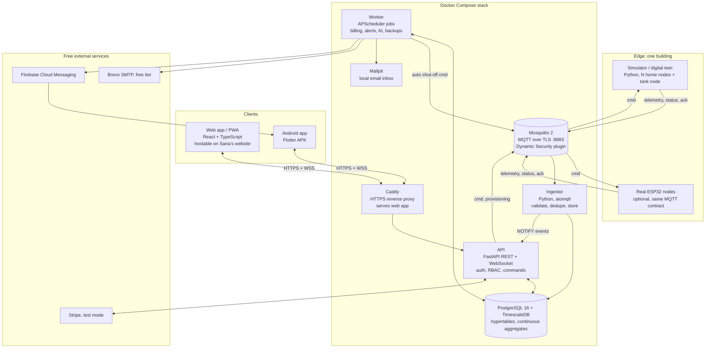

### 6.2 Components

| Component | Technology | Responsibility | Related FRs |
|---|---|---|---|
| **Simulator** | Python 3.12, `aiomqtt`, NumPy, FastAPI (tiny control API) | Digital twin of home nodes and tank node; scenarios; backfill | FR-01 to FR-09, FR-17 |
| **ESP32 firmware** | C++ / Arduino framework, PlatformIO, `PubSubClient`, `ArduinoJson`, `WiFiClientSecure` | Real hardware nodes | FR-15, FR-16, FR-17 |
| **Mosquitto broker** | Eclipse Mosquitto 2.x, TLS, Dynamic Security plugin | Message routing, authentication, per-device ACLs, Last Will | FR-10 to FR-14 |
| **Ingestor** | Python, `aiomqtt`, SQLAlchemy 2 (async), `jsonschema` | Subscribe, validate, dedupe, compute litre deltas, store, notify | FR-22, FR-23, FR-72 |
| **API** | FastAPI, Pydantic v2, SQLAlchemy 2, Alembic, PyJWT, argon2-cffi, a small built-in rate limiter | REST + WebSocket, auth, RBAC, commands, billing endpoints, Stripe | FR-18 to FR-31, FR-39, FR-68 to FR-72 |
| **Worker** | Python, APScheduler, pandas, scikit-learn, statsmodels, WeasyPrint, Jinja2 | Bill generation and PDFs, alert rules, notifications, AI training and scoring, backups, audit verification | FR-34 to FR-38, FR-58 to FR-67, FR-73 |
| **Database** | PostgreSQL 16 + TimescaleDB 2.x | Relational data, time-series, continuous aggregates, retention, compression | All |
| **Caddy** | Caddy 2 | HTTPS (automatic certificates online, local CA on the Mac), security headers, static file hosting, reverse proxy | FR-71, FR-56 |
| **Web app** | React 18 + TypeScript, Vite, Tailwind CSS, shadcn/ui, TanStack Query, Recharts, React Router | Owner, Resident, System Admin UI; PWA | FR-42 to FR-57 |
| **Android app** | Flutter 3 (Dart), Riverpod, go_router, dio, fl_chart, flutter_secure_storage, firebase_messaging | Owner and Resident UI; push | FR-41 to FR-52, FR-60 |
| **Mailpit** | Mailpit | Catches all emails locally, so email alerts can be shown without a real mail account | FR-60 |

**Why these choices?**

- **MQTT** is the standard for IoT: tiny messages, works on weak Wi-Fi, has QoS levels and "Last Will" (automatic offline detection).
- **TimescaleDB** is PostgreSQL with superpowers for time-series: we get normal SQL tables for users and bills, *and* fast meter-reading queries in **one** database.
- **FastAPI** is fast, modern Python with automatic API docs, and Python is also the best language for the AI part. One language for backend, simulator and AI makes it easier to learn.
- **React** is the most widely used web framework (great for a portfolio). The build output is plain static files, so it can live on Sana's website.
- **Flutter** builds a real native Android APK from one codebase (and iOS later).
- **Postgres LISTEN/NOTIFY** passes live events from ingestor to API, so we do **not** need an extra service like Redis. Fewer moving parts.

### 6.3 Data flows

**A. Telemetry (every 10 s per device)**
1. Device publishes JSON to `aquapulse/v1/dev/{id}/telemetry` (QoS 0).
2. Broker checks the device's ACL and forwards it to the ingestor (from M5; a shared subscription for several ingestors is the NFR-26 growth path).
3. Ingestor validates schema, size, device status and timestamp; drops duplicates; computes `delta_l` from the cumulative counter (handles reboots); inserts into the `telemetry` hypertable.
4. Ingestor sends `NOTIFY aquapulse_events, '{type, buildingId, homeId, summary}'` in the same transaction.
5. API receives the notification and pushes a summary to WebSockets that are allowed to see that home.
6. A TimescaleDB continuous aggregate keeps 15-minute totals per home up to date; hourly, daily and monthly totals are added up from it in the building's time zone (15-minute blocks, because some zones are 30 or 45 minutes off the hour).

**B. Valve command**
1. User taps "Close water" → `POST /api/v1/homes/{id}/valve`.
2. API checks role, ownership, lock and rate limit → creates `device_commands` row (`queued`) → audit entry → `NOTIFY aquapulse_commands`.
3. The command sender (inside the ingestor service; from M5 with its own MQTT command account, see FR-11) marks it `pending` and publishes `cmd` (QoS 1, not retained, expires in 30 s). One command at a time per device, so quick opposite presses run in order. The API itself never connects to MQTT.
4. Device moves valve → publishes `ack` and new `state`.
5. Ingestor updates the command to `succeeded` → NOTIFY → API → WebSocket → UI shows "Closed ✓".
6. If no ack arrives in 15 s, the command sender marks it `timeout` (alerts for it arrive with M7).

**C. Billing (monthly)**
1. Worker job on the 1st at 02:00 building time.
2. Reads daily consumption per home and occupancy dates; loads tariff version(s).
3. Billing engine calculates lines; bill and lines saved as `draft`; PDF rendered.
4. Owner reviews → issues → residents notified → payments recorded (manual or Stripe webhook).

**D. Alerts and AI**
1. Fast rules run in the ingestor's notification stream (pH, temperature, burst); windowed rules and AI run in the worker every minute / every 15 minutes.
2. New alert → de-duplicated → saved → WebSocket + push + email according to preferences.
3. Optional auto shut-off (FR-61) sends a valve command through the same path as flow B, with actor `system`.

### 6.4 Deployment views

| Environment | How | Who uses it |
|---|---|---|
| **Local (Mac)** | `docker compose up -d` → web at `https://localhost`, Mailpit at `http://localhost:8025`, MQTT at `localhost:8883` | Development, demo video |
| **Public demo, option A** | Same stack on the Mac + **Cloudflare Tunnel** (free) gives a public HTTPS URL while the Mac is on | Quick sharing |
| **Public demo, option B** | Same stack on an **Oracle Cloud Always Free** Ampere VM (arm64, like the Mac) | Always-on portfolio demo |
| **Web app on Sana's website** | Upload `web/dist/` to the website (e.g. `/water/` path or `water.` sub-domain); it calls the API at the public URL | Portfolio visitors |
| **Android** | APK from GitHub Releases; server URL set on the login screen | Phone demo |

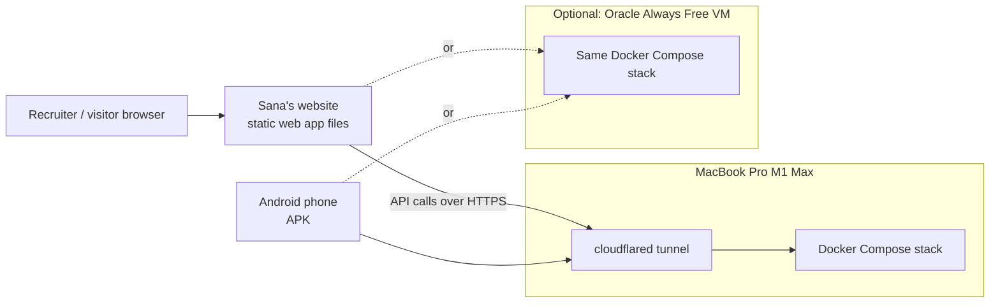

### 6.5 Repository structure (monorepo)

```text
aquapulse/
├── README.md                 # pitch, screenshots, architecture, quick start
├── LICENSE                   # MIT
├── docker-compose.yml        # one-command stack
├── .env.example              # all settings, no secrets
├── Makefile                  # make up, make demo-data, make test ...
├── contracts/                # MQTT JSON Schemas shared by everyone
├── simulator/                # digital twin (Python)
├── backend/
│   ├── app/                  # FastAPI API
│   ├── ingestor/             # MQTT → DB
│   ├── worker/               # jobs: billing, alerts, AI
│   ├── billing/              # pure billing engine (100% tested)
│   ├── ai/                   # leak detection, anomaly, forecast
│   ├── migrations/           # Alembic
│   └── tests/
├── web/                      # React app
├── mobile/                   # Flutter app
├── firmware/                 # ESP32 PlatformIO projects (home-node, tank-node) + Wokwi
├── infra/                    # mosquitto, caddy, certs scripts, backups
├── docs/                     # this SRS, ADRs, guides, security, AI evaluation
└── .github/workflows/        # CI pipelines
```

---

## 7. Database design and MQTT topic design

### 7.1 Entity-relationship diagram

> **In simple words:** each box is a table; lines show how tables connect (e.g. one building has many homes). `telemetry` and `tank_readings` are special TimescaleDB tables optimised for millions of time-stamped rows.

```mermaid
erDiagram
  USERS ||--o{ BUILDINGS : "owns"
  USERS ||--o{ OCCUPANCIES : "lives in"
  USERS ||--o{ REFRESH_TOKENS : "has"
  USERS ||--o{ PUSH_TOKENS : "has"
  USERS ||--o{ NOTIFICATION_PREFS : "sets"
  CURRENCIES ||--o{ BUILDINGS : "bills in"
  BUILDINGS ||--o{ HOMES : "contains"
  BUILDINGS ||--o{ TANKS : "has"
  BUILDINGS ||--o{ TARIFFS : "defines"
  BUILDINGS ||--o{ ALERT_RULES : "configures"
  HOMES ||--o{ OCCUPANCIES : "occupied by"
  HOMES ||--o| DEVICES : "metered by"
  TANKS ||--o| DEVICES : "monitored by"
  HOMES ||--o{ VALVE_LOCKS : "locked by"
  DEVICES ||--o{ TELEMETRY : "sends"
  DEVICES ||--o{ TANK_READINGS : "sends"
  DEVICES ||--o{ DEVICE_COMMANDS : "receives"
  TARIFFS ||--|{ TARIFF_SLABS : "has"
  TARIFFS ||--o{ TARIFF_CHARGES : "has"
  HOMES ||--o{ BILLS : "billed for"
  USERS ||--o{ BILLS : "addressed to"
  BILLS ||--|{ BILL_LINES : "itemised by"
  BILLS ||--o{ PAYMENTS : "paid by"
  BILLS ||--o| BILLS : "replaces"
  BUILDINGS ||--o{ ALERTS : "raises"
  HOMES ||--o{ ALERTS : "concerns"
  ALERTS ||--o{ NOTIFICATION_LOG : "delivered as"
  HOMES ||--o{ AI_INSIGHTS : "gets"
  ML_MODELS ||--o{ AI_INSIGHTS : "produced"
  HOMES ||--o{ FORECASTS : "forecast for"
  USERS ||--o{ AUDIT_LOG : "acts in"

  USERS {
    uuid id PK
    text email UK
    text password_hash "argon2id"
    text full_name
    text phone "optional"
    text role "sysadmin | owner | resident"
    bytea totp_secret_enc "encrypted, optional"
    bool is_active
    timestamptz created_at
  }
  CURRENCIES {
    char3 code PK "PKR USD GBP EUR AUD AED SAR QAR KWD BHD OMR"
    text name
    text symbol
    int minor_units "2 or 3"
  }
  BUILDINGS {
    uuid id PK
    uuid owner_id FK
    text name
    text address
    text timezone "e.g. Asia/Karachi"
    char3 currency_code FK
    bool nonpayment_shutoff_enabled "default false"
    int due_days "default 15"
  }
  HOMES {
    uuid id PK
    uuid building_id FK
    text unit_no "unique per building"
    int floor
    int occupants
    bool auto_shutoff_enabled
    timestamptz archived_at
  }
  OCCUPANCIES {
    uuid id PK
    uuid home_id FK
    uuid user_id FK
    date move_in
    date move_out "null = current"
    bool is_billing_contact
  }
  DEVICES {
    text id PK "e.g. home-b01-03"
    text kind "home | tank"
    uuid home_id FK "nullable"
    uuid tank_id FK "nullable"
    text status "active | revoked"
    text fw_version
    timestamptz last_seen_at
    timestamptz created_at
  }
  TANKS {
    uuid id PK
    uuid building_id FK
    int capacity_l
    int low_pct
    int high_pct
    text mode "auto | manual"
    numeric pump_kw
  }
  TELEMETRY {
    timestamptz time PK "hypertable"
    text device_id PK
    uuid boot_id
    bigint seq
    numeric total_l "cumulative counter"
    numeric delta_l "litres since previous reading"
    numeric flow_lpm
    numeric ph
    numeric temp_c
    text valve "open | closed | moving | fault"
    int rssi
  }
  TANK_READINGS {
    timestamptz time PK "hypertable"
    text device_id PK
    numeric level_pct
    numeric level_l
    bool pump_on
    bool sump_ok
    bool dry_run_protect
  }
  DEVICE_COMMANDS {
    uuid id PK "cmdId"
    text device_id FK
    text type "valve | pump | config"
    text action
    uuid requested_by FK "null = system"
    text reason
    text state "pending | succeeded | failed | rejected | timeout"
    timestamptz issued_at
    timestamptz expires_at
    timestamptz acked_at
    text result_reason
  }
  VALVE_LOCKS {
    uuid id PK
    uuid home_id FK
    text locked_state "open | closed"
    text reason
    uuid locked_by FK
    timestamptz locked_at
    uuid unlocked_by FK
    timestamptz unlocked_at
    text unlock_reason
  }
  TARIFFS {
    uuid id PK
    uuid building_id FK
    text name
    int version
    date effective_from
    uuid created_by FK
  }
  TARIFF_SLABS {
    uuid id PK
    uuid tariff_id FK
    int from_l
    int to_l "null = no upper limit"
    numeric rate_per_kl "price per 1000 L"
  }
  TARIFF_CHARGES {
    uuid id PK
    uuid tariff_id FK
    text name "e.g. Sales tax, Sewerage"
    text kind "tax_percent | extra_percent | extra_fixed"
    numeric value
  }
  BILLS {
    uuid id PK
    text bill_no UK
    uuid building_id FK
    uuid home_id FK
    uuid user_id FK
    date period_start
    date period_end
    char3 currency_code FK
    numeric litres
    numeric reading_start
    numeric reading_end
    numeric subtotal
    numeric tax_total
    numeric total
    numeric amount_paid
    text status "draft | issued | partially_paid | paid | overdue | void"
    date due_date
    uuid replaces_bill_id FK
    text pdf_path
  }
  BILL_LINES {
    uuid id PK
    uuid bill_id FK
    text kind "slab | extra | tax"
    text description
    numeric quantity_l
    numeric rate
    numeric amount
  }
  PAYMENTS {
    uuid id PK
    uuid bill_id FK
    numeric amount
    text method "cash | bank | stripe_test | other"
    text provider_ref UK "e.g. Stripe event id"
    timestamptz received_at
    uuid recorded_by FK
    timestamptz reversed_at
    text reversal_reason
  }
  ALERTS {
    uuid id PK
    uuid building_id FK
    uuid home_id FK
    text device_id
    text rule
    text severity "info | warning | critical"
    text state "open | acknowledged | resolved | auto_resolved"
    text dedup_key
    text message
    jsonb evidence
    timestamptz opened_at
    uuid acked_by FK
    timestamptz resolved_at
  }
  ALERT_RULES {
    uuid id PK
    uuid building_id FK
    text rule
    bool enabled
    jsonb params
  }
  NOTIFICATION_PREFS {
    uuid user_id PK
    text alert_type PK
    text channel PK "push | email"
    bool enabled
  }
  PUSH_TOKENS {
    uuid id PK
    uuid user_id FK
    text fcm_token
    timestamptz created_at
  }
  NOTIFICATION_LOG {
    uuid id PK
    uuid alert_id FK
    uuid user_id FK
    text channel
    text status
    int attempts
    timestamptz sent_at
  }
  REFRESH_TOKENS {
    uuid id PK
    uuid user_id FK
    uuid family_id
    text token_hash
    timestamptz expires_at
    timestamptz revoked_at
    uuid replaced_by
  }
  AUDIT_LOG {
    bigint id PK
    timestamptz at
    uuid actor_id "null = system"
    text actor_role
    inet ip
    text action
    text target_type
    text target_id
    jsonb details
    bytea prev_hash
    bytea hash
  }
  ML_MODELS {
    uuid id PK
    text kind "leak | anomaly | forecast"
    uuid building_id FK
    int version
    timestamptz trained_at
    jsonb metrics
    bool is_active
  }
  AI_INSIGHTS {
    uuid id PK
    uuid home_id FK
    text kind "leak | abnormal"
    numeric score
    uuid model_id FK
    text explanation
    jsonb evidence
    timestamptz created_at
  }
  FORECASTS {
    uuid id PK
    uuid home_id FK "null = whole building"
    uuid building_id FK
    date day
    numeric yhat_l
    numeric lo_l
    numeric hi_l
    uuid model_id FK
    timestamptz made_at
  }
```

### 7.2 Database notes

| Topic | Design |
|---|---|
| **Time-series** | `telemetry` and `tank_readings` are TimescaleDB **hypertables** (1-day chunks), compressed after 7 days, raw data dropped after 13 months (FR-75). |
| **Aggregates** | Continuous aggregates `consumption_hourly` and `consumption_daily` = `SUM(delta_l)` per device per bucket, refreshed every 5 minutes. Monthly totals are computed from daily totals in the building's time zone. |
| **Why `delta_l`?** | The ingestor computes litres since the previous accepted reading of that device. If messages are lost, the next reading's delta simply covers the gap, because the counter is cumulative: **no litres are lost**. If a counter goes **down** (device lost its flash memory), the new reading becomes the new baseline and an alert is raised. Out-of-order readings with an older `seq` are stored with `delta_l = 0`. |
| **Money** | `NUMERIC(14,3)` + `currency_code`. Rounded per currency `minor_units` in the billing engine. |
| **Integrity** | Foreign keys everywhere; unique constraints: `(building_id, unit_no)`, `bill_no`, `payments.provider_ref`, `(device_id, boot_id, seq)` for dedupe. |
| **Audit protection** | The app's DB role has `INSERT, SELECT` only on `audit_log`; a separate migration role owns the table. |
| **Migrations** | Alembic; every schema change is a reviewed migration; CI runs `upgrade` then `downgrade` on a fresh DB. |
| **Seed data** | Currencies (11), one System Admin, one demo Owner, one building with 10 homes and 12 residents (2 move-in/out examples), one tank, a PKR tariff. |

### 7.3 MQTT topic design (the device contract)

> **In simple words:** a **topic** is like an address on an envelope. Every device only has permission to write to its own addresses and to read its own "commands" mailbox. This contract is the **only** thing the simulator and real hardware must agree on.

**Namespace:** `aquapulse/v1/dev/{deviceId}/{channel}` where `deviceId` is the MQTT username (e.g. `home-b01-03`, `tank-b01-01`). Mapping device → home is kept in the database, so a device can move to another home, or be replaced, without touching code.

| Topic | Direction | QoS | Retained | Purpose |
|---|---|:---:|:---:|---|
| `aquapulse/v1/dev/{id}/telemetry` | device → server | 0 | No | Periodic readings (every 10 s). QoS 0 is safe because the counter is cumulative |
| `aquapulse/v1/dev/{id}/status` | device → server | 1 | **Yes** | `online` on connect; `offline` as **Last Will** |
| `aquapulse/v1/dev/{id}/state` | device → server | 1 | **Yes** | Current valve/pump state, thresholds, firmware; published on change |
| `aquapulse/v1/dev/{id}/cmd` | server → device | 1 | **No** | Commands: valve open/close, pump on/off, set thresholds, set interval |
| `aquapulse/v1/dev/{id}/ack` | device → server | 1 | No | Command result |
| `$share/ingest/aquapulse/v1/dev/+/+` | broker → ingestors | 1 | n/a | Shared subscription so several ingestors split the load |
| `$CONTROL/dynamic-security/v1` | API provisioning account → broker | 1 | No | Create, rotate, disable device clients (FR-14) |

**Payload examples**

Home telemetry:
```json
{
  "v": 1,
  "ts": "2026-10-30T08:15:20Z",
  "bootId": "6f1c2b8e-3a0d-4f43-9a51-0e8f2a7c1d55",
  "seq": 4821,
  "totalL": 128734.62,
  "flowLpm": 7.85,
  "ph": 7.21,
  "tempC": 24.6,
  "valve": "open",
  "rssi": -61,
  "fw": "1.0.0",
  "boot": false
}
```

Tank telemetry:
```json
{ "v": 1, "ts": "2026-10-30T08:15:20Z", "bootId": "…", "seq": 912,
  "levelPct": 63.4, "levelL": 3170, "capacityL": 5000, "pumpOn": false,
  "sumpOk": true, "sensorOk": true, "dryRunProtect": false, "overflowProtect": false,
  "mode": "auto", "lowPct": 25, "highPct": 95, "rssi": -58, "fw": "1.0.0", "boot": false }
```

Command (server → device):
```json
{ "v": 1, "cmdId": "0d6a6a2e-8f0e-4a8e-bb2a-4b9f2b7e0c11", "type": "valve",
  "action": "close", "issuedAt": "2026-10-30T08:15:21Z",
  "expiresAt": "2026-10-30T08:15:51Z", "by": "owner" }
```

Acknowledgement (device → server):
```json
{ "v": 1, "cmdId": "0d6a6a2e-8f0e-4a8e-bb2a-4b9f2b7e0c11",
  "result": "ok", "reason": null, "state": "closed", "ts": "2026-10-30T08:15:24Z" }
```
`result` is one of `ok`, `rejected` (expired, duplicate, invalid, unsafe), `failed` (hardware problem, e.g. `VALVE_STUCK`).

> **The exact rules are the JSON Schemas in [`/contracts`](../contracts/README.md)** (added in M2). Where an example here and a schema differ, the schema wins.

Status (retained, also the Last Will):
```json
{ "v": 1, "state": "offline", "ts": "2026-10-30T08:20:00Z" }
```

**Access control (Dynamic Security roles)**

| Account | Can publish | Can subscribe |
|---|---|---|
| Device `{id}` (one role per device, created at provisioning) | `aquapulse/v1/dev/{id}/telemetry`, `/status`, `/state`, `/ack` | `aquapulse/v1/dev/{id}/cmd` |
| `svc-ingestor` | nothing | `$share/ingest/aquapulse/v1/dev/+/+` (telemetry, status, state, ack) |
| `svc-commander` (API and worker) | `aquapulse/v1/dev/+/cmd` | nothing |
| `svc-provisioner` (API) | `$CONTROL/dynamic-security/v1` | `$CONTROL/dynamic-security/v1/response` |
| anonymous | **denied** | **denied** |

**Other broker settings:** TLS 1.2+ on 8883 only; `max_packet_size 4096`; keep-alive 30 s; `max_inflight_messages` and per-client connection rate limits; persistence on (so QoS 1 commands survive a broker restart until they expire).

---

## 8. API list

> **In simple words:** the list of "doors" into the backend. Each line says which address, which HTTP method, who may use it, and what it does. Base path: `/api/v1`. All endpoints except those marked *public* need a valid access token. Full details live in the auto-generated OpenAPI docs at `/api/docs`.

Roles: **SA** System Admin · **OW** Owner (own buildings) · **RE** Resident (own home) · **public** no login · **Stripe** signed webhook

### 8.1 Authentication and profile

| Method | Endpoint | Role | Purpose | FR |
|---|---|---|---|---|
| POST | `/auth/login` | public | Email + password → tokens (or "MFA required") | FR-18, FR-68 |
| POST | `/auth/login/mfa` | public | Complete login with TOTP code | FR-70 |
| POST | `/auth/refresh` | public (refresh token) | Rotate refresh token, new access token | FR-69 |
| POST | `/auth/logout` | SA, OW, RE | Revoke current session | FR-18 |
| POST | `/auth/logout-all` | SA, OW, RE | Revoke all sessions | FR-18 |
| POST | `/auth/password/forgot` | public | Send reset email (same response whether or not the email exists) | FR-68 |
| POST | `/auth/password/reset` | public (reset token) | Set new password | FR-68 |
| POST | `/auth/invitations/accept` | public (invite token) | Resident sets password, joins home | FR-18, FR-21 |
| GET | `/me` | SA, OW, RE | Current user, role, homes/buildings | FR-18 |
| PATCH | `/me` | SA, OW, RE | Update name, phone | FR-52 |
| POST | `/me/password` | SA, OW, RE | Change password | FR-68 |
| POST | `/me/mfa/setup`, `/me/mfa/verify`, `/me/mfa/disable` | SA, OW | Manage TOTP | FR-70 |
| GET / PUT | `/me/notification-prefs` | SA, OW, RE | Read / change alert preferences, quiet hours | FR-52, FR-60 |
| POST / DELETE | `/me/push-tokens` | OW, RE | Register / remove FCM token | FR-60 |
| GET | `/me/data-export` | RE | Download personal data (JSON) | FR-75 |
| POST | `/me/delete-request` | RE | Request account deletion | FR-75 |
| POST | `/ws-ticket` | SA, OW, RE | Short-lived (30 s) ticket to open the WebSocket | FR-25 |
| WS | `/ws?ticket=…` | SA, OW, RE | Live events stream, filtered by permissions | FR-25 |

### 8.2 System administration

| Method | Endpoint | Role | Purpose | FR |
|---|---|---|---|---|
| GET / POST | `/admin/owners` | SA | List / create owner accounts | FR-20, FR-55 |
| PATCH | `/admin/owners/{id}` | SA | Enable/disable owner, assign buildings | FR-55 |
| GET | `/admin/health` | SA | Service status, connected devices, ingest rate, last backup | FR-31, FR-55 |
| GET | `/admin/audit` | SA | Full audit log with filters | FR-28 |
| POST | `/admin/audit/verify` | SA | Verify audit hash chain | FR-73 |
| GET | `/healthz`, `/readyz` | public | Liveness / readiness | FR-31 |
| GET | `/metrics` | internal network only | Prometheus metrics | FR-31 |

### 8.3 Buildings, homes, residents, devices

| Method | Endpoint | Role | Purpose | FR |
|---|---|---|---|---|
| GET / POST | `/buildings` | SA, OW | List / create buildings | FR-20 |
| GET / PATCH | `/buildings/{id}` | SA, OW | View / edit building (name, time zone, currency, policies) | FR-20, FR-32 |
| GET | `/buildings/{id}/overview` | OW | Dashboard summary numbers | FR-42 |
| GET | `/buildings/{id}/audit` | OW | Audit entries for this building | FR-28 |
| GET / POST | `/buildings/{id}/homes` | SA, OW | List / create homes | FR-20, FR-43 |
| GET / PATCH / DELETE | `/homes/{id}` | SA, OW (RE: GET own) | View / edit / archive home | FR-20 |
| POST | `/homes/{id}/invitations` | OW | Invite resident by email | FR-21, FR-46 |
| GET | `/homes/{id}/occupancies` | OW | Occupancy history | FR-21 |
| PATCH | `/occupancies/{id}` | OW | Set move-out date, billing contact | FR-21 |
| GET | `/buildings/{id}/devices` | OW | Devices and their status | FR-46 |
| POST | `/homes/{id}/devices` and `/tanks/{id}/devices` | OW | Register device → one-time password + QR | FR-14 |
| POST | `/devices/{id}/rotate` | OW | New device password (shown once) | FR-14 |
| POST | `/devices/{id}/revoke` | OW | Disable device | FR-14 |
| PUT | `/devices/{id}/assignment` | OW | Move/replace device for a home (sim → real hardware) | FR-09 |

### 8.4 Live data, consumption and control

| Method | Endpoint | Role | Purpose | FR |
|---|---|---|---|---|
| GET | `/homes/{id}/live` | OW, RE | Latest readings and valve state | FR-43, FR-48 |
| GET | `/homes/{id}/telemetry?from&to` | OW, RE | Raw readings (max 7 days per call) | FR-43 |
| GET | `/homes/{id}/consumption?granularity=hour\|day\|month&from&to` | OW, RE | Consumption series | FR-23, FR-49 |
| GET | `/buildings/{id}/consumption?granularity&from&to` | OW | Building consumption series, per-home breakdown | FR-23, FR-42 |
| GET | `/buildings/{id}/average-per-person?month` | OW, RE | Anonymous average (only if ≥ 3 occupied homes) | FR-49 |
| POST | `/homes/{id}/valve` | OW, RE | Open/close valve → returns `cmdId` (202) | FR-24, FR-44, FR-51 |
| GET | `/commands/{cmdId}` | OW, RE | Command status | FR-24 |
| POST | `/homes/{id}/valve-lock` | OW | Lock open/closed with reason | FR-27 |
| POST | `/homes/{id}/valve-unlock` | OW | Unlock with reason | FR-27 |
| GET | `/buildings/{id}/tank` | OW | Tank live state | FR-26, FR-47 |
| GET | `/tanks/{id}/history?from&to` | OW | Level history, pump runtime | FR-26 |
| PATCH | `/tanks/{id}/settings` | OW | Thresholds, mode auto/manual, pump kW | FR-26 |
| POST | `/tanks/{id}/pump` | OW | Manual pump on/off → `cmdId` | FR-26 |
| GET | `/exports/consumption.csv`, `/exports/bills.csv` | OW, RE | CSV exports | FR-30 |

### 8.5 Billing and payments

| Method | Endpoint | Role | Purpose | FR |
|---|---|---|---|---|
| GET | `/currencies` | SA, OW, RE | Supported currencies and decimals | FR-32 |
| GET / POST | `/buildings/{id}/tariffs` | OW | List tariff versions / create new version | FR-33 |
| GET | `/tariffs/{id}` | OW | Tariff details | FR-33 |
| POST | `/tariffs/preview` | OW | Calculate an example bill with a draft tariff | FR-34, FR-45 |
| POST | `/buildings/{id}/bills/generate` | OW | Generate drafts for a month (idempotent) | FR-35 |
| GET | `/buildings/{id}/bills?month&status` | OW | List bills | FR-45 |
| POST | `/buildings/{id}/bills/issue-all` | OW | Issue all drafts for a month | FR-45 |
| GET | `/me/bills` | RE | Own bills | FR-50 |
| GET | `/bills/{id}` | OW, RE | Bill details with lines and payments | FR-37, FR-50 |
| GET | `/bills/{id}/pdf` | OW, RE | Download PDF | FR-36 |
| POST | `/bills/{id}/issue` | OW | Issue a draft | FR-37 |
| POST | `/bills/{id}/void` | OW | Void with reason | FR-37 |
| POST | `/bills/{id}/payments` | OW | Record manual payment | FR-40 |
| POST | `/payments/{id}/reverse` | OW | Reverse payment with reason | FR-40 |
| POST | `/bills/{id}/checkout` | RE | Create Stripe Checkout session (test mode) | FR-39 |
| POST | `/webhooks/stripe` | Stripe (signature checked) | Payment confirmation | FR-39 |

### 8.6 Alerts and AI

| Method | Endpoint | Role | Purpose | FR |
|---|---|---|---|---|
| GET | `/alerts?building&home&state&severity` | SA (system), OW, RE | List alerts (filtered by permission) | FR-59 |
| POST | `/alerts/{id}/ack` | OW, RE | Acknowledge | FR-59 |
| POST | `/alerts/{id}/resolve` | OW | Resolve with note | FR-59 |
| GET / PUT | `/buildings/{id}/alert-rules` | OW | Rule settings and thresholds | FR-62 |
| PUT | `/homes/{id}/auto-shutoff` | OW | Enable/disable automatic leak shut-off | FR-61 |
| GET | `/homes/{id}/insights` | OW, RE | Leak / abnormal-use insights with explanations | FR-63, FR-64, FR-66 |
| GET | `/homes/{id}/forecast` | OW, RE | 7-day forecast + month-end litres and bill estimate | FR-65 |
| GET | `/buildings/{id}/forecast` | OW | Building forecast | FR-65 |
| GET | `/buildings/{id}/ai/models` | OW | Model versions and metrics | FR-67 |

**Standard error format** (RFC 9457 Problem Details): `{"type": "...", "title": "...", "status": 403, "detail": "...", "instance": "/api/v1/homes/..."}`. Status codes used: 200, 201, 202 (command accepted), 204, 400, 401, 403, 404, 409 (illegal state change), 422 (validation), 423 (valve locked), 429 (rate limited), 503.

---

## 9. Screens list

> **In simple words:** every screen we will design and build, grouped by app. "W" = web app, "A" = Android app. Wireframes will be drawn in Figma (or Penpot) during M8 and added to `/docs/design`.

### 9.1 Shared screens (all roles)

| ID | Screen | W | A | Main content | FR |
|---|---|:---:|:---:|---|---|
| S-01 | Splash / server select | | ✅ | App logo; server URL field (demo, tunnel, custom) | FR-41 |
| S-02 | Login | ✅ | ✅ | Email, password, "forgot password", error messages | FR-18 |
| S-03 | Two-factor code | ✅ | ✅ | 6-digit code, use recovery code | FR-70 |
| S-04 | Accept invitation / set password | ✅ | ✅ | Name, password, strength meter | FR-18, FR-21 |
| S-05 | Forgot / reset password | ✅ | ✅ | Email field; new password form | FR-68 |
| S-06 | Profile and security | ✅ | ✅ | Name, phone, change password, 2FA, sign out everywhere | FR-52, FR-70 |
| S-07 | Notification settings | ✅ | ✅ | Per alert type: push / email toggles, quiet hours | FR-52 |
| S-08 | Alerts inbox | ✅ | ✅ | List by severity, filters, acknowledge, detail with evidence chart | FR-59 |
| S-09 | Error / offline page | ✅ | ✅ | Friendly message, retry | FR-56 |

### 9.2 Owner screens

| ID | Screen | W | A | Main content | FR |
|---|---|:---:|:---:|---|---|
| O-01 | Building overview dashboard | ✅ | ✅ | KPI cards (litres today/month, homes online, open alerts, unpaid total), live building flow chart, tank gauge, top AI insights, homes needing attention | FR-42 |
| O-02 | Homes list | ✅ | ✅ | Table/cards: unit, resident, today L, month L, valve, pH, temp, online; search, sort, filter | FR-43 |
| O-03 | Home detail | ✅ | ✅ | Live readings, valve control + lock, charts (24 h / 7 d / 30 d / 90 d), forecast, insights, bills, occupancy | FR-43, FR-44, FR-65 |
| O-04 | Valve confirm / lock dialog | ✅ | ✅ | Home, resident, action, reason field, pending → confirmed state | FR-44, FR-27 |
| O-05 | Tank and pump | ✅ | ✅ | Tank gauge, pump state, auto/manual, thresholds, 7-day level chart, runtime | FR-47 |
| O-06 | Residents | ✅ | | Residents per home, invite, move-in/out, billing contact | FR-46 |
| O-07 | Devices | ✅ | | Devices, status, last seen, firmware, register (one-time password + QR), rotate, revoke, reassign | FR-46, FR-14 |
| O-08 | Tariffs | ✅ | | Currency, versions, slab editor, taxes, extra charges, live preview | FR-45, FR-33 |
| O-09 | Bills | ✅ | ✅ | Month selector, generate, drafts, issue all, filter by status, totals per status | FR-45 |
| O-10 | Bill detail | ✅ | ✅ | Lines, PDF, payments, record payment, void | FR-45, FR-40 |
| O-11 | Alert rules | ✅ | | Enable/disable rules, thresholds, recipients, auto shut-off per home | FR-62, FR-61 |
| O-12 | AI insights and forecast | ✅ | ✅ | Leak/abnormal list with explanations, building forecast, model metrics | FR-63 to FR-67 |
| O-13 | Audit log (building) | ✅ | | Filterable list of actions | FR-28 |
| O-14 | Reports / export | ✅ | | Choose range and data, download CSV | FR-30 |
| O-15 | Building settings | ✅ | | Name, address, time zone, currency, due days, non-payment policy | FR-20, FR-27 |

### 9.3 Resident screens

| ID | Screen | W | A | Main content | FR |
|---|---|:---:|:---:|---|---|
| R-01 | My home | ✅ | ✅ | Today / month litres, "water running" indicator, valve button, water quality badge (Safe / Check / Unsafe), temperature, bill estimate | FR-48, FR-51 |
| R-02 | My usage | ✅ | ✅ | Daily and monthly charts, vs last month, vs building average per person, 7-day forecast | FR-49, FR-65 |
| R-03 | Water quality | ✅ | ✅ | pH and temperature history, what pH means in simple words | FR-48 |
| R-04 | My bills | ✅ | ✅ | List with status, total, due date | FR-50 |
| R-05 | Bill detail and pay | ✅ | ✅ | Lines, PDF, payments, "Pay online (test mode)" | FR-50, FR-39 |
| R-06 | Payment result | ✅ | ✅ | Success / cancelled / pending confirmation | FR-39 |
| R-07 | My data | ✅ | | Download my data, delete my account request | FR-75 |

### 9.4 System Admin screens (web only)

| ID | Screen | Main content | FR |
|---|---|---|---|
| A-01 | System health | Service status, connected devices, ingest rate, rejected messages, last backup, notification failures | FR-55, FR-31 |
| A-02 | Owners and buildings | Create/disable owners, assign buildings | FR-55 |
| A-03 | Global audit log | All entries, filters, "verify chain" button and result | FR-28, FR-73 |

### 9.5 Simulator control (developer tool, internal)

| ID | Screen | Main content | FR |
|---|---|---|---|
| D-01 | Simulator console (Swagger UI of the simulator) | Start/stop devices, inject scenarios, list ground-truth labels | FR-05 |

---

## 10. Use case, sequence and activity diagrams

### 10.1 Use case diagram

> Mermaid has no special "use case" shape, so actors are shown as rounded boxes and use cases as stadium shapes.

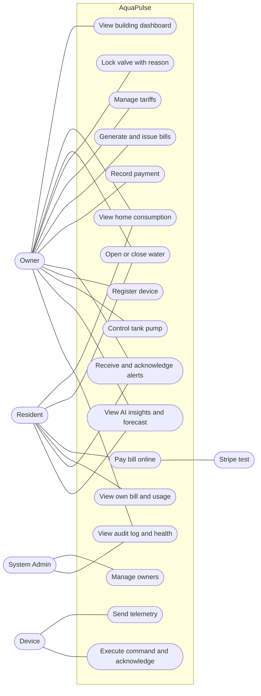

### 10.2 Sequence diagram: valve on/off

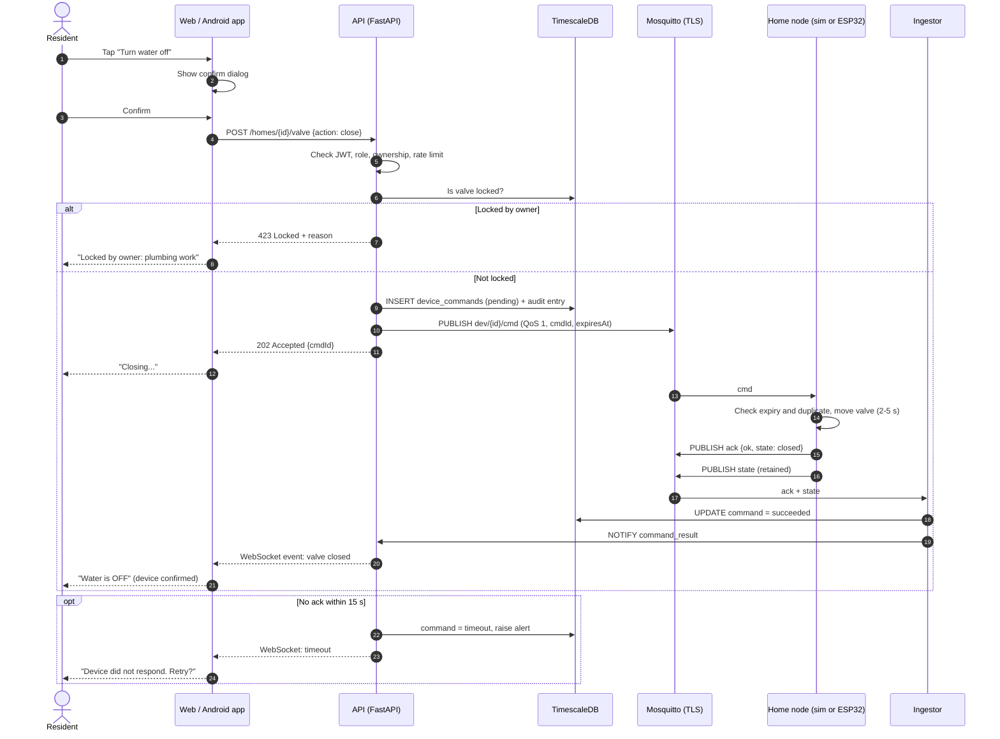

### 10.3 Sequence diagram: monthly bill generation and payment

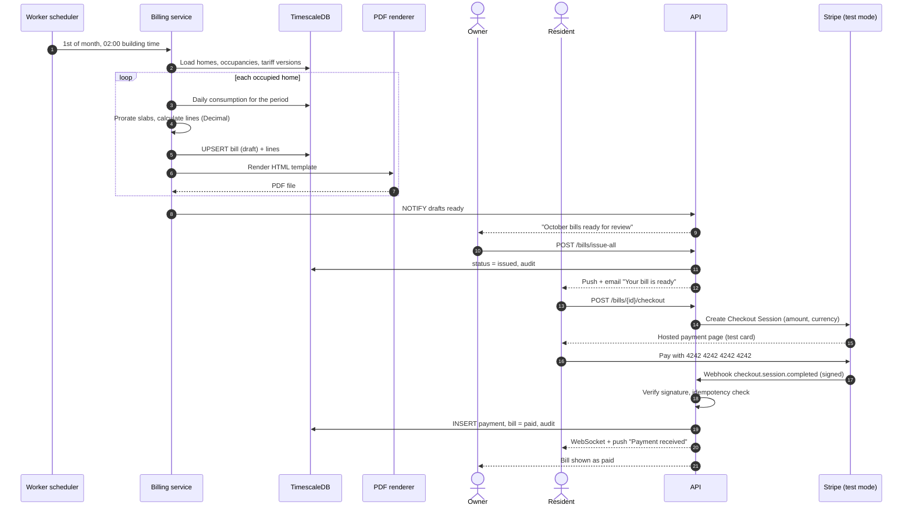

### 10.4 Sequence diagram: leak alert

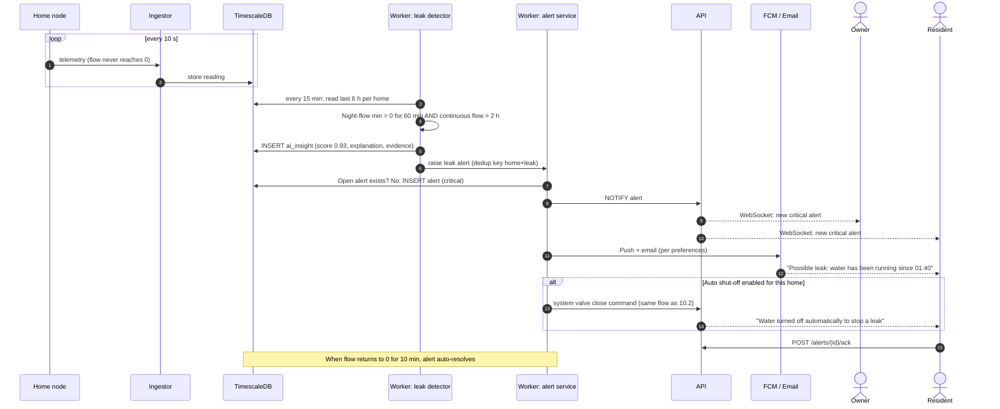

### 10.5 Activity diagram: valve command processing on the device

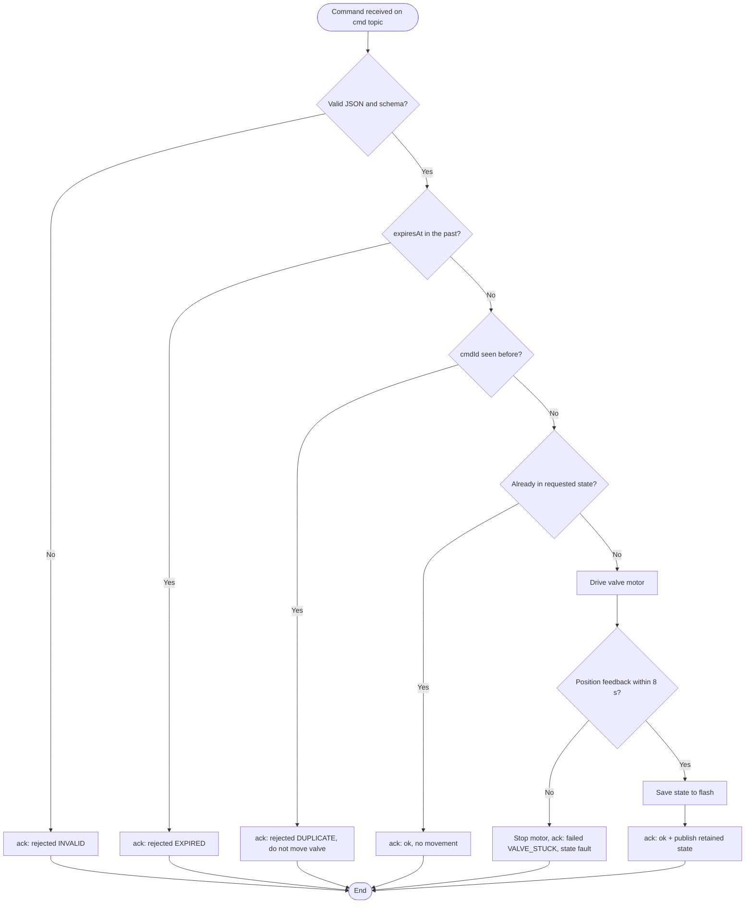

### 10.6 Activity diagram: monthly bill generation

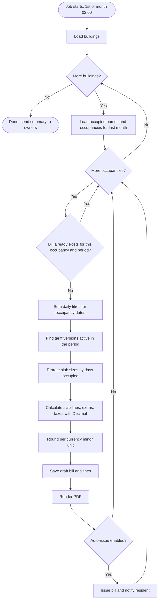

### 10.7 Activity diagram: leak detection and response

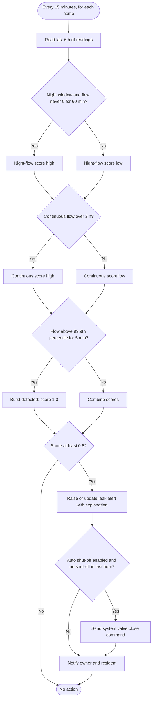

### 10.8 Activity diagram: tank pump automation (runs on the tank node)

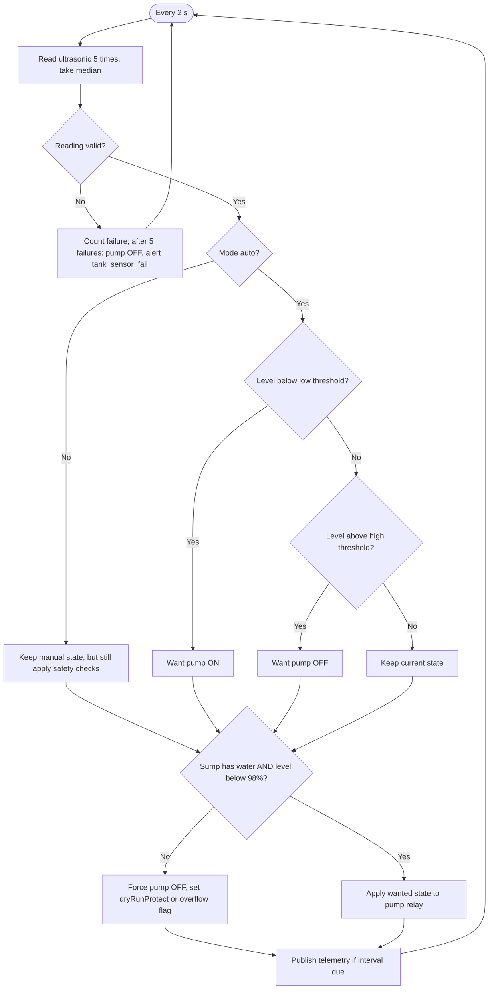

---

## 11. Security design and STRIDE threat model

> **In simple words:** we list everything an attacker might try, and the protection for each. STRIDE is a checklist of six kinds of attack. We apply it to every part of the system where data crosses a "trust boundary" (for example, from the internet into our server).

### 11.1 Security principles

1. **Defence in depth:** TLS + authentication + ACL + validation + audit; no single control is relied on.
2. **Least privilege:** each device and service account can do only its own job (Section 7.3); the DB app user cannot change the audit log.
3. **Server decides:** the server checks permissions on every request; the apps only hide buttons for convenience.
4. **Secure by default:** anonymous MQTT off, plain port off, 2FA required for System Admin, Stripe and FCM off until configured.
5. **No secrets in code:** `.env` (git-ignored) and Docker secrets; `gitleaks` in CI.
6. **Everything important is audited**, and the audit log is tamper-evident.

### 11.2 Trust boundaries and data flow diagram

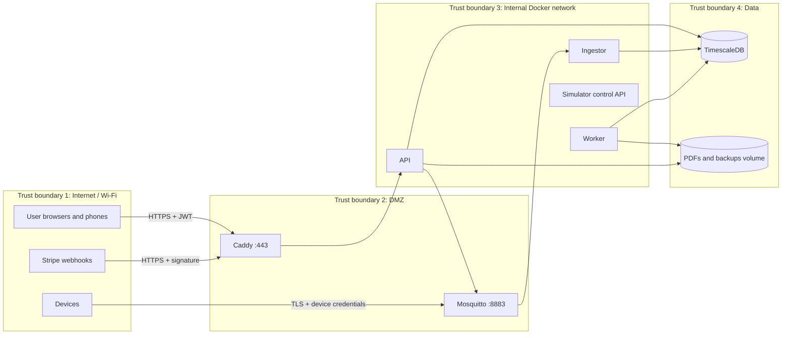

### 11.3 Security controls

| Area | Control |
|---|---|
| **Device identity** | Unique device ID + random 32-byte password per device; Dynamic Security per-device role; optional upgrade path to client certificates (mutual TLS) documented for real hardware |
| **Device transport** | MQTT over TLS 1.2+ (8883), project CA; firmware verifies the CA certificate (no `setInsecure()`) |
| **Command integrity** | Only `svc-commander` can publish commands; commands have `cmdId` + short expiry; not retained; devices reject duplicates and expired commands |
| **User authentication** | Argon2id, rate limits, lockout delays, TOTP 2FA, generic error messages |
| **Sessions** | 15-minute access JWT (EdDSA), rotating refresh tokens with reuse detection, logout everywhere, WebSocket tickets (30 s, single use) |
| **Token storage** | Web: access token in memory, refresh token in an `HttpOnly; Secure; SameSite=Strict` cookie scoped to `/api/v1/auth`. Android: `flutter_secure_storage` (Keystore) |
| **Authorization** | RBAC + object-level ownership checks via one central dependency; tested for every endpoint × role |
| **Input handling** | Pydantic (`extra="forbid"`), JSON Schema for MQTT, size limits, parameterised SQL, output encoding in React, CSP |
| **Web security** | HSTS, CSP (no inline scripts), X-Content-Type-Options, Referrer-Policy, frame-ancestors none, CORS allowlist, CSRF protection for cookie-based refresh (SameSite + custom header) |
| **Payments** | Stripe-hosted Checkout (we never touch card data); webhook signature verification; idempotency; amount always from our DB, never from the client |
| **Data at rest** | Database volume on encrypted disk (FileVault on Mac; encrypted boot volume on Oracle); TOTP secrets encrypted with an app key; backups encrypted with `age` |
| **Logging and audit** | Structured JSON logs without secrets; append-only hash-chained audit log; failed login and rejected MQTT counters |
| **Supply chain** | Pinned dependency versions (lock files), Dependabot, pip-audit, pnpm audit, Trivy, CodeQL, gitleaks; images from official sources; non-root containers; read-only root filesystems where possible |
| **Availability** | Rate limits on API and broker; payload size caps; container restart policies; local tank automation keeps working offline |
| **Physical (real hardware)** | Disable serial console in release builds, flash encryption + secure boot documented as an optional hardening step for ESP32 |

### 11.4 STRIDE threat model

Risk = Likelihood (L, 1 to 3) × Impact (I, 1 to 3). Residual risk after mitigation is shown.

| ID | Component / flow | STRIDE | Threat | L | I | Risk | Mitigation | Residual | FR / NFR |
|---|---|---|---|:---:|:---:|:---:|---|:---:|---|
| T-01 | Device → broker | **S**poofing | Attacker pretends to be `home-03` and sends fake low readings to reduce the bill | 2 | 3 | 6 | Per-device credentials, TLS, ACL limits device to own topics; anomaly detection on sudden drops; counter can't go backwards without an alert | Low | FR-11, FR-12, FR-23 |
| T-02 | Broker → device | **S**poofing / **T**ampering | Attacker publishes a "close valve" command to many homes | 2 | 3 | 6 | Only `svc-commander` may publish to `cmd`; devices can't publish to other topics; commands expire after 30 s | Low | FR-11, FR-13 |
| T-03 | Wi-Fi network | **I**nformation disclosure | Sniffing MQTT traffic to see usage patterns (reveals when people are home) | 2 | 2 | 4 | TLS 1.2+ everywhere; no plain port | Low | FR-12, NFR-07 |
| T-04 | Command channel | **T**ampering (replay) | Recorded command re-sent later | 1 | 3 | 3 | `cmdId` dedupe + `expiresAt`; TLS prevents recording in the first place | Low | FR-13 |
| T-05 | Web/API login | **S**poofing | Password guessing / credential stuffing | 3 | 3 | 9 | Argon2id, rate limits, lockout delays, common-password check, 2FA for Owner/SA | Low | FR-68, FR-70 |
| T-06 | API tokens | **S**poofing / **E**levation | JWT forgery (`alg: none`, key confusion), stolen refresh token | 2 | 3 | 6 | Fixed algorithm, `aud`/`iss` checks, short expiry, rotation + reuse detection | Low | FR-69 |
| T-07 | API | **E**levation of privilege | Resident changes ID in URL to see or control another home (IDOR) | 3 | 3 | 9 | Central object-level checks, 404 for foreign objects, automated test for every endpoint × role | Low | FR-19, NFR-09 |
| T-08 | API | **E**levation of privilege | Resident sends `role: owner` in a profile update (mass assignment) | 2 | 3 | 6 | Pydantic models with explicit allowed fields, `extra="forbid"` | Low | FR-72 |
| T-09 | API | **T**ampering | SQL injection in filters or search | 2 | 3 | 6 | SQLAlchemy parameterised queries only; Schemathesis fuzzing; Bandit/CodeQL | Low | FR-72 |
| T-10 | Web app | **T**ampering / **I**nfo disclosure | XSS via resident name or alert text | 2 | 3 | 6 | React escaping, no `dangerouslySetInnerHTML`, strict CSP, input length limits | Low | FR-71 |
| T-11 | Billing | **T**ampering | Owner or attacker edits issued bills or tariff after the fact | 2 | 2 | 4 | Issued bills immutable (void + reissue only), tariff versioning, audit log | Low | FR-33, FR-37, FR-28 |
| T-12 | Payments | **S**poofing / **T**ampering | Fake "payment success" by calling the success URL or forging a webhook | 2 | 3 | 6 | Bill paid only via signed webhook; amount from DB; idempotency | Low | FR-39 |
| T-13 | Audit log | **R**epudiation | Owner denies shutting off a resident's water | 2 | 3 | 6 | Mandatory reason, append-only audit with user, IP, time; hash chain; resident notified | Low | FR-27, FR-28, FR-73 |
| T-14 | Audit log | **T**ampering | Admin with DB access deletes embarrassing entries | 1 | 3 | 3 | App role has no UPDATE/DELETE; hash chain detects edits; daily verification; off-host encrypted backups | Medium (a DB superuser could rewrite the whole chain; documented) | FR-73 |
| T-15 | Broker | **D**enial of service | Flooding the broker with connections or huge messages | 2 | 2 | 4 | Max packet size, connection rate limits, auth required before subscribe, Docker resource limits | Medium (single host) | FR-10, NFR-25 |
| T-16 | API | **D**enial of service | Expensive queries (e.g. 10 years of raw data) | 2 | 2 | 4 | Range limits (7 days raw, 400 days aggregates), pagination, rate limits, query timeouts | Low | FR-22, FR-72 |
| T-17 | Valve control | **D**enial of service (safety) | Water cut off wrongly or maliciously | 2 | 3 | 6 | Owner lock requires reason + notification; non-payment shut-off off by default with 48 h warning; auto shut-off limited to once per hour; full audit | Low | FR-27, FR-61 |
| T-18 | Tank | **T**ampering / DoS (physical) | Pump commanded ON with empty sump (damages pump) or full tank (overflow) | 2 | 3 | 6 | Device-side safety checks override any command; local automation; alerts | Low | FR-16, FR-07 |
| T-19 | Resident data | **I**nformation disclosure | Building average reveals one neighbour's use | 2 | 1 | 2 | Average only shown with ≥ 3 occupied homes; per-person value only | Low | FR-49 |
| T-20 | Logs / backups | **I**nformation disclosure | Secrets or personal data leaked through logs or backup files | 2 | 2 | 4 | Log redaction, log-scan test, encrypted backups, retention | Low | NFR-15, NFR-18 |
| T-21 | Device provisioning | **I**nformation disclosure | Device password leaked from DB or screen | 2 | 3 | 6 | Shown once, never stored in plain text, rotation and revoke available | Low | FR-14 |
| T-22 | Supply chain | **T**ampering | Malicious dependency or image | 1 | 3 | 3 | Lock files, Dependabot, scans, official images, minimal dependencies | Medium | FR-74 |
| T-23 | Physical device | **I**nfo disclosure / **S**poofing | Thief reads Wi-Fi and MQTT password from a stolen ESP32's flash | 2 | 2 | 4 | Per-device credential (only that device affected), revoke in 1 click; optional ESP32 flash encryption | Medium | FR-14 |
| T-24 | Simulator control API | **E**levation | Someone uses the simulator API to inject fake leaks in production | 1 | 2 | 2 | Bound to internal Docker network only; disabled when `SIM_ENABLED=false` | Low | FR-05 |
| T-25 | Admin role | **E**levation / **R**epudiation | Compromised System Admin account | 1 | 3 | 3 | Mandatory 2FA; SA cannot control valves (separation of duties); all SA actions audited | Low | FR-70, Section 3 |

**Review:** the threat model is reviewed at milestones M5 and M12 and saved in `docs/security/threat-model.md`. New features must add their threats before merge.

---

## 12. Testing plan

> **In simple words:** how we prove that everything works. Tests run automatically on every push (GitHub Actions). If a test fails, the change cannot be merged.

### 12.1 Test levels

| Level | What | Tools | Where it runs |
|---|---|---|---|
| **Unit** | Small pieces alone: billing engine, consumption delta logic, alert rules, AI features, JWT handling, Flutter widgets, React components | pytest, Hypothesis, Vitest, React Testing Library, `flutter test` | Every push |
| **Contract** | MQTT payloads and topics match `/contracts` schemas (simulator, ingestor, firmware) | pytest + jsonschema | Every push; firmware in M11 via Wokwi CI |
| **Integration** | API + real TimescaleDB + real Mosquitto in Docker | pytest, Testcontainers (Python), httpx | Every push |
| **Security** | RBAC matrix (every endpoint × role), IDOR tests, JWT attack tests, MQTT ACL negative tests, fuzzing, dependency/container/secret scans, DAST | pytest, Schemathesis, OWASP ZAP baseline, Trivy, pip-audit, pnpm audit, gitleaks, CodeQL, Bandit | Every push (scans), nightly (ZAP, Schemathesis) |
| **End-to-end** | Full stack via the browser: login, valve control, bill generation, payment (Stripe test), alerts | Playwright | Every push to `main` and PRs |
| **Mobile** | Flutter widget and integration tests on emulator | `flutter test`, `integration_test` | Every push (widget), nightly (emulator) |
| **AI evaluation** | Leak detection precision/recall, forecast MAPE vs baseline on labelled simulator data | pytest + evaluation script writing `docs/ai-evaluation.md` | Nightly + before release |
| **Performance** | Ingest throughput, API latency, valve round trip | k6, custom MQTT load generator | Before each release (manual trigger) |
| **Resilience (chaos)** | Message loss, broker restart, device reboot, DB restart | Simulator scenarios + Docker restarts | Nightly |
| **Accessibility** | axe-core checks on main pages | @axe-core/playwright | Every push |
| **Usability** | 5 users, task-based (find bill, turn off water), SUS questionnaire | Manual, documented | Once at M12 |

### 12.2 Test environments and data

- **CI:** GitHub Actions, Ubuntu runners, services via Docker; fixed random seed for simulator data.
- **Local:** `make test` runs all backend and web tests; `make e2e` starts the stack and runs Playwright.
- **Test data:** factories (factory_boy) + simulator backfill with known ground truth (labelled leaks, pH events).
- **Stripe:** test mode keys in GitHub Actions secrets; E2E uses Stripe test card; webhook tests use signed sample payloads (no network needed).

### 12.3 Entry and exit criteria

| | Criteria |
|---|---|
| **Entry** (start testing a milestone) | Code builds; migrations apply; linters pass |
| **Exit** (milestone done) | All acceptance criteria for its FRs pass as automated tests (or a documented manual test where automation is impossible, e.g. real hardware); coverage targets met (NFR-27); no Critical/High security findings; demo script for the milestone works from a fresh `docker compose up` |
| **Release (v1.0)** | All Must FRs pass; all NFR measurements recorded in `docs/test-report.md`; RTM (Section 15) 100% linked; README screenshots taken from the real running system |

### 12.4 CI pipeline

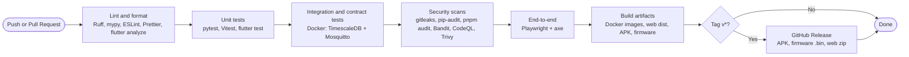

### 12.5 Defect handling

Bugs are GitHub Issues with labels (`bug`, `security`, severity `S1` to `S4`). Each fix adds a regression test. Security issues follow `SECURITY.md` (private reporting via GitHub Security Advisories).

---

## 13. Complete free tools list

> **In simple words:** everything you need to install or sign up for, what it is for, what the free plan allows, and how to install it on your MacBook Pro M1 Max. **You do not need to install everything today.** Each milestone (Section 14) says exactly which tools it needs, and we install them together step by step in M0.
>
> Free-plan limits change from time to time. The limits below are as known when this SRS was written (October 2026). Check the official link before relying on a limit. Every external service in AquaPulse is optional or replaceable, so a change in a free plan cannot break the project.

### 13.1 Core developer tools (install in M0)

| # | Tool | Purpose in AquaPulse | Free plan / license | Official link | macOS install (Apple silicon) |
|---|---|---|---|---|---|
| 1 | **Xcode Command Line Tools** | Compilers + `git` for macOS | Free | https://developer.apple.com/xcode/resources/ | `xcode-select --install` |
| 2 | **Homebrew** | Package manager for installing everything else | Free, open source (BSD-2) | https://brew.sh | `/bin/bash -c "$(curl -fsSL https://raw.githubusercontent.com/Homebrew/install/HEAD/install.sh)"` then follow the two "Next steps" lines it prints to add `/opt/homebrew/bin` to your PATH |
| 3 | **Git** | Version control | Free, open source (GPL-2) | https://git-scm.com | `brew install git` then `git config --global user.name "Sanaullah Khan Niazi"` and `git config --global user.email "<your email>"` |
| 4 | **GitHub account** | Hosts the repo, issues, releases, portfolio | Free: unlimited public and private repos | https://github.com/signup | Sign up in the browser; enable 2FA (Settings → Password and authentication) |
| 5 | **GitHub CLI (`gh`)** | Create repo, PRs and releases from terminal | Free, open source (MIT) | https://cli.github.com | `brew install gh` then `gh auth login` |
| 6 | **GitHub Actions** | CI: tests, scans, builds APK and firmware | Free and unlimited minutes on standard runners for **public** repos (private repos: 2,000 min/month) | https://docs.github.com/actions | Nothing to install; workflows live in `.github/workflows/` |
| 7 | **Visual Studio Code** | Code editor for everything | Free (MIT core) | https://code.visualstudio.com | `brew install --cask visual-studio-code`; then in VS Code: Cmd+Shift+P → "Shell Command: Install 'code' command in PATH" |
| 8 | **Docker Desktop** | Runs the whole stack in containers | Free for personal use, education, non-commercial open source and small businesses (< 250 employees and < $10M revenue) | https://www.docker.com/products/docker-desktop/ | `brew install --cask docker-desktop` (on older Homebrew: `brew install --cask docker`), open Docker.app once, then Settings → Resources: 4 CPUs, 8 GB RAM. Test: `docker run hello-world` |
| 9 | **uv** (Python manager) | Installs Python 3.12 and project packages, very fast | Free, open source (MIT/Apache-2) | https://docs.astral.sh/uv/ | `brew install uv` then `uv python install 3.12` |
| 10 | **Python 3.12** | Backend, simulator, AI | Free (PSF license) | https://www.python.org | Installed by uv (step above). Check: `uv run python --version` |
| 11 | **fnm + Node.js 22 LTS** | Runs the React tooling | Free, open source (MIT) | https://github.com/Schniz/fnm · https://nodejs.org | `brew install fnm`, add `eval "$(fnm env --use-on-cd)"` to `~/.zshrc`, then `fnm install 22 && fnm default 22` |
| 12 | **pnpm** | Fast JavaScript package manager | Free, open source (MIT) | https://pnpm.io | `corepack enable pnpm` (Corepack comes with Node) |
| 13 | **pre-commit** | Runs linters before each commit | Free, open source (MIT) | https://pre-commit.com | `uv tool install pre-commit` then in the repo `pre-commit install` |
| 14 | **gitleaks** | Stops secrets from being committed | Free, open source (MIT) | https://github.com/gitleaks/gitleaks | `brew install gitleaks` |
| 15 | **Make** | Short commands like `make up`, `make test` | Free (comes with Xcode CLT) | https://www.gnu.org/software/make/ | Included with step 1 |

**VS Code extensions (all free):** Python (Microsoft), Pylance, Ruff, Docker, ESLint, Prettier, Tailwind CSS IntelliSense, Dart, Flutter, PlatformIO IDE, Wokwi Simulator, YAML, Even Better TOML, Markdown Preview Mermaid Support, GitLens, Thunder Client (optional). Install from the Extensions panel (Cmd+Shift+X), or: `code --install-extension ms-python.python charliermarsh.ruff ms-azuretools.vscode-docker dbaeumer.vscode-eslint esbenp.prettier-vscode bradlc.vscode-tailwindcss Dart-Code.flutter platformio.platformio-ide wokwi.wokwi-vscode bierner.markdown-mermaid` (one ID per `--install-extension` flag if your VS Code version requires it).

### 13.2 Server-side software (runs inside Docker; nothing to install on the Mac)

| # | Tool | Purpose | License | Official link | How we get it |
|---|---|---|---|---|---|
| 16 | **Eclipse Mosquitto 2.x** | MQTT broker with TLS and Dynamic Security | Free, open source (EPL-2.0 / EDL-1.0) | https://mosquitto.org | Docker image `eclipse-mosquitto:2` |
| 17 | **Mosquitto clients** (optional on Mac) | `mosquitto_pub` / `mosquitto_sub` for testing from the terminal | Free, open source | https://mosquitto.org/download/ | `brew install mosquitto` (we only use the client tools; the broker runs in Docker) |
| 18 | **PostgreSQL 16** | Main database | Free, open source (PostgreSQL license) | https://www.postgresql.org | Included in the TimescaleDB image |
| 19 | **TimescaleDB** (community edition) | Time-series: hypertables, continuous aggregates, compression, retention | Free (Apache-2 core + Timescale License community features, free to self-host) | https://www.timescale.com · https://docs.timescale.com | Docker image `timescale/timescaledb:latest-pg16` (pinned to an exact version in M1) |
| 20 | **Caddy 2** | HTTPS reverse proxy, security headers, serves web app | Free, open source (Apache-2) | https://caddyserver.com | Docker image `caddy:2` |
| 21 | **Mailpit** | Fake email inbox for local testing (see every email at `http://localhost:8025`) | Free, open source (MIT) | https://mailpit.axllent.org | Docker image `axllent/mailpit` |
| 22 | **OpenSSL 3** | Creates the project CA and TLS certificates | Free, open source (Apache-2) | https://www.openssl.org | `brew install openssl@3` (macOS ships LibreSSL; we use OpenSSL 3 for consistent scripts) |

### 13.3 Backend and AI libraries (Python, installed automatically by `uv sync`)

| Library | Purpose | License | Link |
|---|---|---|---|
| FastAPI + Uvicorn | REST API + WebSocket server | MIT / BSD | https://fastapi.tiangolo.com |
| Pydantic v2 + pydantic-settings | Validation and settings | MIT | https://docs.pydantic.dev |
| SQLAlchemy 2 + asyncpg + Alembic | Database access and migrations | MIT / Apache-2 | https://www.sqlalchemy.org |
| aiomqtt (on paho-mqtt 2) | Async MQTT client (ingestor, API, simulator) | BSD / EPL | https://github.com/empicano/aiomqtt |
| jsonschema | Validate MQTT payloads against contracts | MIT | https://python-jsonschema.readthedocs.io |
| PyJWT + cryptography | JWT signing (EdDSA) | MIT / Apache-2 | https://pyjwt.readthedocs.io |
| argon2-cffi | Password hashing | MIT | https://argon2-cffi.readthedocs.io |
| pyotp | TOTP two-factor | MIT | https://pyauth.github.io/pyotp/ |
| python-multipart | Reads the login form used by Swagger's Authorize button | Apache-2 | https://github.com/Kludex/python-multipart |
| APScheduler | Scheduled jobs in the worker | MIT | https://apscheduler.readthedocs.io |
| WeasyPrint + Jinja2 | HTML → PDF bills | BSD | https://weasyprint.org |
| stripe (Python SDK) | Stripe Checkout + webhooks (test mode) | MIT | https://github.com/stripe/stripe-python |
| firebase-admin | Send push via FCM | Apache-2 | https://firebase.google.com/docs/admin/setup |
| pandas, NumPy | Data handling | BSD | https://pandas.pydata.org |
| scikit-learn | Isolation Forest (abnormal use) | BSD | https://scikit-learn.org |
| statsmodels | Holt-Winters forecasting | BSD | https://www.statsmodels.org |
| structlog | Structured JSON logs | MIT / Apache-2 | https://www.structlog.org |
| prometheus-client | Metrics | Apache-2 | https://github.com/prometheus/client_python |
| **Testing:** pytest, pytest-asyncio, Hypothesis, httpx, Testcontainers, factory_boy, Schemathesis, coverage | Tests and fuzzing | MIT / BSD / MPL-2 | https://docs.pytest.org · https://hypothesis.readthedocs.io · https://schemathesis.readthedocs.io |
| **Quality:** Ruff, mypy, Bandit, pip-audit | Lint, types, security | MIT / Apache-2 | https://docs.astral.sh/ruff/ · https://mypy-lang.org · https://bandit.readthedocs.io · https://github.com/pypa/pip-audit |

### 13.4 Web app libraries (installed automatically by `pnpm install`)

| Library | Purpose | License | Link |
|---|---|---|---|
| React 18 + TypeScript | UI framework and typed JavaScript | MIT / Apache-2 | https://react.dev · https://www.typescriptlang.org |
| Vite + vite-plugin-pwa | Fast dev server, build, PWA | MIT | https://vitejs.dev · https://vite-pwa-org.netlify.app |
| Tailwind CSS + shadcn/ui (Radix UI) | Styling and accessible components | MIT | https://tailwindcss.com · https://ui.shadcn.com |
| TanStack Query | Server data fetching and caching | MIT | https://tanstack.com/query |
| React Router | Pages and navigation | MIT | https://reactrouter.com |
| Recharts | Charts | MIT | https://recharts.org |
| React Hook Form + Zod | Forms and validation | MIT | https://react-hook-form.com · https://zod.dev |
| i18next | Translations (English now, Urdu/Arabic later) | MIT | https://www.i18next.com |
| **Testing:** Vitest, React Testing Library, Playwright, @axe-core/playwright | Unit, E2E, accessibility | MIT / Apache-2 / MPL-2 | https://vitest.dev · https://playwright.dev |
| **Quality:** ESLint, Prettier | Lint and format | MIT | https://eslint.org · https://prettier.io |

### 13.5 Mobile (Android app)

| # | Tool | Purpose | Free plan / license | Official link | macOS install |
|---|---|---|---|---|---|
| 23 | **Flutter SDK (stable)** | Build the Android app (Dart) | Free, open source (BSD-3) | https://flutter.dev | `brew install --cask flutter` then `flutter doctor` |
| 24 | **Android Studio** | Android SDK, emulator, build tools (we still write code in VS Code) | Free | https://developer.android.com/studio | `brew install --cask android-studio`; open it → More Actions → SDK Manager: install Android SDK Platform 35, Command-line Tools, Build-Tools; Device Manager: create a Pixel emulator with an **arm64-v8a** system image (fast on M1); then `flutter doctor --android-licenses` (accept all) |
| 25 | **CocoaPods** (only if you later build for iOS) | iOS dependencies | Free, open source | https://cocoapods.org | `brew install cocoapods` (not needed for Android) |
| | Flutter packages: Riverpod, go_router, dio, fl_chart, flutter_secure_storage, firebase_core, firebase_messaging, web_socket_channel, intl | App state, routing, HTTP, charts, secure storage, push, live data, formatting | Free (MIT / BSD) | https://pub.dev | Installed automatically by `flutter pub get` |

### 13.6 Hardware and firmware tools

| # | Tool | Purpose | Free plan / license | Official link | macOS install |
|---|---|---|---|---|---|
| 26 | **PlatformIO** (VS Code extension) | Build and flash ESP32 firmware; dependency management; CI builds | Free, open source (Apache-2) | https://platformio.org | VS Code Extensions → "PlatformIO IDE" |
| 27 | **Wokwi** | Online ESP32 simulator: run our real firmware in the browser with virtual sensors, no hardware needed | Free plan for simulating in the browser (paid plans add private projects and extras); free VS Code extension license for hobby/open-source use | https://wokwi.com · https://docs.wokwi.com | Use at https://wokwi.com in the browser, or install the "Wokwi Simulator" VS Code extension and request the free license |
| 28 | **Arduino IDE 2** (optional) | Simpler alternative for beginners flashing the ESP32 | Free, open source (AGPL) | https://www.arduino.cc/en/software | `brew install --cask arduino-ide` |
| 29 | **CP210x / CH340 USB driver** (only with real hardware) | Lets the Mac talk to some ESP32 boards | Free | https://www.silabs.com/developers/usb-to-uart-bridge-vcp-drivers | Recent macOS includes drivers for most boards; install only if the board does not appear in `ls /dev/cu.*` |

### 13.7 Testing, API and MQTT tools

| # | Tool | Purpose | Free plan / license | Official link | macOS install |
|---|---|---|---|---|---|
| 30 | ~~MQTT Explorer~~ | Replaced by MQTTX (#31): its Homebrew cask was disabled in September 2026 because it fails the macOS Gatekeeper check | n/a | n/a | n/a |
| 31 | **MQTTX** | Watch every MQTT message live and publish test commands; supports TLS | Free, open source (Apache-2) | https://mqttx.app | `brew install --cask mqttx` |
| 32 | **Postman** | Try API calls; shareable collection | Free plan for individuals (small team limits) | https://www.postman.com | `brew install --cask postman` |
| 33 | **Bruno** (recommended alternative) | Same as Postman, fully open source, collections stored as files in the repo | Free, open source (MIT) | https://www.usebruno.com | `brew install --cask bruno` |
| 34 | **DBeaver Community** | Look inside the database with a GUI | Free, open source (Apache-2) | https://dbeaver.io | `brew install --cask dbeaver-community` |
| 35 | **k6** | Load testing (NFR-03, NFR-04) | Free, open source (AGPL-3) | https://k6.io | `brew install k6` |
| 36 | **OWASP ZAP** | Web security scan (DAST) | Free, open source (Apache-2) | https://www.zaproxy.org | `brew install --cask zap` (also runs in CI as a Docker image) |
| 37 | **Trivy** | Container and dependency vulnerability scanner | Free, open source (Apache-2) | https://trivy.dev | `brew install trivy` |
| 38 | **testssl.sh** | Check TLS configuration | Free, open source (GPL-2) | https://testssl.sh | `brew install testssl` |
| 39 | **CodeQL + Dependabot** | Code security analysis and dependency updates | Free for public GitHub repos | https://codeql.github.com · https://docs.github.com/code-security/dependabot | Enabled in GitHub repo settings → Code security |
| 40 | **Codecov** (optional) | Coverage badge and reports | Free for open-source repos | https://about.codecov.io | Sign in with GitHub; add repo |

### 13.8 Design and documentation

| # | Tool | Purpose | Free plan / license | Official link | macOS install |
|---|---|---|---|---|---|
| 41 | **Mermaid** | All diagrams in this SRS (renders directly on GitHub) | Free, open source (MIT) | https://mermaid.js.org · Live editor: https://mermaid.live | Nothing to install (VS Code extension for preview) |
| 42 | **draw.io (diagrams.net)** | Wiring diagram and nicer architecture poster for README | Free, open source (Apache-2) | https://www.drawio.com | `brew install --cask drawio` |
| 43 | **Figma** | UI wireframes and mock-ups | Free "Starter" plan (limited number of shared files and pages; unlimited personal drafts) | https://www.figma.com | `brew install --cask figma` (or use in browser) |
| 44 | **Penpot** (fully free alternative) | Same purpose as Figma, open source, no limits | Free, open source (MPL-2) | https://penpot.app | Use in browser (free cloud account) |
| 45 | **OBS Studio** | Record the demo video | Free, open source (GPL-2) | https://obsproject.com | `brew install --cask obs` |
| 46 | **Shotcut** (optional) | Edit the demo video | Free, open source (GPL-3) | https://shotcut.org | `brew install --cask shotcut` |

### 13.9 Free online services and accounts

| # | Service | Purpose | Free plan limits (Oct 2026, verify) | Official link | Setup |
|---|---|---|---|---|---|
| 47 | **Firebase** (Spark plan) | Firebase Cloud Messaging for Android push alerts | Spark plan is free; FCM has no charge | https://firebase.google.com | Create project → add Android app (package `dev.aquapulse.app`) → download `google-services.json` (git-ignored) → create a service-account key for the backend (`.env`, never committed) |
| 48 | **Stripe** (test mode) | Online bill payment demo, no real money | Test mode is free; no charges unless you go live | https://stripe.com · https://docs.stripe.com/testing | Create an account → stay in **Test mode** → copy test keys to `.env` → install Stripe CLI to forward webhooks locally: `brew install stripe/stripe-cli/stripe` then `stripe login` and `stripe listen --forward-to localhost/api/v1/webhooks/stripe`. See Open Question OQ-2 about sign-up country |
| 49 | **Brevo** (optional, for real emails online) | SMTP for alert and bill emails on the public demo | Free plan about 300 emails/day | https://www.brevo.com | Create account → SMTP & API → SMTP key → `.env`. Locally we use Mailpit instead, so this is optional |
| 50 | **Cloudflare** account + **Cloudflare Tunnel** | Public HTTPS URL for the backend running on your Mac (for the website and phone) | Free | https://www.cloudflare.com · https://developers.cloudflare.com/cloudflare-one/connections/connect-networks/ | `brew install cloudflared`; quick test with no account: `cloudflared tunnel --url https://localhost:443 --no-tls-verify` (random `trycloudflare.com` URL); permanent URL needs a free account and a domain on Cloudflare |
| 51 | **Oracle Cloud Always Free** (optional) | Always-on server for the public demo | Always Free Ampere A1 compute (up to 4 OCPUs / 24 GB RAM total) and 200 GB block storage; a card is required for identity verification but not charged on Always Free resources | https://www.oracle.com/cloud/free/ | Guide provided in M12 (create VM, install Docker, clone repo, `docker compose up -d`) |
| 52 | **GitHub Pages** or **Cloudflare Pages** (optional) | Host the web app if not on your own website; also host the project docs site | GitHub Pages: free for public repos (1 GB site). Cloudflare Pages: free plan | https://pages.github.com · https://pages.cloudflare.com | Configured in M8 / M12 |
| 53 | **UptimeRobot** (optional) | Monitor the public demo is up (NFR-19) | Free plan with 5-minute checks | https://uptimerobot.com | Add HTTP monitor for `/api/v1/healthz` |
| 54 | **Your own website** | Hosts the web app (static files) and the project write-up | (You already have it) | n/a | Upload `web/dist/` (see FR-56); details in Open Question OQ-3 |

### 13.10 One-shot install script for M0 (macOS, Apple silicon)

Run these after Homebrew is installed. Every line is explained in the M0 guide.

```bash
# Core
xcode-select --install                       # compilers + git (skip if already installed)
brew install git gh uv fnm gitleaks openssl@3 mosquitto k6 trivy testssl cloudflared
brew install --cask visual-studio-code docker-desktop mqtt-explorer mqttx bruno \
                    dbeaver-community drawio obs
uv python install 3.12
uv tool install pre-commit
echo 'eval "$(fnm env --use-on-cd)"' >> ~/.zshrc && source ~/.zshrc
fnm install 22 && fnm default 22 && corepack enable pnpm

# Mobile (M9)
brew install --cask flutter android-studio
flutter doctor --android-licenses

# Payments (M6, optional)
brew install stripe/stripe-cli/stripe

# Check everything
git --version && gh --version && uv --version && node --version && pnpm --version \
  && docker --version && flutter --version
```

---

## 14. Milestone plan

> **In simple words:** we build AquaPulse in 13 steps (M0 to M12). After **every** step you have something that runs and that you can show (a screenshot, a short screen recording or a terminal demo). For each milestone I will give you the code, the exact commands, an explanation, and then wait for your "OK, next".

```mermaid
flowchart LR
  M0[M0 Tools and repo] --> M1[M1 Infrastructure]
  M1 --> M2[M2 Digital twin]
  M2 --> M3[M3 Backend core]
  M3 --> M4[M4 Live data and valve]
  M4 --> M5[M5 Secure MQTT]
  M5 --> M6[M6 Billing]
  M6 --> M7[M7 Alerts]
  M7 --> M8[M8 Web app]
  M8 --> M9[M9 Android app]
  M9 --> M10[M10 AI]
  M10 --> M11[M11 ESP32 hardware]
  M11 --> M12[M12 Demo data, polish, release]
```

The estimated effort assumes about 10 to 15 hours per week while learning. It is a guide, not a promise.

| Milestone | Goal | FRs covered | What you can run and show | "Done" criteria | Tools needed | Effort |
|---|---|---|---|---|---|---|
| **M0: Tools and repository** | Install tools, create the GitHub repo with a professional skeleton | FR-74 (setup: gitleaks, pre-commit, `.env.example`) | Public GitHub repo with README skeleton, MIT license, folder structure, green "CI" badge (hello-world workflow + gitleaks) | `git clone` + `make help` works; CI passes; pre-commit blocks a fake secret | 1 to 15 | 1 week |
| **M1: Infrastructure** | One-command stack: Mosquitto (dev profile), TimescaleDB, Caddy, Mailpit | Foundation for FR-10, FR-22 (no FR completed); NFR-17, NFR-29 | `docker compose up -d` → all containers healthy; publish/subscribe a test message with MQTTX; open DB in DBeaver; Mailpit at `localhost:8025` | `docker compose ps` all healthy; `make down && make up` works; doc page explains each container | Docker, MQTTX, DBeaver | 1 week |
| **M2: Digital twin simulator** | 10 virtual homes + 1 tank speaking the MQTT contract | FR-01, FR-02, FR-03, FR-04, FR-05, FR-06, FR-07, FR-09, FR-10, FR-17 (simulator part) | MQTTX shows 10 homes sending live data; send a `close` command with MQTTX and watch flow drop to 0; inject a leak via the simulator's Swagger UI; tank fills and pump switches | Contract tests and simulator unit tests pass in CI; all FR acceptance criteria above pass | Python, uv, MQTTX | 2 weeks |
| **M3: Backend core** | API with login, roles, buildings, homes, residents, audit log | FR-18, FR-19, FR-20, FR-21, FR-28, FR-29, FR-31, FR-68, FR-69, FR-72 (API part) | Swagger UI at `/api/docs`: log in as owner and resident, create homes, see 403 when a resident tries owner actions; audit entries in DB | RBAC matrix test passes for all endpoints; coverage ≥ 80%; migrations up/down in CI | FastAPI, Bruno/Postman | 2 weeks |
| **M4: Live data and valve control** | Ingestor stores telemetry; consumption; WebSocket; valve and pump commands; backfill | FR-08, FR-13, FR-22, FR-23, FR-24, FR-25, FR-26, FR-27, FR-72 (MQTT part) | `curl` the consumption API for 90 days of demo data; `make live` prints the WebSocket stream; close a valve via API and see the simulator obey; owner lock returns 423 to the resident | 10%-message-loss test within 0.5%; valve round trip p95 ≤ 2 s plus the valve's own travel time (2 to 5 s in the simulator); backfill idempotent | k6 (light), `make live` | 2 weeks |
| **M5: Secure MQTT and HTTPS** | TLS everywhere, per-device credentials, ACLs, provisioning, security headers | FR-11, FR-12, FR-14, FR-71 | `openssl s_client` shows TLS 1.3; a device trying another home's topic is refused (log shown); register a new device and get a one-time password + QR; HTTPS at `https://localhost` | Port 1883 closed in default profile; ACL negative tests pass; testssl.sh no high issues; STRIDE review #1 done | OpenSSL 3, testssl.sh | 1.5 weeks |
| **M6: Billing and payments** | Currencies, tariffs, bill engine, monthly bills, PDFs, manual and Stripe test payments | FR-32, FR-33, FR-34, FR-35, FR-36, FR-37, FR-39, FR-40 | Generate October bills for 10 homes in PKR and a second demo building in KWD; open the PDF; record a cash payment; pay one bill with the Stripe test card | Billing engine 100% branch coverage; 20 worked examples pass; webhook signature and idempotency tests pass | WeasyPrint (Docker), Stripe CLI | 2 weeks |
| **M7: Alerts and notifications** | Rule engine, alert lifecycle, in-app + email, overdue reminders, audit chain | FR-38, FR-58, FR-59, FR-60 (in-app, email), FR-62, FR-73 | Inject `ph_drift` → critical alert appears via WebSocket and an email arrives in Mailpit; acknowledge it; tamper with an audit row and watch verification fail | Each rule's scenario test passes; 7-day false-positive test passes; dedupe test (one alert per incident) | Mailpit | 1.5 weeks |
| **M8: Web app (React)** | Owner, resident and System Admin web app; PWA; deploy to your website | FR-30, FR-42 to FR-57 (web), FR-70 | Full click-through demo in the browser: owner dashboard with live charts, valve control, tariff editor, bills; resident view; installable PWA; version uploaded to your website talking to the tunnel URL | Playwright E2E for every role passes at 390 px and 1440 px; axe 0 serious; Lighthouse ≥ 85 | Node, pnpm, Figma/Penpot, Playwright | 3 weeks |
| **M9: Android app (Flutter)** | One APK for owners and residents with push notifications | FR-41, FR-42 to FR-52 (Android), FR-60 (push) | Install the APK on the emulator or your phone, log in as resident, turn water off, receive a push when a leak is injected | APK built in CI and attached to a release; widget tests pass; push received on emulator | Flutter, Android Studio, Firebase | 3 weeks |
| **M10: AI** | Leak detection, abnormal use, forecasts, explanations, auto shut-off | FR-61, FR-63, FR-64, FR-65, FR-66, FR-67 | Dashboard shows "Possible leak" with explanation and evidence chart; 7-day forecast with interval; month-end bill estimate; `docs/ai-evaluation.md` with real precision/recall/MAPE numbers | Leak recall ≥ 90%, precision ≥ 80%; forecast beats seasonal-naive; evaluation report generated in CI | scikit-learn, statsmodels | 2 weeks |
| **M11: ESP32 firmware and hardware** | Real firmware, Wokwi simulation, parts list, wiring diagram | FR-09 (re-verify), FR-15, FR-16, FR-17 (firmware part) | Firmware running in Wokwi (VS Code extension with its private gateway, so it can reach the broker on your Mac): a small Wokwi custom chip generates flow-meter pulses, a potentiometer acts as the pH probe; it connects over TLS and appears in the dashboard next to simulated homes; swap one simulated home for the Wokwi device with zero code change | Firmware builds in CI; contract tests pass against the Wokwi device; BOM and wiring diagram in `/docs/hardware` | PlatformIO, Wokwi, draw.io | 2 weeks |
| **M12: Demo data, polish and release** | Final demo data, privacy features, full security pass, docs, public demo, v1.0 release | FR-74 (complete), FR-75; all NFR measurements | One command `make demo` → 10 homes × 3 months of data; public demo URL; README with real screenshots, architecture, quick start; demo video recorded; LinkedIn/website write-up | All Must FRs pass; NFR results in `docs/test-report.md`; RTM complete; ZAP/Trivy clean; fresh-clone quick start ≤ 15 min; tag `v1.0.0` | OBS, Cloudflare Tunnel or Oracle Cloud, UptimeRobot | 2 weeks |

**Final deliverables checklist (end of M12)**

- [ ] Clean public GitHub repo, MIT license, `CONTRIBUTING.md`, `SECURITY.md`, `CODE_OF_CONDUCT.md`
- [ ] Professional README: one-line pitch, badges (CI, coverage, license), real screenshots/GIF, architecture diagram, features, quick start, tech stack, security highlights, AI results, roadmap
- [ ] `/docs`: this SRS, architecture decision records, milestone guides, threat model, ASVS checklist, AI evaluation, test report, hardware guide, website deployment guide
- [ ] `docker compose up` one-command setup with demo data (10 homes, 3 months)
- [ ] Tests passing in CI (backend, web, mobile, firmware build, security scans)
- [ ] GitHub Release v1.0.0 with APK, firmware binaries and web build
- [ ] Demo video script (3 to 4 minutes) and recorded video
- [ ] Short write-up for your website and a LinkedIn post

---

## 15. Requirements traceability matrix

> **In simple words:** this table links every requirement to its module, the milestone that builds it, and the test that proves it. If a row has no passing test, the requirement is not done. Test IDs (`TC-xx`) are used as test names, e.g. `def test_TC_24_valve_lifecycle()`, so you can search the code for any requirement.

| FR | Requirement | Module | Priority | Milestone | Test ID | Test type | Planned test location |
|---|---|---|---|---|---|---|---|
| FR-01 | Virtual home devices | SIM | Must | M2 | TC-01 | Unit + Contract | `simulator/tests/test_virtual_home_devices.py` |
| FR-02 | Realistic consumption profiles | SIM | Must | M2 | TC-02 | Unit + Contract | `simulator/tests/test_realistic_consumption_profiles.py` |
| FR-03 | Telemetry publishing | SIM | Must | M2 | TC-03 | Unit + Contract | `simulator/tests/test_telemetry_publishing.py` |
| FR-04 | Valve command handling | SIM | Must | M2 | TC-04 | Unit + Contract | `simulator/tests/test_valve_command_handling.py` |
| FR-05 | Scenario and fault injection | SIM | Must | M2 | TC-05 | Unit + Contract | `simulator/tests/test_scenario_and_fault_injection.py` |
| FR-06 | Online / offline status | SIM | Must | M2 | TC-06 | Unit + Contract | `simulator/tests/test_online_offline_status.py` |
| FR-07 | Tank and pump simulation | SIM | Must | M2 | TC-07 | Unit + Contract | `simulator/tests/test_tank_and_pump_simulation.py` |
| FR-08 | Historical backfill for demo data | SIM | Must | M4 | TC-08 | Integration | `simulator/tests/test_backfill.py` |
| FR-09 | Contract conformance (simulator ↔ real hardware) | SIM | Must | M2 (re-verified M11) | TC-09 | Unit + Contract | `simulator/tests/test_contract_conformance_simulator_real_hard.py` |
| FR-10 | Versioned topic and payload contract | DEV | Must | M2 | TC-10 | Contract + Integration | `simulator/tests/test_versioned_topic_and_payload_contract.py` |
| FR-11 | Per-device credentials and topic ACLs | DEV | Must | M5 | TC-11 | Security (negative ACL) | `tests/contract/test_broker_acl.py` |
| FR-12 | TLS-only broker | DEV | Must | M5 | TC-12 | Security + Integration | `tests/contract/test_broker_tls.py` |
| FR-13 | Safe command delivery | DEV | Must | M4 | TC-13 | Contract + Integration | `tests/contract/test_safe_command_delivery.py` |
| FR-14 | Device provisioning and credential rotation | DEV | Must | M5 | TC-14 | Contract + Integration | `tests/contract/test_device_provisioning_and_credential_rotat.py` |
| FR-15 | ESP32 home-node firmware | DEV | Must | M11 | TC-15 | Build + Contract (Wokwi) | `firmware/home-node/test/ , tests/contract/` |
| FR-16 | ESP32 tank-node firmware with local automation | DEV | Should | M11 | TC-16 | Build + Wokwi scenario | `firmware/tank-node/test/` |
| FR-17 | Device resilience | DEV | Must | M2 (simulator), M11 (firmware) | TC-17 | Chaos + Contract | `simulator/tests/ , tests/chaos/` |
| FR-18 | Login and sessions | API | Must | M3 | TC-18 | Integration | `backend/tests/api/test_login_and_sessions.py` |
| FR-19 | Role-based and object-level access control | API | Must | M3 | TC-19 | Integration | `backend/tests/api/test_role_based_and_object_level_access_contr.py` |
| FR-20 | Building and home management | API | Must | M3 | TC-20 | Integration | `backend/tests/api/test_building_and_home_management.py` |
| FR-21 | Resident and occupancy management | API | Must | M3 | TC-21 | Integration | `backend/tests/api/test_resident_and_occupancy_management.py` |
| FR-22 | Telemetry ingestion | API | Must | M4 | TC-22 | Integration | `backend/tests/api/test_telemetry_ingestion.py` |
| FR-23 | Consumption calculation | API | Must | M4 | TC-23 | Integration | `backend/tests/api/test_consumption_calculation.py` |
| FR-24 | Valve control with command lifecycle | API | Must | M4 | TC-24 | Integration | `backend/tests/api/test_valve_control_with_command_lifecycle.py` |
| FR-25 | Real-time stream (WebSocket) | API | Must | M4 | TC-25 | Integration | `backend/tests/api/test_real_time_stream_websocket.py` |
| FR-26 | Tank and pump API | API | Must | M4 | TC-26 | Integration | `backend/tests/api/test_tank_and_pump_api.py` |
| FR-27 | Owner valve lock with mandatory reason | API | Must | M4 | TC-27 | Integration | `backend/tests/api/test_owner_valve_lock_with_mandatory_reason.py` |
| FR-28 | Audit log | API | Must | M3 | TC-28 | Integration | `backend/tests/api/test_audit_log.py` |
| FR-29 | API documentation | API | Must | M3 | TC-29 | Integration | `backend/tests/api/test_api_documentation.py` |
| FR-30 | CSV data export | API | Could | M8 | TC-30 | Integration | `backend/tests/api/test_csv_data_export.py` |
| FR-31 | Health and metrics | API | Should | M3 | TC-31 | Integration | `backend/tests/api/test_health_and_metrics.py` |
| FR-32 | Multi-currency support | BIL | Must | M6 | TC-32 | Unit + Property + Integration | `backend/tests/billing/test_multi_currency_support.py` |
| FR-33 | Tariff configuration with versioning | BIL | Must | M6 | TC-33 | Unit + Property + Integration | `backend/tests/billing/test_tariff_configuration_with_versioning.py` |
| FR-34 | Bill calculation engine | BIL | Must | M6 | TC-34 | Unit + Property + Integration | `backend/tests/billing/test_bill_calculation_engine.py` |
| FR-35 | Monthly bill generation with occupancy proration | BIL | Must | M6 | TC-35 | Unit + Property + Integration | `backend/tests/billing/test_monthly_bill_generation_with_occupancy_p.py` |
| FR-36 | PDF bills | BIL | Must | M6 | TC-36 | Integration (PDF text compare) | `backend/tests/billing/test_pdf.py` |
| FR-37 | Bill lifecycle | BIL | Must | M6 | TC-37 | Unit + Property + Integration | `backend/tests/billing/test_bill_lifecycle.py` |
| FR-38 | Overdue detection and reminders | BIL | Should | M7 | TC-38 | Unit + Property + Integration | `backend/tests/billing/test_overdue_detection_and_reminders.py` |
| FR-39 | Online payment (Stripe test mode) | BIL | Should | M6 | TC-39 | Integration (signed webhook fixtures) + E2E | `backend/tests/billing/test_stripe.py , web/e2e/resident/pay.spec.ts` |
| FR-40 | Manual payment recording | BIL | Must | M6 | TC-40 | Unit + Property + Integration | `backend/tests/billing/test_manual_payment_recording.py` |
| FR-41 | Android app for owners and residents | OWN | Must | M9 | TC-41 | Build + Widget + Integration | `mobile/test/ , mobile/integration_test/` |
| FR-42 | Building overview | OWN | Must | M8 (web), M9 (Android) | TC-42 | E2E (web) + Widget (Android) | `web/e2e/owner/ , mobile/test/owner/` |
| FR-43 | Homes list and home detail | OWN | Must | M8 (web), M9 (Android) | TC-43 | E2E (web) + Widget (Android) | `web/e2e/owner/ , mobile/test/owner/` |
| FR-44 | Remote valve control UI | OWN | Must | M8 (web), M9 (Android) | TC-44 | E2E (web) + Widget (Android) | `web/e2e/owner/ , mobile/test/owner/` |
| FR-45 | Billing management UI | OWN | Must | M8 (web), M9 (Android: view, issue, record payment) | TC-45 | E2E (web) + Widget (Android) | `web/e2e/owner/ , mobile/test/owner/` |
| FR-46 | Resident and device management UI | OWN | Must | M8 (web) | TC-46 | E2E (web) + Widget (Android) | `web/e2e/owner/ , mobile/test/owner/` |
| FR-47 | Tank and pump panel | OWN | Must | M8 (web), M9 (Android) | TC-47 | E2E (web) + Widget (Android) | `web/e2e/owner/ , mobile/test/owner/` |
| FR-48 | My home dashboard | RES | Must | M8 (web), M9 (Android) | TC-48 | E2E (web) + Widget (Android) | `web/e2e/resident/ , mobile/test/resident/` |
| FR-49 | My consumption history and comparison | RES | Must | M8 (web), M9 (Android) | TC-49 | E2E (web) + Widget (Android) | `web/e2e/resident/ , mobile/test/resident/` |
| FR-50 | My bills and payment | RES | Must | M8 (web), M9 (Android) | TC-50 | E2E (web) + Widget (Android) | `web/e2e/resident/ , mobile/test/resident/` |
| FR-51 | My valve control | RES | Must | M8 (web), M9 (Android) | TC-51 | E2E (web) + Widget (Android) | `web/e2e/resident/ , mobile/test/resident/` |
| FR-52 | Profile and notification preferences | RES | Must | M8 (web), M9 (Android) | TC-52 | E2E (web) + Widget (Android) | `web/e2e/resident/ , mobile/test/resident/` |
| FR-53 | Responsive, role-based web app | WEB | Must | M8 | TC-53 | E2E + Accessibility | `web/e2e/` |
| FR-54 | Live charts without refresh | WEB | Must | M8 | TC-54 | E2E + Accessibility | `web/e2e/` |
| FR-55 | System admin console | WEB | Must | M8 | TC-55 | E2E + Accessibility | `web/e2e/` |
| FR-56 | Installable PWA, hostable on Sana's website | WEB | Must | M8 | TC-56 | E2E + Accessibility | `web/e2e/` |
| FR-57 | Accessibility, theming and language readiness | WEB | Should | M8 | TC-57 | E2E + Accessibility | `web/e2e/` |
| FR-58 | Rule-based alert engine | ALT | Must | M7 | TC-58 | Integration + Scenario | `backend/tests/alerts/test_rule_based_alert_engine.py` |
| FR-59 | Alert lifecycle, severity and de-duplication | ALT | Must | M7 | TC-59 | Integration + Scenario | `backend/tests/alerts/test_alert_lifecycle_severity_and_de_duplicat.py` |
| FR-60 | Notification channels and preferences | ALT | Must | M7 (in-app, email), M9 (push) | TC-60 | Integration + Android device test | `backend/tests/alerts/ , mobile/integration_test/` |
| FR-61 | Optional automatic leak shut-off | ALT | Should | M10 | TC-61 | Scenario | `backend/tests/alerts/test_auto_shutoff.py` |
| FR-62 | Owner alert rule configuration | ALT | Should | M7 | TC-62 | Integration + Scenario | `backend/tests/alerts/test_owner_alert_rule_configuration.py` |
| FR-63 | Leak detection | AI | Must | M10 | TC-63 | Evaluation + Unit | `backend/tests/ai/test_leak_detection.py` |
| FR-64 | Abnormal usage detection | AI | Should | M10 | TC-64 | Evaluation + Unit | `backend/tests/ai/test_abnormal_usage_detection.py` |
| FR-65 | Consumption forecast and bill projection | AI | Must | M10 | TC-65 | Evaluation + Unit | `backend/tests/ai/test_consumption_forecast_and_bill_projection.py` |
| FR-66 | Explainable AI insights | AI | Must | M10 | TC-66 | Evaluation + Unit | `backend/tests/ai/test_explainable_ai_insights.py` |
| FR-67 | Model evaluation and retraining | AI | Should | M10 | TC-67 | Evaluation + Unit | `backend/tests/ai/test_model_evaluation_and_retraining.py` |
| FR-68 | Password security | SEC | Must | M3 | TC-68 | Security | `backend/tests/security/test_password_security.py` |
| FR-69 | Token security | SEC | Must | M3 | TC-69 | Security | `backend/tests/security/test_token_security.py` |
| FR-70 | Two-factor authentication (TOTP) | SEC | Should | M8 | TC-70 | Security | `backend/tests/security/test_two_factor_authentication_totp.py` |
| FR-71 | Transport security and HTTP security headers | SEC | Must | M5 | TC-71 | Security + Integration | `backend/tests/security/test_transport.py` |
| FR-72 | Input validation and rate limiting | SEC | Must | M3 (API), M4 (MQTT) | TC-72 | Security | `backend/tests/security/test_input_validation_and_rate_limiting.py` |
| FR-73 | Tamper-evident audit chain | SEC | Should | M7 | TC-73 | Security | `backend/tests/security/test_tamper_evident_audit_chain.py` |
| FR-74 | Secrets management and CI security scanning | SEC | Must | M0 (setup), M12 (complete) | TC-74 | CI pipeline check | `.github/workflows/security.yml` |
| FR-75 | Privacy: data minimisation, export and deletion | SEC | Should | M12 | TC-75 | Security | `backend/tests/security/test_privacy_data_minimisation_export_and_del.py` |

**Coverage summary:** 75 functional requirements (Must 62 · Should 12 · Could 1), each with one test ID and a planned test location. Every milestone M2 to M12 owns at least one FR. M1 owns none: it builds the infrastructure that the FRs run on.

### 15.1 Non-functional requirements → verification

| NFR | Verified by | Test / report location | Milestone first measured |
|---|---|---|---|
| NFR-01 | Playwright timing test (50 valve commands) | `web/e2e/perf/valve-roundtrip.spec.ts` | M8 (API-level in M4) |
| NFR-02 | Lighthouse CI | `.github/workflows/web.yml` | M8 |
| NFR-03 | MQTT load generator | `tests/load/ingest_load.py` | M4 |
| NFR-04 | k6 script | `tests/load/api_read.js` | M4 |
| NFR-05 | E2E timestamp comparison | `web/e2e/perf/live-latency.spec.ts` | M8 |
| NFR-06 | `docker stats` sampling script | `tests/load/resources.sh` | M12 |
| NFR-07 | testssl.sh + port scan | `tests/security/tls_check.sh` | M5 |
| NFR-08 | Config unit tests | `backend/tests/security/test_crypto_config.py` | M3 |
| NFR-09 | RBAC matrix test | `backend/tests/security/test_rbac_matrix.py` | M3 |
| NFR-10 | pip-audit, pnpm audit, Trivy, ZAP | `.github/workflows/security.yml` | M0 (grows each milestone) |
| NFR-11 | ASVS checklist review | `docs/security/asvs-checklist.md` | M12 |
| NFR-12 | gitleaks full history | `.github/workflows/security.yml` | M0 |
| NFR-13 | Tenant isolation tests (API, WS, exports, PDF) | `backend/tests/security/test_isolation.py` | M4 |
| NFR-14 | Retention policy + deletion tests | `backend/tests/privacy/` | M12 |
| NFR-15 | Log scan test | `backend/tests/security/test_log_redaction.py` | M3 |
| NFR-16 | Chaos test with ground truth | `tests/chaos/test_no_lost_litres.py` | M4 |
| NFR-17 | Restart test | `tests/chaos/test_restart_recovery.py` | M5 |
| NFR-18 | Backup/restore job | `.github/workflows/backup-restore.yml` | M12 |
| NFR-19 | UptimeRobot report | `docs/test-report.md` | M12 |
| NFR-20 | Backend-down test (tank keeps working) | `simulator/tests/test_tank_offline_safety.py` | M2 (firmware M11) |
| NFR-21 | Usability test sessions + SUS | `docs/usability-test.md` | M12 |
| NFR-22 | axe-core in Playwright | `web/e2e/a11y.spec.ts` | M8 |
| NFR-23 | Playwright viewports, emulator screenshots | `web/e2e/` , `mobile/integration_test/` | M8 / M9 |
| NFR-24 | Content review checklist | `docs/content-style.md` | M8 |
| NFR-25 | 2,000-device load test | `tests/load/scale_2000.py` | M12 |
| NFR-26 | Two-ingestor test, no duplicates | `tests/load/test_shared_subscription.py` | M4 |
| NFR-27 | Coverage and linters in CI | `.github/workflows/*.yml` | M0 onward |
| NFR-28 | Fresh-clone quick-start test | `docs/test-report.md` | M12 |
| NFR-29 | Multi-arch image build | `.github/workflows/images.yml` | M1 |
| NFR-30 | Tools list review (Section 13) | This document | M0 and M12 |

---

## 16. Glossary and open questions

### 16.1 Glossary

| Term | Simple meaning |
|---|---|
| **Acceptance criteria** | The exact checks that prove a requirement is done |
| **ACL (Access Control List)** | The list of MQTT topics each account is allowed to read or write |
| **Acknowledgement (ack)** | The device's reply saying "I did it" (or why not) after a command |
| **Argon2id** | A modern, slow-on-purpose password hashing method that makes stolen passwords very hard to crack |
| **Audit log** | A permanent diary of important actions: who did what, when, and from where |
| **Backfill** | Quickly generating past data (e.g. 3 months) so dashboards and bills have history from day one |
| **Billing contact** | The resident whose name is on the bill for a home |
| **Broker** | The MQTT "post office" (Mosquitto) that receives messages and delivers them to subscribers |
| **CA (Certificate Authority)** | Signs certificates so clients can trust they are talking to the real server |
| **Continuous aggregate** | A TimescaleDB table that keeps hourly/daily totals up to date automatically |
| **Contract (MQTT)** | The agreed topic names and JSON formats; anything that follows it can act as a device |
| **Cumulative counter** | A meter reading that only goes up (like a car's odometer); the difference between two readings = litres used |
| **Digital twin** | Software that acts exactly like a real device, so we can build and test without hardware |
| **Docker / Docker Compose** | Runs each service in its own box (container); Compose starts all of them with one command |
| **Dry-run protection** | Switching the pump off when there is no water to pump, so the pump is not damaged |
| **ESP32** | A cheap microcontroller with built-in Wi-Fi, used for the real sensor nodes |
| **FCM** | Firebase Cloud Messaging, Google's free service for push notifications to Android |
| **Hash chain** | Each audit entry includes a fingerprint of the previous one, so any change breaks the chain and is detected |
| **Holt-Winters** | A forecasting method that learns the level, trend and weekly pattern of a time series |
| **Hypertable** | A TimescaleDB table split automatically into time chunks for fast time-series queries |
| **Hysteresis** | Using two thresholds (e.g. pump on at 25%, off at 95%) so the pump doesn't switch on and off constantly |
| **IDOR** | Insecure Direct Object Reference: seeing someone else's data by changing an ID in a URL |
| **Isolation Forest** | A machine-learning method that finds unusual data points by how easily they can be separated from the rest |
| **JWT** | JSON Web Token, a signed "ticket" proving who you are, sent with each API request |
| **Last Will (LWT)** | A message the broker publishes for a device if it disconnects unexpectedly ("offline") |
| **MAPE** | Mean Absolute Percentage Error: average forecast error in percent (lower is better) |
| **Minimum night flow** | The lowest water flow during the night; above zero usually means a leak |
| **Minor unit** | The smallest unit of a currency (paisa, cent, fils); KWD, BHD, OMR have 1,000 per main unit |
| **MoSCoW** | Must, Should, Could, Won't priorities |
| **MQTT** | A lightweight publish/subscribe messaging protocol used by IoT devices |
| **Occupancy** | A record that a resident lives in a home from a move-in date to a move-out date |
| **pH** | How acidic (below 7) or alkaline (above 7) water is; drinking water should be 6.5 to 8.5 |
| **Precision / Recall** | Precision: of the leaks we reported, how many were real. Recall: of the real leaks, how many we found |
| **Proration** | Splitting a monthly allowance by days when someone moves in or out mid-month |
| **PWA** | A website that can be installed on a phone or computer like an app |
| **QoS** | MQTT delivery guarantee: 0 = at most once, 1 = at least once, 2 = exactly once |
| **RBAC** | Role-Based Access Control: what you can do depends on your role (Owner, Resident ...) |
| **Refresh token** | A longer-lived token used only to get new short-lived access tokens |
| **Retained message** | A message the broker keeps and gives to anyone who subscribes later (used for "current state") |
| **Slab tariff** | Price per 1,000 litres that changes by usage band (first band cheaper, higher bands more expensive) |
| **STRIDE** | Six threat types: Spoofing, Tampering, Repudiation, Information disclosure, Denial of service, Elevation of privilege |
| **Telemetry** | Regular sensor readings sent by a device |
| **TLS** | The encryption used by HTTPS and secure MQTT |
| **TOTP** | Time-based one-time password: the 6-digit code from an authenticator app |
| **Webhook** | A message another service (Stripe) sends to our server when something happens (payment completed) |
| **WebSocket** | A connection that stays open so the server can push live updates to the app |

### 16.2 Open questions

These don't block approval. Where an answer is needed, the milestone that needs it is listed, and a sensible default is used until you decide.

| ID | Question | Default if not answered | Needed by |
|---|---|---|---|
| OQ-1 | Which name: **AquaPulse**, FlowWise or HydroNest (or another)? I will check GitHub and domain availability for your choice. | AquaPulse | M0 (repo name) |
| OQ-2 | Can you create a **Stripe** account from your country? Stripe test mode needs an account, and as far as I know Stripe does not yet offer accounts to businesses based in Pakistan (check https://stripe.com/global). If you can't, we ship manual payments only and keep Stripe as an optional plugin that others can enable. | Manual payments always; Stripe plugin built and tested with signed sample webhooks; live Checkout demo only if an account is available | M6 |
| OQ-3 | What is your **website** built with (WordPress, static HTML, Next.js, hosting provider) and its address? This decides how we upload the web app (sub-folder vs sub-domain). | Sub-domain such as `water.<your-domain>` serving static files | M8 |
| OQ-4 | Public demo hosting: keep it running on your **Mac + Cloudflare Tunnel** (only online while the Mac is on), or set up **Oracle Cloud Always Free** (always on; needs a card for verification)? | Cloudflare Tunnel during development; Oracle optional in M12 | M12 |
| OQ-5 | Default demo building: currency **PKR** with Quetta time zone, plus a second small demo building in **KWD** (to show 3-decimal currencies)? Example slab rates? | Building 1: PKR, Asia/Karachi, slabs 0 to 5,000 L Rs 60/kL, 5,001 to 15,000 L Rs 120/kL, above Rs 200/kL, sales tax 0%. Building 2: KWD, Asia/Kuwait, 3 slabs | M6 |
| OQ-6 | Do you plan to buy hardware later? If yes, which country (affects parts and shops in Appendix A)? | Parts list with generic part numbers available on AliExpress / local electronics markets | M11 |
| OQ-7 | Should the UI include **Urdu** (right-to-left) in v1.0, or English only with translation-ready texts? | English only, translation-ready | M8 |
| OQ-8 | Should owners be allowed to enable **shut-off for unpaid bills** at all? It's legally and ethically sensitive in many countries. | Feature exists but is **off** by default, with 48 h warning and audit (FR-27) | M4 |
| OQ-9 | Do you want an **iOS** build too? Flutter supports it, but installing on an iPhone needs a Mac with Xcode, and distributing it needs a paid Apple Developer account. | Android only for v1.0 | M9 |

---

## Appendix A: Hardware parts list and wiring

> **In simple words:** you don't need any of this to build and demo AquaPulse; the simulator does everything. This appendix is for anyone who wants to build a real node. The firmware (M11) matches these parts and pins exactly. Prices are rough guides and vary by country.

### A.1 Bill of materials: home node (per home)

| # | Part | Example model | Qty | Why | Approx. price (USD) |
|---|---|---|:---:|---|---|
| 1 | ESP32 dev board | ESP32-DevKitC (WROOM-32E) | 1 | Wi-Fi microcontroller | 5 to 10 |
| 2 | Water flow sensor | YF-S201 (½", 1 to 30 L/min, ~450 pulses/L) for prototyping; **for real billing, a certified meter with pulse (reed) output** | 1 | Measures litres | 3 to 8 (proto) / 25 to 60 (pulse meter) |
| 3 | Motorised ball valve | ½" or ¾", 12 V DC, 5-wire type (CR05-style) with open/closed position feedback | 1 | Water on/off; holds position without power; reports real state | 12 to 25 |
| 4 | Relay module | 2-channel, 3.3 V-logic compatible, opto-isolated | 1 | Switches valve power/direction | 2 to 4 |
| 5 | pH sensor kit | DFRobot Gravity Analog pH Sensor V2 (SEN0161-V2) or equivalent, with probe | 1 | Water quality | 30 to 40 |
| 6 | pH flow cell / probe holder | Inline flow cell or sampling T-piece | 1 | pH probes need a holder; not designed for full pipe pressure | 10 to 20 |
| 7 | Temperature sensor | DS18B20 waterproof probe | 1 | Water temperature | 2 to 4 |
| 8 | Resistors | 4.7 kΩ (DS18B20 pull-up); 10 kΩ + 20 kΩ (5 V → 3.3 V divider for flow pulse) | set | Signal conditioning | 1 |
| 9 | Power supply | 12 V 2 A DC adapter | 1 | Valve + node | 5 to 8 |
| 10 | Buck converter | LM2596 or MP1584 module, set to 5.0 V | 1 | 12 V → 5 V for ESP32 and sensors | 1 to 3 |
| 11 | Enclosure | IP65 junction box + cable glands | 1 | Water and dust protection | 5 to 10 |
| 12 | Misc. | Plumbing fittings, PTFE tape, wires, terminal blocks | | Installation | 5 to 10 |

### A.2 Bill of materials: tank node (per building)

| # | Part | Example model | Qty | Why |
|---|---|---|:---:|---|
| 1 | ESP32 dev board | ESP32-DevKitC | 1 | Controller |
| 2 | Waterproof ultrasonic sensor | JSN-SR04T (or A02YYUW UART version) | 1 | Tank level, mounted at the top of the tank |
| 3 | Float switch | Vertical float switch in the sump (ground tank) | 1 | Sump has water? (dry-run protection) |
| 4 | Pump contactor / relay | Relay module driving a properly rated **contactor** for the mains pump | 1 | Switch the pump safely |
| 5 | Power | 5 V 2 A supply (or 12 V + buck) | 1 | Node power |
| 6 | Enclosure | IP65 box | 1 | Protection |

> ⚠️ **Safety:** the pump runs on mains voltage (220 to 240 V or 110 V). Mains wiring must be done by a qualified electrician using a contactor and proper protection (MCB/RCD). The ESP32 only switches the low-voltage relay coil.

### A.3 Pin map (matches firmware)

**Home node**

| ESP32 pin | Connects to | Notes |
|---|---|---|
| GPIO27 | Flow sensor signal (yellow) through 10 kΩ/20 kΩ divider | Interrupt on falling edge; sensor powered from 5 V, signal reduced to 3.3 V |
| GPIO34 (ADC1_CH6) | pH board analog output | Input-only pin; **ADC1** is used because ADC2 can't be used while Wi-Fi is on; read with `analogReadMilliVolts()` and two-point calibration |
| GPIO4 | DS18B20 data + 4.7 kΩ pull-up to 3.3 V | OneWire |
| GPIO26 | Relay IN1: valve power | Active-low module: HIGH = off at boot |
| GPIO25 | Relay IN2: valve direction (open/close) | |
| GPIO32 | Valve "open" feedback wire | `INPUT_PULLUP`; LOW = fully open |
| GPIO33 | Valve "closed" feedback wire | `INPUT_PULLUP`; LOW = fully closed |
| GPIO2 | Onboard LED | Status: blink = connecting, solid = online |
| 5V / VIN | Buck converter 5 V out | |
| GND | Common ground for all modules | Single ground point |

**Tank node**

| ESP32 pin | Connects to | Notes |
|---|---|---|
| GPIO5 | JSN-SR04T TRIG | |
| GPIO18 | JSN-SR04T ECHO through 10 kΩ/20 kΩ divider | Echo is 5 V |
| GPIO19 | Sump float switch | `INPUT_PULLUP` |
| GPIO23 | Relay IN: pump contactor coil | Active-low; pump OFF at boot |

### A.4 Wiring diagram (block view)

A full drawing (draw.io + Wokwi `diagram.json`) is produced in M11. This block view shows every connection:

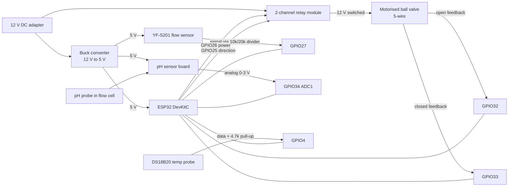

### A.5 Notes for a real deployment

- **Billing accuracy:** hobby flow sensors like the YF-S201 can be off by ±10%. For real billing, use a certified water meter with a pulse output and set the "litres per pulse" value in the device config.
- **pH probes** need calibration every 1 to 3 months with buffer solutions, and must stay wet. Keep a note of the last calibration date for each node.
- **Wi-Fi:** place the node where 2.4 GHz signal is better than −75 dBm (shown as RSSI in the dashboard).
- **Credentials:** each node gets its own credentials from the Devices screen (FR-14). Never reuse them between nodes.

---

*End of SRS v1.0 (draft). After your approval, this document is saved as `docs/SRS.md` in the repository, and every change after that is made through a pull request.*
