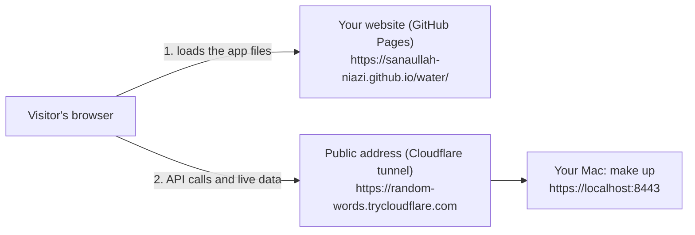

# Put the AquaPulse web app on your own website (FR-56)

> **Goal:** people open `https://<your website>/water/`, log in and use AquaPulse, while the server runs on your Mac.
> **Cost:** nothing. GitHub Pages and Cloudflare's quick tunnel are free.
> **Time:** about 20 minutes.
> **When:** linking AquaPulse to your website is planned for the end of the project. This guide is ready for that day; you can also try it any time and take it down again.

## The idea in one picture



Your website can only hold **files**. The app is just files (HTML, JavaScript, pictures), so it can live there. The **server** (API, database, MQTT, worker) cannot: it keeps running on your Mac. The visitor's browser loads the app from your website and then talks straight to your server through a public address.

Three things make that work:

1. **A build for the folder.** The app must know it lives in `/water/`, not `/app/`. `make web-site` builds it that way.
2. **A public address for your Mac.** A free Cloudflare tunnel gives your Mac's server an `https://` address that anyone can reach, without opening your router.
3. **Permission (CORS).** Browsers stop a page on one address from calling an API on another, unless the API says "this website is allowed". You add your website to `CORS_ORIGINS`.

The examples use `https://sanaullah-niazi.github.io` as the website. If your website has its own domain, use that instead everywhere.

## Step 1: Try it on your Mac first

This builds the app for `/water/`, serves it like GitHub Pages does at http://localhost:8099/water/, and lets a real browser check it:

```bash
cd "/Users/niazi_127.0.0.1/Documents/Water Management System/aquapulse"
make up
make web-site-check
```

It ends with:

```text
  ✓  1 e2e-site/site.spec.ts › it can be installed as an app (PWA) from the /water/ folder
  ✓  2 e2e-site/site.spec.ts › without the service worker, like a first visit › log in, live data and a link straight to a page
  2 passed
Putting the API back to the CORS_ORIGINS in your .env...
```

What it proved: Chrome says the app can be installed (no installability errors), a resident can log in from another address (CORS), live data arrives (WebSocket), and a link straight to `/water/bills` opens the bills page.

## Step 2: Give your Mac's server a public address

Install Cloudflare's free tunnel program once:

```bash
brew install cloudflared
```

Start the tunnel (keep this Terminal window open; closing it closes the address):

```bash
cloudflared tunnel --url https://localhost:8443 --no-tls-verify
```

After a few seconds it prints a box with an address like:

```text
https://random-words-here.trycloudflare.com
```

That is your **server address**. Check it in a browser: `https://random-words-here.trycloudflare.com/api/healthz` should show `"status":"ok"`.

`--no-tls-verify` is needed because the tunnel talks to Caddy on your own Mac, which uses your home-made certificate (M5). Visitors still get a real, trusted certificate from Cloudflare.

Be honest with yourself about this free address:

- It changes every time you start the tunnel, and it works only while your Mac is on and `make up` is running.
- For a fixed address you need a domain of your own on Cloudflare (Cloudflare's "named tunnel" is free, but a domain usually costs money). Running the server on a hosting service comes in M12.

## Step 3: Allow your website and point emails at it

Open `.env` and change these three lines (put in your own addresses):

```bash
# The server's public address (the tunnel)
PUBLIC_URL=https://random-words-here.trycloudflare.com
# Where the app lives: links in emails (invites, password reset, bills, alerts) and Stripe go here
WEB_APP_URL=https://sanaullah-niazi.github.io/water
# Pages allowed to call the API: your Mac's own app, plus your website (no folder, no / at the end)
CORS_ORIGINS=https://localhost:8443,https://sanaullah-niazi.github.io
```

Then restart so the API reads them:

```bash
cd "/Users/niazi_127.0.0.1/Documents/Water Management System/aquapulse"
make up
```

## Step 4: Build the app for your website

```bash
cd "/Users/niazi_127.0.0.1/Documents/Water Management System/aquapulse"
make web-site BASE=/water/ API=https://random-words-here.trycloudflare.com
```

The result is the folder `web/site/`:

| File | What it is |
|---|---|
| `index.html`, `assets/` | The app |
| `config.js` | Only one setting: the server address. Change it here if the address changes; no new build needed |
| `manifest.webmanifest`, `sw.js`, the icons | What makes the app installable and start without the internet |
| `404.html` | Helps links straight to a page, see step 6 |
| `.nojekyll` | Tells GitHub Pages to serve the files as they are |

## Step 5: Upload it to your website

Your website is a GitHub repository. In its folder on your Mac:

```bash
cd <your website's folder>
mkdir -p water
cp -R "/Users/niazi_127.0.0.1/Documents/Water Management System/aquapulse/web/site/." water/
git add water
git commit -m "Add the AquaPulse web app at /water/"
git push
```

Wait a minute for GitHub Pages, then open `https://sanaullah-niazi.github.io/water/` and log in as `resident01@example.com` with the demo password (`grep DEMO_PASSWORD .env`).

Every time the tunnel address changes: edit `water/config.js` in your website (just the `apiUrl` line), change `PUBLIC_URL` and restart with `make up`, then commit and push the website. `CORS_ORIGINS` and `WEB_APP_URL` stay the same.

## Step 6: Links straight to a page (optional)

A link like `https://sanaullah-niazi.github.io/water/bills` is not a real file, so GitHub Pages shows your website's "page not found" page. The app's own `404.html` fixes that by sending the visitor to the app, which then opens the bills page. GitHub Pages only uses the `404.html` in your website's **top** folder, so:

- If your website has no `404.html` yet: copy `water/404.html` to the top folder of your website.
- If it already has one: leave it, and accept that such links work only after the visitor has opened the app once (the app's service worker then handles them).

Inside the app every link works anyway; this is only about links pasted from outside (emails, chats).

## Taking it down

Stop the tunnel (Ctrl+C in its window). The website then shows the app, but logging in fails with "Failed to fetch". To remove it completely, delete the `water` folder from your website and push. Put `.env` back to `https://localhost:8443` values and run `make up`.

## Troubleshooting

| Problem | Fix |
|---|---|
| Logging in shows "Failed to fetch" (Safari: "Load failed") | Is the tunnel window still open? Does `<server address>/api/healthz` show `ok`? Is the address in `water/config.js` exactly the tunnel's (https, no `/` at the end)? |
| The browser console says "blocked by CORS policy" | Your website's address is missing from `CORS_ORIGINS`, or has a folder or `/` at the end. Fix `.env`, then `make up` |
| The page is blank and the console says a file under `/app/` was not found | The build was made for another folder. Run `make web-site BASE=/water/ ...` again and upload the new files |
| An old version keeps showing after an upload | The service worker keeps the last version for offline use. Reload the page twice, or close all its tabs |
| "Live" never appears at the top | The live connection (WebSocket) goes through the same tunnel: check the tunnel window for errors |
| Email links open `https://localhost:8443/app/...` | `WEB_APP_URL` is not set; see step 3 |
| `make web-site` says "API must be the server's https address" | Use the full `https://` address with nothing after the name |
| Too many wrong logins from different people lock each other out | All visitors reach the server through the one tunnel, so the server sees them as one address. Fine for a demo; a real host (M12) passes the visitor's own address |
