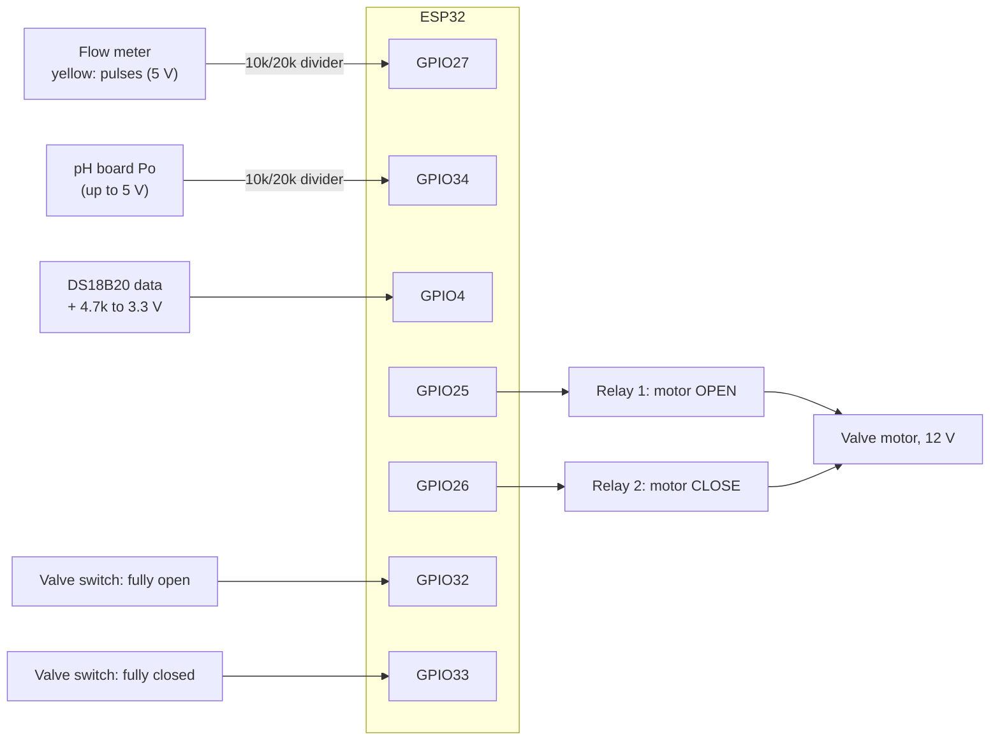

# Home node: parts and wiring

Firmware: `firmware/src/home`. Pins: `firmware/include/config.h`.

## Parts (about USD 45 per home)

| Part | Example | About |
|---|---|---|
| ESP32 board | ESP32 DevKit v1 (ESP32-WROOM-32) | 5 |
| Water flow meter | YF-S201 (1/2", 1 to 30 L/min, about 450 pulses per litre) | 4 |
| pH probe and board | PH-4502C board with an E-201-C probe | 15 |
| Temperature sensor | DS18B20, waterproof, with a 4.7 kΩ resistor | 2 |
| Motorised ball valve | 1/2", 12 V, 5 wires (two for the motor, three for "fully open/closed" switches) | 12 |
| 2-channel relay module | 5 V, with optocouplers | 2 |
| Power | 12 V 2 A adapter, and a 12 V to 5 V buck converter for the ESP32 | 4 |
| Small parts | 10 kΩ and 20 kΩ resistors (two dividers), a box, wires | 1 |
| pH buffers | pH 4.00 and pH 7.00 calibration powder | 2 |

## Wiring

| From | To | Note |
|---|---|---|
| Flow meter red / black | 5 V / GND | |
| Flow meter yellow | GPIO27 through the divider (20 kΩ to GND, 10 kΩ from the sensor) | 5 V becomes 3.3 V |
| pH board V+ / G | 5 V / GND | |
| pH board Po | GPIO34 through the divider | `PH_DIVIDER 1.5` in config.h undoes the divider |
| DS18B20 red / black | 3.3 V / GND | |
| DS18B20 yellow | GPIO4, plus 4.7 kΩ to 3.3 V | |
| Relay module IN1 / IN2 | GPIO25 / GPIO26 | the firmware never switches both on |
| Relays | the valve's two motor wires and 12 V | wire them so relay 1 opens and relay 2 closes |
| Valve "open" / "closed" switches | GPIO32 / GPIO33, common to GND | LOW = there. A valve without them: set `VALVE_HAS_FEEDBACK 0` |
| Status LED | GPIO2 (on the board) | on = connected to the broker |

## First start

1. Flash it (see [README.md](README.md)) and open the serial monitor: `cd firmware && uvx --from platformio==6.1.18 pio device monitor`.
2. **Calibrate pH:** rinse the probe, put it in the pH 7.00 buffer, wait a minute, type `cal7`. Rinse, put it in pH 4.00, wait, type `cal4`. Type `info` to check. The values stay in flash.
3. **Check the meter:** run exactly 10 L into a bucket. `info` should show about 10 L more. If not, change `FLOW_PULSES_PER_LITRE` (pulses ÷ litres) and flash again.
