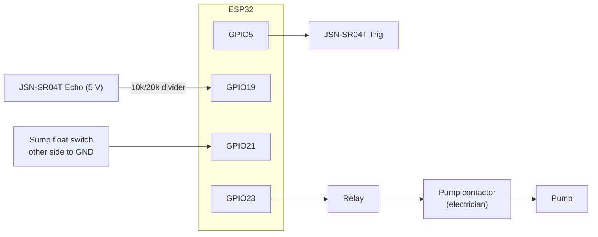

# Tank node: parts and wiring

Firmware: `firmware/src/tank`. Pins and tank size: `firmware/include/config.h`.

The tank node runs the pump **by itself** (FR-16). It follows the same rules as the simulator: pump on at or below the low threshold (25%), off at the high threshold (95%), never on with an empty sump (dry run), and never on at 98% or more (overflow). It keeps working when the internet or the server is down. The server can switch auto/manual mode, change the thresholds (kept in flash) and, in manual mode only, switch the pump.

## Parts (about USD 30 plus the pump contactor)

| Part | Example | About |
|---|---|---|
| ESP32 board | ESP32 DevKit v1 | 5 |
| Waterproof ultrasonic sensor | JSN-SR04T (25 cm to 4.5 m) | 8 |
| Sump float switch | vertical float switch, normally open | 3 |
| 1-channel relay module | 5 V, with optocoupler | 2 |
| Pump contactor | rated for your pump, coil voltage to match | 10 to 20 (electrician) |
| Power | 5 V 2 A adapter | 3 |
| Small parts | 10 kΩ and 20 kΩ resistors, a box, wires | 1 |

## Wiring

| From | To | Note |
|---|---|---|
| JSN-SR04T 5V / GND | 5 V / GND | |
| JSN-SR04T Trig | GPIO5 | |
| JSN-SR04T Echo | GPIO19 through the divider | 5 V becomes 3.3 V |
| Float switch | GPIO21 and GND | closed (LOW) = water in the sump |
| Relay module IN | GPIO23 | HIGH = pump on |

## Setting it up

1. Mount the sensor at the top of the tank, pointing straight down, at least 25 cm above the highest water level (its dead zone).
2. Measure from the sensor to the water when the tank is empty and when it is full. Put them in `TANK_EMPTY_CM` and `TANK_FULL_CM`, and the tank's size in `TANK_CAPACITY_L`.
3. Flash it and type `info` in the serial monitor: it shows the level, the pump, the mode and the sump.
4. **Test without the server:** unplug the internet. Let the level drop below 25%. The pump must start, and stop at 95%.
