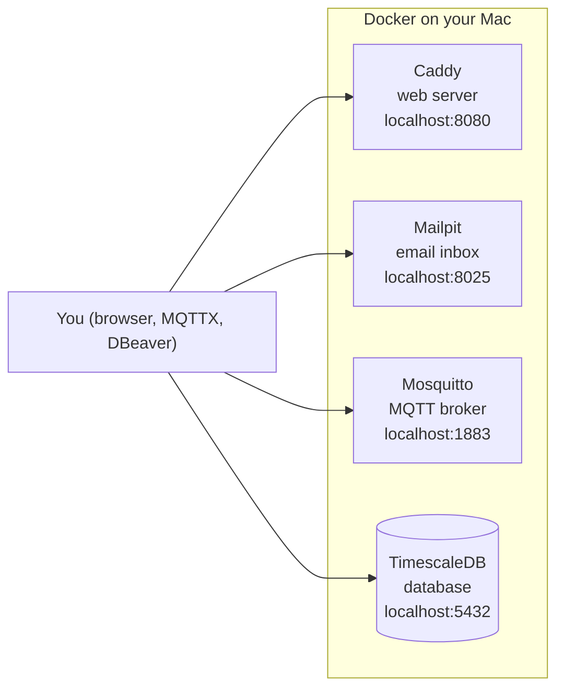

# M1: Infrastructure (Docker Compose)

> **Goal:** start the four base services of AquaPulse with **one command**, and prove each one really works.
> **Requirements covered:** no FR is finished yet; this is the foundation for FR-10 (MQTT contract) and FR-22 (storing readings). It measures NFR-17 (healthy again within 90 s after a restart) and NFR-29 (same images on Apple silicon and Intel/AMD).
> **Time:** about 30 minutes.

## What you will have at the end



| Service | Simple explanation | Why AquaPulse needs it |
|---|---|---|
| **Mosquitto** | A post office for small messages. Devices drop readings in; anyone subscribed gets a copy | Every home's meter talks to the server through it (M2 onwards) |
| **TimescaleDB** | PostgreSQL (a normal database) with an add-on that's very fast at time-stamped data | Stores users and bills, and millions of meter readings |
| **Mailpit** | A fake email inbox. Emails never leave your Mac | Shows alert and bill emails without a real email account |
| **Caddy** | A web server, the "front door" | Serves the web app and API later, and does HTTPS in M5 |

---

## Part 1: Get the M1 code

M1 is in a pull request on your repo. Merge it, then pull it to your Mac:

```bash
cd "/Users/niazi_127.0.0.1/Documents/Water Management System/aquapulse"
gh pr list                                  # find the M1 PR number
gh pr merge <NUMBER> --squash --delete-branch
git switch main
git pull
```

## Part 2: Start everything

Make sure the **Docker** app is running (whale icon in the menu bar). Then:

```bash
make up
```

What happens:

1. `make env` adds the new database settings to your private `.env`, including a **random database password** made just for your Mac.
2. Docker downloads the four images. The first time takes a few minutes; after that it's seconds.
3. Docker starts them and **waits until every health check passes**.

You'll see four lines ending in **Healthy**. Check any time with:

```bash
make ps
```

## Part 3: Prove it works

```bash
make smoke
```

Expected:

```text
  ✅ mqtt container is healthy
  ✅ db container is healthy
  ✅ mailpit container is healthy
  ✅ caddy container is healthy
  ✅ TimescaleDB 2.31.0: hypertable created, reading stored and read back
  ✅ Mosquitto: message published and received
  ✅ Mailpit: email sent and found in the inbox (http://localhost:8025)
  ✅ Caddy: status page served at http://localhost:8080

All M1 checks passed. 🎉
```

The smoke test does **real work**, not just "is it switched on". It creates a time-series table and stores a reading, sends an MQTT message and receives it, sends an email and finds it, and loads the web page. GitHub runs exactly the same test on every push (the new **Docker stack smoke test** job in CI).

## Part 4: Look around (this is your demo)

**1. Status page:** open http://localhost:8080. Caddy serves it.

**2. Email inbox:** open http://localhost:8025. You'll see the "AquaPulse smoke test" email(s).

**3. MQTT with MQTTX:**

1. Open **MQTTX** → **New Connection**. Name: `AquaPulse local`, Host: `localhost`, Port: `1883`. Leave the username and password empty. Click **Connect**.
2. Click **New Subscription**, topic `aquapulse/#`, then **Confirm**. (`#` means "everything under aquapulse/".)
3. At the bottom, set the topic to `aquapulse/test`, type `{"hello": "water"}` and press **Send**. The message appears in the list, because you're subscribed to it.
4. Watch it from Terminal too: run `make mqtt-watch`, send again in MQTTX, and the message prints in Terminal. Press Ctrl+C to stop.

**4. Database with DBeaver:**

1. Find your password: `grep POSTGRES_PASSWORD .env`
2. Open **DBeaver** → **New Database Connection** → **PostgreSQL**. Host `localhost`, Port `5432`, Database `aquapulse`, Username `aquapulse`, Password = the value from step 1. If it asks to download a driver, click **Download**. Then **Test Connection** → **Finish**.
3. Open an SQL editor and run:
   ```sql
   SELECT extname, extversion FROM pg_extension;
   ```
   You'll see `timescaledb`. Or use the terminal instead: `make psql`, then type `\dx` and `\q` to quit.

📸 **Screenshots for your portfolio:** `make smoke` all green, the status page, MQTTX showing your message, and Mailpit showing the email.

---

## How it works (in simple words)

**Docker image vs container.** An *image* is a ready-made box with a program inside (like an installer). A *container* is that box running. `docker-compose.yml` lists the four images, their settings, and how they connect.

**Pinned versions.** We write exact versions like `eclipse-mosquitto:2.1.2-alpine`, never `latest`. So your Mac, GitHub and anyone who clones the repo run the same thing. Dependabot now also watches these versions and opens a PR when an update exists.

**Health checks.** Each service has a small test Docker runs every 10 seconds. For example, the database answers `pg_isready`, and Mosquitto answers a subscribe. `make up` waits until all are healthy, so you never use a half-started system.

**Volumes (where data lives).** Containers can be deleted and recreated at any time, but `db-data`, `mqtt-data` and `caddy-data` are kept separately. `make down` stops everything **and keeps your data**. Only `make reset` deletes data, and it asks first.

**Ports on 127.0.0.1 only.** `"127.0.0.1:5432:5432"` means "only this Mac can connect". Someone on the same Wi-Fi cannot reach your database or broker.

**Why MQTT has no password yet.** To learn MQTT step by step, M1 to M4 use the simple `dev-insecure.conf`: plain MQTT with no login, and only on your Mac. **M5** replaces it with encrypted MQTT (TLS, port 8883), a password per device, and rules for which device may use which topic (SRS FR-11, FR-12). This is written in the config file itself, so nobody mistakes it for production settings.

**The random database password.** `.env.example` says `POSTGRES_PASSWORD=__GENERATE__`. `make env` turns that into a random 48-character password in *your* `.env`, which is never committed. If the password is missing, the stack refuses to start, instead of falling back to a weak default.

## New commands

| Command | What it does |
|---|---|
| `make up` | Start everything and wait until healthy |
| `make ps` | Show containers and their health |
| `make smoke` | Prove everything works |
| `make logs` | Live logs from all services (Ctrl+C to stop) |
| `make mqtt-watch` | Print every MQTT message under `aquapulse/` |
| `make psql` | SQL prompt inside the database |
| `make down` | Stop everything, keep data |
| `make reset` | Stop and **delete all data** (asks you to type `yes`) |
| `make env` | Add new settings from `.env.example` to `.env` (never changes existing values) |

## Files in this milestone

| File | Purpose |
|---|---|
| `docker-compose.yml` | The four services, their versions, ports, volumes and health checks |
| `infra/mosquitto/dev-insecure.conf` | Broker settings for learning (replaced in M5) |
| `infra/db/init/001-extensions.sql` | Turns on TimescaleDB on the first start |
| `infra/caddy/Caddyfile`, `infra/caddy/site/index.html` | Web server config and status page |
| `scripts/sync-env.sh` | Keeps `.env` up to date and generates secrets |
| `scripts/smoke-test.sh` | The end-to-end check |
| `.github/workflows/ci.yml` | New job: starts the stack on GitHub and runs the smoke test |
| `.github/dependabot.yml` | Now also watches Docker image versions |

## Done criteria

- [ ] `make up` → all four services **Healthy**
- [ ] `make smoke` → **All M1 checks passed**
- [ ] `make down && make up` works, and your data is still there
- [ ] You sent and received a message in MQTTX
- [ ] You connected to the database in DBeaver (or `make psql`)
- [ ] CI is green, including **Docker stack smoke test (M1)**

When all are ticked, reply **"OK, next"** for **M2: the digital twin**, ten virtual homes sending live water readings over MQTT. 🚰

## Troubleshooting

| Problem | Fix |
|---|---|
| `Cannot connect to the Docker daemon` | Open the Docker app and wait for "Engine running" |
| `POSTGRES_PASSWORD is missing` | Run `make env`, then `make up` |
| `port is already allocated` (5432, 1883, 8025 or 8080) | Another program uses that port. Find it with `lsof -i :5432`. Often it's a Homebrew PostgreSQL or Mosquitto service: `brew services stop postgresql` / `brew services stop mosquitto` |
| A service stays `unhealthy` | `make logs` shows why. Then `make down && make up` |
| `toomanyrequests` while downloading images | Docker Hub limits anonymous downloads. Wait a few minutes and run `make up` again, or sign in to a free Docker account in the Docker app |
| DBeaver: "password authentication failed" | Copy the password again from `.env`. If you changed it **after** the first start, the database still has the old one: `make reset` (deletes data) and `make up` |
| Want a completely fresh start | `make reset` then `make up` |
