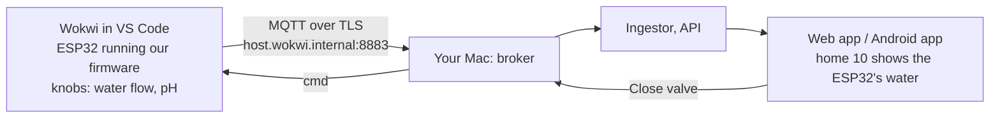

# M11: ESP32 firmware (part 1: the home node)

> **Goal:** real device code. The same messages the simulator sends now come from an ESP32, first in the free Wokwi simulator, later on a real board.
> **Requirements covered in part 1:** FR-15 (home-node firmware), FR-17 on the device (back-off, counter saved to flash, valve back to its last state after a power cut), and the firmware half of FR-09 (every firmware message is checked against the device contract).
> **Part 2** (at the end): the tank node with local pump control (FR-16), and the parts lists and wiring diagrams in [docs/hardware](../hardware). [Jump to part 2](#m11-part-2-the-tank-node).
> **Time:** about 10 minutes for the tests. About 30 minutes the first time for Wokwi, because PlatformIO downloads the ESP32 tools once.

## What you will have at the end



| Piece | Simple explanation |
|---|---|
| **ESP32** | A small, cheap Wi-Fi chip board (about USD 5). It is the "home node": it counts the water, reads pH and temperature, and opens or closes the valve |
| **PlatformIO** | A free tool that builds C++ code for boards like the ESP32. `platformio.ini` lists the board and the libraries, with exact versions |
| **Wokwi** | A free ESP32 simulator. It runs the **same firmware file** as a real board, with virtual parts (knobs, LEDs, a temperature sensor) |
| **`aquapulse_core`** | The device's rules in plain C++, with no Arduino code: the message formats, the command checks, saving the counter, the back-off. Because it is plain C++, your Mac runs its tests in a second |
| **`secrets.h`** | The Wi-Fi name, broker address, device password and CA certificate. It is git-ignored, so it never reaches GitHub. `make firmware-secrets` writes it for you |

### Three ideas worth understanding

**1. The rules are tested on your Mac, not only on the board.** Testing code on a real board is slow. So everything that is logic (does this command look expired? is this message valid?) lives in `firmware/lib/aquapulse_core`, and `make firmware-test` runs 132 checks on it. Then it prints one of every message the firmware sends, and the simulator's contract checker validates them. If the firmware and the contract disagree, the test fails.

**2. The device is careful with its flash memory and its counter.** Flash memory wears out if you write it too often. The litre counter is saved at most once a minute, or sooner after 10 L. A reboot then loses at most 10 L (FR-17). The server already handles a counter that continues after a reboot (FR-23), because each boot has a new `bootId`.

**3. The device checks commands itself.** A command that is expired, repeated, for the wrong kind of device, or has unknown fields is refused with an `ack` that says why. This is the same as the simulator, so the backend cannot tell them apart. That is the whole point of FR-09.

## Run the tests (no board needed)

```bash
cd "/Users/niazi_127.0.0.1/Documents/Water Management System/aquapulse"
git switch main && git pull
make firmware-test
```

You should see `132 checks, 0 failed` and `firmware messages: 6 kinds checked against the contract, 0 problems`.

## Run the firmware in Wokwi

1. **Give home 10 to the ESP32.** The simulator plays homes 1 to 10. Give device `home-b01-10` its own password, like a real device gets: log in to the web app as `owner@example.com` → **Devices** → `home-b01-10` → **New password**. Copy the password (it is shown only once). From now on the simulator's home 10 is refused by the broker, so only the ESP32 is home 10.
2. **Get the stack ready, write `secrets.h` and build:**
   ```bash
   make up                    # also gives the server certificate the name host.wokwi.internal
   make firmware-secrets PASSWORD='the-password-you-copied'
   make firmware-build        # first time: downloads the ESP32 tools (a few minutes)
   ```
   If the stack was already running before `make up` changed the certificate, run `make down && make up` once. The CA stays the same, so the APK and your browser keep working.
3. **Install the Wokwi extension in VS Code** (Extensions → search "Wokwi Simulator"). The first time, it asks you to get a free licence from the Wokwi website.
4. In VS Code, open the `aquapulse` folder. Press **F1**, choose **Wokwi: Select Config File**, and pick `firmware/wokwi/home-node/wokwi.toml`. Then press **F1** again and choose **Wokwi: Start Simulator**.
5. The serial monitor shows `MQTT: connected`. Turn the **water flow** knob. The ESP32 makes the meter's pulses itself, and the firmware counts them like a real meter.

### Try it

- **See its messages:** `make mqtt-watch` shows `aquapulse/v1/dev/home-b01-10/telemetry` about every 10 seconds, with `flowLpm` following the knob.
- **In the app:** log in as `owner@example.com` → **Homes** → unit 10. The live flow follows the knob.
- **Close the valve:** run `make valve-close DEVICE=home-b01-10`. The red LED (close motor) lights for 3 seconds, then the valve is "closed". The flow drops to 0 even with the knob turned up, and the app shows the valve closed.
- **Power cut:** stop the simulation and start it again. The serial monitor says `Restored: ... L, valve closed`, and the counter continues.
- **pH calibration:** type `cal7` in the serial monitor with the pH knob at the "pH 7 buffer" position, then `cal4` at the "pH 4 buffer" position. Type `info` to see the result.
- When you are done, `make sim-passwords` gives home 10 back to the simulator.

If the ESP32 cannot reach `host.wokwi.internal`, check that the stack is running (`make ps`) and that the extension is up to date. Wokwi's "Private IoT Gateway" is what makes this name reach your Mac. I could not run Wokwi in my own environment, so tell me what the serial monitor says if it fails.

## On a real ESP32 (optional)

```bash
make firmware-secrets DEVICE=home-b01-10 PASSWORD='...' HOST=<a name in the server certificate> WIFI="your Wi-Fi" WIFI_PASSWORD="..."
make firmware-upload
```

The password is the one shown once by **New password** (or by **Register** for a new device). The wiring diagram comes in part 2 (`docs/hardware`).

## What is different from the SRS (and why)

| SRS | Here | Why |
|---|---|---|
| `PubSubClient` library | `256dpi/MQTT` | PubSubClient cannot send QoS 1 messages, and the contract needs QoS 1 for status, state and acks |
| A custom Wokwi chip makes the flow pulses | The ESP32 makes them on GPIO18, wired to the flow pin | It works with no extra chip code, and the counting code is still the real interrupt code |
| Captive portal or `secrets.h` | `secrets.h` | The SRS allows either. `secrets.h` is simpler and is never committed |

## Done criteria (part 1)

- [ ] `make firmware-test` passes on your Mac.
- [ ] The CI job "ESP32 firmware" is green: the firmware builds with no warnings in our code.
- [ ] In Wokwi, the ESP32 connects and home 10 shows its flow in the app.
- [ ] `make valve-close DEVICE=home-b01-10` closes the Wokwi valve, and the app shows it.

---

# M11 part 2: the tank node

> **Requirements covered:** FR-16 (tank-node firmware with local automation), NFR-20 (the tank stays safe with the server down), and the hardware guide.
> **Time:** about 15 minutes in Wokwi.

## What is new

- **`firmware/src/tank`**: the tank node. It reads an ultrasonic level sensor once a second, keeps the median of the last 5 readings, and runs the pump itself with the same rules as the simulator: on at 25% or below, off at 95%, never with an empty sump, never at 98% or more. A lost echo does not move the level. Only 5 lost echoes in a row count as "sensor failed", and then the pump stops (the safe side).
- **Commands from the server:** auto/manual mode, new thresholds (kept in flash after a reboot, FR-16 AC3), and in manual mode a pump on/off. A pump command is refused with the same reasons as the simulator: `NOT_MANUAL_MODE`, `UNSAFE_DRY_RUN`, `UNSAFE_OVERFLOW`.
- **`firmware/src/common`**: what both nodes share (Wi-Fi, clock, TLS MQTT, command checks, acks). The home node now uses it too, so a fix there helps both.
- **[docs/hardware](../hardware)**: parts lists with rough prices, wiring tables and diagrams for both nodes, and safety notes.

## Run the tank node in Wokwi

1. Give the tank to the ESP32: web app as `owner@example.com` → **Devices** → `tank-b01-01` → **New password**. Copy it.
2. Write `secrets.h` and build:
   ```bash
   make firmware-secrets DEVICE=tank-b01-01 PASSWORD='the-password-you-copied'
   make firmware-build
   ```
3. VS Code: **F1** → **Wokwi: Select Config File** → `firmware/wokwi/tank-node/wokwi.toml`, then **F1** → **Wokwi: Start Simulator**.

### Try it

- **Automatic pump:** click the ultrasonic sensor and move its distance to 130 cm (about 16% full). The blue "pump relay" LED goes on. Move it to 30 cm (96%): the pump goes off. In between, it keeps doing what it was doing (that is the hysteresis).
- **Dry run:** slide the sump switch to the other side ("empty") while the pump runs. The pump stops at once, and the app's **Tank and pump** page says the sump is empty.
- **Without the server (FR-16 AC1, NFR-20):** run `make down`. The serial monitor shows the MQTT connection failing and backing off, but the pump still follows the level.
- **New thresholds:** `make up` again, then owner → **Tank and pump** → **Settings** → 30 and 80. Stop and start the simulation: `Restored: mode auto, thresholds 30/80%`.
- **Manual mode:** press **Switch to manual**, then **Start the pump**. Try it with the sump empty: the tank refuses (UNSAFE_DRY_RUN), and the pump stays off.
- When you are done, `make sim-passwords` gives the tank back to the simulator.

## Done criteria (part 2)

- [ ] `make firmware-test` shows 132 checks passing.
- [ ] The CI job builds all four firmwares (home and tank, real and Wokwi).
- [ ] In Wokwi, the pump follows the level, also with `make down`.
- [ ] Thresholds set in the app are still there after restarting the simulation.
