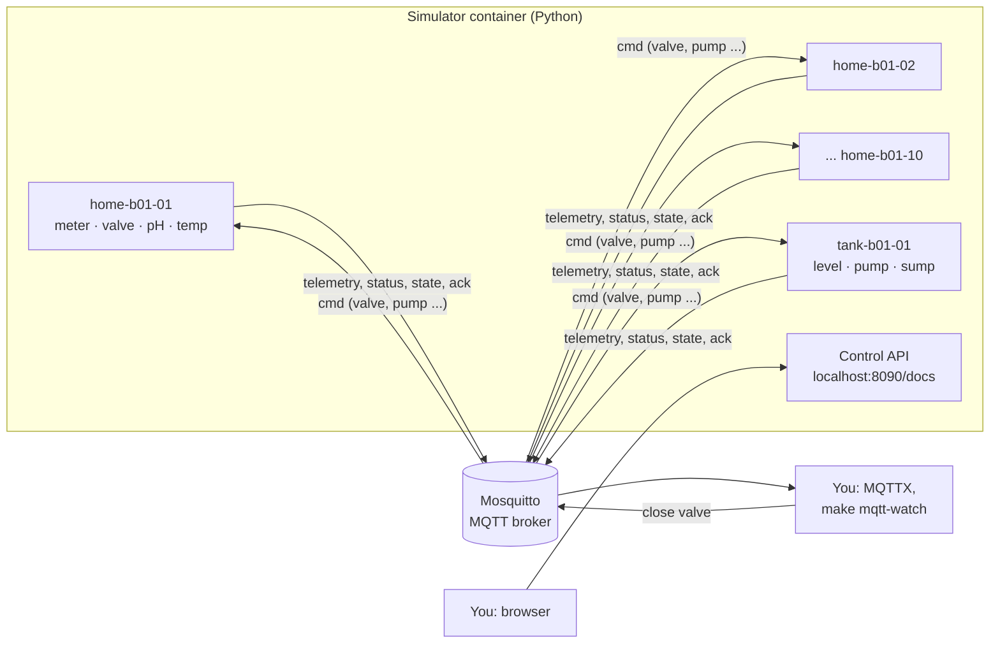

# M2: The digital twin (10 virtual homes + 1 tank)

> **Goal:** a virtual building that sends live water readings over MQTT, exactly like real ESP32 hardware will, so we can build the whole system before buying any hardware.
> **Requirements covered:** FR-01 (virtual devices), FR-02 (realistic water use), FR-03 (telemetry), FR-04 (valve commands), FR-05 (fault injection), FR-06 (online/offline), FR-07 (tank and pump), FR-09 (contract conformance), FR-10 (versioned contract), FR-17 (resilience, simulator part). Also NFR-20 (the tank protects itself with no server).
> **Time:** about 45 minutes.

## What you will have at the end



| Piece | Simple explanation |
|---|---|
| **Home node** (×10) | A pretend water meter + valve + water-quality sensor in each apartment. Every 10 s it reports: total litres so far, flow now, pH, temperature, valve position, Wi-Fi signal |
| **Tank node** (×1) | The overhead tank on the roof. It reports the water level and switches the pump by itself: ON below 25%, OFF above 95% |
| **Contract** (`/contracts`) | The "language" rules: which topics, which fields, which values. Real hardware will follow the same files |
| **Control API** | A small web page where you can inject problems: a leak, a burst pipe, bad water, a device going offline ... |

---

## Part 1: Get the M2 code

```bash
cd "/Users/niazi_127.0.0.1/Documents/Water Management System/aquapulse"
gh pr list                                  # find the M2 PR number
gh pr merge <NUMBER> --squash --delete-branch
git switch main
git pull
```

## Part 2: Start everything

Docker must be running (whale icon). Then:

```bash
make up
```

This time `make up` also **builds** our own simulator image the first time (2 to 3 minutes: it downloads Python and the packages listed in `simulator/uv.lock`). Then you'll see **five** services Healthy: the four from M1, plus `simulator`.

Prove it:

```bash
make smoke
```

Expected, at the end:

```text
  ✅ simulator container is healthy
  ...
  ✅ Simulator: 11 devices online (retained MQTT status)
  ✅ Simulator: telemetry received from all 11 devices (watch: make mqtt-watch)
  ✅ Simulator: control API answers at http://localhost:8090/docs

All checks passed. 🎉
```

## Part 3: Watch the building live (your demo)

### 3.1 In the Terminal

```bash
make mqtt-watch
```

Every 10 seconds each device prints a line. A home looks like this:

```text
aquapulse/v1/dev/home-b01-05/telemetry {"v":1,"ts":"2026-10-30T13:15:20.123Z","bootId":"5c4c...","seq":42,
  "totalL":128.734,"flowLpm":7.85,"ph":7.21,"tempC":24.6,"valve":"open","rssi":-61,"fw":"1.0.0","boot":false}
```

Read it like this: home 5 has used **128.7 litres** since its meter started, water is flowing **right now** at 7.85 litres per minute (someone is showering?), pH 7.21 and 24.6 °C are normal, and the valve is open.

💡 Most of the time `flowLpm` is **0**. That's normal: a home only uses water for a few minutes at a time. In the morning (06:00 to 09:00) and evening (18:00 to 22:00) you'll see much more flow. The building's clock is `DEMO_TIMEZONE` in `.env` (Asia/Karachi).

Press **Ctrl+C** to stop watching.

### 3.2 In MQTTX

1. Open your **AquaPulse local** connection from M1 and click **Connect**.
2. **New Subscription** → topic `aquapulse/v1/dev/#` → **Confirm**.
3. The message list fills up. Click a message to see it nicely formatted.

📸 Screenshot: MQTTX with messages from several homes and the tank.

### 3.3 Close a valve (remote water shut-off)

Back in Terminal (keep MQTTX open next to it):

```bash
make valve-close DEVICE=home-b01-03
```

```text
sent: {"v": 1, "cmdId": "8746ef82-...", "type": "valve", "action": "close", "expiresAt": "...30 s later...", "by": "owner", ...}
ack:  {"v": 1, "cmdId": "8746ef82-...", "result": "ok", "reason": null, "state": "closed", ...}
```

What happened, step by step (you can see each step in MQTTX):

1. A **command** was published on `aquapulse/v1/dev/home-b01-03/cmd`.
2. The home's **state** changed to `"valve":"moving"` (a motorised valve takes 2 to 5 seconds to turn).
3. The home sent an **ack** (acknowledgement) with `"result":"ok"` and the **same cmdId**, so the sender knows *its* command worked.
4. Every telemetry message from home 3 now shows `"valve":"closed"` and `"flowLpm":0`, and `totalL` stops growing.

Open it again: `make valve-open DEVICE=home-b01-03`

**Try it by hand in MQTTX** (this shows the safety rules). At the bottom of MQTTX set the topic to `aquapulse/v1/dev/home-b01-03/cmd`, QoS **1**, and send this payload:

```json
{"v":1,"cmdId":"11111111-2222-4333-8444-555555555555","type":"valve","action":"close","issuedAt":"2026-01-01T00:00:00Z","expiresAt":"2030-01-01T00:00:00Z","by":"owner"}
```

- First send: an ack with `"result":"ok"`.
- **Send the exact same message again:** `"result":"rejected","reason":"DUPLICATE"`. The device never acts twice on one command, even if the network delivers it twice.
- Change the last digit of `cmdId`, and change `expiresAt` to `"2020-01-01T00:00:00Z"`: `"reason":"EXPIRED"`. An old command that arrives late is ignored.
- Send `hello`: `"reason":"INVALID"`.

Then open the valve again: `make valve-open DEVICE=home-b01-03`.

### 3.4 Inject a leak (Swagger UI)

1. Open **http://localhost:8090/docs**. This is the simulator's control API, with buttons. (It's only reachable from your Mac.)
2. Click **POST /scenarios** → **Try it out**. Put this in the box and click **Execute**:
   ```json
   {"type": "leak", "device": "home-b01-07", "minutes": 120}
   ```
3. The answer shows the leak's strength, e.g. `"params": {"lpm": 1.71}`.
4. In MQTTX, home 7's `flowLpm` **never drops to 0** any more, even at night. That pattern is exactly what the AI leak detector (M10) will learn to spot.
5. **GET /scenarios** lists every problem you injected with its exact start and end. That's the "ground truth" used to score the AI later.
6. To end it early: **DELETE /scenarios/{scenario_id}** with the id from step 3.

Shortcut from Terminal: `make leak DEVICE=home-b01-07`.

Other scenarios to try: `burst`, `ph_drift`, `temp_spike`, `sensor_stuck`, `valve_stuck`, `offline`, `reboot` (homes) and `tank_sensor_fail`, `sump_empty` (tank). **GET /scenario-types** explains each one.

### 3.5 See a device die and come back (Last Will)

In MQTTX, subscribe to `aquapulse/v1/dev/+/status`. In Swagger run **POST /scenarios** with:

```json
{"type": "offline", "device": "home-b01-04", "minutes": 1}
```

Home 4 "loses its Wi-Fi" without saying goodbye. The **broker itself** publishes `{"v":1,"state":"offline"}` for it. That's the **Last Will**: a message the device left with the broker when it connected, to be sent only if it disappears. One minute later, home 4 reconnects and publishes `"online"`.

### 3.6 The tank and pump

Look at `tank-b01-01` messages: `levelPct`, `pumpOn`, `mode`. It starts at 30% full, the homes use water, and when the level drops **below 25%** the pump switches **ON** (`"pumpOn":true`) and fills the tank at 60 L/min until it is **above 95%**.

Try the safety rules:

```bash
docker compose exec simulator aquapulse-sim send tank-b01-01 pump on
# → rejected NOT_MANUAL_MODE: in auto mode the tank decides
docker compose exec simulator aquapulse-sim send tank-b01-01 mode manual
docker compose exec simulator aquapulse-sim send tank-b01-01 pump on
# → ok (unless the tank is almost full: UNSAFE_OVERFLOW)
```

Now in Swagger inject `{"type": "sump_empty", "device": "tank-b01-01", "minutes": 5}`: the pump is forced OFF and `"dryRunProtect":true` (a pump running without water burns out). Put it back:

```bash
docker compose exec simulator aquapulse-sim send tank-b01-01 mode auto
```

### 3.7 Realistic water use

```bash
make sim-profile
```

```text
device         people    L/day   L/person/day
home-b01-01         3      370          123.4
home-b01-05         5      633          126.6
home-b01-06         1      133          133.0
...
Whole building, average litres per hour of the day:
  03:00       1
  07:00     355 ########################################
  13:00      92 ##########
  19:00     424 ################################################
```

Each person uses 100 to 150 L per day, with morning and evening peaks and quiet nights. Weekends use about 17% more.

📸 Screenshots for your portfolio: MQTTX with live data, the valve ack, Swagger with a leak scenario, and `make sim-profile`.

---

## How it works (in simple words)

**Water use is made of "events".** A day is a list of events: a 6-minute shower at 7.5 L/min, a toilet flush, a tap for 30 seconds, the washing machine ... Each event gets a random start time, but morning and evening hours are much more likely (`HOURLY_WEIGHTS` in `simulator/src/aquapulse_sim/profile.py`). Events are added until the home reaches its daily amount: people × 105 to 140 L, plus 17% on weekends. The flow at any moment is the sum of the events running at that moment.

**The seed.** The randomness comes from a *seed* (`SIM_SEED=42`). Same seed → exactly the same showers at exactly the same times. That makes demos and tests repeatable. Change the seed and you get a different, but equally realistic, building.

**Cumulative counter.** A real water meter counts up forever, like a car's odometer. Each message sends the *total* (`totalL`), not "litres since last message". So if a message is lost, nothing is lost: the next message has the new total. That's why telemetry can use the cheapest MQTT delivery (QoS 0).

**One connection per device.** Each home has its *own* MQTT connection and client ID, just like 10 separate ESP32 boards. Stopping one doesn't affect the others.

**Retained messages.** `status` and `state` are *retained*: the broker keeps the latest one per device and gives it immediately to anyone who subscribes later. So a dashboard opened at any time instantly knows who's online and which valves are closed.

**Last Will.** When a device connects, it leaves a "will" with the broker: "if I vanish, tell everyone I'm offline". A clean goodbye (like `make down`) doesn't trigger it; a sudden loss does. The broker notices within 45 s (1.5 × the 30 s keep-alive); a closed connection is noticed at once.

**Safe commands.** Every command has a unique `cmdId` and an `expiresAt` 30 s in the future. The device refuses duplicates and expired commands, and **always answers** with an ack. Only the ack proves the valve really moved. That's what the backend will rely on in M4.

**Tank control (hysteresis).** "ON below 25%, OFF above 95%, otherwise keep doing what you're doing." The gap stops the pump from flicking on and off around one level. Safety checks win over everything: no pump without water in the sump, none above 98%, and none after 5 failed level readings. This logic runs **inside the tank node**, so the tank is safe even when the server is down (NFR-20).

**Flash memory and reboots.** A real ESP32 saves its litre counter to flash every 10 L or 60 s (flash wears out if written constantly). After a reboot it continues from the saved value: at most 10 L are lost. The simulator does the same in the `sim-data` Docker volume, so counters also survive `make down` / `make up`. A reboot also creates a new `bootId` and sends `"boot":true` with `seq` 0, so the server knows.

**Reconnecting.** If the broker disappears, every device retries after 1, 2, 4, 8 ... up to 60 seconds, with a little random "jitter" so 500 devices don't all knock at the same millisecond. Our live test restarts the broker and checks everyone is back within 90 s (FR-17).

**The contract is checked before sending.** Every message is validated against the JSON Schemas in `/contracts` *before* it goes out. If the simulator ever produced a wrong field, the tests would fail at once instead of the backend receiving bad data later.

**Tests.** `make sim-test` runs 91 unit tests in under a minute, with a fake clock: a simulated week takes seconds. `make sim-test-live` runs 7 tests against the real broker: 11 devices online, contract on the wire, 2-second interval timing, valve close with ack, Last Will, stop one device, and the broker restart. GitHub runs both on every push (new CI jobs **Simulator lint + unit tests** and **Docker stack smoke + live MQTT tests**).

Each test file is named after its requirement, e.g. `simulator/tests/test_valve_command_handling.py` is FR-04, matching the traceability table in the SRS.

## New commands

| Command | What it does |
|---|---|
| `make mqtt-watch` | Watch every message (from M1, now with real data) |
| `make sim-logs` | The simulator's log: connects, disconnects, scenarios |
| `make sim-profile` | A week of water use per home, with an hourly bar chart |
| `make valve-close DEVICE=home-b01-03` | Close a valve over MQTT and print the ack |
| `make valve-open DEVICE=home-b01-03` | Open it again |
| `make leak DEVICE=home-b01-07` | Start a 2-hour leak |
| `make sim-test` | Simulator unit tests (needs `uv`, no Docker) |
| `make sim-test-live` | Live tests against the running stack |
| `make test` | All unit tests (more each milestone) |
| `docker compose exec simulator aquapulse-sim --help` | Every simulator command |

## Settings (`.env`)

`make up` adds these to your `.env` automatically. Change one, then run `make up` again.

| Setting | Default | Meaning |
|---|---|---|
| `SIM_HOMES` | 10 | Number of virtual homes (1 to 500) |
| `SIM_INTERVAL_S` | 10 | Seconds between messages |
| `SIM_SEED` | 42 | Same seed = same water use |
| `SIM_BUILDING` | b01 | Used in device IDs |
| `SIM_WEEKEND_DAYS` | sat,sun | For a Gulf building use `fri,sat` |
| `SIM_TANK_CAPACITY_L` | 5000 | Tank size |
| `SIM_TANK_START_PCT` | 30 | Level on the very first start |
| `SIM_PUMP_LPM` | 60 | Pump speed |

## Files in this milestone

| File | Purpose |
|---|---|
| `contracts/schemas/*.json` | The device contract: one JSON Schema per message type |
| `contracts/examples/` | Valid example messages (checked by tests) |
| `contracts/README.md` | The contract in plain words, all ack reasons |
| `simulator/src/aquapulse_sim/` | The simulator (code map in `simulator/README.md`) |
| `simulator/tests/` | 91 unit tests + 7 live tests, one file per requirement |
| `simulator/Dockerfile`, `simulator/pyproject.toml`, `simulator/uv.lock` | Image and exact package versions |
| `docker-compose.yml` | New `simulator` service and `sim-data` volume |
| `scripts/smoke-test.sh` | 3 new simulator checks |
| `.github/workflows/ci.yml` | New simulator job; the stack job now also runs the live tests |
| `.pre-commit-config.yaml` | Adds `ruff` (Python lint + format) |
| `.github/dependabot.yml` | Now also watches Python packages and the Python base image |
| `docs/SRS.md` | MQTT Explorer → MQTTX; tank message example and duplicate rule match the schemas |

## Done criteria

- [ ] `make up` → five services **Healthy**
- [ ] `make smoke` → **All checks passed**
- [ ] MQTTX shows messages from 10 homes and the tank
- [ ] `make valve-close` → ack `ok`, then `flowLpm` 0 in MQTTX; `make valve-open` brings it back
- [ ] The repeated command in MQTTX was rejected as `DUPLICATE`
- [ ] A leak from Swagger keeps that home's flow above 0
- [ ] CI is green, including the two new jobs

When all are ticked, reply **"OK, next"** for **M3: Backend core**: the FastAPI server with login, roles (owner, resident, admin), and an audit log.

## Troubleshooting

| Problem | Fix |
|---|---|
| `make up` fails while building the simulator with a network error | Check your internet and run `make up` again (it continues where it stopped) |
| `toomanyrequests` while downloading | Docker Hub limit: wait a few minutes, or sign in to a free Docker account in the Docker app |
| `simulator` stays `unhealthy` | `make sim-logs`. Usually the broker is not healthy yet: `make ps`, then `make up` again |
| `port is already allocated` for 8090 | Another program uses it: `lsof -i :8090` |
| `make valve-close` says "No ack within 15 s" | The device may be stopped or in an `offline` scenario: check **GET /devices** in Swagger |
| MQTTX shows nothing | Subscribe to `aquapulse/v1/dev/#` exactly, and check the connection is green (connected) |
| All `flowLpm` are 0 | Normal outside peak hours. Try `make leak`, or watch at 07:00 or 19:00 |
| `make sim-test` says `uv: command not found` | Run `uv tool update-shell` from M0 and open a new Terminal |
| Start counters from zero | `make reset` (deletes **all** data, asks first), then `make up` |
