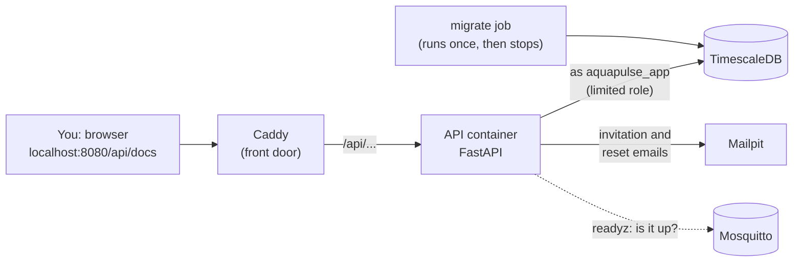

# M3: Backend core (login, roles, buildings, audit log)

> **Goal:** the server that every app will talk to. People can log in safely, each role sees only what it may see, owners manage their buildings and homes, residents join by invitation, and every important action is written to a log that cannot be changed.
> **Requirements covered:** FR-18 (login and sessions), FR-19 (roles and per-object access), FR-20 (buildings and homes), FR-21 (residents and occupancies), FR-28 (audit log), FR-29 (API docs), FR-31 (health and metrics), FR-68 (password security), FR-69 (token security), FR-72 (input checks and rate limits, API part). Also NFR-08 (crypto settings), NFR-09 (every endpoint in the role test), NFR-15 (no secrets in logs).
> **Time:** about 45 minutes.

## What you will have at the end



| Piece | Simple explanation |
|---|---|
| **API** | The "brain" the web and Android apps will talk to. It answers web requests like "log me in" or "list my homes" with JSON |
| **migrate** | A small job that runs before the API: it creates or updates the database tables, then stops. Every `make up` runs it; if nothing is new it does nothing |
| **Swagger UI** (`/api/docs`) | A web page listing every API endpoint, where you can try each one with a click |
| **Audit log** | A diary of important actions (who, what, when, from which IP). Entries can be added but never changed or deleted |

### Three ideas worth understanding

**1. Two tokens instead of one password.** When you log in you get two "tickets":
- an **access token** that works for **15 minutes**. Apps send it with every request. If it is stolen, it is useless soon.
- a **refresh token** that works for **7 days**, but only **once**: using it gives you a fresh pair. If a thief and the real user both try the same refresh token, the server sees it was used twice and **ends that whole login** for both (theft detection, FR-69).

The access token is a **JWT** signed with an **Ed25519** key (a modern, fast signature). The server only accepts that one algorithm, so old tricks like `"alg": "none"` fail. The database only stores a **hash** (a fingerprint) of each refresh token, so even a stolen database copy contains no usable tokens.

**2. Two locks on every door (FR-19).**
- Lock 1, the **role**: may an *owner* call "create building"? Yes. May a *resident*? No → **403 Forbidden**.
- Lock 2, the **object**: may *this* owner see *that* building? Only if it is theirs. If not, the answer is **404 Not found**, exactly as if it did not exist, so a curious resident who changes an ID in the URL learns nothing.

A test calls **every** endpoint with **every** role (69 combinations, plus every endpoint without logging in) and compares the result with the permission table in the SRS. A new endpoint that is missing from that table makes CI fail.

**3. A diary that cannot be rewritten (FR-28).** Each audit entry stores a SHA-256 fingerprint of itself **plus the fingerprint of the entry before it**, a "hash chain". Change one old entry and every fingerprint after it stops matching. On top of that:
- the API logs into the database as `aquapulse_app`, a role that may only **add** and **read** audit entries, never change or delete them;
- a database trigger refuses changes even from the main database user.

Passwords are stored with **Argon2id**, the current best practice: slow and memory-hungry on purpose (19 MiB, 2 passes), so guessing passwords from a stolen database is very expensive.

---

## Part 1: Get the M3 code

```bash
cd "/Users/niazi_127.0.0.1/Documents/Water Management System/aquapulse"
gh pr list                                  # find the M3 PR number
gh pr merge <NUMBER> --squash --delete-branch
git switch main
git pull
```

## Part 2: Start everything

```bash
make up
```

`make up` first adds 5 new settings to your `.env` (new random secrets, see [Settings](#settings-env)). Then it builds the backend image (2 to 3 minutes the first time) and you'll see `migrate` **Exited** (that is correct: it did its job and stopped) and `api` **Healthy**.

Create the demo accounts:

```bash
make seed
```

```text
Demo data created. Log in at http://localhost:8080/api/docs with:
  admin@example.com (System Admin), owner@example.com (Building Owner),
  resident01@example.com ... resident10@example.com (Residents)
  password: the DEMO_PASSWORD value in your .env file
```

See your demo password with `grep DEMO_PASSWORD .env`.

Prove everything works:

```bash
make smoke
```

Expected, at the end (17 checks in total now):

```text
  ✅ api container is healthy
  ...
  ✅ Database migrations applied (migrate job finished OK)
  ✅ API: ready through Caddy, database + broker reachable (http://localhost:8080/api/docs)
  ✅ API: owner@example.com logged in and sees the demo building
  ✅ API: /metrics works inside Docker and is hidden from outside
  ✅ Audit log: the API's database role cannot delete history

All checks passed. 🎉
```

## Part 3: Try it (your demo)

### 3.1 Log in through Swagger

1. Open **http://localhost:8080/api/docs**.
2. Click **Authorize** (top right, padlock).
3. **username:** `owner@example.com`, **password:** your `DEMO_PASSWORD`. Leave the rest empty. Click **Authorize**, then **Close**.
4. Open **GET /api/v1/me** → **Try it out** → **Execute**. You see the owner, with one building ID.
5. Open **GET /api/v1/buildings** → Execute: "AquaPulse Demo Tower". Copy its `id`.
6. **GET /api/v1/buildings/{building_id}/homes** with that ID: 10 homes, units 01 to 10 (the same 10 homes the simulator plays; M4 connects them).

### 3.2 See the two locks in action

1. Click **Authorize** → **Logout**, and log in again as `resident01@example.com` (same password).
2. **GET /api/v1/me**: note the one `home_ids` entry. **GET /api/v1/homes/{home_id}** with it → 200, your home.
3. Now try **GET /api/v1/buildings** → **403** "Your role may not do this" (lock 1, the role).
4. Log in as the owner again, copy a *different* home's ID from step 3.1.6, log back in as `resident01` and ask for that home → **404 Not found** (lock 2, the object). The resident cannot even tell whether that home exists.

### 3.3 Invite a resident (real email in Mailpit)

1. As the owner, open **POST /api/v1/homes/{home_id}/invitations**. Use home 01's ID and the example body, but set `"is_billing_contact": false` (home 01 already has a billing contact; try `true` to see the **409**).
2. Open **http://localhost:8025**: the invitation email is there with a one-time code.
3. **POST /api/v1/auth/invitations/accept** with that code and a new password. You get tokens: the new resident is in. Try the same code again → **400**: it works once, and it expires after 48 hours anyway.

### 3.4 Wrong passwords and the rate limit

Log out of Swagger, then use **POST /api/v1/auth/login** with a wrong password 5 times → **401** "Wrong email or password" (the same message whether or not the email exists). The **6th** try → **429 Too Many Requests**, even with the right password. It unlocks after about 15 minutes, and every extra try while locked makes the wait longer. (Restarting the API also clears it: `docker compose restart api`.)

### 3.5 Read and check the audit log

1. Log in as `admin@example.com`. **GET /api/v1/admin/audit**: every login, failed login, invitation and change you just made, newest first, with time, who, IP and details.
2. **POST /api/v1/admin/audit/verify** → `{"ok": true, "first_broken_id": null}`: every fingerprint in the chain matches.
3. Owners see only their own buildings' entries: **GET /api/v1/buildings/{building_id}/audit**.

Want to see the protection yourself? `make psql`, then:

```sql
SET ROLE aquapulse_app;
DELETE FROM audit_log;   -- ERROR: permission denied for table audit_log
\q
```

### 3.6 Look at the tables (optional)

In DBeaver (from M1), refresh the `aquapulse` database: the new tables are `users`, `buildings`, `homes`, `occupancies`, `invitations`, `password_resets`, `refresh_tokens`, `audit_log` and `currencies` (the 11 currencies, KWD/BHD/OMR with 3 decimals). The `password_hash` column starts with `$argon2id$`; there are no plain passwords anywhere.

### 3.7 Run the tests

```bash
make api-test
```

About 213 tests run against a separate test database (`aquapulse_test`, created and thrown away by the tests, so your demo data is safe). At the end: coverage above 80% (CI fails below that).

## How it works (in simple words)

1. **Caddy** receives `http://localhost:8080/api/...` and forwards it to the API container. Anything else (the status page) Caddy serves itself. `/metrics` is never forwarded, so it stays private (FR-31).
2. **FastAPI** checks the request body first: wrong types, too-long text or **unknown fields** are refused with **422** (FR-72). Nobody can sneak in `"role": "sysadmin"`.
3. The **token check** reads the JWT, verifies the Ed25519 signature, the expiry, issuer and audience, and that the login session was not ended (logout works at once, not 15 minutes later).
4. The **role check**, then the **object check** (see the two locks above). Then a **rate limit**: 120 requests per minute per user.
5. The **endpoint** does its work with SQLAlchemy. All SQL uses parameters, so text like `x'); DROP TABLE homes; --` is stored as plain text (there is a test for exactly this).
6. Important actions call `audit.record(...)` in the **same database transaction**: either the change and its audit entry are both saved, or neither.

Code map: `backend/README.md`.

## New commands

| Command | What it does |
|---|---|
| `make seed` | Create the demo accounts, building and 10 homes (safe to run again) |
| `make api-logs` | The API's log (Ctrl+C to stop) |
| `make api-test` | API, security and migration tests (needs `make up`) |
| `make api-lint` | Check the backend code style |
| `make migrate` | Apply database migrations now (`make up` does it too) |
| `make openapi` | Regenerate `backend/openapi.json` after an API change |
| `make test` | Simulator + API tests |

### Bruno (optional, free)

`backend/bruno/` is a small collection for **Bruno**, a free open-source API client (`brew install --cask bruno`). Open the folder in Bruno, pick the **Local** environment, put your `DEMO_PASSWORD` into `demoPassword`, and run the requests in order: log in, who am I, buildings, homes, audit, refresh, log out. The login request saves the tokens for the others.

## Settings (`.env`)

`make up` adds these automatically, with fresh random values:

| Setting | Meaning |
|---|---|
| `APP_DB_PASSWORD` | Password of the API's limited database role `aquapulse_app` |
| `JWT_SECRET` | The key that signs login tokens is made from this. Changing it logs everyone out |
| `JWT_PREVIOUS_SECRETS` | To change the key **without** logging everyone out: move the old `JWT_SECRET` here, set a new one, `make up`. Old tokens keep working until they expire (FR-69 key rotation) |
| `DEMO_PASSWORD` | Password of all demo accounts from `make seed` |
| `PUBLIC_URL` | Start of the links inside emails |

## Files in this milestone

| File | Purpose |
|---|---|
| `backend/app/` | The API (code map in `backend/README.md`) |
| `backend/migrations/` | Alembic migrations: versioned database changes |
| `backend/tests/` | Tests, one file per requirement (see the SRS traceability table) |
| `backend/openapi.json` | The API description, committed so API changes show up in pull requests |
| `backend/bruno/` | Bruno request collection (FR-29) |
| `backend/Dockerfile`, `pyproject.toml`, `uv.lock` | Image and exact package versions |
| `docker-compose.yml` | New `migrate` and `api` services |
| `infra/caddy/Caddyfile` | Forwards `/api/*` to the API, max 1 MB per request |
| `scripts/smoke-test.sh` | 6 new API checks |
| `.github/workflows/ci.yml` | New backend job (lint + tests + coverage), API checks in the stack job |
| `.github/dependabot.yml` | Watches backend packages; Python base images stay on 3.12 |
| `.env.example` | The 5 new settings |

## What is not here yet (on purpose)

- **Blocking a currency change once bills exist** (FR-20) needs bills, which arrive in **M6**; the test is added there.
- **Two-factor login** (FR-70) is **M8**; the login page and the reset/invite web pages are **M8** too. Until then, invitation and reset codes are used through Swagger.
- **HTTPS** and the full set of security headers are **M5**.

## Done criteria

- [ ] `make up` → `api` **Healthy**, `migrate` **Exited (0)**
- [ ] `make seed`, then `make smoke` → **All checks passed** (17)
- [ ] Swagger: logged in as the owner, saw the demo building and its 10 homes
- [ ] As `resident01`: own home 200, buildings 403, another home 404
- [ ] Invitation email arrived in Mailpit and the code worked once
- [ ] 6th wrong password → 429
- [ ] `POST /admin/audit/verify` → `ok: true`
- [ ] `make api-test` → all passed, coverage above 80%
- [ ] CI is green, including the new backend job

When all are ticked, reply **"OK, next"** for **M4: Live data and valve control**: the ingestor stores the simulator's readings in TimescaleDB, and owners and residents can open and close valves through the API.

## Troubleshooting

| Problem | Fix |
|---|---|
| `make up` says `APP_DB_PASSWORD is missing` | Run `make env` (or just `make up` again, it runs `make env` first) |
| `migrate` **Exited (1)** | `docker compose logs migrate`. Usually the database was not ready: run `make up` again |
| `api` stays `unhealthy` | `make api-logs`. If it says a setting is missing, run `make env` |
| `http://localhost:8080/api/docs` shows 404 or 502 | 502: the API is still starting, wait 10 s. 404: Caddy has the old config: `docker compose restart caddy` |
| Login says 401 with the right password | `make seed` uses `DEMO_PASSWORD` from the **first** time it ran. If you changed it later, `make reset`, `make up`, `make seed` |
| 429 Too Many Requests while testing | Wait 15 minutes, or `docker compose restart api` |
| Swagger calls say 401 after a while | The access token expired (15 min): **Authorize** → Logout → log in again |
| `make api-test` cannot connect to the database | Run `make up` first; the tests need the database container |
| `make api-test` says `uv: command not found` | Run `uv tool update-shell` from M0 and open a new Terminal |
