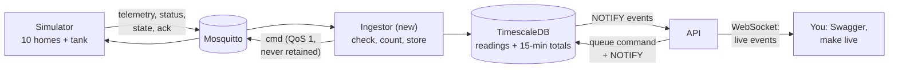

# M4: Live data and valve control

> **Goal:** the simulator's readings arrive in the database, checked and counted correctly; owners and residents see live data and water use, open and close valves, and the owner controls the tank and pump. Everything a user can do is confirmed by the device itself.
> **Requirements covered:** FR-08 (90-day demo history), FR-13 (safe command delivery), FR-22 (telemetry ingestion), FR-23 (consumption from the counter, in the building's time zone), FR-24 (valve commands and their life cycle), FR-25 (live WebSocket), FR-26 (tank and pump API), FR-27 (owner valve lock with a reason), FR-72 (MQTT part: every device message checked; 10 commands per minute).
> **Time:** about 45 minutes.

## What you will have at the end



| Piece | Simple explanation |
|---|---|
| **Ingestor** | A new container and the only server program that speaks MQTT. It checks every device message, stores readings, sends commands and records the device's answers |
| **Hypertables** | `telemetry` (homes) and `tank_readings` (tank): TimescaleDB tables cut into one-day pieces, so months of readings stay fast |
| **Continuous aggregate** | `consumption_15m`: litres per home per 15 minutes, kept up to date by TimescaleDB. Hours, days and months are added up from it in the building's time zone |
| **Command** | A row in `device_commands`: `queued` → `pending` (sent) → `succeeded` / `failed` / `rejected` / `timeout`. Only the device's answer (its "ack") can make it succeed |
| **WebSocket** | A connection that stays open, so the server can push events (new reading, valve moved, lock) the moment they happen |

### Four ideas worth understanding

**1. Litres come from the counter, not from the flow (FR-23).** Every home device reports `totalL`, a number that only goes up, like the dials on a water meter. Litres used = new total minus previous total. So if 10% of the messages are lost on the way, nothing is lost: the next message's difference covers the gap. A test drops 10% of a week of readings at random and every daily total stays within 0.5% (in fact, almost exact). Special cases:
- the same message twice, or an old one arriving late → 0 litres;
- after a power cut the device continues from the value saved in its "flash", a few litres lower → that lower value becomes the new starting point, nothing negative;
- a jump bigger than water can flow (over 200 L/min) → not trusted, new starting point.

**2. Every message is checked before it is stored (FR-22, FR-72).** In order: correct topic, a **registered and active** device, at most 2 KB, valid JSON, valid against the **same JSON Schema files** the simulator uses (`contracts/`), and a time within 10 minutes of the server clock. A repeated `(device, bootId, seq)` is stored once. Rejected messages are counted by reason in `ingest_rejected_total{reason}` and logged with the device ID and reason only, never the contents.

**3. A button press is a request, the device has the last word (FR-13, FR-24).** `POST /homes/{id}/valve` only saves a command as `queued` and answers **202 Accepted** at once. The ingestor sends it (QoS 1, never retained, valid for 30 s) and waits. The device answers `ok`, `rejected` (for example `BUSY`, `EXPIRED`) or `failed` (`VALVE_STUCK`). No answer in 15 s → `timeout`. Two quick presses are sent one after the other, so the last one wins. The app always shows the **valve state the device reported**, never just what someone asked for.

**4. The API and the ingestor talk through the database.** The API never connects to MQTT. When it queues a command it sends a PostgreSQL `NOTIFY`; the ingestor `LISTEN`s and sends the command at once. When the ingestor stores a reading or a command finishes, it `NOTIFY`s back, and the API pushes it to the WebSockets of the people allowed to see it. A NOTIFY is only delivered when its transaction is saved, so nobody ever sees data that was rolled back. No extra server needed (free, and one less thing to run).

---

## Part 1: Get the M4 code

```bash
cd "/Users/niazi_127.0.0.1/Documents/Water Management System/aquapulse"
gh pr list                                  # find the M4 PR number
gh pr merge <NUMBER> --squash --delete-branch
git switch main
git pull
```

## Part 2: Start everything

```bash
make up
```

This rebuilds the backend and simulator images (1 to 2 minutes), runs migration `0002` (new tables) and starts the new **ingestor** container. Caddy is recreated once, because its config is now mounted as a folder (the M3 fix, permanent now).

Add the tank and the 11 devices to your demo building (your accounts from M3 are kept):

```bash
make seed
```

```text
Added the water tank and 11 demo devices.
Demo accounts are already there.
```

Wait about 30 seconds so every device has sent a reading, then load **90 days of history** (FR-08):

```bash
make demo-data
```

The simulator replays the same 10 homes and the tank from 90 days ago until now, as fast as it can, and the backend loads every reading through **the same checks as live data**. It takes 1 to 3 minutes and ends like this:

```text
Demo history: 285120 readings stored over 91 days, 9 labelled events, 0 already there, ...
```

Run it again: `0 readings stored`, nothing doubled (it only fills the time *before* the first live reading).

Prove everything works:

```bash
make smoke
```

Expected, at the end (23 checks now):

```text
  ✅ ingestor container is healthy
  ...
  ✅ Ingestor: readings from all 11 devices stored in the last minute (make ingest-logs)
  ✅ Valve: unit 03 closed and opened again, confirmed by the device's ack
  ✅ Live stream: WebSocket delivered command and telemetry events (try: make live)
  ✅ Consumption: daily litres for all 10 homes (101234.5 L in the last 30 days)

All checks passed. 🎉
```

## Part 3: Try it (your demo)

Open **http://localhost:8080/api/docs** and **Authorize** as `owner@example.com` (password: `grep DEMO_PASSWORD .env`). Copy the building ID from **GET /api/v1/buildings** and a home ID from **GET /api/v1/buildings/{building_id}/homes** (unit 03 is a good one).

### 3.1 Live data and water use

1. **GET /api/v1/homes/{home_id}/live**: the newest reading (litres counter, flow, pH, temperature), `online: true` and `valve: "open"` as reported by the device.
2. **GET /api/v1/homes/{home_id}/consumption** with `granularity=day`: litres per day for the last 30 days. Try `month` with `from=2026-08-01`: three months. Days run midnight to midnight **in the building's time zone** (Asia/Karachi for the demo).
3. **GET /api/v1/buildings/{building_id}/consumption**: the whole building, plus the total of each home.
4. **GET /api/v1/homes/{home_id}/telemetry**: the raw readings of the last hour (at most 7 days per call).

### 3.2 Watch events live

In a second terminal:

```bash
make live
```

Every 10 seconds you see a `telemetry` event per home and a `tank` event. Leave it open for the next steps. `make live WHO=resident03@example.com` shows what resident 03 sees: **only home 03**, never the neighbours or the tank (FR-25).

### 3.3 Close and open a valve

1. **POST /api/v1/homes/{home_id}/valve** with `{"action": "close", "reason": "testing"}` → **202**, `"state": "queued"`. Copy the `id`.
2. In the `make live` window: a `command` event `pending`, then `succeeded` 2 to 5 seconds later (a motorised valve takes that long to turn).
3. **GET /api/v1/commands/{command_id}** → `succeeded`, `result_state: "closed"`. **GET .../live** → `valve: "closed"`, and the flow is 0.
4. Open it again with `"action": "open"`.

Want to see a failure? Make the valve motor "break" in the simulator, then try again: the command ends as `failed` with `VALVE_STUCK`, and the device reports `fault`:

```bash
docker compose exec simulator aquapulse-sim scenario valve_stuck home-b01-03 --minutes 5
```

Press **close** 11 times within a minute: the 11th gets **429** (FR-72).

### 3.4 Lock a valve (FR-27)

1. **POST /api/v1/homes/{home_id}/valve-lock** with `{"state": "closed", "reason": "Plumber is fixing the kitchen pipe"}` → **201**. The valve closes, and `resident03` gets an email: see **http://localhost:8025**.
2. Log in as `resident03@example.com` and try **POST .../valve** → **423 Locked**, with the reason. The owner gets 423 too: unlock first.
3. A reason shorter than 10 characters → **422**.
4. As the owner: **POST .../valve-unlock** with `{"reason": "Repair finished, pipe tested"}`. Every step is in the audit log (`valve.locked`, `device.command_requested`, `device.command_finished`, `valve.unlocked`).

### 3.5 Tank and pump (FR-26)

1. **GET /api/v1/buildings/{building_id}/tank**: level, pump on/off, mode, thresholds and the tank `id`.
2. **GET /api/v1/tanks/{tank_id}/history** with `from` and `to` (e.g. the last 7 days): the level over time, and **pump hours and energy (kWh) per day** (hours × pump kW, 0.75 kW unless you change it).
3. **PATCH /api/v1/tanks/{tank_id}/settings** with `{"low_pct": 30, "high_pct": 90}` → **202** with a `thresholds` command. When the device confirms, GET tank shows 30 and 90. Try `{"low_pct": 50, "high_pct": 55}` → **422** (at least 10 points apart).
4. **POST /api/v1/tanks/{tank_id}/pump** with `{"action": "on"}` while the tank is in `auto` mode → `rejected`, `NOT_MANUAL_MODE`. Switch to manual (`{"mode": "manual"}`), then try again. With the tank almost full you get `UNSAFE_OVERFLOW`: the device refuses to overflow. Set it back to `auto` when done.

### 3.6 Look at the data (optional)

In DBeaver: `telemetry` and `tank_readings` (millions of rows are fine), `device_commands` (every command and its outcome), `valve_locks`, and `device_events`: the 9 problems planted in the history (3 leaks, a burst, 2 pH drifts, a temperature spike, a reboot and an empty sump). They are the "answers" the leak detector will be scored against in M10.

### 3.7 Run the tests

```bash
make test
```

About 345 backend tests (plus the simulator's) with 97% coverage. They include a real WebSocket server with two residents who must never see each other's events, the ingestor against the real broker, and 25-hour days when the UK clocks go back.

## How it works (in simple words)

1. A device publishes `aquapulse/v1/dev/home-b01-03/telemetry`. The **ingestor** reads it from Mosquitto and puts it in a queue.
2. Every 100 ms (or every 500 messages) it checks the batch and stores it in **one transaction**: readings in the hypertables, `delta_l` (litres since the previous reading) worked out from the counter, the device marked online.
3. In the same transaction it **NOTIFYs** an event per reading. The **API** listens once for everybody, and forwards each event to the open WebSockets whose user may see it.
4. You press **close**: the API checks the role, the home, the lock and the rate limit, saves a `queued` command, audits it and NOTIFYs the ingestor.
5. The ingestor marks it `pending`, publishes it (QoS 1, not retained, expires in 30 s), and waits. The device answers on `.../ack`; the ingestor records the outcome, audits it, and NOTIFYs. The next queued command for that valve is sent only now.
6. Every second the ingestor also marks commands without an answer for 15 s as `timeout`.
7. TimescaleDB adds the litres up per 15 minutes in the background. A "day" is then added up from those blocks in the building's time zone, so DST days with 23 or 25 hours are correct. (15-minute blocks, not hours, because some time zones are 30 or 45 minutes off the hour.)

## New commands

| Command | What it does |
|---|---|
| `make demo-data` | Load 90 days of history (safe to run again). `make demo-data DAYS=30` for fewer |
| `make live` | Print live events like an app sees them (`WHO=resident03@example.com` for a resident) |
| `make ingest-logs` | The ingestor's log (Ctrl+C to stop) |

## New API endpoints

| Endpoint | Who | What |
|---|---|---|
| `GET /homes/{id}/live` | owner, resident | Latest reading, device-reported valve state, lock, running command |
| `GET /homes/{id}/telemetry` | owner, resident | Raw readings, max 7 days |
| `GET /homes/{id}/consumption` | owner, resident | Litres per hour, day or month (residents: only since they moved in) |
| `GET /buildings/{id}/consumption` | owner | Whole building, plus each home's total |
| `POST /homes/{id}/valve` | owner, resident | Open or close → command (202) |
| `GET /commands/{id}` | owner, resident | What became of a command |
| `POST /homes/{id}/valve-lock`, `/valve-unlock` | owner | Lock with a reason of 10+ characters |
| `GET /buildings/{id}/tank` | owner | Tank level, pump, confirmed settings |
| `GET /tanks/{id}/history` | owner | Level over time, pump hours and kWh per day |
| `PATCH /tanks/{id}/settings` | owner | Thresholds and mode (sent to the device), pump kW |
| `POST /tanks/{id}/pump` | owner | Pump on/off by hand (manual mode only) |
| `POST /ws-ticket`, `WS /ws?ticket=…` | everyone | A 30-second, one-time ticket, then the live stream |

## Files in this milestone

| File | Purpose |
|---|---|
| `backend/app/ingest/` | The ingestor: `counter.py` (litres), `handler.py` (checks and storage), `commands.py` (sending, timeouts), `service.py` (MQTT connection) |
| `backend/app/contract.py` | Reads the JSON Schemas in `contracts/` (shared with the simulator) |
| `backend/app/events.py` | LISTEN/NOTIFY between the ingestor and the API |
| `backend/app/control.py` | Queues commands, the 10-per-minute limit |
| `backend/app/routers/live.py`, `valves.py`, `tanks.py`, `stream.py` | The new endpoints |
| `backend/app/backfill.py`, `simulator/src/aquapulse_sim/backfill.py` | Demo history: made by the simulator, loaded by the backend |
| `backend/app/watch.py` | `make live` |
| `backend/migrations/versions/0002_...py` | Devices, readings (hypertables), 15-minute totals, commands, locks, events |
| `backend/tests/ingest/`, `backend/tests/api/test_*` | Tests for every M4 requirement |
| `contracts/schemas/ack.v1.json` | Small fix: a `BUSY` answer may report the valve as `moving` (a test found it was missing) |
| `docker-compose.yml` | New `ingestor` service; Caddy config mounted as a folder |
| `scripts/smoke-test.sh` | 5 new checks |

## What is not here yet (on purpose)

- **Shutting off water for unpaid bills** (FR-27 criterion 4) needs bills: **M6**. Until then no such shut-off exists at all.
- **Push notifications** for locks (FR-27 criterion 3) come with the Android app in **M9**; for now the resident gets an email and a live event.
- **Device passwords and TLS on MQTT** (FR-11, FR-12, FR-14) are **M5**, and with them registering, replacing and disabling devices through the API.
- **Reconnecting and reloading after a dropped WebSocket** (FR-25 criterion 4) is the apps' job: **M8** (web) and **M9** (Android). The server already closes slow or logged-out sockets with a clear code.
- **Leak detection** using the labelled history is **M10**.

## Done criteria

- [ ] `make up` → `ingestor` **Healthy**
- [ ] `make seed` added the tank and 11 devices; `make demo-data` loaded about 90 days; running it again stores 0
- [ ] `make smoke` → **All checks passed** (23)
- [ ] Swagger: daily and monthly consumption for a home, in the building's time zone
- [ ] Closed and opened a valve; saw `pending` then `succeeded` in `make live`
- [ ] Lock → resident gets 423 and an email; unlock works; short reason → 422
- [ ] Tank history shows pump hours and kWh; a manual pump `on` in auto mode is `rejected`
- [ ] `make test` → all passed
- [ ] CI is green

When all are ticked, reply **"OK, next"** for **M5: Security hardening**: TLS on MQTT and HTTPS, per-device passwords and access rules, and device registration through the API.

## Troubleshooting

| Problem | Fix |
|---|---|
| `ingestor` stays `unhealthy` | `make ingest-logs`. "reconnecting" means it cannot reach Mosquitto: `docker compose restart mqtt ingestor` |
| `make demo-data` says "No live data yet for: ..." | The devices had not sent a reading yet. Wait until `make smoke` passes, then run it again |
| Consumption shows 0 for old days | Run `make demo-data` again: it also refreshes the 15-minute totals |
| A valve command ends as `timeout` | The device is offline or stopped (see `http://localhost:8090/docs`, `GET /devices`), or the ingestor is down (`make ingest-logs`) |
| 423 Locked on every valve request | The valve is locked: see `lock` in `GET /homes/{id}/live`, then `valve-unlock` as the owner |
| 429 on valve commands | More than 10 commands in a minute. Wait a minute |
| `make live` stops with code 4401 | You logged out, or the account was disabled. 1013 means the connection fell behind or the server restarted: run it again |
