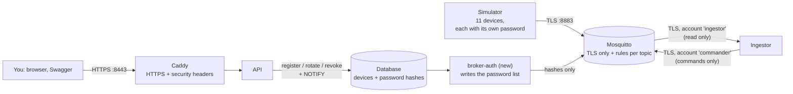

# M5: Secure MQTT and HTTPS

> **Goal:** nobody can listen in, pretend to be a device, or touch another home's data. All traffic is encrypted, every device has its own password, and each account can only use its own topics. The owner registers devices, replaces their passwords and switches them off through the API.
> **Requirements covered:** FR-11 (per-device passwords and topic rules), FR-12 (TLS-only broker), FR-14 (device registration, password rotation, revoke), FR-71 (HTTPS, security headers, CORS). Also NFR-07 (encryption in transit, TLS scan) and NFR-17 (healthy again within 90 s after a restart), plus the first threat-model review.
> **Time:** about 40 minutes.

## What you will have at the end



| Piece | Simple explanation |
|---|---|
| **Certificate (TLS)** | An ID card for a server. Your browser, the simulator and (later) the ESP32 check it, so they know they talk to the real broker or web server, and everything on the wire is encrypted |
| **Project CA** | Our own small "ID card office", made by `make certs`. Everyone is told to trust it. Its secret key stays in `infra/certs/ca/` and is **never** given to a container |
| **broker-auth** | A new small container. It writes the broker's password list (only *hashes*) from the database, and updates it within a second when a device is registered, gets a new password or is revoked |
| **ACL** | "Access control list": `infra/mosquitto/acl`. Device `home-b01-03` may only publish to `aquapulse/v1/dev/home-b01-03/...` and only read its own `cmd` topic |
| **Security headers** | Instructions Caddy adds to every page: only HTTPS (HSTS), only load scripts from this site (CSP), never show inside another site's frame |
| **CORS** | Which *other* websites may call the API from a browser. Only those in `CORS_ORIGINS` (later: your website) |

### Four ideas worth understanding

**1. Every account can do exactly one job (FR-11).** Nobody can log in without a password (no "anonymous"). The server has three accounts, each with its own password in `.env`:

| Account | May do | May not |
|---|---|---|
| `ingestor` | read telemetry, status, state, ack of all devices | send commands |
| `commander` | send commands (`cmd` topics) | read anything |
| `monitor` | read everything (health check, `make mqtt-watch`, tests) | publish anything |

Every device logs in with its **device ID as username** and may only use its own topics. Even subscribing to `#` ("everything") gives a device nothing but its own commands. So a stolen or hacked device can only lie about itself, and the owner can switch it off in one click.

**2. A password is shown once and never stored (FR-14).** When the owner registers a device, the API makes a 32-byte random password, stores only a **hash** of it (in the exact format Mosquitto uses), and shows the password **once**, together with a **QR code** that holds the full device settings. Lost it? You can't see it again: rotate it (make a new one). The tests search every table and every log line for the password and find nothing.

**3. Changes reach the broker in about a second, without a restart.** The API sends a `NOTIFY` (the same trick as M4) → broker-auth writes the new password list → the broker's start script sees it and tells Mosquitto to reload (`SIGHUP`) → Mosquitto checks every connected client again and **disconnects** the ones whose password is no longer valid. The smoke test measures it: about 1 s (FR-14 allows 10 s).

**4. Simulated devices get their password from one secret.** Typing 11 passwords into the simulator would be silly, so each virtual device's password is made from `SIM_DEVICE_SECRET` (in `.env`) and its device ID (HMAC-SHA256: the same input always gives the same password, but you cannot work backwards). The simulator and broker-auth both compute it. Real devices never use this: they get a random password when registered. On a server with only real devices you leave `SIM_DEVICE_SECRET` empty, and those accounts simply do not exist. The same rule makes `home-test-01`, an account only the automated tests use.

## Part 1: Get the M5 code

```bash
cd "/Users/niazi_127.0.0.1/Documents/Water Management System/aquapulse"
gh pr list                                  # find the M5 PR number
gh pr merge <NUMBER> --squash --delete-branch
git switch main
git pull
```

## Part 2: Start everything

```bash
make up
```

This now does three extra things before starting:

1. **`make env`** adds the new settings to your `.env` (three MQTT passwords, `SIM_DEVICE_SECRET` and a few others, all explained in `.env.example`) and changes `PUBLIC_URL` to `https://localhost:8443`. You will see lines like `+ added MQTT_INGESTOR_PASSWORD`.
2. **`make certs`** (only the first time) makes the project CA and the server certificate with your Homebrew OpenSSL 3:

   ```text
   Created the AquaPulse CA and server certificate in infra/certs
     CA fingerprint: 65:4C:75:...
   ```

3. Rebuilds the images, runs migration `0003` (password hashes; a home can now have old revoked devices plus one active one), starts the new **broker-auth** container and restarts Mosquitto in TLS mode.

Your data is kept. Your 11 demo devices have no password of their own yet, so they use their simulator password and reconnect by themselves within a few seconds.

Prove everything works:

```bash
make smoke
```

Expected (32 checks now; the new ones):

```text
  ✅ broker-auth container is healthy
  ...
  ✅ Mosquitto: message sent and received over TLS, with passwords
  ✅ Mosquitto: no password or a wrong password is refused
  ✅ Mosquitto: home-test-01 may not publish to home-b01-02's topic ("Warning: Publish 1 failed: Not authorized.")
  ✅ Mosquitto: plain port 1883 is closed, TLS port 8883 only
  ✅ Caddy: status page served over HTTPS at https://localhost:8443
  ✅ Caddy: http://localhost:8080 redirects to HTTPS
  ✅ Caddy: security headers (HSTS, CSP, nosniff, referrer, frame) are sent
  ...
  ✅ Devices: a newly registered device logged in after 0.6s (no broker restart)
  ✅ Devices: password rotated: old connection cut after 0.5s, old password refused, new one works
  ✅ Devices: revoked device disconnected after 1.0s and refused from then on

All checks passed. 🎉
```

Then the TLS scan (about 1 minute; it downloads the free **testssl.sh** scanner the first time):

```bash
make tls-check
```

```text
  ✅ Port 1883 (plain MQTT) is closed; only 8883 (TLS) is open
  ✅ mqtt:8883: TLS 1.3, certificate signed by the AquaPulse CA for 'mqtt'
  ✅ caddy:443: TLS 1.3, certificate signed by the AquaPulse CA for 'caddy'
  ✅ mqtt:8883: testssl.sh found no old protocols, weak ciphers or known attacks
  ✅ caddy:443: testssl.sh found no old protocols, weak ciphers or known attacks

TLS check passed. 🔒
```

## Part 3: Try it (your demo)

### 3.1 HTTPS in your browser

Open **https://localhost:8443**. Your browser warns "not private" because it does not know our CA yet. Two choices:

- **Recommended:** `make trust-ca` (asks for your Mac password once). Restart the browser: the padlock is there, no warning. Safari and Chrome use the Mac's keychain. Firefox: Settings → Privacy & Security → Certificates → turn on "Allow Firefox to trust third-party root certificate authorities". To undo: Keychain Access → System → "AquaPulse Local CA" → Delete.
- Or click "Show details → visit this website" each time.

Try **http://localhost:8080**: you land on https://localhost:8443 (FR-71 criterion 1). In the browser's developer tools (⌥⌘I → Network → click the page → Headers) you can see `strict-transport-security`, `content-security-policy` and the others.

Swagger is now at **https://localhost:8443/api/docs**. The Bruno collection (`backend/bruno`) points there too; in Bruno, Preferences → SSL/TLS → turn on "Use custom CA certificate" and choose `infra/certs/public/ca.crt`.

### 3.2 Look at TLS yourself (`openssl s_client`)

```bash
$(brew --prefix openssl@3)/bin/openssl s_client -connect localhost:8883 \
  -CAfile infra/certs/public/ca.crt -brief </dev/null
```

```text
CONNECTION ESTABLISHED
Protocol version: TLSv1.3
Ciphersuite: TLS_AES_256_GCM_SHA384
Verification: OK
```

`Verification: OK` means the broker's certificate was signed by our CA for the name `localhost`. Try it without `-CAfile ...`: verification fails, because nobody else vouches for our broker. That is why every client is given our CA.

### 3.3 Register a device (FR-14)

In Swagger, **Authorize** as `owner@example.com` (password `DEMO_PASSWORD` in `.env`).

1. `GET /api/v1/buildings` → copy the building `id`.
2. `POST /api/v1/buildings/{building_id}/homes` with `{"unit_no": "A-201", "occupants": 2}` → copy the new home's `id`.
3. `POST /api/v1/homes/{home_id}/device` → **201**:

   ```json
   {
     "device": {"id": "home-3f9a2c1d-01", "status": "active", "has_own_password": true, ...},
     "username": "home-3f9a2c1d-01",
     "password": "Xq3...43 characters...",
     "broker": {"host": "localhost", "port": 8883, "tls": true, "ca_sha256": "65:4C:75:..."},
     "config": {...},
     "qr_svg": "data:image/svg+xml,..."
   }
   ```

   Copy the whole `qr_svg` value into a new browser tab's address bar: that is the QR code an installer would scan (M11 firmware reads the same `config`). The password is shown **only now**.

4. Connect as the new device (replace `DEVICE` and `PASSWORD`). This runs the MQTT tools inside the broker container:

   ```bash
   docker compose exec mqtt mosquitto_pub -h localhost -p 8883 --cafile /mosquitto/certs/ca.crt \
     -u DEVICE -P 'PASSWORD' -t aquapulse/v1/dev/DEVICE/status -m '{"v":1,"state":"online"}'
   ```

   No output = accepted. It worked about a second after registering, without restarting anything.

### 3.4 Try to cheat (FR-11)

As the same device, publish to **another home's** topic:

```bash
docker compose exec mqtt mosquitto_pub -h localhost -p 8883 --cafile /mosquitto/certs/ca.crt \
  -u DEVICE -P 'PASSWORD' -V 5 -q 1 -t aquapulse/v1/dev/home-b01-02/telemetry -m fake
```

```text
Warning: Publish 1 failed: Not authorized.
```

Without a password, or with a wrong one:

```bash
docker compose exec mqtt mosquitto_pub -h localhost -p 8883 --cafile /mosquitto/certs/ca.crt -t x -m x
```

```text
Connection error: Connection Refused: not authorised
```

The broker's log shows every refused login: `make broker-logs` (look for `disconnected: not authorised`).

### 3.5 Rotate and revoke

- `POST /api/v1/devices/{device_id}/password` → a **new** password (and QR). Run the `mosquitto_pub` from 3.3 with the **old** password: `not authorised`. With the new one: accepted.
- `POST /api/v1/devices/{device_id}/revoke` → `"status": "revoked"`. Now even the newest password is refused, and a device still connected is thrown off. You may now register a replacement device for the same home.
- `GET /api/v1/buildings/{building_id}/devices` lists all devices; `has_own_password: false` marks the simulated ones.
- Everything is in the audit log: `device.registered`, `device.password_rotated`, `device.revoked` (never the password).

> Rotating or revoking one of the **simulated** devices (`home-b01-..`) locks the simulator out of it too. That is the point; to give it back its simulator password: `make sim-passwords`.

### 3.6 MQTTX on your Mac (optional)

New connection: Host `mqtts://localhost`, Port `8883`, Username `monitor`, Password = `MQTT_MONITOR_PASSWORD` from `.env`. Turn on **SSL/TLS**, choose **CA signed server certificate** → CA File `infra/certs/public/ca.crt`. Connect and subscribe to `aquapulse/#`: you see every device live. `monitor` can only read, so publishing from MQTTX is refused. Same thing in the terminal: `make mqtt-watch`.

### 3.7 Restart test and the tests

```bash
make restart-check    # restarts everything; must be healthy again within 90 s
make test             # simulator + backend tests (409 backend tests now)
make sim-test-live    # live MQTT tests, now over TLS with the monitor/commander accounts
```

## How it works (in simple words)

1. `make certs` → `infra/certs/` (git-ignored). `server/` (certificate + key) is mounted into Mosquitto and Caddy; `public/ca.crt` into everything that must *check* them (API, ingestor, simulator); `ca/ca.key` into nothing.
2. broker-auth starts first and writes `/broker-auth/passwd` (a Docker volume): three server accounts, every **active** device with its own hash, and the simulated devices.
3. Mosquitto starts through `infra/mosquitto/start.sh`, which copies the certificates, the ACL and the password list where only the `mosquitto` user can read them, starts the broker, and checks every second for a new password list (`SIGHUP` = reload).
4. The ingestor opens **two** TLS connections: `ingestor` reads, `commander` sends. A bug in the reading code can never send a command.
5. Caddy listens on 80 (only redirects, plus the health check) and 443 (HTTPS with our certificate, TLS 1.2 and 1.3, security headers). On your Mac they are 8080 and 8443.

## New commands

| Command | What it does |
|---|---|
| `make certs` | Makes the CA and server certificate (once; `make up` runs it). `./scripts/make-certs.sh --force` makes new ones (then `make up`) |
| `make trust-ca` | Lets your Mac's browsers trust `https://localhost:8443` |
| `make tls-check` | Port 1883 closed, TLS 1.3 + certificate check, testssl.sh scan |
| `make restart-check` | Restart everything, healthy again within 90 s (NFR-17) |
| `make devices` | List all devices: online, last seen, own password or not |
| `make sim-passwords` | Give the simulated devices back their simulator passwords |
| `make broker-logs` | Follow the broker and broker-auth logs |
| `make valve-close DEVICE=home-b01-03` | Now goes **through the API** (logged in as the demo owner), because only the server's `commander` account may send commands |

`aquapulse-sim send` is gone for the same reason. Pump and tank settings: Swagger.

## New API endpoints

| Endpoint | Who | What |
|---|---|---|
| `GET /buildings/{id}/devices` | Owner | All devices of the building, revoked ones too |
| `POST /homes/{id}/device` | Owner | Register a home device: ID, password (once), QR |
| `POST /tanks/{id}/device` | Owner | Register the tank device |
| `POST /devices/{id}/password` | Owner | New password; the old one stops working |
| `POST /devices/{id}/revoke` | Owner | Switch the device off for good |

System Admins cannot register or control devices (separation of duties). Every endpoint × role combination is tested in the RBAC matrix.

## Files in this milestone

| File | What it is |
|---|---|
| `scripts/make-certs.sh` | Makes the CA and server certificate (OpenSSL) |
| `infra/mosquitto/mosquitto.conf`, `acl`, `start.sh` | TLS-only broker, topic rules, reload on change. `dev-insecure.conf` is deleted |
| `infra/caddy/Caddyfile`, `site/style.css` | HTTPS, redirect, security headers (the page style moved to a file so the strict CSP allows it) |
| `backend/app/brokerauth.py` | The broker-auth service |
| `backend/app/security/mqtt_passwords.py` | Random passwords, Mosquitto-format hashes, simulator passwords |
| `backend/app/routers/devices.py` | Register, rotate, revoke, list |
| `backend/migrations/versions/0003_device_credentials.py` | Password hash, dates, one active device per home/tank |
| `backend/app/valve.py` | `make valve-close/open` through the API |
| `backend/tests/broker/` | Live tests against the real broker: ACL (FR-11) and TLS (FR-12) |
| `backend/tests/api/test_device_provisioning_and_credential_rotation.py`, `tests/test_broker_auth.py`, `tests/security/test_transport.py`, `tests/security/test_mqtt_passwords.py` | FR-14, broker-auth, CORS + "no client skips the certificate check", hashes |
| `scripts/tls-check.sh`, `scripts/restart-check.sh` | NFR-07 and NFR-17 |
| `docs/security/threat-model.md` | STRIDE review #1 |

## What is not here yet (on purpose)

- **Let's Encrypt** certificates and the real domain: **M12** (public demo). Caddy does it by itself once the site has a real name.
- **ESP32 firmware** that reads the QR config and checks the CA fingerprint: **M11**.
- **2FA** for owners and admins (T-05, T-25): **M8**.
- **Mozilla Observatory grade A** (FR-71 criterion 2) can only be measured on the public demo (**M12**); the headers it checks are already sent.

## Done criteria

- [ ] `make up` → `broker-auth` and `mqtt` **Healthy**; `make smoke` → **All checks passed** (32)
- [ ] `make tls-check` → **TLS check passed**
- [ ] `https://localhost:8443` opens (after `make trust-ca`: with a padlock); `http://localhost:8080` redirects
- [ ] `openssl s_client` shows TLSv1.3 and `Verification: OK`
- [ ] Registered a device, connected with its password, saw "Not authorized" on another home's topic
- [ ] Rotated (old password refused) and revoked (refused) it
- [ ] `make restart-check` passes; `make test` → all passed
- [ ] CI is green

When all are ticked, reply **"OK, next"** for **M6: Billing**: the owner's tariff slabs in the building's currency, monthly bills from the meter readings, Stripe test payments and manual payments.

## Troubleshooting

| Problem | Fix |
|---|---|
| `make certs` fails with an OpenSSL error | `brew install openssl@3`, then `make certs` again |
| `make up` stops at `mqtt` (unhealthy) | `make broker-logs`. "no password list from broker-auth" → `docker compose logs broker-auth`. Certificates missing → `make certs` |
| `simulator` stays unhealthy, log says "not authorised" | One of its devices got its own password in Swagger: `make sim-passwords`. If you changed `SIM_DEVICE_SECRET`: `docker compose up -d --force-recreate broker-auth simulator`. A **revoked** demo device stays off for good (that is what revoke means): `make reset` starts the demo from scratch |
| Browser: "Your connection is not private" | Expected until `make trust-ca` (see 3.1) |
| `make up` complains "MQTT_..._PASSWORD is missing" | Run `make env` |
| After `./scripts/make-certs.sh --force`, things fail TLS | Restart with the new certificates: `docker compose up -d --force-recreate` |
| `make tls-check` hangs at the first run | It is downloading the testssl.sh image (about 60 MB). Give it a minute |
