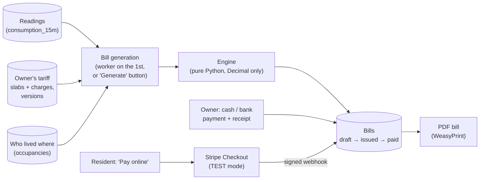

# M6: Billing and payments

> **Goal:** every month, each resident gets a correct water bill in the building's own currency, made from the real meter readings and the owner's own rates. It can be downloaded as a PDF and paid in cash, by bank transfer or (test mode only) by card through Stripe.
> **Requirements covered:** FR-32 (11 currencies), FR-33 (tariffs with versions), FR-34 (the calculation engine), FR-35 (monthly bills, people moving in and out), FR-36 (PDF bills), FR-37 (bill states, numbers, void), FR-39 (Stripe test mode), FR-40 (manual payments). Also FR-20 criterion 2 (a building's currency is locked once it has bills) and FR-27 criterion 4 (shutting off water for an unpaid bill only with the policy on and a 48-hour warning).
> **Time:** about 40 minutes (plus 15 minutes for the optional Stripe part).

## What you will have at the end



| Piece | Simple explanation |
|---|---|
| **Tariff** | The owner's price list: up to 10 **slabs** ("the first 5,000 L cost Rs 60 per 1,000 L, the next 10,000 L cost Rs 120 ...") plus optional **charges** (sewerage 10%, meter rent 50, sales tax 17%). There is **no fixed fee built in**: the owner decides everything |
| **Version** | Changing prices never edits the old tariff. The owner adds **version 2** with a start date. Old bills keep the prices they were made with |
| **Engine** | `app/billing/engine.py`: litres + tariff in, bill lines out. It never touches the database, so it is easy to test (100% of its code paths are tested) |
| **Worker** | A new small container. On the 1st of each month at 02:00 (in each building's own time zone) it makes last month's bills, and every minute it marks bills **overdue** after their due date |
| **Bill states** | `draft` (only the owner sees it) → `issued` (number, due date, email to the resident) → `partially_paid` / `paid`, or `overdue`. A wrong bill is **voided** with a reason, never deleted |
| **Stripe test mode** | Stripe's free sandbox: a real checkout page and real card form, but only test cards (`4242 4242 4242 4242`) and **never real money** |

### Five ideas worth understanding

**1. Money is never a float (FR-32).** In Python `0.1 + 0.2` is `0.30000000000000004`. That is fine for a water level, not for a bill. All money is `Decimal` in Python and `NUMERIC(14,3)` in the database. A test reads every billing file and fails if it finds a single `float`. Each currency has its own number of decimals: 2 for PKR, USD and the others, **3** for KWD, BHD and OMR (`KWD 4.375`). Each line is rounded half-up to the currency's decimals, and the total is the sum of the rounded lines, so the PDF always adds up.

**2. Slabs are "the next N litres" (FR-34).** With slabs 0-5,000 at 60 and 5,000-15,000 at 120 per 1,000 L, a home that used 11,384 L pays 5,000 × 0.060 = **300.00** plus 6,384 × 0.120 = **766.10**: total **Rs 1,066.10**. Then the charges: extra % (like sewerage) is a % of the water, a fixed charge is the same every month, and tax is a % of water + extras.

**3. People move in and out (FR-35).** If unit 03's tenant leaves on the 15th and a new one arrives on the 16th, each gets **their own bill** for their own days, with their own litres. The slab limits shrink to match: 15 of 30 days means the first slab is 0-2,500 L instead of 0-5,000 L, so nobody gets a cheaper (or dearer) rate just for a short stay. The same happens when a new tariff version starts in the middle of a month: the litres are split by date.

**4. Issued bills are history (FR-37).** Once issued, a bill never changes. Bill numbers are given at issue, one after the other per building and year (`B01-2026-000001`), with no gaps. A mistake is fixed by **voiding** (with a reason, in the audit log) and generating again: the new draft says which bill it replaces. The database account the API uses is not even allowed to `DELETE` a bill or a payment.

**5. A payment is only believed if Stripe signs it (FR-39).** "Pay online" opens Stripe's own page; card numbers never touch our server. When the payment succeeds, Stripe calls our **webhook** with a signed message. We check the signature with the webhook secret, and only then mark the bill paid. The same message arriving twice is recorded once. The browser's "payment done" page is just a thank-you page: it changes nothing.

## Part 1: Get the M6 code

```bash
cd "/Users/niazi_127.0.0.1/Documents/Water Management System/aquapulse"
gh pr list                                  # find the M6 PR number
gh pr merge <NUMBER> --squash --delete-branch
git switch main
git pull
brew install pango                          # draws the PDF bills when you run the tests on the Mac
```

Pango is free (part of GNOME). Inside Docker it is already installed in the image; Homebrew is only needed for `make test`, which runs the backend tests directly on your Mac.

## Part 2: Start everything

```bash
make up
make seed
make demo-data
```

1. `make up` rebuilds the images, runs migration **`0004`** (tariffs, bills, payments; every building gets a short code like `B01`) and starts the new **worker** container. Your data is kept. `make env` adds two empty settings, `STRIPE_SECRET_KEY` and `STRIPE_WEBHOOK_SECRET`; leave them empty for now.
2. `make seed` adds a demo tariff to "AquaPulse Demo Tower" (PKR) and a second demo building, **"AquaPulse Demo Gulf"** (KWD, Kuwait time, 3 homes), to show a 3-decimal currency. In unit 03, `gulf03a@example.com` moved out on the 15th of last month and `gulf03b@example.com` moved in on the 16th.
3. `make demo-data` now also loads 90 days of history for the Gulf homes (they have no live devices). About 1 extra minute.

Prove everything works:

```bash
make smoke
```

Expected (37 checks now; the new ones):

```text
  ✅ worker container is healthy
  ...
  ✅ Billing: last month's bill generated from the readings: 7,000 L = KWD 2.475 (3 decimals)
  ✅ Billing: issued as B03-2026-000001, due 2026-11-14
  ✅ Billing: PDF bill downloaded (21 KB)
  ✅ Billing: cash part payment -> partially paid; bank transfer of the rest -> paid

All checks passed. 🎉
```

The billing checks use their own building, **"Smoke Test Building"** (`B03`), so they never touch your demo bills. Each run adds one home there and archives it at the end.

## Part 3: Try it (your demo)

Below, "last month" is the month before today (September if you do this in October). The worker only makes bills by itself on the 1st, so today you start it by hand.

### 3.1 Make last month's bills

```bash
make bills
```

```text
B01 AquaPulse Demo Tower, September 2026: 10 new drafts, 0 recalculated, 0 already issued
B02 AquaPulse Demo Gulf, September 2026: 4 new drafts, 0 recalculated, 0 already issued
B03 Smoke Test Building, September 2026: 0 new drafts, 0 recalculated, 1 already issued
```

Run it again: `0 new drafts, 10 recalculated`. Drafts are simply made again from the latest readings; nothing is ever doubled. The Gulf building has **4** bills for 3 homes: unit 03 had two residents.

In Swagger (**https://localhost:8443/api/docs**), **Authorize** as `owner@example.com` (password `DEMO_PASSWORD` in `.env`), then:

1. `GET /api/v1/buildings` → copy both building `id`s.
2. `GET /api/v1/buildings/{building_id}/bills` for the Demo Tower → 10 drafts like `"total_text": "Rs 1,066.10"`.
3. `GET /api/v1/bills/{bill_id}` for one of them → the `lines`:

   ```json
   {"description": "Slab 1 (0-5,000 L)", "amount": "300.00"},
   {"description": "Slab 2 (5,000-15,000 L)", "amount": "766.10"}
   ```

### 3.2 The KWD building and the move-out

`GET /api/v1/buildings/{gulf_id}/bills` → the two unit 03 bills:

```text
Gulf resident 03A  2026-09-01 to 2026-09-15   7,816.785 L   KWD 3.716
Gulf resident 03B  2026-09-16 to 2026-09-30   7,855.088 L   KWD 3.750
```

Open one: `Slab 1 (0-2,500 L, 15/30 days) 0.625`, ..., `Sewerage (10% of water) 0.341`. Three decimals, slab limits halved for half a month. Your litres will be different (the demo data is random), the rules are the same.

### 3.3 Try the tariff calculator (no bill needed)

`POST /api/v1/tariffs/preview`:

```json
{
  "currency_code": "KWD",
  "litres": "7000",
  "slabs": [
    {"from_l": 0, "to_l": 5000, "rate_per_kl": "0.250"},
    {"from_l": 5000, "to_l": null, "rate_per_kl": "0.500"}
  ],
  "charges": [{"name": "Sewerage", "kind": "extra_percent", "value": "10"}]
}
```

→ `"total_text": "KWD 2.475"` (1.250 + 1.000 + 0.225). Try breaking the rules: a gap between slabs (`"from_l": 6000` in the second one), a last slab with an upper limit, a tax of `150`. Each answers **422** with the rule that was broken. Use `POST /api/v1/buildings/{id}/tariffs` with the same slabs plus `"name"` and `"effective_from"` to save a new version.

### 3.4 Issue, PDF, pay

1. `POST /api/v1/buildings/{tower_id}/bills/issue-all` with `{"month": "2026-09"}` → 10 bills get numbers `B01-2026-000001` ... and a due date 15 days away. Open **Mailpit** (http://localhost:8025): each resident got "Your water bill for September 2026 is ready".
2. `GET /api/v1/bills/{bill_id}/pdf` → **Download file**. One A4 page: who and where, the meter readings, each slab line, payments, and a 6-month usage chart.
3. `POST /api/v1/bills/{bill_id}/payments` with `{"amount": "500", "method": "cash"}` → bill `partially_paid`. Pay the rest with `"method": "bank"` → `paid`. Download the PDF again: it now says **PAID** and lists both payments.
4. Optional: attach a photo of a bank slip with `PUT /api/v1/payments/{payment_id}/receipt` (JPEG, PNG or PDF, at most 2 MB).
5. Made a mistake? `POST /api/v1/payments/{payment_id}/reverse` with a reason (at least 10 characters). The payment is kept but no longer counts, and the bill is unpaid again.

### 3.5 Void and generate again

On an **unpaid** issued bill: `POST /api/v1/bills/{bill_id}/void` with `{"reason": "Meter was read wrongly"}` → `void`. Then `make bills` again → `1 new drafts`, and the new draft has `"replaces_bill_id"` = the voided one. A bill with payments cannot be voided until they are reversed (409).

### 3.6 What a resident sees

Authorize as `resident01@example.com`:

- `GET /api/v1/me/bills` → only **their own issued** bills. Drafts are hidden until issued; neighbours' bills answer 404.
- `POST /api/v1/bills/{bill_id}/checkout` → **409 "Online payment is not set up on this server"** until you do Part 4. That is the honest answer: no fake "pay" button.

### 3.7 Overdue and the shut-off rule (FR-27)

When a due date passes, the worker marks the bill **overdue** within a minute (`make worker-logs`). Closing a home's water **because of** an unpaid bill (`POST /api/v1/homes/{id}/valve-lock` with a `bill_id`) is refused unless all of these are true:

1. the owner switched the policy on (`PATCH /api/v1/buildings/{id}` with `{"nonpayment_shutoff_enabled": true}`),
2. the bill is overdue,
3. the resident was warned (`POST /api/v1/bills/{bill_id}/shutoff-warning`, which emails them) **at least 48 hours** earlier.

Water is an essential service, so every refusal says which rule is missing. The tests go through the whole path; in your demo the bills are not overdue yet, so you will see "not overdue".

## Part 4 (optional): Stripe test mode

Stripe is free to use in test mode, but at the time of writing it does **not offer accounts to businesses in Pakistan**. Sign up only if Stripe lets you choose your country (or skip this part: manual payments always work, and the online-payment code is covered by tests that use a fake Stripe).

1. Make a free account at https://dashboard.stripe.com/register. Stay in **Test mode** (the toggle at the top).
2. Developers → API keys → copy the **Secret key** (`sk_test_...`) into `.env` as `STRIPE_SECRET_KEY`. A live key (`sk_live_...`) is **refused** on purpose.
3. Install the free Stripe CLI and log in:

   ```bash
   brew install stripe/stripe-cli/stripe
   stripe login
   stripe listen --forward-to https://localhost:8443/api/v1/webhooks/stripe --skip-verify
   ```

   It prints `Your webhook signing secret is whsec_...`. Put that in `.env` as `STRIPE_WEBHOOK_SECRET`, then `docker compose up -d api` (in another terminal; keep `stripe listen` running).
4. As `resident01@example.com`: `POST /api/v1/bills/{bill_id}/checkout` → copy the `url` into your browser. Pay with card `4242 4242 4242 4242`, any future date, any CVC.
5. You land on "Payment received". In the `stripe listen` window: `checkout.session.completed ... [200]`. `GET /api/v1/bills/{bill_id}` → `paid`, with a payment `"method": "stripe"`.

For a KWD bill Stripe charges up to 9 fils more (KWD 4.375 becomes 4.380), because Stripe only accepts 3-decimal amounts that end in 0. The amount Stripe will charge is in the checkout answer (`amount`), and the payment is recorded as charged.

## How it works (in simple words)

1. **Litres** come from the `consumption_15m` table you built in M4, between local midnights in the building's time zone (so a day is a day, even across a daylight-saving change).
2. **generate** (`app/billing/generate.py`) finds who lived in each home during the month (one bill per billing contact per stay), splits their days by tariff version, asks the engine for the lines and saves a **draft**. Bills already issued are left alone.
3. **issue** (`app/billing/lifecycle.py`) gives the next number from a counter row that is locked while it counts, sets the due date, emails the resident and tells the live stream (M4) so the app can update.
4. **PDF** (`app/billing/pdf.py` + `templates/bill.html`): an HTML page turned into a PDF by WeasyPrint. It is drawn when asked for, so it always shows the latest payments.
5. **Stripe** (`app/billing/stripe_pay.py`): our code talks to a small `PaymentProvider` interface. The tests plug in a fake one; the real one uses Stripe's official Python library.

## New commands

| Command | What it does |
|---|---|
| `make bills` | Make last month's draft bills for every building now (the worker does it on the 1st). `make bills MONTH=2026-08` for another month |
| `make worker-logs` | Follow the worker: monthly runs, bills marked overdue |

## New API endpoints

| Endpoint | Who | What |
|---|---|---|
| `GET/POST /buildings/{id}/tariffs`, `GET /tariffs/{id}` | Owner | List, add (a new version) and read tariffs |
| `POST /tariffs/preview` | Owner | Try slabs and charges on any number of litres |
| `POST /buildings/{id}/bills/generate` | Owner | Make or refresh one month's drafts |
| `GET /buildings/{id}/bills` | Owner | Bills of a month or a status |
| `POST /buildings/{id}/bills/issue-all` | Owner | Issue all drafts of a month |
| `GET /bills/{id}`, `GET /bills/{id}/pdf` | Owner, its resident | The bill and its PDF |
| `POST /bills/{id}/issue`, `/void` | Owner | One bill |
| `POST /bills/{id}/payments`, `POST /payments/{id}/reverse` | Owner | Cash, bank or other; undo with a reason |
| `PUT/GET /payments/{id}/receipt` | Owner (GET: also the resident) | Receipt photo or PDF |
| `POST /bills/{id}/shutoff-warning` | Owner | The 48-hour warning email |
| `GET /me/bills`, `POST /bills/{id}/checkout` | Resident | My bills, pay online (test mode) |
| `POST /webhooks/stripe` | Stripe | Only signed messages are accepted |

System Admins can read bills but not change them. Every endpoint × role combination is in the RBAC matrix test.

## Files in this milestone

| File | What it is |
|---|---|
| `backend/app/billing/money.py` | Rounding, formatting (`Rs 1,250.00`, `KWD 4.375`), Stripe amounts |
| `backend/app/billing/engine.py` | The calculation engine (FR-34) |
| `backend/app/billing/periods.py` | Months, days, who lived where, which tariff version on which day |
| `backend/app/billing/generate.py` | Monthly generation from readings (FR-35) |
| `backend/app/billing/lifecycle.py` | Issue, void, payments, overdue, shut-off rules (FR-37, FR-40, FR-27) |
| `backend/app/billing/pdf.py`, `templates/bill.html` | The PDF bill (FR-36) |
| `backend/app/billing/stripe_pay.py` | Stripe Checkout and webhook check (FR-39) |
| `backend/app/routers/tariffs.py`, `routers/bills.py` | The new endpoints |
| `backend/app/worker.py`, `app/bills.py` | The worker container and `make bills` |
| `backend/migrations/versions/0004_billing.py` | The new tables |
| `backend/tests/billing/` | 9 test files, one per requirement (88 tests, plus 45 engine cases), including property tests (Hypothesis) for the engine |
| `infra/caddy/site/pay/` | The "payment done" and "payment cancelled" pages |

## What is not here yet (on purpose)

- **Reminder emails** before and after the due date (FR-38): **M7**, with the alerts.
- **Screens** for all of this (the owner's billing page, the resident's "My bills"): the web app (**M8**) and the Android app (**M9**). Until then: Swagger.
- **Real money.** Never in this project: only Stripe **test** keys are accepted.

## Done criteria

- [ ] `make up` → `worker` **Healthy**; `make smoke` → **All checks passed**
- [ ] `make bills` made drafts for both demo buildings; the KWD bills show 3 decimals
- [ ] Unit 03 of the Gulf building has two bills, one per resident, each for its own days
- [ ] Issued the Demo Tower bills, saw the emails in Mailpit, downloaded a PDF
- [ ] Recorded a part payment and the rest; the PDF says PAID
- [ ] Voided an unpaid bill and generated its replacement
- [ ] `make test` → all passed
- [ ] CI is green
- [ ] (Optional) Paid a bill with the Stripe test card

When all are ticked, reply **"OK, next"** for **M7: Alerts**: rule-based alerts (leaks, low tank, water quality), bill reminders before and after the due date, and in-app and email notifications.

## Troubleshooting

| Problem | Fix |
|---|---|
| `make test` fails with `OSError: cannot load library 'libpango-1.0-0'` | `brew install pango`. If it still fails: `DYLD_FALLBACK_LIBRARY_PATH=/opt/homebrew/lib make test` (the Makefile already sets this) |
| `make bills` says `No tariff covers ...` | The building has no tariff for that month (in its currency). Add one in Swagger (`POST /buildings/{id}/tariffs`) with an `effective_from` on or before the month's first day |
| `make bills` says `... is not over yet` | Bills are only made for finished months |
| Every bill is `0.00` | No readings for that month: run `make demo-data` |
| `PATCH /buildings/{id}` says the currency `cannot change any more` | On purpose (FR-20): a building with bills keeps its currency. Make a new building for another currency |
| A new tariff answers 409 "already issued" | A new version may not start inside a month that already has issued bills. Pick a later `effective_from` |
| Checkout answers 409 "not set up" | Stripe keys are empty or not test keys, or `STRIPE_WEBHOOK_SECRET` is missing. See Part 4; then `docker compose up -d api` |
| Stripe payment done but the bill stays unpaid | `stripe listen` must be running and its `whsec_...` must be the one in `.env`. Look for `[400]` in its window (wrong secret) |
| The worker made no bills on the 1st | It runs from 02:00 building time until the 5th. `make worker-logs`; or just run `make bills` |
