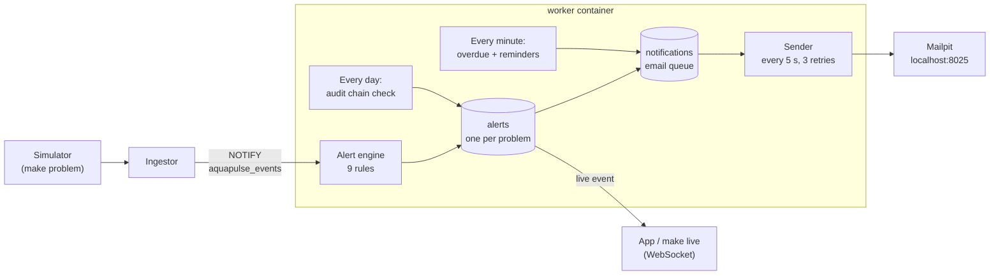

# M7: Alerts and notifications

> **Goal:** when something goes wrong with the water (unsafe pH, hot water, a quiet device, a low or overflowing tank, a stuck valve), the right people hear about it within a minute: in the app and by email. One problem is one alert, not hundreds. Residents also get bill reminders, and the System Admin can prove nobody secretly changed the audit log.
> **Requirements covered:** FR-38 (overdue bills and reminders, the unpaid list), FR-58 (rule engine), FR-59 (alert life cycle and de-duplication), FR-60 (in-app and email, with retries; push comes in M9), FR-62 (owner rule settings), FR-73 (tamper-evident audit chain).
> **Time:** about 30 minutes.

## What you will have at the end



| Piece | Simple explanation |
|---|---|
| **Rule** | One kind of problem, like "pH below 6.5 or above 8.5 for 5 readings in a row". There are 9 (table below). Each owner can switch them on or off and change the numbers for their building, within safe limits |
| **Alert** | One problem in one place, with a **severity** (info, warning, critical) and a **state**: `open` → `acknowledged` (someone has seen it) → `resolved` (someone closed it) or `auto_resolved` (the problem went away by itself) |
| **De-duplication key** | A name for the problem, like `ph_unsafe:home-b01-05`. While an alert with that key is open, new bad readings only update it (`seen_count` goes up). So a 2-hour problem is one alert and one email, not 720 |
| **Notification** | One email waiting to be sent. The worker sends them every 5 seconds. If the mail server says no, it tries again after 10 s, 30 s and 90 s, then marks it `failed` so the System Admin can see it |
| **Reminder** | An email about a bill: 3 days before the due date, on the due date, and 7 days after. Each is sent only once |
| **Audit chain** | Every audit entry carries a fingerprint (SHA-256 hash) of itself **plus the entry before it**. Change one old entry and its fingerprint no longer fits, and neither does the link to the next one. The worker checks the whole chain every day |

### The 9 rules (FR-58)

| Rule | Starts when (defaults) | Severity | Clears when |
|---|---|---|---|
| `ph_unsafe` | pH < 6.5 or > 8.5 for 5 readings in a row | critical | pH is back in range |
| `temp_abnormal` | water < 2 °C or > 35 °C for 5 readings | warning | temperature is back in range |
| `device_offline` | no message for 30 s, or the device's Last Will arrives | warning | the device talks again |
| `tank_low` | tank below 15 % | warning | level is back above 15 % |
| `tank_overflow` | tank above 98 %, or the pump still ON above the tank's high mark for 3 readings | critical | level and pump are fine |
| `dry_run` | the tank device stopped the pump because the sump is empty | critical | the device says the sump is OK |
| `high_usage` | after 18:00, today's litres > 150 % of the home's average day (last 30 days) | info | the next day starts |
| `command_failed` | a valve command ended as `failed` or `timeout` | warning | the next command on that valve works |
| `sensor_stuck` | pH and temperature exactly the same for 60 minutes | warning | the readings move again |

`high_usage` waits until a home has at least 7 days of history and uses 20 L or more on an average day, so a new or empty flat does not get silly alerts.

### Five ideas worth understanding

**1. "5 readings in a row" stops false alarms.** One odd reading is often just noise. The engine keeps a small counter per problem; one good reading resets it. A test runs 7 normal simulated days through every rule and expects no alerts at all (FR-58 criterion 2).

**2. The worker hears readings at once.** It does not ask the database every few seconds. The ingestor already shouts "new reading!" through PostgreSQL's `NOTIFY` (you built that in M4); the worker `LISTEN`s, so an alert appears about a second after the bad reading is stored. Rules that need time (a quiet device, high daily use) are checked every 10 seconds and every 5 minutes.

**3. Auto-resolve waits 10 minutes.** When the problem goes away, the alert remembers when (`cleared_at`) but stays open for 10 more minutes. If the problem comes back in that time, it is still the same alert. Only after 10 quiet minutes does it become `auto_resolved` (FR-59).

**4. Emails go through a queue.** The engine never sends an email itself. It writes a row in `notifications` in the **same** database transaction as the alert. If the mail server is down, nothing is lost: the sender tries again later. Each person chooses from which severity they want emails (`warning` by default, or `critical`, `info`, `off`), and each building chooses who gets which severity (by default: info to the owner, warning and critical to the owner and the home's residents).

**5. Who sees what.** A resident sees alerts about their own home, and only from the day they moved in. The owner sees everything in their buildings. A System Admin can read every alert, but only acknowledges or resolves **system** alerts (like a broken audit chain); building alerts belong to the owner.

## Part 1: Get the M7 code

```bash
cd "/Users/niazi_127.0.0.1/Documents/Water Management System/aquapulse"
gh pr list                                  # find the M7 PR number
gh pr merge <NUMBER> --squash --delete-branch
git switch main
git pull
```

## Part 2: Start everything

```bash
make up
make smoke
```

`make up` rebuilds the images and runs migration **`0005`** (tables `alerts`, `notifications`, `bill_reminders`, `audit_checks`). Your data is kept. The worker starts the alert engine; `make worker-logs` shows:

```text
worker-1  | INFO aquapulse.alerts alert engine listening for live events
worker-1  | INFO aquapulse.worker audit chain OK: 131 entries in 0.2 s
```

Expected from `make smoke` (41 checks now; the new ones, which take about 1.5 minutes):

```text
  (alerts: waiting up to 2 minutes for 5 hot readings in a row...)
  ✅ Alerts: hot water on unit 05 opened a warning alert 80 s after it started (47 °C)
  ✅ Alerts: email to the owner is in Mailpit (http://localhost:8025)
  ✅ Alerts: the owner acknowledged it, then resolved it
  ✅ Audit chain: all 154 entries checked, nothing changed (0.01 s)

All checks passed. 🎉
```

Why 80 s? The simulator warms the water slowly over one minute (like a real heater). It passes 35 °C after about 30 s, then the rule waits for 5 readings in a row (10 s apart). So the alert comes about 40 s after the water is really too hot, inside the 60 s the SRS asks for.

## Part 3: Try it (your demo)

### 3.1 Watch an alert happen

Open three things side by side:

1. A terminal with `make live WHO=resident03@example.com` (the live stream an app sees).
2. A terminal with `make worker-logs`.
3. Mailpit in the browser: **http://localhost:8025**.

In a fourth terminal:

```bash
make problem
```

This makes the water in **unit 03** about 25 °C hotter for 5 minutes. Within about 80 seconds:

- the worker log says `alert opened: warning temp_abnormal:home-b01-03`
- the live stream prints an `alert` event
- Mailpit has two emails, to `owner@example.com` and `resident03@example.com`: **[AquaPulse] Warning: Water temperature abnormal (unit 03, AquaPulse Demo Tower)**

Then see it in the database:

```bash
make alerts
```

```text
 severity | state | rule          | device      | opened              | seen | message
----------+-------+---------------+-------------+---------------------+------+---------------------------
 warning  | open  | temp_abnormal | home-b01-03 | 2026-11-02 10:15:05 |    9 | Water is 46.9 °C, too hot
```

Run `make alerts` again a minute later: `seen` goes up, but it is still **one** alert and no new email. After the 5 minutes the water cools down; 10 minutes later `make alerts` shows `auto_resolved`.

**A critical one:** `make problem TYPE=ph_drift MINUTES=30` slowly moves unit 03's pH. It takes about 12 minutes to pass 8.5 (or drop below 6.5): a slow drift, like real water. Then a **critical** `pH unsafe` alert opens and both people get an email.

**Other problems to try** (each needs `DEVICE=`):

| Command | Alert |
|---|---|
| `make problem TYPE=offline DEVICE=home-b01-04 MINUTES=2` | `device_offline` (warning) within about a minute (the broker first waits for the device's keep-alive to run out) |
| `make problem TYPE=sump_empty DEVICE=tank-b01-01 MINUTES=5` | `dry_run` (critical), the owner only (a tank belongs to no flat) |
| `make problem TYPE=sensor_stuck DEVICE=home-b01-06 MINUTES=70` | `sensor_stuck` after 60 minutes |
| `make problem TYPE=valve_stuck DEVICE=home-b01-03` then `make valve-close` | `command_failed` (warning) |

### 3.2 Acknowledge and resolve (Swagger)

In Swagger (**https://localhost:8443/api/docs**), **Authorize** as `resident03@example.com` (password `DEMO_PASSWORD` in `.env`):

1. `GET /api/v1/alerts` → the resident sees only unit 03's alerts. Copy the `id`.
2. `POST /api/v1/alerts/{alert_id}/acknowledge` → `"state": "acknowledged"`, with `acknowledged_by` and `acknowledged_at`. This is in the audit log.

Log out, then **Authorize** as `owner@example.com`:

3. `GET /api/v1/alerts?active=true` → every open alert in your buildings, newest first. Filters: `severity`, `building_id`, `home_id`.
4. `POST /api/v1/alerts/{alert_id}/resolve` with `{"note": "Heater fixed"}` → `"state": "resolved"`. Only owners resolve building alerts. If the water is still hot, the next reading opens a **new** alert (the old one stays closed, as history).

### 3.3 Change the rules for your building (FR-62)

As the owner:

1. `GET /api/v1/buildings` → copy the Demo Tower's `id`.
2. `GET /api/v1/buildings/{building_id}/alert-rules` → all 9 rules, their numbers, and the safe limits for each number (`"min"`, `"max"`).
3. `PATCH` the same address with only what you want to change:

```json
{
  "rules": {"temp_abnormal": {"high": 40}, "high_usage": {"enabled": false}},
  "recipients": {"warning": ["owner"]}
}
```

That means: hot water only above 40 °C, no high-usage alerts, and warnings go to the owner only (not residents). Unsafe values are refused with a clear message; try `{"rules": {"ph_unsafe": {"low": 8, "high": 7.8}}}` → 422 `'low' must be less than 'high'`. Every change is in the audit log (`alert_rules.changed`). The worker picks up the change within 10 seconds.

### 3.4 Choose your own emails

Anyone, for themselves: `GET /api/v1/me/notifications` → `{"alert_email_min": "warning"}`. `PATCH` it with `"critical"` (only the serious ones), `"info"` (everything) or `"off"` (no alert emails; alerts still show in the app).

### 3.5 Bill reminders and the unpaid list (FR-38)

The worker checks every minute (it already marked bills `overdue` in M6). Now it also emails each unpaid bill's resident:

| When | Subject |
|---|---|
| 3 days before the due date | Reminder: your water bill B01-2026-000001 is due on 2026-11-14 |
| on the due date | Your water bill B01-2026-000001 is due |
| 7 days after | Your water bill B01-2026-000001 is overdue |

Each is sent once (a table remembers it). A paid bill gets none. If you issued the demo bills in M6 with today's date, you will see the first reminder 3 days before their due date.

As the owner: `GET /api/v1/bills/unpaid` → every bill still to be paid, plus **totals per currency**, because Rs and KWD can't be added together. For example (your numbers will differ):

```json
"totals": [
  {"currency_code": "KWD", "bills": 4, "amount_text": "KWD 9.875"},
  {"currency_code": "PKR", "bills": 10, "amount_text": "Rs 10,566.40"}
]
```

Add `?building_id=...` for one building.

### 3.6 Catch someone changing the audit log (FR-73)

This shows why the chain matters. You will change one old audit entry **as the database superuser** (the API's own account is not allowed to), then let the system find it.

```bash
make psql
```

```sql
SELECT id, action, ip FROM audit_log ORDER BY id LIMIT 5;
-- pretend to be an attacker hiding where a login came from:
ALTER TABLE audit_log DISABLE TRIGGER audit_log_no_change;
UPDATE audit_log SET ip = '6.6.6.6' WHERE id = 5;
ALTER TABLE audit_log ENABLE TRIGGER audit_log_no_change;
\q
```

In Swagger, **Authorize** as `admin@example.com`, then `POST /api/v1/admin/audit/verify`:

```json
{"ok": false, "first_broken_id": 5, "entries": 5, "seconds": 0.004, ...}
```

At the same time a **critical** alert "Audit log changed" opens for System Admins, and Mailpit gets **[AquaPulse] Critical: Audit log changed (AquaPulse server)**. Owners and residents never see it.

Now put it back (in `make psql`, the same three lines with the old IP, usually `'127.0.0.1'`) and run `verify` again: `"ok": true`. The alert is marked as cleared; resolve it with `POST /api/v1/alerts/{id}/resolve`. `GET /api/v1/admin/audit/checks` lists every check (daily ones have `"requested_by": null`).

How fast? A test builds **100,000** entries and checks them all in about 5 seconds (the SRS asks for under 30).

### 3.7 When email fails (FR-60)

`GET /api/v1/admin/notifications` (as `admin@example.com`) lists emails that failed after 3 retries: who, when, how many tries and why (`"the mail server did not accept it"`), but not the email's text (that is personal). Try it: `docker compose stop mailpit`, run `make problem`, wait 3 minutes, look at the list, then `docker compose start mailpit`. `?status=sent` and `?status=pending` show the others.

## How it works (in simple words)

1. **detect** (`app/alerts/detect.py`) is pure Python with no database: a reading goes in, "problem X started" or "problem X stopped" signals come out. That makes every rule easy to test with the real simulator's data (`tests/alerts/twin.py`).
2. **store** (`app/alerts/store.py`) turns signals into alert rows: opens a new one, updates the open one, or marks it cleared. It locks the row while it works, so two signals can't open the same alert twice. A database rule (a partial unique index) also refuses a second open alert with the same key.
3. **engine** (`app/alerts/engine.py`) glues it together: `LISTEN` for live events, run them through the detector in small batches, and every 10 s check quiet devices, settings changes and auto-resolve.
4. **deliver** (`app/alerts/deliver.py`) takes up to 50 due emails at a time (oldest first) and sends them through the same SMTP code as M3. Two workers could never send the same email: the rows are locked with `SKIP LOCKED`.
5. **reminders** (`app/billing/reminders.py`) decides which reminder fits today for each unpaid bill, and records it so it is never sent twice.

## New commands

| Command | What it does |
|---|---|
| `make problem` | Make unit 03's water too hot for 5 minutes. `TYPE=`, `DEVICE=` and `MINUTES=` for other problems (table in 3.1) |
| `make alerts` | The newest 20 alerts, open ones first |
| `make worker-logs` | Now also shows alerts opened, emails sent and audit checks |

## New API endpoints

| Endpoint | Who | What |
|---|---|---|
| `GET /alerts`, `GET /alerts/{id}` | Everyone (their own) | Alerts, newest first; filters `active`, `severity`, `building_id`, `home_id` |
| `POST /alerts/{id}/acknowledge` | Everyone (their own) | "I have seen it" |
| `POST /alerts/{id}/resolve` | Owner (System Admin for system alerts) | Close it, with a note |
| `GET/PATCH /buildings/{id}/alert-rules` | Owner (System Admin: read) | Rules, numbers, safe limits, who gets which severity |
| `GET/PATCH /me/notifications` | Everyone | From which severity I get emails |
| `GET /bills/unpaid` | Owner, System Admin | Unpaid bills with totals per currency |
| `POST /admin/audit/verify`, `GET /admin/audit/checks` | System Admin | Check the audit chain now; past checks |
| `GET /admin/notifications` | System Admin | Failed (or pending, sent) emails |

Every endpoint × role combination is in the RBAC matrix test.

## Files in this milestone

| File | What it is |
|---|---|
| `backend/app/alerts/rules.py` | The 9 rules, their defaults and safe limits, checking an owner's changes |
| `backend/app/alerts/detect.py` | Readings in, "problem started / stopped" out (no database) |
| `backend/app/alerts/store.py` | Alerts in the database, recipients, emails queued, quiet devices, daily use |
| `backend/app/alerts/engine.py` | Listens for live events and runs everything in the worker |
| `backend/app/alerts/deliver.py` | Sends queued emails with retries |
| `backend/app/billing/reminders.py` | Bill reminders (FR-38) |
| `backend/app/audit.py` | Now also stores each chain check (`check_chain`) |
| `backend/app/routers/alerts.py` | The alert, rule and preference endpoints |
| `backend/migrations/versions/0005_alerts.py` | The new tables |
| `backend/tests/alerts/` | Rules with the real simulator (including 7 normal days), life cycle, emails and retries, owner settings |
| `backend/tests/billing/test_overdue_detection_and_reminders.py` | Reminders once each, overdue in one run, the unpaid list |
| `backend/tests/security/test_tamper_evident_audit_chain.py` | Changed and removed rows found; 100,000 entries in under 30 s |

## What is not here yet (on purpose)

- **Leak alerts.** A leak is water that keeps flowing when it shouldn't. Telling a leak from a long shower needs the AI of **M10** (FR-63), and automatic shut-off on a leak too (FR-61). The rule engine is ready for it: it will be one more rule.
- **Push notifications** to the Android app: **M9** (Firebase Cloud Messaging, free).
- **Screens** (an alert bell, the rule settings page): the web app (**M8**) and the Android app (**M9**). Until then: Swagger, `make alerts` and `make live`.

## Done criteria

- [ ] `make up` → all **Healthy**; `make smoke` → **All checks passed** (41)
- [ ] `make problem` → one alert in `make alerts`, two emails in Mailpit, an `alert` event in `make live`
- [ ] Acknowledged it as the resident, resolved it as the owner
- [ ] Changed a rule with `PATCH /alert-rules` and saw an unsafe value refused
- [ ] Changed an audit row with `make psql`, `verify` said `"ok": false`, then put it back
- [ ] `make test` → all passed
- [ ] CI is green

When all are ticked, reply **"OK, next"** for **M8: Web app**: the React app (installable as a PWA) with the dashboards, live charts, valve buttons, bills and the alert bell, using everything built so far.

## Troubleshooting

| Problem | Fix |
|---|---|
| `make smoke`: no temperature alert | `make worker-logs`: look for `alert engine listening`. If the worker restarted, run `make smoke` again. Check that unit 05 is online: `make devices` |
| `make smoke`: alert OK but no email | Mailpit must be running (`make ps`). Look in `make worker-logs` for `notifications: {... 'retry': 1 ...}` and see 3.7 |
| `make problem` does nothing for a minute | Normal for hot water (it warms slowly) and very normal for `ph_drift` (about 12 minutes) |
| Got an alert but no email | Check your own choice (`GET /me/notifications`) and the building's `recipients` (`GET /alert-rules`). Info alerts go only to the owner by default |
| An old alert does not go away | It auto-resolves 10 minutes after the problem stops. If the device still sends bad data (for example a scenario still running: `curl http://localhost:8090/scenarios`), it stays open, as it should |
| `verify` says `"ok": false` and you did not do 3.6 | Something really changed the audit log. Look at `first_broken_id` with `make psql`: `SELECT * FROM audit_log WHERE id BETWEEN <id>-1 AND <id>+1;` |
