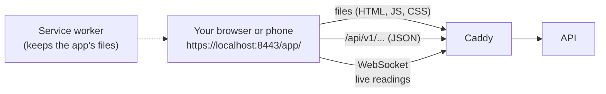

# M8: Web app (parts 1 and 2 of 3)

> **Goal:** a real app in the browser, not Swagger. Residents log in (with an optional second step from an authenticator app), see their home live, turn their water off and on, compare their use, follow water quality and open their bills. Everyone can manage their profile and choose their alert emails. It works on a 360 px phone and a big monitor, and you can install it like an app (PWA).
> **Requirements covered in part 1:** FR-48 (my home), FR-49 (usage and comparison), FR-50 (my bills and payment), FR-51 (my valve), FR-52 (profile and notification choices), FR-53 (responsive, by role: resident screens), FR-54 (live charts), FR-56 (installable PWA; the website guide comes in part 3), FR-57 (accessibility, light and dark, all texts in a translation file), FR-70 (two-factor login).
> **Part 2 (owner screens)** is at the end of this guide: [jump to part 2](#m8-part-2-the-owner-screens). It covers FR-30 (CSV export), FR-42 to FR-47 (owner dashboard, homes, valves and locks, residents, devices, tariffs, bills, tank) and the owner side of FR-53.
> **Next part:** part 3 adds the System Admin console, makes 2FA required for System Admins, and the guide to host the app on your own website.
> **Time:** about 30 minutes.

## What you will have at the end



| Piece | Simple explanation |
|---|---|
| **React** | A library for building screens out of small pieces (components). Each screen is a file in `web/src/pages/` |
| **Vite** | The build tool. `pnpm build` turns our TypeScript and React code into a few plain files in `web/dist/` that any web server can host |
| **Caddy** | Our web server from M1. Since M8 its Docker image also contains the built app and serves it at `/app/`. The `web/Dockerfile` builds the app with Node, then copies only the finished files into Caddy |
| **PWA** | "Progressive Web App": a manifest (name, icon, colours) and a **service worker** (a small script the browser keeps) let you install the app on your phone's home screen and open it even offline. Water data is never cached: it is always fresh or clearly marked as old |
| **TanStack Query** | Asks the API for data, keeps it for a short time, shows "Loading…" and errors, and asks again when a live event says something changed |
| **WebSocket** | The same live connection as `make live` (M4). New readings, valve answers, alerts and bill changes arrive by themselves, so screens update without reloading |
| **Two-factor login (2FA)** | After your password, a 6-digit code from a free app on your phone (Aegis, 2FAS, Google Authenticator, Microsoft Authenticator). The code changes every 30 seconds, so a stolen password alone is not enough |
| **Playwright** | A tool that opens a real Chromium browser and clicks through the app like a person, at phone size (390 px) and desktop size (1440 px) |
| **axe-core** | Checks each screen for accessibility problems (missing labels, low contrast, keyboard traps). The tests fail on any "serious" or "critical" one |

### Five ideas worth understanding

**1. The app is only files; all the rules stay in the API.** The browser can hide a button, but the API decides. A resident who types another home's address gets nothing (404), and a locked valve is refused by the API (423) even if someone removes the "disabled" from the button.

**2. Two tokens, kept in two places.** The short **access token** (15 minutes) is kept only in memory, so a page reload forgets it. The **refresh token** is kept in the browser's storage, so the installed app stays logged in. It works once: each use gives a new pair, and if an old one is ever used again the API ends the whole session (M3). Only one browser tab refreshes at a time (a browser "lock"), so two tabs do not trip that alarm.

**3. Live without asking again and again.** A new reading arrives over the WebSocket and goes straight into the screen: the "My home" numbers and the **Live (1 h)** pH and temperature charts. The 24-hour and 7-day charts ask the API for averages (one point per 10 minutes or per hour), because 60,000 raw readings would be slow.

**4. Fair comparisons.** "Per person" divides your home's litres by the people living there. The **building average per person** is shown only when at least 3 homes are occupied, so nobody can work out a neighbour's use. A new resident never sees anything from before they moved in (FR-49).

**5. The bill so far is the real calculation.** "Bill so far this month" runs the same billing engine as real bills (M6) on this month's litres with your building's real rates. If the owner has not set rates, it says so instead of guessing. It is clearly marked "Not a bill".

## Part 1: Get the M8 code

```bash
cd "/Users/niazi_127.0.0.1/Documents/Water Management System/aquapulse"
gh pr list                                  # find the M8 part 1 PR number
gh pr merge <NUMBER> --squash --delete-branch
git switch main
git pull
```

## Part 2: Start everything

```bash
cd "/Users/niazi_127.0.0.1/Documents/Water Management System/aquapulse"
make up
make smoke
```

`make up` now also builds the web app inside the Caddy image (the first time it downloads Node, so give it 2 to 3 minutes). It runs migration **`0006`** (2FA columns, `recovery_codes`, and the new email choices). Your data is kept. `make smoke` has one new line:

```text
  ✅ Web app: served at https://localhost:8443/app/ (page, manifest and offline service worker)
```

## Part 3: Try it (your demo)

The demo password is `DEMO_PASSWORD` in your `.env` file (open it in VS Code: `code .env`).

### 3.1 Log in as a resident

1. Open **https://localhost:8443/app/** in Chrome or Safari. If the browser warns about the certificate, run `make trust-ca` once (M5) and restart the browser.
2. Log in as `resident01@example.com`.
3. **My home**: litres today and this month, "Water right now", pH with a **Safe / Check / Unsafe** label, temperature, the bill so far, the water switch and the latest alerts. Watch the numbers change every 10 seconds without reloading (the green **Live** dot at the top means the live connection is on).

### 3.2 Turn the water off and on (FR-51)

1. Press **Turn water off**. The app asks first. Press **Yes, do it**.
2. You see "Waiting for the valve to confirm…", then "Done. The valve confirmed it." and **Water is OFF**. That answer came from the simulated device over MQTT, not from the app.
3. Turn it on again the same way.

If the owner locked the valve, the button is gone and you see the lock and its reason.

### 3.3 Usage, quality and bills

- **My usage**: this month against last month, per person, and the building average per person; daily bars for 7, 30 or 90 days and the last 12 months. Hover or tap a bar for the exact litres.
- **Water quality**: what pH means in plain words, and pH and temperature charts. **Live (1 h)** adds each new reading as it arrives; the dashed lines are your building's safe pH range.
- **My bills**: your bills with their status. Open one for the lines, payments and **Download PDF**. If it is still to pay, **Pay online (test mode)** opens Stripe's test page (card `4242 4242 4242 4242`, any future date, any CVC). Back in the app the bill changes to **Paid** by itself a moment later.

No bills yet? Make some: `make bills`, then issue one in Swagger as the owner (M6 guide, part 3), or wait for part 2's owner screens.

### 3.4 Turn on two-factor login (FR-70)

1. Install a free authenticator app on your phone (for example **Aegis** or **2FAS**).
2. In the web app: **Profile → Two-factor login**, type your password, press **Turn on two-factor login**.
3. Scan the QR code with the phone app, type the 6-digit code it shows, press **Turn on**.
4. You now see **10 recovery codes**. Each one works once if you lose your phone. Save them, then press **I saved them**.
5. **Log out** and log in again: after the password, the app asks for the code.

To turn it off: Profile → type your password and a fresh code → **Turn off two-factor login**. In Swagger (`/api/docs`) the code goes in the **client_secret** box of **Authorize**.

### 3.5 Choose your alert emails (FR-52)

**Notifications**: pick from which level you get emails, tick alert types you never want by email, and set quiet hours (for example 22:00 to 07:00). During quiet hours a warning email waits until the end; a **critical** alert (like unsafe water) is always sent at once. Try it: log in as `resident03@example.com` (`make problem` heats the water in unit 03), tick "Water temperature abnormal", save, run `make problem`, and about 80 seconds later check Mailpit (http://localhost:8025): the owner gets the email, resident03 does not. The alert still shows in the app under **Alerts**.

### 3.6 Phone size, dark mode and installing

- In Chrome press `Cmd+Option+I`, then the phone icon, and pick a phone: the menu folds behind a **Menu** button and nothing scrolls sideways.
- Open the menu and set **Theme** to Dark.
- Install it: in Chrome the install icon is at the right end of the address bar; on a phone, "Add to Home screen". (The browser must trust the certificate, so do `make trust-ca` first.)

## Part 4: Run the tests yourself (optional)

```bash
cd "/Users/niazi_127.0.0.1/Documents/Water Management System/aquapulse"
make web-setup     # once: the app's packages and the test browser
make web-test      # type check + unit tests (seconds, no Docker)
make web-e2e       # a real browser clicks through everything (about 1 minute; make up first)
make api-test      # the API tests, now with 2FA, comparison and quiet hours
```

`make web-e2e` prints a line per test, for both sizes, for example:

```text
  ✓  17 [desktop] › e2e/resident/screens.spec.ts › my home shows live numbers
  ✓  26 [desktop] › e2e/resident/valve.spec.ts › turn the water off and on again
  25 passed (1.2m)
```

To change the app with instant reload: `make web-dev`, then open http://localhost:5173/app/ (it uses the API from `make up`).

## How it works (in simple words)

1. Caddy sends the same `index.html` for every address under `/app/` (like `/app/bills/123`). The app reads the address and picks the screen itself.
2. The app asks `/api/v1/me` who you are and shows only your role's menu.
3. For live data it asks the API for a one-time **ticket**, opens the WebSocket with it, and reconnects by itself (waiting a little longer each time) if the connection drops.
4. Every text on screen is in `web/src/locales/en.json`, so another language later is a new file, not code changes.

## New commands

| Command | What it does |
|---|---|
| `make web-setup` | Installs the web app's packages and the Playwright browser (once) |
| `make web-dev` | Runs the app with instant reload at http://localhost:5173/app/ |
| `make web-build` | Builds the app into `web/dist` |
| `make web-test` | Type check and unit tests |
| `make web-e2e` | Browser tests at phone and desktop size, with accessibility checks |

## New API endpoints

| Endpoint | Who | What |
|---|---|---|
| `POST /api/v1/me/2fa/setup` | everyone | Password in, a new secret and its QR code out |
| `POST /api/v1/me/2fa/enable` | everyone | The first code turns 2FA on and returns 10 recovery codes |
| `POST /api/v1/me/2fa/recovery-codes` | everyone | Password and code: 10 new codes (the old ones stop working) |
| `POST /api/v1/me/2fa/disable` | everyone | Password and code: 2FA off |
| `GET/PATCH /api/v1/me/notifications` | everyone | Now also: alert types never emailed, and quiet hours |
| `GET /api/v1/homes/{id}/comparison` | owner, resident | This month, last month, per person, building average per person |
| `GET /api/v1/homes/{id}/bill-estimate` | owner, resident | The bill so far this month, from the real rates |
| `GET /api/v1/homes/{id}/telemetry?every=600` | owner, resident | Readings averaged per period, for charts |

`POST /auth/login` takes an optional `code`. Without it, an account with 2FA gets `401 Two-factor code required` and the header `X-Two-Factor: required`, so the app knows to ask.

## Files in this milestone (part 1)

```text
web/                       the app: package.json, vite.config.ts, Dockerfile
web/src/pages/resident/    my home, usage, quality, bills
web/src/pages/shared/      login, reset, invite, profile, notifications, alerts
web/src/components/        layout, charts, valve switch, small building blocks
web/src/locales/en.json    every text on screen
web/e2e/                   Playwright browser tests
backend/app/security/totp.py               2FA codes, encrypted secrets, recovery codes
backend/app/routers/myhome.py              comparison and bill so far
backend/migrations/versions/0006_web_app.py
infra/caddy/Caddyfile                      serves /app/
```

## Done criteria (part 1)

- [ ] `make smoke` passes, including the web app line.
- [ ] You logged in as a resident at https://localhost:8443/app/ and saw the numbers change live.
- [ ] You turned the water off and on, and the device confirmed both.
- [ ] You turned 2FA on, logged in with a code, and turned it off.
- [ ] The app looks right at phone size and in dark mode.

## Troubleshooting

| Problem | Fix |
|---|---|
| `make up` fails while building `caddy` (`pnpm install`) | Check your internet connection and run `make up` again. Docker downloads Node and the packages only the first time |
| https://localhost:8443/app/ shows the old status page or 404 | The Caddy image was not rebuilt: `docker compose build caddy && make up` |
| "Not live" at the top | The live connection is reconnecting. If it stays, check `make api-logs` |
| "Too many tries. Please wait a few minutes." | The API allows 120 requests a minute per person, and 5 wrong logins per 15 minutes. Wait, then try again |
| The authenticator code is refused | The phone's clock must be right (Settings → General → Date & Time → Set automatically). Each code also works only once: wait for the next one |
| Lost your phone with 2FA on | Log in with one of your recovery codes instead of the 6-digit code, then turn 2FA off and on again |
| No install button | The browser must trust the certificate: `make trust-ca`, then restart the browser |
| `make web-e2e`: "Executable doesn't exist" | Run `make web-setup` once |
| `make web-e2e`: "Set DEMO_PASSWORD" | The tests read it from `.env`; run them from the project folder with `make web-e2e` |

---

# M8 part 2: the owner screens

> **Goal:** the building owner runs the whole building from the app: a live overview, every home, valves and locks, residents, the tank and pump, devices, tariffs, bills and payments, alert rules and building settings, plus CSV files for a spreadsheet.
> **Requirements covered:** FR-30 (CSV export), FR-42 (dashboard), FR-43 (homes list), FR-44 (one home: valve, lock, residents), FR-45 (tariffs and bills), FR-46 (devices), FR-47 (tank and pump), FR-53 (owner menu, phone and desktop).
> **Time:** about 30 minutes.

## What is new

| Screen | Address | What you can do |
|---|---|---|
| Overview | `/app/` | Litres today and this month (compared with the same days last month), water flowing now, meters online, closed and locked valves, unpaid bills, open alerts by level, the tank gauge, and every home in one table. Numbers change live |
| Homes | `/app/homes` | Search by unit or resident, sort by any column (a dropdown on phones) |
| One home | `/app/homes/<id>` | Live numbers, turn the water off or on, **lock** the valve with a reason, usage charts (24 h, 30 days, 12 months) and a CSV download, residents (invite, move-out date, who gets the bills), the home's bills and alerts |
| Tank and pump | `/app/tank` | Live gauge, pump on or off, automatic or manual mode, start and stop levels, the level over 7 days and pump hours per day with the energy used |
| Devices | `/app/devices` | Every meter and the tank device: online, last seen, firmware. Register a meter, give a device a new password (shown once, with a QR code) or revoke it |
| Bills | `/app/bills` | Pick a finished month, make the draft bills, check them, issue them all. "Unpaid" lists what is still owed. CSV downloads of daily usage, bills and payments |
| One bill | `/app/bills/<id>` | The resident's view plus owner actions: issue, void (with a reason), record a cash or bank payment, reverse a payment, send the shut-off warning for an overdue bill |
| Tariffs | `/app/tariffs` | Every version. "Make a new version" opens an editor with a live example bill |
| Alert rules | `/app/alert-rules` | Each check on or off, its numbers within safe limits, and who is emailed for each level |
| Building settings | `/app/settings` | Name, address, time zone, currency, days to pay, issue bills at once, allow shut-off for overdue bills |

The "AI insights" card on the overview says that predictions come in M10. It shows no numbers until they really work.

### Four ideas worth understanding

**1. One request for the whole overview.** The dashboard needs numbers from every home. Instead of 10 or 100 requests, the new endpoint `GET /buildings/{id}/overview` adds everything up in the database in one go (using the 15-minute totals from M4). After that, each live reading updates the numbers on screen by itself, and the API is asked again only once a minute.

**2. The tariff editor cannot make a gap.** You type only where each slab **ends**. The next slab starts there automatically, and the last slab has no limit. So "0 to 5,000, then 4,000 to ..." cannot happen. The example bill on the right is not worked out in the browser: it is sent to the API's real billing engine (`POST /tariffs/preview`), so it always matches the real bills.

**3. Locks win over everyone.** A locked valve cannot be changed by anyone, the owner included, until it is unlocked. Both locking and unlocking need a reason of at least 10 characters, and both go to the audit log (FR-28).

**4. Safe CSV files.** A spreadsheet runs a cell that starts with `=`, `+`, `-` or `@` as a formula. A resident could name themselves `=HYPERLINK(...)` to attack the owner's computer. So every such text cell gets a `'` in front, and Excel shows it as plain text. Each export is written to the audit log, a range is at most 400 days, and a resident can export only their own home, only from their move-in date.

## Part 1: Get the code

```bash
cd "/Users/niazi_127.0.0.1/Documents/Water Management System/aquapulse"
gh pr list                                  # find the M8 part 2 PR number
gh pr merge <NUMBER> --squash --delete-branch
git switch main
git pull
```

## Part 2: Start everything

```bash
cd "/Users/niazi_127.0.0.1/Documents/Water Management System/aquapulse"
make up
make smoke
```

No new migration in this part. `make up` rebuilds the API and the web app.

## Part 3: Try it (your demo)

Open https://localhost:8443/app/ and log in as **owner@example.com** with the demo password from `.env` (`grep DEMO_PASSWORD .env`).

1. **Overview.** Watch "Used today" and the homes table: they change every few seconds as the simulator sends readings.
2. **Lock a valve.** Homes → Unit 10 → "Lock the valve". Try a short reason: the button stays grey. Type a reason of 10 or more characters, choose "Off", lock it. Log in as `resident10@example.com` in a private window: the switch is locked, with your reason. Unlock it again.
3. **Tariff with live example.** Tariffs → "Make a new version". Type 6000 in "Litres used in a month": the example shows 5,000 L at 60 plus 1,000 L at 120 = Rs 420.00. Change slab 2 to end at 4000: a message says what is wrong and Save stays grey. Press Cancel (or save, if you want a new version: it must start after your last issued bill).
4. **Bills.** Bills → month September 2026 → "Make draft bills". Open one bill, record a cash payment, then see "Still to pay" go down. "Unpaid" shows what is left in total.
5. **CSV.** On Bills, press "Bills (CSV)" and open the file in Numbers or Excel.
6. **Phone size.** Make the browser narrow (or open it on your phone): the menu folds away, tables become cards, and sorting homes is a dropdown.

## Part 4: Run the tests yourself (optional)

```bash
cd "/Users/niazi_127.0.0.1/Documents/Water Management System/aquapulse"
make web-test
make web-e2e       # now about 3 minutes: the owner tests wait a minute between phone and desktop
make api-test
```

`make web-e2e` now ends with:

```text
  45 passed (2.6m)
```

The owner tests log in once and wait a minute before the desktop run, because the API allows each person 120 requests a minute (FR-72) and the dashboard is busy.

## New API endpoints

| Endpoint | Who | What |
|---|---|---|
| `GET /api/v1/buildings/{id}/overview` | owner | Everything the dashboard shows, in one call |
| `GET /api/v1/buildings/{id}/export/{kind}.csv` | owner | `kind` = `consumption` (litres per home per day), `bills` or `payments`; `?from=&to=` (at most 400 days) |
| `GET /api/v1/homes/{id}/export/{kind}.csv` | owner, resident | `consumption` or `bills` for one home; a resident only from their move-in |

`GET /homes/{id}/occupancies` now also returns each resident's name and email, so the owner sees who lives where.

## Also fixed in this part

- If the API is busy (too many requests) or briefly down while the app starts, it now waits and tries again instead of logging you out.
- `GET /me` lists an owner's buildings oldest first, so the app always opens the same building.

## Files in this part

```text
backend/app/routers/owner.py          overview and CSV exports
web/src/pages/owner/                  the ten owner screens
web/e2e/owner/screens.spec.ts         browser tests for the owner screens
backend/tests/api/test_building_overview.py
backend/tests/api/test_csv_data_export.py
```

## Done criteria (part 2)

- [ ] `make smoke` passes.
- [ ] As the owner you saw the overview change live.
- [ ] You locked and unlocked a valve with a reason, and the resident saw the lock.
- [ ] The tariff editor showed a live example bill and refused a gap.
- [ ] You made September's draft bills and downloaded a CSV.

## Troubleshooting (part 2)

| Problem | Fix |
|---|---|
| "You have no building yet" | The owner has no building. Run `make seed` (demo data), or create one in Swagger as the System Admin |
| "Make draft bills" is grey | Only a finished month can be billed: pick last month or earlier |
| Saving a tariff says "Bills up to ... are already issued" | Issued bills never change, so a new tariff must start after them. Choose a later start date (or void those bills first) |
| A CSV opens with strange letters in Excel | Use Data → From Text/CSV and pick UTF-8 |
| The overview numbers stop changing | Look at "Live" at the top. If it says "Not live", check `make api-logs` |
