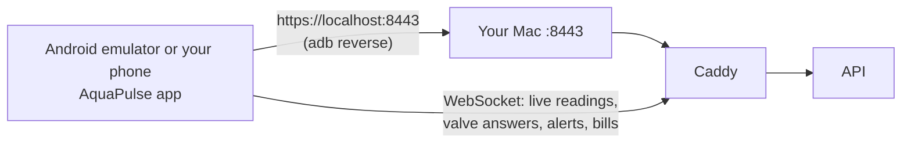

# M9: Android app (part 1: residents)

> **Goal:** a real Android app, built with Flutter, that residents and owners install from an APK. After login the server says who you are, and the app shows only your screens.
> **Requirements covered in part 1:** FR-41 (one Android app, any server, tokens in secure storage, role-based screens, APK built in GitHub Actions), FR-48 to FR-52 on Android (my home, usage and comparison, bills and payment, my valve, profile and notification choices), FR-70 (two-factor code at login).
> **Coming next:** part 2, the owner screens (FR-42 to FR-45, FR-47 on Android). Part 3, push notifications through Firebase (FR-60) and the APK attached to each GitHub Release.
> **Time:** about 45 minutes the first time (Android Studio and Gradle download a lot once), then 5 minutes.

## What you will have at the end



| Piece | Simple explanation |
|---|---|
| **Flutter** | Google's free toolkit for apps. We write the app once in the **Dart** language; Flutter turns it into a real Android app. Every screen is a file in `mobile/lib/screens/` |
| **APK** | The Android app file. You install it on the emulator or on your phone, like an app from a store but without the store |
| **Android emulator** | A virtual Android phone running on your Mac (from Android Studio) |
| **adb reverse** | `adb` is the tool that talks to the phone. `adb reverse tcp:8443 tcp:8443` makes "localhost:8443" on the phone go to port 8443 on your Mac. So the app talks to your Mac with the same certificate name (`localhost`) as your browser |
| **Secure storage** | Android keeps a secret key in its **Keystore** (a locked box the app cannot read out). The app encrypts the login token with it, so the token is never in a plain file |
| **Widget tests** | Flutter tests that build each screen in memory with a fake API and tap through it like a person. They run in seconds, with no phone and no server |

### Four ideas worth understanding

**1. One app, two kinds of people.** The app asks the API "who am I?" after login. A resident gets resident screens; an owner gets owner screens (part 2). Hiding screens is only for comfort: the API itself refuses owner calls from a resident token (403), as the API tests already prove.

**2. Your Mac's certificate.** Your Mac's HTTPS uses the project's own certificate authority (CA) from M5. Android does not know it, so `make apk` copies the CA's public certificate (`infra/certs/public/ca.crt`, never the private key) into the app. The app then trusts Android's normal list **plus** this one CA. There is no "ignore certificate errors" switch. The APK built by GitHub has no CA inside, so it only talks to servers with a normal certificate (a Cloudflare tunnel or a cloud server).

**3. Two tokens.** The short access token (15 minutes) stays in memory. The refresh token (7 days, works once) goes into secure storage, so the app stays logged in after a restart. When the access token runs out, the app swaps the refresh token for new ones by itself.

**4. Live, like the web app.** The app opens the same WebSocket as the web app (with a 30-second, one-time ticket). New readings go straight into "My home", the valve's answer arrives the moment the device replies, and a bill turns "Paid" by itself when the owner records a payment.

## Part 1: Install Flutter and Android Studio (once)

```bash
brew install --cask flutter android-studio
```

1. Open **Android Studio** once. Choose **Standard** setup and let it download the Android SDK (a few GB).
2. Accept the Android licences (type `y` a few times):
   ```bash
   flutter doctor --android-licenses
   flutter doctor
   ```
   `flutter doctor` should show green ticks for **Flutter** and **Android toolchain**. Xcode and Chrome do not matter here.
3. Make a virtual phone: Android Studio → **More Actions** (or the ⋮ menu) → **Virtual Device Manager** → **+** → **Pixel 8** → system image **API 35** (download it) → **Finish**. Press ▶ to start it.

## Part 2: Get the M9 code and start the stack

```bash
cd "/Users/niazi_127.0.0.1/Documents/Water Management System/aquapulse"
gh pr list                                  # find the M9 part 1 PR number
gh pr merge <NUMBER> --squash --delete-branch
git switch main
git pull
make up
```

Nothing changed on the server side in part 1, so `make smoke` stays as it was.

## Part 3: Build and install the app

With the emulator running:

```bash
make apk            # the first time Gradle downloads its tools: 5 to 10 minutes
make apk-install    # installs the app, connects the phone to your Mac, opens the app
```

The app opens on the login screen. Its server is already `https://localhost:8443`.

**Your own phone instead?** Turn on Developer options and **USB debugging** (Settings → About phone → tap "Build number" 7 times; then Settings → System → Developer options). Plug it in with a USB cable, allow the computer on the phone, then `make apk-install`.

## Part 4: Try it (your demo)

The demo password is `DEMO_PASSWORD` in your `.env` file.

1. Log in as `resident01@example.com`.
2. **My home**: litres today and this month, "Water right now", pH with **Safe / Check / Unsafe**, temperature, the bill so far, the water switch and the latest alerts. The green **Live** dot at the top right means the live connection is on; watch the numbers change every 10 seconds.
3. **Turn the water off**: press **Turn water off**, then **Yes, do it**. You see "Waiting for the valve to confirm…", then "Done. The valve confirmed it." and **Water is OFF**. The answer came from the simulated device over MQTT. Turn it on again the same way.
4. **Usage** (bottom bar): this month against last month, per person, the building average per person, and daily and monthly bar charts. Tap a bar for its litres.
5. **Water quality** (menu ☰): pH and temperature for the last 24 hours, with the safe pH range as dashed lines.
6. **Bills**: open a bill for its lines and payments. **Download PDF** opens it in the phone's PDF viewer. **Pay online (test mode)** opens Stripe's test page in the browser (only if you set Stripe test keys in M6).
7. **Alerts** (menu ☰): open alerts; press **Seen** to acknowledge one. Run `make problem` on the Mac: about a minute later a new alert appears by itself.
8. **Profile**: change your name, your password, and which alert emails you get, with quiet hours.

**Two-factor login:** turn it on in the web app (Profile → Two-factor login, M8). Log out of the Android app and log in again: after the password it asks for the 6-digit code.

**Owner accounts** see "Owner screens come in the next update" in part 1. That is part 2.

## Part 5: Run the tests yourself (optional)

```bash
make app-test      # flutter analyze + 16 widget tests (about 30 seconds, no phone needed)
```

The tests start the app on a fake API and check: login, the two-factor step, a wrong password, a saved login at start-up and a refused one, the System Admin message, server address checks, **no tokens in plain settings files**, my home with the API's numbers and a live reading, the valve's confirm step and the device's answer, a timed-out command with "Try again", a locked valve, usage with the building average hidden under 3 homes, water quality, bills with a live "Paid", saving notification choices, and a 360 px wide phone without overflow.

GitHub Actions runs the same tests on every push, then builds the release APK. Download it from the run's page → **Artifacts** → `aquapulse-apk`. (That one has no Mac CA inside: use it with a tunnel or cloud server.)

## What is in the code

```text
mobile/lib/main.dart                  start: saved login, or the login screen
mobile/lib/app_state.dart             login, 2FA code, logout, "who am I"
mobile/lib/live.dart                  the live WebSocket, reconnects by itself
mobile/lib/api/client.dart            HTTP calls, token refresh, error messages
mobile/lib/api/token_store.dart       secure storage (Android Keystore)
mobile/lib/api/server.dart            server address check, trusted certificates
mobile/lib/screens/shell.dart         which screens for which role
mobile/lib/screens/resident/          my home, my usage, water quality
mobile/lib/screens/shared/            login, server, bills, alerts, profile
mobile/lib/widgets/valve_control.dart the water switch and the device's answer
mobile/test/                          widget tests against a fake API
mobile/android/                       Android settings: Android 8.0+ (API 26), internet, icon
Makefile                              make app-test, make apk, make apk-install
.github/workflows/ci.yml              new "mobile" job: analyze, test, build the APK
```

## Done criteria (part 1)

- [ ] `make apk` and `make apk-install` worked and the app opened on the emulator (or your phone).
- [ ] You logged in as `resident01@example.com` and saw the numbers change live.
- [ ] You turned the water off and on and saw the device's answer.
- [ ] A bill opened as a PDF.
- [ ] `make app-test` passes.

## Troubleshooting (part 1)

| Problem | Fix |
|---|---|
| "Cannot reach the server at https://localhost:8443" | Run `adb reverse tcp:8443 tcp:8443` again (it is forgotten when the emulator restarts), and check `make up` is running |
| A certificate error (HandshakeException) | The app was not built with your CA. Build it with `make apk`, not `flutter build` directly |
| `adb: command not found` | Add Android's tools to your PATH: `echo 'export PATH="$HOME/Library/Android/sdk/platform-tools:$PATH"' >> ~/.zshrc && source ~/.zshrc` |
| `adb: no devices/emulators found` | Start the emulator first (Android Studio → Virtual Device Manager → ▶), or plug in your phone and allow USB debugging |
| `make apk` stops with "Android licenses not accepted" | `flutter doctor --android-licenses` and type `y` |
| "INSTALL_FAILED_UPDATE_INCOMPATIBLE" | An APK from another computer (or from GitHub) is installed: `adb uninstall io.github.sanaullahniazi.aquapulse`, then `make apk-install` |
| PDF does not open | Install a PDF viewer on the phone (the emulator has none by default; Google Drive works) |
