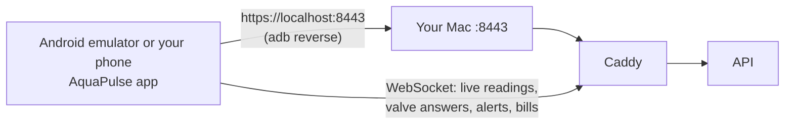

# M9: Android app (parts 1 and 2)

> **Goal:** a real Android app, built with Flutter, that residents and owners install from an APK. After login the server says who you are, and the app shows only your screens.
> **Requirements covered in part 1:** FR-41 (one Android app, any server, tokens in secure storage, role-based screens, APK built in GitHub Actions), FR-48 to FR-52 on Android (my home, usage and comparison, bills and payment, my valve, profile and notification choices), FR-70 (two-factor code at login).
> **Part 2 (owner screens)** is at the end: [jump to part 2](#m9-part-2-the-owner-screens). It covers FR-42 to FR-45 and FR-47 on Android.
> **Coming next:** part 3, push notifications through Firebase (FR-60) and the APK attached to each GitHub Release.
> **Time:** about 45 minutes the first time (Android Studio and Gradle download a lot once), then 5 minutes.

## What you will have at the end



| Piece | Simple explanation |
|---|---|
| **Flutter** | Google's free toolkit for apps. We write the app once in the **Dart** language; Flutter turns it into a real Android app. Every screen is a file in `mobile/lib/screens/` |
| **APK** | The Android app file. You install it on the emulator or on your phone, like an app from a store but without the store |
| **Android emulator** | A virtual Android phone running on your Mac (from Android Studio) |
| **adb reverse** | `adb` is the tool that talks to the phone. `adb reverse tcp:8443 tcp:8443` makes "localhost:8443" on the phone go to port 8443 on your Mac. So the app talks to your Mac with the same certificate name (`localhost`) as your browser |
| **Secure storage** | Android keeps a secret key in its **Keystore** (a locked box the app cannot read out). The app encrypts the login token with it, so the token is never in a plain file |
| **Widget tests** | Flutter tests that build each screen in memory with a fake API and tap through it like a person. They run in seconds, with no phone and no server |

### Four ideas worth understanding

**1. One app, two kinds of people.** The app asks the API "who am I?" after login. A resident gets resident screens; an owner gets owner screens (part 2). Hiding screens is only for comfort: the API itself refuses owner calls from a resident token (403), as the API tests already prove.

**2. Your Mac's certificate.** Your Mac's HTTPS uses the project's own certificate authority (CA) from M5. Android does not know it, so `make apk` copies the CA's public certificate (`infra/certs/public/ca.crt`, never the private key) into the app. The app then trusts Android's normal list **plus** this one CA. There is no "ignore certificate errors" switch. The APK built by GitHub has no CA inside, so it only talks to servers with a normal certificate (a Cloudflare tunnel or a cloud server).

**3. Two tokens.** The short access token (15 minutes) stays in memory. The refresh token (7 days, works once) goes into secure storage, so the app stays logged in after a restart. When the access token runs out, the app swaps the refresh token for new ones by itself.

**4. Live, like the web app.** The app opens the same WebSocket as the web app (with a 30-second, one-time ticket). New readings go straight into "My home", the valve's answer arrives the moment the device replies, and a bill turns "Paid" by itself when the owner records a payment.

## Part 1: Install Flutter and Android Studio (once)

```bash
brew install --cask flutter android-studio
```

1. Open **Android Studio** once. Choose **Standard** setup and let it download the Android SDK (a few GB).
2. Accept the Android licences (type `y` a few times):
   ```bash
   flutter doctor --android-licenses
   flutter doctor
   ```
   `flutter doctor` should show green ticks for **Flutter** and **Android toolchain**. Xcode and Chrome do not matter here.
3. Make a virtual phone: Android Studio → **More Actions** (or the ⋮ menu) → **Virtual Device Manager** → **+** → **Pixel 8** → system image **API 35** (download it) → **Finish**. Press ▶ to start it.

## Part 2: Get the M9 code and start the stack

```bash
cd "/Users/niazi_127.0.0.1/Documents/Water Management System/aquapulse"
gh pr list                                  # find the M9 part 1 PR number
gh pr merge <NUMBER> --squash --delete-branch
git switch main
git pull
make up
```

Nothing changed on the server side in part 1, so `make smoke` stays as it was.

## Part 3: Build and install the app

With the emulator running:

```bash
make apk            # the first time Gradle downloads its tools: 5 to 10 minutes
make apk-install    # installs the app, connects the phone to your Mac, opens the app
```

The app opens on the login screen. Its server is already `https://localhost:8443`.

**Your own phone instead?** Turn on Developer options and **USB debugging** (Settings → About phone → tap "Build number" 7 times; then Settings → System → Developer options). Plug it in with a USB cable, allow the computer on the phone, then `make apk-install`.

## Part 4: Try it (your demo)

The demo password is `DEMO_PASSWORD` in your `.env` file.

1. Log in as `resident01@example.com`.
2. **My home**: litres today and this month, "Water right now", pH with **Safe / Check / Unsafe**, temperature, the bill so far, the water switch and the latest alerts. The green **Live** dot at the top right means the live connection is on; watch the numbers change every 10 seconds.
3. **Turn the water off**: press **Turn water off**, then **Yes, do it**. You see "Waiting for the valve to confirm…", then "Done. The valve confirmed it." and **Water is OFF**. The answer came from the simulated device over MQTT. Turn it on again the same way.
4. **Usage** (bottom bar): this month against last month, per person, the building average per person, and daily and monthly bar charts. Tap a bar for its litres.
5. **Water quality** (menu ☰): pH and temperature for the last 24 hours, with the safe pH range as dashed lines.
6. **Bills**: open a bill for its lines and payments. **Download PDF** opens it in the phone's PDF viewer. **Pay online (test mode)** opens Stripe's test page in the browser (only if you set Stripe test keys in M6).
7. **Alerts** (menu ☰): open alerts; press **Seen** to acknowledge one. Run `make problem` on the Mac: about a minute later a new alert appears by itself.
8. **Profile**: change your name, your password, and which alert emails you get, with quiet hours.

**Two-factor login:** turn it on in the web app (Profile → Two-factor login, M8). Log out of the Android app and log in again: after the password it asks for the 6-digit code.

## Part 5: Run the tests yourself (optional)

```bash
make app-test      # flutter analyze + 16 widget tests (about 30 seconds, no phone needed)
```

The tests start the app on a fake API and check: login, the two-factor step, a wrong password, a saved login at start-up and a refused one, the System Admin message, server address checks, **no tokens in plain settings files**, my home with the API's numbers and a live reading, the valve's confirm step and the device's answer, a timed-out command with "Try again", a locked valve, usage with the building average hidden under 3 homes, water quality, bills with a live "Paid", saving notification choices, and a 360 px wide phone without overflow.

GitHub Actions runs the same tests on every push, then builds the release APK. Download it from the run's page → **Artifacts** → `aquapulse-apk`. (That one has no Mac CA inside: use it with a tunnel or cloud server.)

## What is in the code

```text
mobile/lib/main.dart                  start: saved login, or the login screen
mobile/lib/app_state.dart             login, 2FA code, logout, "who am I"
mobile/lib/live.dart                  the live WebSocket, reconnects by itself
mobile/lib/api/client.dart            HTTP calls, token refresh, error messages
mobile/lib/api/token_store.dart       secure storage (Android Keystore)
mobile/lib/api/server.dart            server address check, trusted certificates
mobile/lib/screens/shell.dart         which screens for which role
mobile/lib/screens/resident/          my home, my usage, water quality
mobile/lib/screens/shared/            login, server, bills, alerts, profile
mobile/lib/widgets/valve_control.dart the water switch and the device's answer
mobile/test/                          widget tests against a fake API
mobile/android/                       Android settings: Android 8.0+ (API 26), internet, icon
Makefile                              make app-test, make apk, make apk-install
.github/workflows/ci.yml              new "mobile" job: analyze, test, build the APK
```

## Done criteria (part 1)

- [ ] `make apk` and `make apk-install` worked and the app opened on the emulator (or your phone).
- [ ] You logged in as `resident01@example.com` and saw the numbers change live.
- [ ] You turned the water off and on and saw the device's answer.
- [ ] A bill opened as a PDF.
- [ ] `make app-test` passes.

## Troubleshooting (part 1)

| Problem | Fix |
|---|---|
| "Cannot reach the server at https://localhost:8443" | Run `adb reverse tcp:8443 tcp:8443` again (it is forgotten when the emulator restarts), and check `make up` is running |
| A certificate error (HandshakeException) | The app was not built with your CA. Build it with `make apk`, not `flutter build` directly |
| `adb: command not found` | Add Android's tools to your PATH: `echo 'export PATH="$HOME/Library/Android/sdk/platform-tools:$PATH"' >> ~/.zshrc && source ~/.zshrc` |
| `adb: no devices/emulators found` | Start the emulator first (Android Studio → Virtual Device Manager → ▶), or plug in your phone and allow USB debugging |
| `make apk` stops with "Android licenses not accepted" | `flutter doctor --android-licenses` and type `y` |
| "INSTALL_FAILED_UPDATE_INCOMPATIBLE" | An APK from another computer (or from GitHub) is installed: `adb uninstall io.github.sanaullahniazi.aquapulse`, then `make apk-install` |
| PDF does not open | Install a PDF viewer on the phone (the emulator has none by default; Google Drive works) |

---

# M9 part 2: the owner screens

> **Requirements covered:** FR-42 (building overview), FR-43 (homes list and home detail), FR-44 (valve control and locks), FR-45 on Android (view bills, make and issue them, record payments), FR-47 (tank and pump), and the owner side of FR-41.
> **Time:** about 10 minutes.

Owners log in to the same app. The server says "owner", so the app shows owner screens. Residents, devices, tariffs and alert rules stay in the web app (bigger screen, rarely changed).

## Get it

```bash
cd "/Users/niazi_127.0.0.1/Documents/Water Management System/aquapulse"
gh pr list                                  # find the M9 part 2 PR number
gh pr merge <NUMBER> --squash --delete-branch
git switch main
git pull
make up
make apk           # start the emulator first
make apk-install
```

## Try it

Log out in the app (Profile → Log out), then log in as `owner@example.com` (same `DEMO_PASSWORD`).

1. **Overview**: litres today and this month (and the change against the same days last month), water flowing now, homes online, closed and locked valves, open alerts by severity, the tank level and pump, and unpaid bills. The numbers move with every reading, without pulling down. Tap the alerts, tank or bills card to jump there.
2. **Homes**: search "03" or a resident's name; sort by any column (litres, pH, online, alerts...) with the arrow for low to high or high to low. Run `make problem TYPE=ph_drift DEVICE=home-b01-02 MINUTES=30` on the Mac: in a few minutes unit 02's pH shows **Unsafe** with an icon (not only a colour).
3. Tap a home: live readings, the water switch (the confirm step names the unit and the resident), **Lock the valve** (choose closed or open, and a reason of at least 10 characters, which the resident sees), water use for 24 hours, 30 days or 12 months, the home's bills and alerts. Log in as the resident in the web app to see the lock and its reason.
4. **Tank**: the gauge follows each tank reading. **Switch to manual** asks first (the API writes it in the audit log); then **Turn pump on / off** appears. **Back to automatic** when done. Below: the 7-day level chart and the pump's hours and energy per day.
5. **Bills**: choose a month, **Make draft bills**, then **Issue all drafts**. Open a bill: **Issue this bill**, **Void** (with a reason), or **Record a payment** (cash, bank or other). The resident's app shows the new status by itself.

## Run the tests

```bash
make app-test      # now 23 widget tests
```

New owner tests: the overview's numbers and a live reading, search and sort on every column, the pH warning word, the valve confirm with the resident's name, a lock refused under 10 characters, the tank's manual-mode confirm and a live gauge, making, issuing and paying bills, and every owner tab on a 360 px phone.

## What is new in the code

```text
mobile/lib/api/owner_models.dart          overview, tank, building shapes (+ live updates)
mobile/lib/screens/owner/owner_shell.dart building picker and owner navigation
mobile/lib/screens/owner/overview.dart    the overview, kept live
mobile/lib/screens/owner/homes.dart       search and sort
mobile/lib/screens/owner/home_detail.dart one home, valve, lock, charts
mobile/lib/screens/owner/tank.dart        tank and pump
mobile/lib/screens/owner/bills.dart       month bills and the owner's bill actions
mobile/test/owner/                        owner widget tests
```

## Done criteria (part 2)

- [ ] As `owner@example.com` you saw the overview change live.
- [ ] You found a home by searching, locked its valve with a reason, and unlocked it.
- [ ] You switched the tank to manual (it asked first), ran the pump, and went back to automatic.
- [ ] You recorded a payment and the bill turned Paid or Partly paid.
- [ ] `make app-test` passes.

## Troubleshooting (part 2)

| Problem | Fix |
|---|---|
| "You have no building yet" | Log in as `owner@example.com` (the demo owner), not a resident or admin. `make seed` creates the demo building again |
| "Make draft bills" says the building has no tariff | Set rates in the web app first: Tariffs (M8 part 2) |
| The pump buttons do nothing | The tank device must be online (`make devices`), and pump buttons only work in manual mode |

---

# M9 part 3: push notifications and the release APK

> **Requirements covered:** FR-60 (alerts as pushes through Firebase Cloud Messaging) and the "built in GitHub Actions and attached to Releases" part of FR-41.
> **Time:** about 20 minutes (most of it is the one-time Firebase setup).

Parts 2 and 3 are in the same pull request, so "Get it" from part 2 already gave you this code.

Push is **optional**. Without Firebase everything still works: alerts appear in the app live and come by email. With Firebase, an alert also arrives on the phone when the app is closed.

## How it works (in one minute)

1. After login the app asks Android for a **push token** (an address for this phone) and sends it to the server: `POST /me/push-devices`.
2. When the alert engine opens an alert, it checks each person's push choices (Profile → Notifications) and queues a push, just like an email.
3. The worker sends it to Google (Firebase Cloud Messaging, HTTP v1). Critical alerts go at high priority and ignore quiet hours. Failed sends are retried after 10, 30 and 90 seconds. If Google says the phone is gone (app removed), the server forgets that token.
4. On logout the app tells the server to forget the token.

## One-time Firebase setup (free, no card)

1. Open <https://console.firebase.google.com> and sign in with your Google account.
2. **Create a project**, name it `aquapulse`. Google Analytics is not needed: turn it off.
3. In the project, click the **Android** icon ("Add app"). Package name: `io.github.sanaullahniazi.aquapulse`. Nickname: AquaPulse. Leave the SHA-1 empty. Click **Register app**.
4. **Download google-services.json** and put it here: `mobile/android/app/google-services.json`. Skip the rest of Google's steps (the code already has them).
5. Back in the console: gear icon → **Project settings** → **Service accounts** → **Generate new private key**. Save the file as `infra/firebase/firebase-service-account.json`.

Both files are in `.gitignore`. Never commit them. The service account file is a real secret: it can send pushes in your name.

## Turn it on

```bash
cd "/Users/niazi_127.0.0.1/Documents/Water Management System/aquapulse"
docker compose up -d --force-recreate api worker   # the server reads the new file
make apk            # start the emulator first; the APK now includes Firebase
make apk-install
```

The emulator must be a "Google Play" or "Google APIs" image (the default Pixel image is), because pushes come through Google Play services.

## Try it

1. Open the app and log in as `owner@example.com`. Android asks "Allow AquaPulse to send you notifications?": tap **Allow**.
2. Profile → Notifications now has **Push to this phone from** and **Never push about**. Leave "Warning and above".
3. Close the app (swipe it away).
4. On the Mac: `make problem TYPE=ph_drift DEVICE=home-b01-02 MINUTES=30`. Within a few minutes a notification about unsafe water in unit 02 appears on the phone.
5. `make alerts` shows the alert; `docker compose logs worker | grep -i push` shows the send.

If Profile says "Push is not set up on this server", the server file is missing or the api was not recreated. If it says "This app was built without Firebase settings", `google-services.json` was not in place when you ran `make apk`.

## Make a release with the APK attached

Anyone can then download the app from GitHub, no Flutter needed.

```bash
git switch main && git pull
git tag v0.9.0
git push origin v0.9.0
```

GitHub Actions ("Release APK") runs the tests, builds the APK and attaches `aquapulse-v0.9.0.apk` to the release page: <https://github.com/Sanaullah-Niazi/aquapulse/releases>.

To have push in the released APK too, add a repository secret once: GitHub → the repo → Settings → Secrets and variables → Actions → **New repository secret**, name `GOOGLE_SERVICES_JSON`, value: paste the whole content of `google-services.json`. Without the secret the released APK works, only push is off.

Note: the released APK does not contain your Mac's own CA, so it can only reach servers with a normal certificate (for example through a Cloudflare tunnel, see the hosting guide). For your Mac, use `make apk`.

## Run the tests

```bash
make app-test      # now 27 widget tests
make test          # the API tests include 10 new push tests
```

New tests: the phone registers its token after login, sends the new token when Firebase changes it, forgets it on logout, registers nothing without Firebase, push choices are saved, and the profile explains when the server has no push. On the server: register and move a token, choices saved, a critical alert pushed at once, muting by severity and by type, no phone registered, a removed phone's token deleted and retried, and the exact Firebase HTTP v1 message format (no real Google call in tests).

## What is new in the code

```text
backend/app/push.py                        Firebase HTTP v1 sender (signed JWT -> access token -> send)
backend/app/alerts/store.py                queues pushes next to emails (same rules, quiet hours)
backend/app/alerts/deliver.py              the worker sends them, retries, forgets removed phones
backend/migrations/versions/0008_*.py      push choices on users, push_devices table
infra/firebase/                            where the server's service account file goes
mobile/lib/push.dart                       Firebase on the phone (and a fake one for tests)
.github/workflows/release.yml              tag v* -> APK on the GitHub release
```

## Done criteria (part 3)

- [ ] Profile → Notifications shows the push choices.
- [ ] With the app closed, `make problem` made a notification appear on the phone.
- [ ] After **Log out**, a new alert no longer reaches the phone.
- [ ] (Optional) A `v0.9.0` tag made a release with the APK attached.
- [ ] `make app-test` and `make test` pass.

## Troubleshooting (part 3)

| Problem | Fix |
|---|---|
| No notification arrives | Check Android settings → Apps → AquaPulse → Notifications is on. Check the alert severity is at or above your "Push to this phone from" choice, and quiet hours are off for non-critical alerts |
| Worker log says "Firebase did not accept it" | The service account file is from another project than `google-services.json`. Download both from the same Firebase project |
| Build fails with "No matching client found for package name" | `google-services.json` was made for another package name. Register the Android app again with `io.github.sanaullahniazi.aquapulse` |
| "Push is not set up on this server" after adding the file | `docker compose up -d --force-recreate api worker` |
